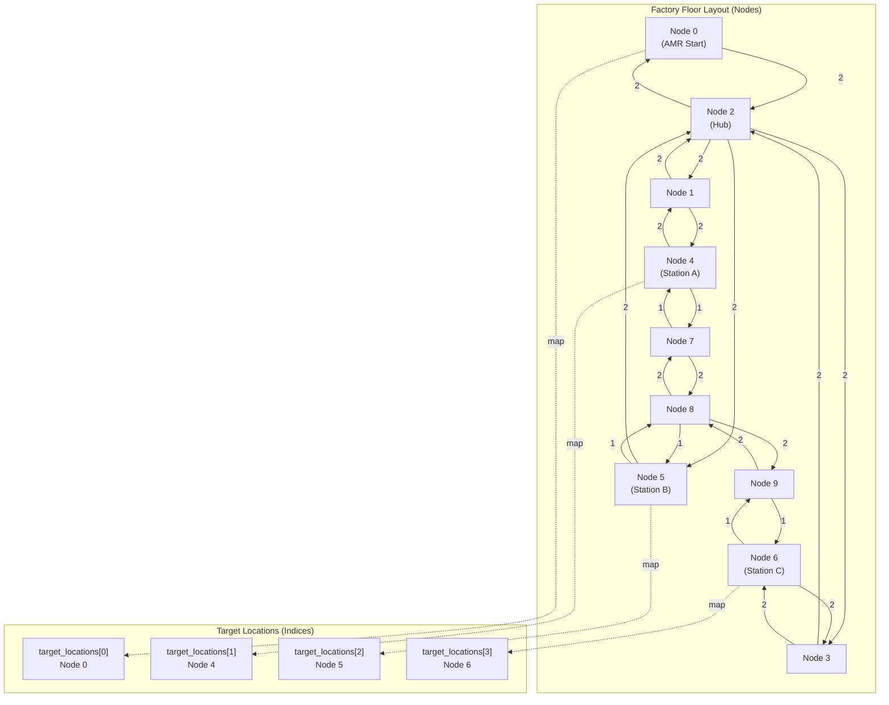
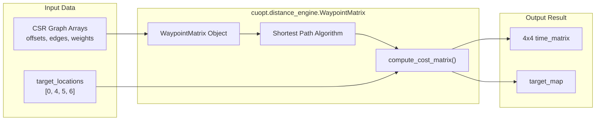
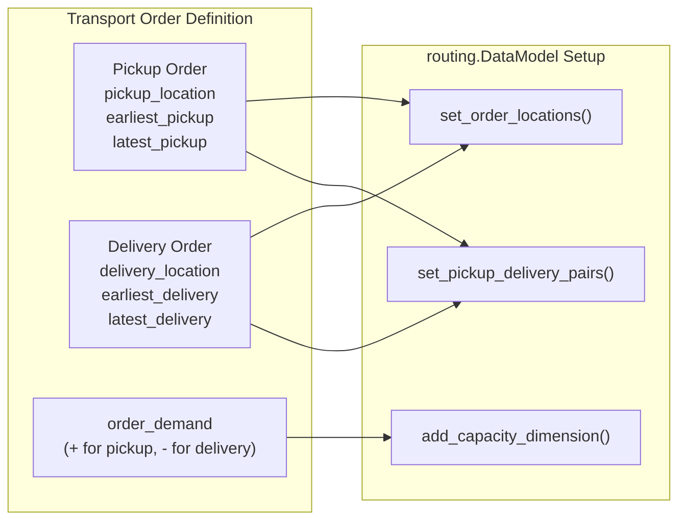
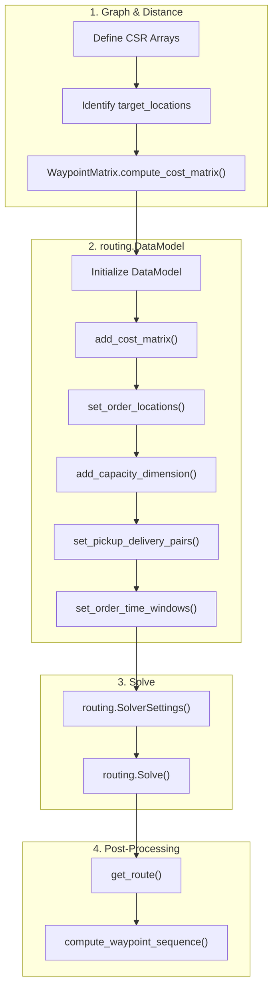

<!-- source: DeepWiki mcp.deepwiki.com · repo NVIDIA/cuopt-examples · page 12.3 Intra-Factory Transport · fetched 2026-10-26 -->

# Intra-Factory Transport

<details>
<summary>Relevant source files</summary>

The following files were used as context for generating this wiki page:

- [diet_optimization/README.md](diet_optimization/README.md)
- [intra-factory_transport/cost_matrix.png](intra-factory_transport/cost_matrix.png)
- [intra-factory_transport/cost_matrix_and_waypoint_graph_creation.ipynb](intra-factory_transport/cost_matrix_and_waypoint_graph_creation.ipynb)
- [intra-factory_transport/intra-factory_transport.ipynb](intra-factory_transport/intra-factory_transport.ipynb)
- [intra-factory_transport/waypoint_graph.png](intra-factory_transport/waypoint_graph.png)
- [last_mile_delivery/cvrp_daily_deliveries.ipynb](last_mile_delivery/cvrp_daily_deliveries.ipynb)
- [last_mile_delivery/cvrptw_benchmark_gehring_homberger.ipynb](last_mile_delivery/cvrptw_benchmark_gehring_homberger.ipynb)
- [last_mile_delivery/cvrptw_service_team_routing.ipynb](last_mile_delivery/cvrptw_service_team_routing.ipynb)

</details>


This page documents the intra-factory transport optimization example using NVIDIA cuOpt to solve Capacitated Pickup and Delivery Problems with Time Windows (CPDPTW) for autonomous mobile robot (AMR) routing in factory environments. The example demonstrates graph-based navigation using waypoint graphs, pickup-delivery pair constraints, and time window management for factory automation scenarios.

For general vehicle routing concepts, see **Vehicle Routing Problems (4)**. For cost matrix generation approaches, see **Cost Matrix Generation (4.5)**. For service team routing with time windows but without pickup-delivery pairs, see **CVRPTW - Vehicle Routing with Time Windows (4.3)**.

## Problem Overview

The intra-factory transport scenario addresses the movement of parts between processing stations within a factory using multiple AMRs. Each station represents a specific manufacturing process, and products may visit stations multiple times during assembly. The optimization objective is to assign pickup and delivery orders to AMRs while respecting capacity limits, time windows, and factory navigation constraints.

**Key Problem Characteristics:**
- **Problem Type:** CPDPTW (Capacitated Pickup and Delivery with Time Windows) [intra-factory_transport/intra-factory_transport.ipynb:9-11]()
- **Environment Representation:** Waypoint graph with CSR encoding [intra-factory_transport/intra-factory_transport.ipynb:175-187]()
- **Vehicles:** Multiple AMRs with fixed capacity [intra-factory_transport/intra-factory_transport.ipynb:326-338]()
- **Constraints:** Capacity, time windows, pickup-delivery pairing, graph-based navigation [intra-factory_transport/intra-factory_transport.ipynb:21-22]()
- **Orders:** Pickup and delivery pairs between processing stations [intra-factory_transport/intra-factory_transport.ipynb:286-304]()

Sources: [intra-factory_transport/intra-factory_transport.ipynb:1-37]()

## Waypoint Graph Representation

### Graph Structure

The factory environment is represented as a directed weighted graph where nodes represent waypoints and edges represent valid traversal paths with associated costs (time or distance). Unlike traditional cost matrices that only include target locations, waypoint graphs include intermediate nodes that must be traversed but have no associated orders.



**Diagram: Factory Waypoint Graph Structure**

The graph contains 10 nodes (0-9) with weighted directed edges. Only nodes 0, 4, 5, and 6 are designated as target locations where AMRs start or perform pickup/delivery operations. Intermediate nodes (1, 2, 3, 7, 8, 9) are traversal points only.

Sources: [intra-factory_transport/intra-factory_transport.ipynb:162-218](), [intra-factory_transport/waypoint_graph.png:1-10]()

### CSR Encoding

The waypoint graph is encoded in Compressed Sparse Row (CSR) format, which efficiently represents sparse graphs using three arrays:

| Array | Description | Example Values |
|-------|-------------|----------------|
| `offsets` | Starting index in `edges` array for each node | `[0, 1, 3, 7, 9, 11, 13, 15, 17, 20, 22]` |
| `edges` | Destination nodes for all edges | `[2, 2, 4, 0, 1, 3, 5, 2, 6, 1, 7, 2, 8, 3, 9, 4, 8, 5, 7, 9, 6, 8]` |
| `weights` | Cost/weight for each edge | `[2, 2, 2, 2, 2, 2, 2, 2, 2, 2, 1, 2, 1, 2, 1, 1, 2, 1, 2, 2, 1, 2]` |

**CSR Encoding Rules:**
- `offsets[i]` to `offsets[i+1]` contains indices for node `i`'s edges [intra-factory_transport/intra-factory_transport.ipynb:195-198]()
- `edges[offsets[i]:offsets[i+1]]` contains neighbor nodes [intra-factory_transport/intra-factory_transport.ipynb:196]()
- `weights[offsets[i]:offsets[i+1]]` contains corresponding edge costs [intra-factory_transport/intra-factory_transport.ipynb:197]()

Sources: [intra-factory_transport/intra-factory_transport.ipynb:189-198](), [intra-factory_transport/cost_matrix_and_waypoint_graph_creation.ipynb:336-422]()

### Cost Matrix Computation

The `distance_engine.WaypointMatrix` class computes the cost matrix between target locations using shortest-path algorithms on the waypoint graph:



**Diagram: Cost Matrix Computation from Waypoint Graph**

The `WaypointMatrix.compute_cost_matrix()` method takes the target locations array and returns a cost matrix containing shortest-path costs between all pairs of target locations. This abstracts the waypoint-level navigation into a simple location-to-location cost representation for the routing solver.

Sources: [intra-factory_transport/intra-factory_transport.ipynb:240-256]()

## Data Model Components

### Transport Orders

Transport orders specify pickup and delivery pairs representing part movement between processing stations:



**Diagram: Transport Order Data Flow**

Each transport order is decomposed into separate pickup and delivery orders. Pickups have positive demand while deliveries have negative demand (to decrease robot load). The `set_pickup_delivery_pairs()` method links corresponding pickup and delivery orders.

Sources: [intra-factory_transport/intra-factory_transport.ipynb:286-304](), [intra-factory_transport/intra-factory_transport.ipynb:385-413]()

### AMR Fleet Configuration

AMR fleet data specifies the number of robots and their carrying capacity:

| Property | Description | Example |
|----------|-------------|---------|
| `n_robots` | Number of available AMRs | `3` [intra-factory_transport/intra-factory_transport.ipynb:36]() |
| `carrying_capacity` | Maximum parts per robot | `[2, 2, 2]` [intra-factory_transport/intra-factory_transport.ipynb:338]() |

Sources: [intra-factory_transport/intra-factory_transport.ipynb:326-338]()

### Time Windows

Time windows constrain when operations can occur:

| Component | Description | Data Structure |
|-----------|-------------|----------------|
| Factory Hours | Overall operating window | `factory_open_time=0`, `factory_close_time=100` [intra-factory_transport/intra-factory_transport.ipynb:156-157]() |
| Order Time Windows | Pickup and delivery windows | `earliest`, `latest` [intra-factory_transport/intra-factory_transport.ipynb:486-506]() |
| Service Times | Time required at each location | `pickup_service_time`, `delivery_service_time` [intra-factory_transport/intra-factory_transport.ipynb:298-301]() |
| Vehicle Availability | When AMRs are available | `vehicle_earliest_time`, `vehicle_latest_time` [intra-factory_transport/intra-factory_transport.ipynb:504-506]() |

Sources: [intra-factory_transport/intra-factory_transport.ipynb:146-158](), [intra-factory_transport/intra-factory_transport.ipynb:486-506]()

## API Usage Workflow

### Complete Solution Pipeline



**Diagram: Complete API Workflow for Intra-Factory Transport**

Sources: [intra-factory_transport/intra-factory_transport.ipynb:133-624]()

### Key API Methods

#### routing.DataModel Configuration

The `DataModel` class requires the number of locations, vehicles, and orders at initialization. For pickup-delivery problems, `n_orders = 2 * n_transport_orders` because each transport order creates both a pickup and delivery order.

```python
# Initialization
data_model = routing.DataModel(n_locations, n_vehicles, n_orders) # [intra-factory_transport/intra-factory_transport.ipynb:360-371]()

# Constraints
data_model.add_capacity_dimension("demand", order_demand, vehicle_capacity) # [intra-factory_transport/intra-factory_transport.ipynb:413]()
data_model.set_pickup_delivery_pairs(pickup_orders, delivery_orders) # [intra-factory_transport/intra-factory_transport.ipynb:473]()
```

Sources: [intra-factory_transport/intra-factory_transport.ipynb:360-506]()

#### Demand Representation

Pickup-delivery problems use signed demand values:
- **Pickup:** Positive (+) Increases robot load [intra-factory_transport/intra-factory_transport.ipynb:385-413]()
- **Delivery:** Negative (-) Decreases robot load [intra-factory_transport/intra-factory_transport.ipynb:385-413]()

The demand arrays are concatenated: `order_demand = concat([raw_demand, -raw_demand])`

Sources: [intra-factory_transport/intra-factory_transport.ipynb:385-413]()

## Solution Interpretation

### Route Representation

The solution provides routes at two levels of detail:

1.  **Target-Level Route:** Sequence of processing stations visited [intra-factory_transport/intra-factory_transport.ipynb:586-595]().
2.  **Waypoint-Level Route:** Detailed path through the factory floor using `compute_waypoint_sequence()` [intra-factory_transport/intra-factory_transport.ipynb:616-624]().

```python
# Expand target route to waypoint sequence
waypoint_route = waypoint_graph.compute_waypoint_sequence(target_locations, route_data)
```

Sources: [intra-factory_transport/intra-factory_transport.ipynb:552-624]()

### Solution Attributes

| Method | Return Type | Description |
|--------|-------------|-------------|
| `get_status()` | `int` | 0 = success, non-zero = failure [intra-factory_transport/intra-factory_transport.ipynb:552]() |
| `get_total_objective()` | `float` | Total routing cost (time) [intra-factory_transport/intra-factory_transport.ipynb:558]() |
| `get_vehicle_count()` | `int` | Number of AMRs utilized [intra-factory_transport/intra-factory_transport.ipynb:564]() |
| `get_route(vehicle_id)` | `cudf.DataFrame` | Route details for a specific vehicle [intra-factory_transport/intra-factory_transport.ipynb:586-595]() |

Sources: [intra-factory_transport/intra-factory_transport.ipynb:552-595]()

## Key Differences from Other VRP Variants

| Feature | Intra-Factory Transport | Service Team Routing | Daily Deliveries |
|---------|------------------------|---------------------|------------------|
| **Problem Type** | CPDPTW | CVRPTW | CVRP |
| **Environment** | Waypoint graph | Cost matrix | Cost matrix |
| **Pickup-Delivery** | Yes | No | No |
| **Time Windows** | Yes | Yes | No |
| **Navigation** | Graph-based (CSR) | Direct (Euclidean/Map) | Direct (Euclidean/Map) |

Sources: [intra-factory_transport/intra-factory_transport.ipynb:9-11](), [last_mile_delivery/cvrptw_service_team_routing.ipynb:8-9](), [last_mile_delivery/cvrp_daily_deliveries.ipynb:8-9]()

---

