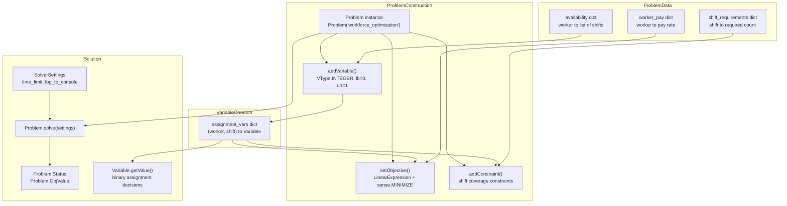
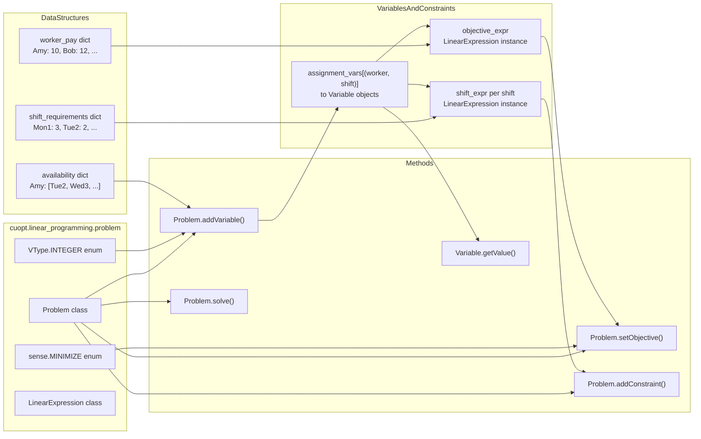
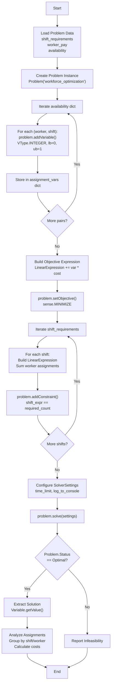

<!-- source: DeepWiki mcp.deepwiki.com · repo NVIDIA/cuopt-examples · page 12.4 Workforce Scheduling · fetched 2026-10-26 -->

# Workforce Scheduling

<details>
<summary>Relevant source files</summary>

The following files were used as context for generating this wiki page:

- [README.md](README.md)
- [VERSION](VERSION)
- [ci/release/update_version.sh](ci/release/update_version.sh)
- [workforce_optimization/workforce_optimization_milp.ipynb](workforce_optimization/workforce_optimization_milp.ipynb)

</details>


## Purpose and Scope

This page documents the workforce scheduling application example, which demonstrates solving a binary assignment problem using cuOpt's Mixed-Integer Linear Programming (MILP) capabilities. The example assigns workers to shifts while minimizing total labor costs and satisfying shift requirements and worker availability constraints.

For general mathematical programming concepts using cuOpt, see [Linear and Mixed-Integer Programming](#6). For the core Problem API documentation, see [Problem API](#3.1). For other complete application examples, see [Application Examples](#12).

**Sources:** [workforce_optimization/workforce_optimization_milp.ipynb:7-18]()

---

## Problem Description

The workforce scheduling problem addresses the following scenario:

| Constraint Type | Description |
|----------------|-------------|
| **Shift Requirements** | Each shift requires a specific number of workers |
| **Worker Availability** | Workers can only be assigned to shifts they are available for |
| **Worker Pay Rates** | Each worker has a per-shift pay rate |
| **Optimization Goal** | Minimize total labor cost across all assignments |

This is a classic assignment problem formulated as a MILP with binary decision variables representing whether a worker is assigned to a specific shift.

**Sources:** [workforce_optimization/workforce_optimization_milp.ipynb:11-18]()

---

## Mathematical Formulation

### Decision Variables

```
x[w,s] ∈ {0, 1}  for all (worker w, shift s) pairs where w is available for s
```

Where `x[w,s] = 1` if worker `w` is assigned to shift `s`, and `0` otherwise.

### Objective Function

```
minimize: Σ(w,s) pay[w] * x[w,s]
```

The objective minimizes total labor cost by summing the pay rate for each worker multiplied by their shift assignments.

### Constraints

**Shift Coverage Constraints:**
```
Σ(w) x[w,s] = required[s]  for all shifts s
```

Ensures each shift has exactly the required number of workers assigned.

**Availability Constraints:**
```
x[w,s] defined only if worker w is available for shift s
```

Implicitly enforced by only creating variables for valid (worker, shift) pairs.

**Sources:** [workforce_optimization/workforce_optimization_milp.ipynb:194-199]()

---

## Implementation Architecture

The following diagram shows the overall structure of the workforce optimization implementation:

Title: Workforce Scheduling Implementation Flow


**Sources:** [workforce_optimization/workforce_optimization_milp.ipynb:102-219]()

---

## Core API Components

### Problem Class Initialization

The `Problem` class from `cuopt.linear_programming.problem` is the main entry point:

```python
from cuopt.linear_programming.problem import Problem, VType, sense, LinearExpression

problem = Problem("workforce_optimization")
```

**Sources:** [workforce_optimization/workforce_optimization_milp.ipynb:107-110](), [workforce_optimization/workforce_optimization_milp.ipynb:208-209]()

### Variable Creation

Binary decision variables are created using `Problem.addVariable()` with integer type and bounds `[0, 1]`:

| Parameter | Value | Purpose |
|-----------|-------|---------|
| `name` | `f"{worker}_{shift}"` | Unique identifier for the variable |
| `vtype` | `VType.INTEGER` | Integer variable type |
| `lb` | `0.0` | Lower bound (minimum value) |
| `ub` | `1.0` | Upper bound (maximum value) |

The implementation iterates through the `availability` dictionary to create variables only for valid (worker, shift) pairs:

```python
assignment_vars = {}
for worker, shifts in availability.items():
    for shift in shifts:
        var_name = f"{worker}_{shift}"
        var = problem.addVariable(name=var_name, vtype=VType.INTEGER, lb=0.0, ub=1.0)
        assignment_vars[(worker, shift)] = var
```

**Sources:** [workforce_optimization/workforce_optimization_milp.ipynb:211-219]()

### Objective Function Construction

The objective function is built using `LinearExpression` to represent the sum of worker costs:

```python
objective_expr = LinearExpression([], [], 0.0)

for (worker, shift), var in assignment_vars.items():
    cost = worker_pay[worker]
    if cost != 0:
        objective_expr += var * cost

problem.setObjective(objective_expr, sense.MINIMIZE)
```

The `LinearExpression` accumulates terms by overloading the `+=` and `*` operators. The `sense.MINIMIZE` enum specifies the optimization direction.

**Sources:** [workforce_optimization/workforce_optimization_milp.ipynb:229-239]()

### Constraint Definition

Shift coverage constraints ensure each shift has the required number of workers. For each shift, the implementation:

1. Collects all variables for workers available for that shift
2. Sums them into a `LinearExpression`
3. Creates an equality constraint using the `==` operator

```python
for shift, required_count in shift_requirements.items():
    shift_assignments = []
    for (worker, shift_name), var in assignment_vars.items():
        if shift_name == shift:
            shift_assignments.append(var)
    
    if len(shift_assignments) > 0:
        shift_expr = LinearExpression([], [], 0.0)
        for var in shift_assignments:
            shift_expr += var
        
        constraint = problem.addConstraint(shift_expr == required_count, name=f"shift_{shift}")
```

**Sources:** [workforce_optimization/workforce_optimization_milp.ipynb:248-270]()

---

## Code Entity Mapping

The following diagram maps the problem components to specific code constructs:

Title: Workforce Scheduling Code Entity Relationships


**Sources:** [workforce_optimization/workforce_optimization_milp.ipynb:107-270]()

---

## Solver Configuration

The `SolverSettings` class configures solver behavior:

| Parameter | Value | Description |
|-----------|-------|-------------|
| `time_limit` | `60.0` | Maximum solve time in seconds |
| `log_to_console` | `True` | Enable solver output logging |
| `method` | `0` | Solver method (0 = default) |

Configuration and solving:

```python
from cuopt.linear_programming.solver_settings import SolverSettings

settings = SolverSettings()
settings.set_parameter("time_limit", 60.0)
settings.set_parameter("log_to_console", True)
settings.set_parameter("method", 0)

problem.solve(settings)
```

**Sources:** [workforce_optimization/workforce_optimization_milp.ipynb:288-294](), [workforce_optimization/workforce_optimization_milp.ipynb:303-313]()

---

## Solution Retrieval

After solving, the solution is accessed through several `Problem` attributes and `Variable` methods:

| Attribute/Method | Type | Description |
|------------------|------|-------------|
| `Problem.Status.name` | `str` | Solution status ("Optimal", "FeasibleFound", etc.) |
| `Problem.ObjValue` | `float` | Optimal objective function value |
| `Problem.SolveTime` | `float` | Time taken to solve in seconds |
| `Problem.NumVariables` | `int` | Total number of variables |
| `Problem.NumConstraints` | `int` | Total number of constraints |
| `Problem.IsMIP` | `bool` | Whether problem is mixed-integer |
| `Variable.getValue()` | `float` | Value of variable in solution |

Binary variable values are tested using `var.getValue() > 0.5` to determine assignments (accounting for numerical tolerance):

```python
for (worker, shift), var in assignment_vars.items():
    if var.getValue() > 0.5:  # Binary variable is 1
        # Process assignment
```

**Sources:** [workforce_optimization/workforce_optimization_milp.ipynb:303-313](), [workforce_optimization/workforce_optimization_milp.ipynb:331-371]()

---

## Solution Workflow

Title: Workforce Scheduling Solution Workflow


**Sources:** [workforce_optimization/workforce_optimization_milp.ipynb:107-372]()

---

## Problem Data Structure

The example uses three dictionaries to define the problem instance:

### Shift Requirements

Defines the number of workers needed for each shift:

```python
shift_requirements = {
    "Mon1": 3,
    "Tue2": 2,
    "Wed3": 4,
    # ... 14 total shifts
}
```

**Sources:** [workforce_optimization/workforce_optimization_milp.ipynb:129-145]()

### Worker Pay Rates

Defines the cost per shift for each worker:

```python
worker_pay = {
    "Amy": 10,
    "Bob": 12,
    "Cathy": 10,
    "Dan": 8,
    "Ed": 8,
    "Fred": 9,
    "Gu": 11,
}
```

**Sources:** [workforce_optimization/workforce_optimization_milp.ipynb:147-156]()

### Worker Availability

Lists which shifts each worker can work:

```python
availability = {
    "Amy": ["Tue2", "Wed3", "Fri5", "Sun7", ...],
    "Bob": ["Mon1", "Tue2", "Fri5", "Sat6", ...],
    # ... availability for all workers
}
```

This structure implicitly enforces availability constraints by only creating variables for valid (worker, shift) pairs.

**Sources:** [workforce_optimization/workforce_optimization_milp.ipynb:158-167]()

---

## Adding Constraint Extensions

The example demonstrates how to extend the model with additional constraints after initial formulation. A common extension limits the maximum number of shifts per worker:

### Maximum Shifts Constraint

For each worker, add a constraint limiting total assigned shifts:

```python
max_shifts_per_worker = 4

for worker in worker_pay.keys():
    worker_shifts = []
    for (w, shift), var in assignment_vars.items():
        if w == worker:
            worker_shifts.append(var)
    
    if worker_shifts:
        worker_expr = LinearExpression([], [], 0.0)
        for var in worker_shifts:
            worker_expr += var
        
        constraint = problem.addConstraint(worker_expr <= max_shifts_per_worker, 
                                          name=f"max_shifts_{worker}")
```

The constraint uses the `<=` operator on `LinearExpression` objects. After adding constraints, the problem can be re-solved:

```python
problem.solve(settings)
```

The solver automatically incorporates the new constraints without needing to rebuild the entire problem.

**Sources:** [workforce_optimization/workforce_optimization_milp.ipynb:407-456]()

---

## Common Constraint Extensions

The basic workforce scheduling model can be extended with various constraints:

| Constraint Type | Implementation Approach | Example Use Case |
|-----------------|------------------------|------------------|
| **Maximum shifts per worker** | `Σ(s) x[w,s] <= max_shifts` | Prevent worker overload |
| **Minimum shifts per worker** | `Σ(s) x[w,s] >= min_shifts` | Ensure fair distribution |
| **Consecutive shift limits** | Temporal constraints on adjacent shifts | Enforce rest periods |
| **Skill requirements** | Additional binary variables for skills | Match shift needs to worker qualifications |
| **Shift preferences** | Modify objective coefficients | Weight assignments by worker preferences |
| **Fairness constraints** | Balance shift counts across workers | Equal workload distribution |

**Sources:** [workforce_optimization/workforce_optimization_milp.ipynb:492-499]()

---

## Solution Analysis

The example provides analysis functions to interpret the optimal solution:

### Output Format

The solution groups assignments in two ways:

**By Shift:**
```
Mon1: ['Bob', 'Ed', 'Gu'] (Required: 3, Assigned: 3, Cost: $31)
Tue2: ['Amy', 'Bob'] (Required: 2, Assigned: 2, Cost: $22)
```

**By Worker:**
```
Amy: ['Tue2', 'Wed3', 'Fri5', 'Sun7'] (4 shifts, $40)
Bob: ['Mon1', 'Tue2', 'Fri5', 'Sat6'] (4 shifts, $48)
```

### Summary Statistics

| Metric | Access Method | Description |
|--------|---------------|-------------|
| Total Labor Cost | `Problem.ObjValue` | Sum of all assignment costs |
| Solve Time | `Problem.SolveTime` | Time to find optimal solution |
| Problem Size | `Problem.NumVariables`, `Problem.NumConstraints` | Problem dimensions |
| Solution Quality | `Problem.Status.name` | Optimality status |

**Sources:** [workforce_optimization/workforce_optimization_milp.ipynb:331-400]()

---

## Performance Characteristics

### Problem Dimensions

For the example problem:

| Dimension | Value | Description |
|-----------|-------|-------------|
| Workers | 7 | Total number of workers |
| Shifts | 14 | Total number of shifts |
| Variables | ~70 | Binary decision variables (worker, shift pairs) |
| Constraints | 14 base + 7 max-shift | Shift requirements + worker limits |
| Solution Time | < 1 second | GPU-accelerated solve time |

The problem size is determined by the number of available (worker, shift) pairs, which depends on worker availability patterns.

**Sources:** [workforce_optimization/workforce_optimization_milp.ipynb:169-171](), [workforce_optimization/workforce_optimization_milp.ipynb:303-313]()

---

## Integration with Problem API

The workforce scheduling example demonstrates several key features of the Problem API (see [Problem API](#3.1)):

### Variable Types

Uses `VType.INTEGER` with bounds `[0, 1]` to create binary variables:

```python
var = problem.addVariable(name=var_name, vtype=VType.INTEGER, lb=0.0, ub=1.0)
```

**Sources:** [workforce_optimization/workforce_optimization_milp.ipynb:216]()

### LinearExpression Operations

Demonstrates operator overloading for building expressions:

- `+=` operator: Add terms to expression
- `*` operator: Multiply variable by coefficient  
- `==` operator: Create equality constraint
- `<=` operator: Create inequality constraint

**Sources:** [workforce_optimization/workforce_optimization_milp.ipynb:230-270](), [workforce_optimization/workforce_optimization_milp.ipynb:430-435]()

### Constraint Types

Shows both equality and inequality constraints:

- **Equality:** `shift_expr == required_count` for exact shift coverage
- **Inequality:** `worker_expr <= max_shifts` for maximum limits

**Sources:** [workforce_optimization/workforce_optimization_milp.ipynb:264](), [workforce_optimization/workforce_optimization_milp.ipynb:434-435]()

---

## File Structure

The workforce optimization example is contained in a single Jupyter notebook:

```
workforce_optimization/
└── workforce_optimization_milp.ipynb
```

The notebook is self-contained and includes:

- Environment setup and GPU checking
- Problem data definition
- Problem formulation
- Solver configuration
- Solution extraction and analysis
- Constraint extension demonstration

**Sources:** [workforce_optimization/workforce_optimization_milp.ipynb:1-545]()

---

## Related Examples

For other application examples demonstrating cuOpt capabilities:

- [Car Rental Fleet Optimization](#12.5) - Multi-location MILP with transfer decisions
- [Diet Optimization](#12.6) - Basic linear programming example
- [Last-Mile Delivery Optimization](#12.1) - Vehicle routing with capacity constraints
- [Service Team Routing](#12.2) - VRP with time windows

For the underlying API documentation:

- [Problem Class Reference](#14.1) - Complete API reference for Problem class
- [SolverSettings and Configuration](#3.2) - Solver configuration options

**Sources:** [README.md:71-82]()

---

