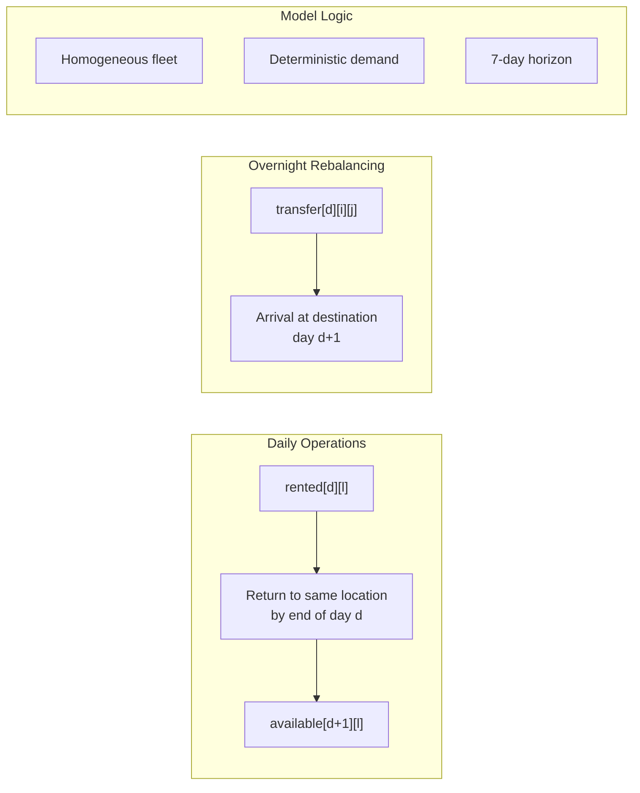
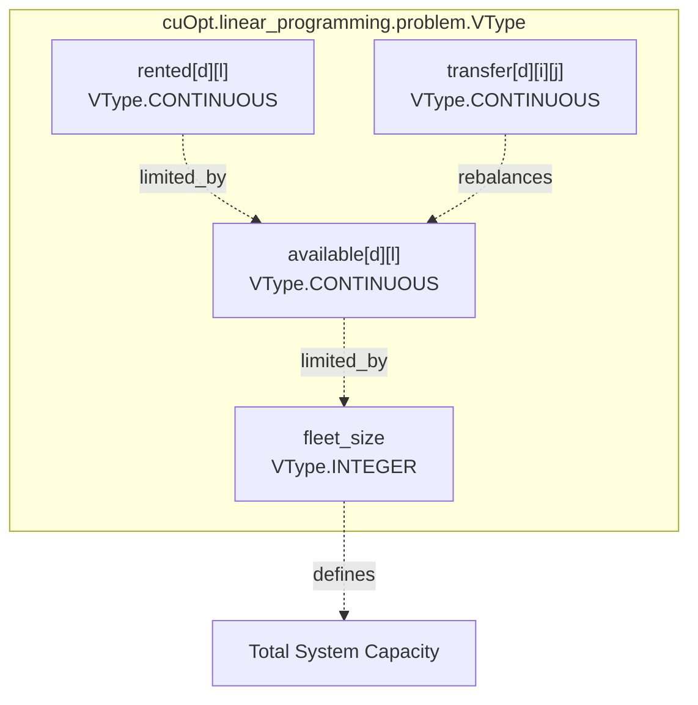
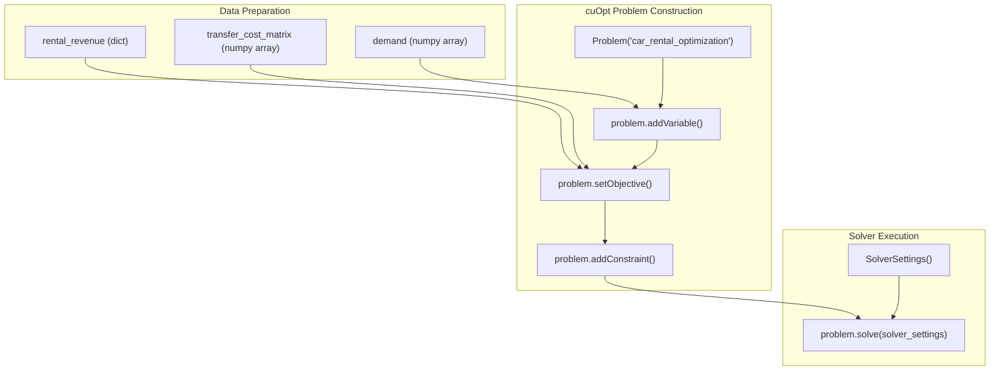

<!-- source: DeepWiki mcp.deepwiki.com · repo NVIDIA/cuopt-examples · page 12.5 Car Rental Fleet Optimization · fetched 2026-10-26 -->

# Car Rental Fleet Optimization

<details>
<summary>Relevant source files</summary>

The following files were used as context for generating this wiki page:

- [car_rental_optimization/README.md](car_rental_optimization/README.md)
- [car_rental_optimization/car_rental_optimization_milp.ipynb](car_rental_optimization/car_rental_optimization_milp.ipynb)

</details>


## Purpose and Scope

This document describes a complete Mixed Integer Linear Program (MILP) example that optimizes car rental fleet operations using cuOpt's `Problem` API. The implementation demonstrates how to solve multi-location inventory optimization problems with integer fleet sizing decisions and continuous allocation variables to maximize weekly profit.

For general MILP problem formulation concepts, see [Mixed-Integer Programming Examples](). For the underlying `Problem` API methods, see [Problem API](). For another MILP workforce example, see [Workforce Scheduling]().

**Sources:** [car_rental_optimization/README.md:1-75](), [car_rental_optimization/car_rental_optimization_milp.ipynb:7-42]()

## Problem Description

The car rental optimization problem determines optimal fleet size and vehicle distribution across multiple locations over a weekly planning horizon. The model maximizes profit by balancing rental revenue against operational costs and inter-location transfer costs while satisfying location-specific demand.

**Key Decisions:**
- Total number of cars in the fleet (integer decision).
- Number of cars available at each location on each day.
- Number of cars rented at each location on each day.
- Number of cars transferred between location pairs on each day.

**Problem Parameters:**
- **4 locations**: Airport, Downtown, Suburb_A, Suburb_B.
- **7-day planning horizon**: Monday through Sunday.
- **Revenue**: Location-specific rental revenue rates ($75-$120 per rental).
- **Operational Cost**: Weekly operational cost ($240 per car).
- **Transfer Cost**: $25-$50 per car depending on the route.

**Sources:** [car_rental_optimization/car_rental_optimization_milp.ipynb:6-42](), [car_rental_optimization/README.md:7-31]()

### Model Assumptions

The model makes several simplifying assumptions suitable for car-sharing services, airport shuttles, and daily rental operations:

| Assumption | Description | Impact |
|------------|-------------|--------|
| Same-day returns | All rentals return to origin location by end of day | Simplifies flow conservation constraints |
| Homogeneous fleet | All vehicles are identical | Single set of availability variables |
| Known demand | Deterministic demand patterns | No stochastic programming required |
| Overnight transfers | Repositioning happens between days | Transfers available next morning |
| Daily horizon | Decisions made per 24-hour period | 7 time periods for weekly optimization |

**Same-Day Rental Model Flow**


**Sources:** [car_rental_optimization/car_rental_optimization_milp.ipynb:23-38](), [car_rental_optimization/README.md:16-31]()

## Mathematical Formulation

### Decision Variables

The problem uses one integer variable and three sets of continuous variables:

| Variable | Type | Dimensions | Bounds | Purpose |
|----------|------|------------|--------|---------|
| `fleet_size` | `VType.INTEGER` | 1 | [0, 500] | Total cars in fleet |
| `available[d][l]` | `VType.CONTINUOUS` | 7 × 4 = 28 | [0, 500] | Cars available for rental |
| `rented[d][l]` | `VType.CONTINUOUS` | 7 × 4 = 28 | [0, demand[d][l]] | Cars actually rented |
| `transfer[d][i][j]` | `VType.CONTINUOUS` | 7 × 4 × 3 = 84 | [0, 100] | Cars transferred between locations |

**Total Variables:** 1 + 28 + 28 + 84 = 141 variables.

**Code to Variable Mapping**


**Sources:** [car_rental_optimization/car_rental_optimization_milp.ipynb:299-380]()

### Objective Function

The objective maximizes weekly profit:
**Maximize:** $\sum_{d,l} (\text{rented}_{d,l} \times \text{revenue}_l) - (\text{fleet\_size} \times \text{weekly\_cost}) - \sum_{d,i,j} (\text{transfer}_{d,i,j} \times \text{transfer\_cost}_{i,j})$

**Sources:** [car_rental_optimization/car_rental_optimization_milp.ipynb:386-422]()

### Constraints

1.  **Rental Limit (28 constraints):** `rented[d][l] <= available[d][l]`.
2.  **Initial Allocation (1 constraint):** $\sum_l \text{available}[0][l] \leq \text{fleet\_size}$.
3.  **Flow Conservation (24 constraints):** $\text{available}[d][l] = \text{available}[d-1][l] + \sum_{i \neq l} \text{transfer}[d-1][i][l] - \sum_{j \neq l} \text{transfer}[d-1][l][j]$.
4.  **Fleet Capacity (7 constraints):** $\sum_l \text{available}[d][l] \leq \text{fleet\_size}$.

**Sources:** [car_rental_optimization/car_rental_optimization_milp.ipynb:428-528]()

## Implementation Detail

### Problem API Usage

The implementation follows the standard `cuopt.linear_programming.problem.Problem` workflow:

1.  **Initialize**: Create the problem instance [car_rental_optimization/car_rental_optimization_milp.ipynb:300]().
2.  **Variables**: Add variables using `problem.addVariable` with specific `VType` [car_rental_optimization/car_rental_optimization_milp.ipynb:303-379]().
3.  **Objective**: Construct a `LinearExpression` and set it via `problem.setObjective` [car_rental_optimization/car_rental_optimization_milp.ipynb:392-421]().
4.  **Constraints**: Add linear constraints using `problem.addConstraint` [car_rental_optimization/car_rental_optimization_milp.ipynb:432-527]().
5.  **Solve**: Execute using `problem.solve(solver_settings)` [car_rental_optimization/car_rental_optimization_milp.ipynb:552]().

**System Architecture and Code Entities**


**Sources:** [car_rental_optimization/car_rental_optimization_milp.ipynb:146-557]()

### Solver Configuration

The solver is configured with a time limit to ensure timely completion on GPU:
```python
solver_settings = SolverSettings()
solver_settings.time_limit = 60.0 
problem.solve(solver_settings)
```

**Sources:** [car_rental_optimization/car_rental_optimization_milp.ipynb:538-552]()

## Analysis and Reporting

After the solve, results are extracted using `.getValue()` on the variable objects:

- **Optimal Fleet Size**: Retrieved from `fleet_size.getValue()` [car_rental_optimization/car_rental_optimization_milp.ipynb:568]().
- **Financials**: Calculated using `problem.ObjValue` and component costs [car_rental_optimization/car_rental_optimization_milp.ipynb:583, 789-815]().
- **Operational Metrics**: Utilization and demand satisfaction are derived from the rental and availability matrices [car_rental_optimization/car_rental_optimization_milp.ipynb:614-692]().

**Sources:** [car_rental_optimization/car_rental_optimization_milp.ipynb:568-838]()

---

