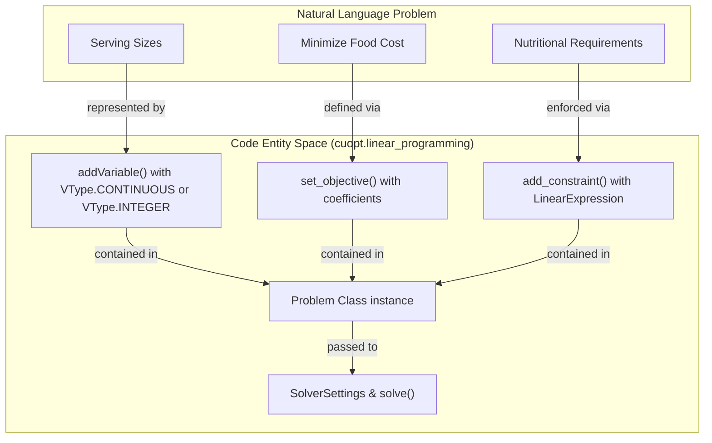
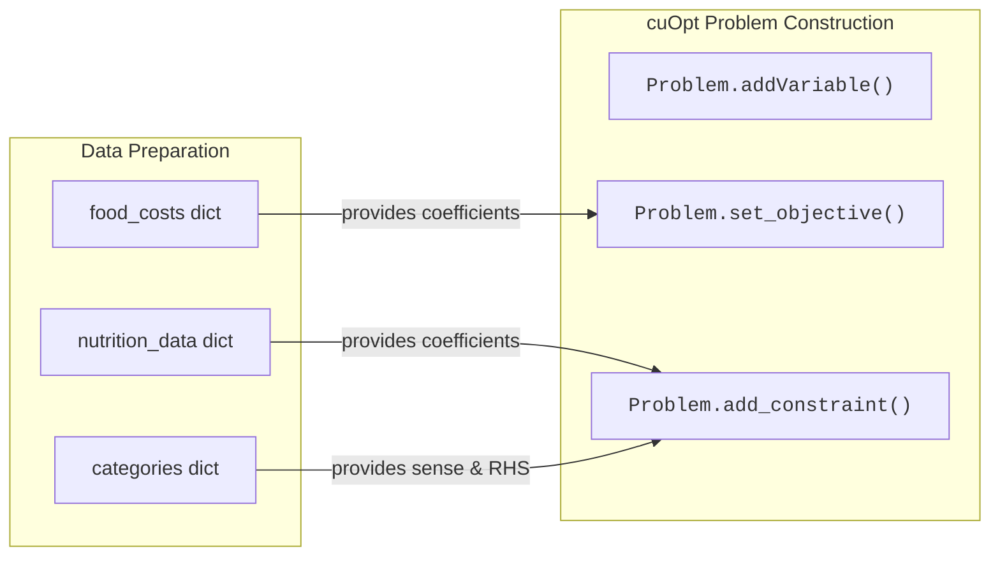

<!-- source: DeepWiki mcp.deepwiki.com · repo NVIDIA/cuopt-examples · page 12.6 Diet Optimization · fetched 2026-10-26 -->

# Diet Optimization

Relevant source files

The following files were used as context for generating this wiki page:

- [AI-accelerated-routing/initializing_cuopt_with_rl_solutions.ipynb](AI-accelerated-routing/initializing_cuopt_with_rl_solutions.ipynb)
- [AI-accelerated-routing/training_rl_agent_for_vrp.ipynb](AI-accelerated-routing/training_rl_agent_for_vrp.ipynb)
- [diet_optimization/README.md](diet_optimization/README.md)
- [diet_optimization/diet_optimization_lp.ipynb](diet_optimization/diet_optimization_lp.ipynb)
- [diet_optimization/diet_optimization_milp.ipynb](diet_optimization/diet_optimization_milp.ipynb)
- [intra-factory_transport/cost_matrix.png](intra-factory_transport/cost_matrix.png)
- [intra-factory_transport/waypoint_graph.png](intra-factory_transport/waypoint_graph.png)
- [portfolio_optimization/cvar_portfolio_optimization.ipynb](portfolio_optimization/cvar_portfolio_optimization.ipynb)

## Purpose and Scope

This page documents the Diet Optimization application example, a classic linear programming problem used to demonstrate NVIDIA cuOpt's capabilities in solving constrained optimization problems. The objective is to minimize the total cost of food purchases while satisfying specific nutritional requirements (min/max bounds on calories, protein, fat, and sodium). 

The example is implemented using the `cuopt.linear_programming` API and is available in two distinct mathematical variants:
*   **Linear Programming (LP):** Allows fractional food servings (continuous variables).
*   **Mixed-Integer Linear Programming (MILP):** Requires whole food servings (integer variables).

**Sources:** [diet_optimization/README.md:1-18](), [diet_optimization/diet_optimization_lp.ipynb:7-18]()

---

## System Architecture and Data Flow

The following diagram bridges the natural language problem description to the specific code entities used in the implementation.

### From Problem Space to Code Entities

**Implementation Mapping: Problem to API**

The problem is modeled by instantiating a `Problem` object, defining decision variables for each food item, and adding constraints based on nutritional data.

**Sources:** [diet_optimization/diet_optimization_lp.ipynb:113-115](), [diet_optimization/diet_optimization_milp.ipynb:113-115]()

---

## Problem Formulation

### Decision Variables
The decision variables $x_i$ represent the number of servings for each food item $i$.

*   **LP Variant:** $x_i \in \mathbb{R}, x_i \geq 0$. Implemented using `VType.CONTINUOUS` [diet_optimization/diet_optimization_lp.ipynb:113]().
*   **MILP Variant:** $x_i \in \mathbb{Z}, x_i \geq 0$. Implemented using `VType.INTEGER` [diet_optimization/diet_optimization_milp.ipynb:113]().

### Objective Function
Minimize the total cost:
$$\text{Minimize } \sum_{i=1}^{n} \text{cost}_i \cdot x_i$$

### Constraints
For each nutrient category $j$ (calories, protein, fat, sodium):
$$\text{min\_requirement}_j \leq \sum_{i=1}^{n} \text{nutrient\_content}_{i,j} \cdot x_i \leq \text{max\_requirement}_j$$

**Sources:** [diet_optimization/diet_optimization_lp.ipynb:133-188](), [diet_optimization/diet_optimization_milp.ipynb:133-188]()

---

## Data Structure and Preparation

The implementation uses standard Python dictionaries and pandas DataFrames to organize the input data before passing it to the cuOpt `Problem` API.

### Input Data Components

| Component | Variable Name | Description | Example Value |
|-----------|---------------|-------------|---------------|
| **Nutrient Bounds** | `categories` | Min/Max limits for calories, protein, etc. | Calories: [1800, 2200] |
| **Food Costs** | `food_costs` | Cost per serving for 9 food items | Hamburger: 2.49 |
| **Nutrient Content** | `nutrition_data` | Matrix of values per food per category | Chicken Protein: 32g |

**Sources:** [diet_optimization/diet_optimization_lp.ipynb:137-188](), [diet_optimization/diet_optimization_milp.ipynb:137-188]()

### Mapping Data to cuOpt API

**Data Flow: Input Dictionaries to API Methods**

The data from `nutrition_data` is used to build `LinearExpression` objects, which are then added as constraints to the `Problem` instance.

**Sources:** [diet_optimization/diet_optimization_lp.ipynb:113-115](), [diet_optimization/diet_optimization_milp.ipynb:113-115]()

---

## Implementation Details

### Core Classes and Methods

The implementation relies on the following components from `cuopt.linear_programming`:

*   **`Problem`**: The main container for the optimization model [diet_optimization/diet_optimization_lp.ipynb:113]().
*   **`VType`**: Enumeration to specify variable types (`CONTINUOUS` for LP, `INTEGER` for MILP) [diet_optimization/diet_optimization_lp.ipynb:113]().
*   **`LinearExpression`**: Used to build the left-hand side of constraints by combining variables and their nutritional coefficients [diet_optimization/diet_optimization_lp.ipynb:113]().
*   **`sense`**: Enumeration for constraint directions (e.g., `sense.GE` for $\geq$, `sense.LE` for $\leq$) [diet_optimization/diet_optimization_lp.ipynb:113]().
*   **`SolverSettings`**: Configures the GPU solver behavior [diet_optimization/diet_optimization_lp.ipynb:114]().

### LP vs. MILP Implementation

The primary difference in the code is the variable type definition:

| Feature | LP Notebook | MILP Notebook |
|---------|-------------|---------------|
| **File Path** | `diet_optimization_lp.ipynb` | `diet_optimization_milp.ipynb` |
| **Variable Type** | `VType.CONTINUOUS` | `VType.INTEGER` |
| **Result** | Can result in 1.5 servings | Only whole servings (1, 2, etc.) |

**Sources:** [diet_optimization/README.md:16-18](), [diet_optimization/diet_optimization_lp.ipynb:113](), [diet_optimization/diet_optimization_milp.ipynb:113]()

---

## Execution and Results

### Solver Workflow

1.  **Initialize**: Create a `Problem` instance.
2.  **Model**: Add variables, the objective function, and constraints.
3.  **Configure**: Instantiate `SolverSettings`.
4.  **Solve**: Call `problem.solve(settings)`.
5.  **Extract**: Use `variable.get_value()` to retrieve the optimal serving sizes.

### Example Constraints Structure

| Nutrient | Lower Bound (min) | Upper Bound (max) | Implementation |
|----------|-------------------|-------------------|----------------|
| Calories | 1800 | 2200 | Two constraints (GE and LE) |
| Protein | 91 | $\infty$ | One constraint (GE) |
| Fat | 0 | 65 | One constraint (LE) |
| Sodium | 0 | 1779 | One constraint (LE) |

**Sources:** [diet_optimization/diet_optimization_lp.ipynb:137-154](), [diet_optimization/diet_optimization_lp.ipynb:198-200]()

---

