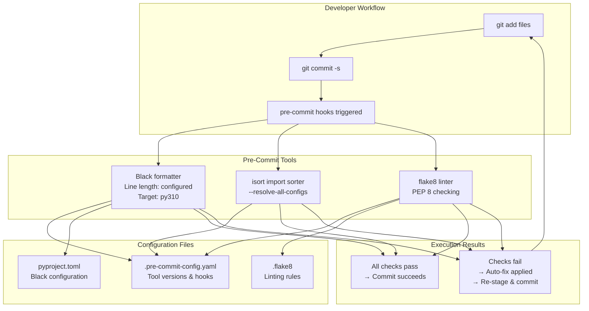
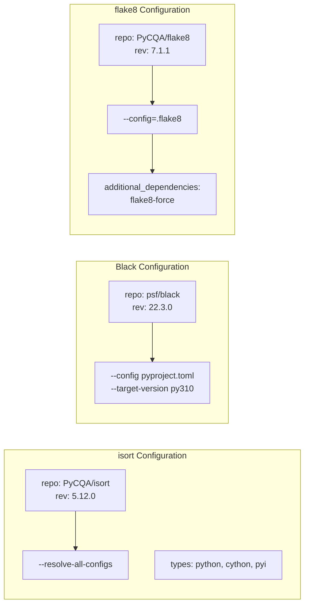
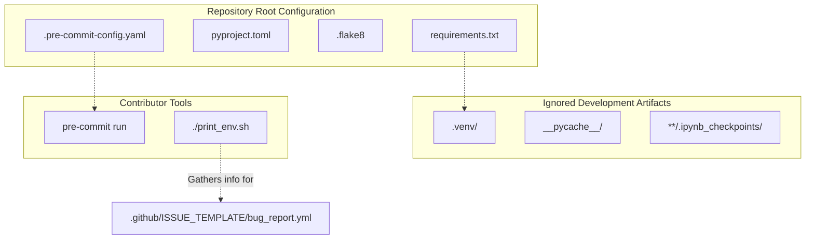

<!-- source: DeepWiki mcp.deepwiki.com · repo NVIDIA/cuopt-examples · page 13.1 Development Environment Setup · fetched 2026-10-26 -->

# Development Environment Setup

<details>
<summary>Relevant source files</summary>

The following files were used as context for generating this wiki page:

- [.github/ISSUE_TEMPLATE/bug_report.yml](.github/ISSUE_TEMPLATE/bug_report.yml)
- [.pre-commit-config.yaml](.pre-commit-config.yaml)
- [CONTRIBUTING.md](CONTRIBUTING.md)
- [LICENSE.md](LICENSE.md)
- [requirements.txt](requirements.txt)

</details>


This document provides detailed instructions for contributors setting up a local development environment for the `cuopt-examples` repository. It covers pre-commit hook configuration, virtual environment setup, and development tooling. For general contribution guidelines and workflow, see [Contribution Workflow](#13.3). For code quality standards enforced by these tools, see [Code Quality Standards](#13.2).

## Overview

The `cuopt-examples` repository supports two primary development approaches: Docker-based development (recommended for running examples) and local Python virtual environment setup (recommended for contributors). Contributors must configure code quality tools regardless of the chosen approach.

### Development Environment Options

| Approach | Use Case | GPU Access | Pre-commit Required |
|----------|----------|------------|---------------------|
| Docker Container | Running examples, testing workflows | Yes (via `--gpus all`) | Yes (inside container) |
| Python Virtual Environment | Contributing code, documentation | Optional | Yes (in host environment) |
| Conda Environment | Alternative to venv | Optional | Yes (in environment) |

Sources: [CONTRIBUTING.md:37-47](), [CONTRIBUTING.md:55-61]()

---

## Pre-Commit Hook Configuration

### Installation and Setup

Pre-commit hooks enforce code quality standards automatically before commits are finalized. The repository uses three primary tools: `Black` (formatting), `isort` (import sorting), and `flake8` (linting).

Title: Pre-commit Hook Execution Flow

Sources: [CONTRIBUTING.md:49-90](), [.pre-commit-config.yaml:1-33]()

### Installing Pre-Commit

Install `pre-commit` via `conda` or `pip`:

```bash
# Option 1: Conda
conda install -c conda-forge pre-commit

# Option 2: Pip
pip install pre-commit
```
Sources: [CONTRIBUTING.md:55-61]()

### Running Pre-Commit Checks

Execute `pre-commit` on staged files manually or install the hook to run automatically on every commit:

```bash
# Run on staged files only
pre-commit run

# Run on all files in repository
pre-commit run --all-files

# Install hooks for automatic execution
pre-commit install
```

To bypass checks (not recommended for contributors), use `git commit --no-verify` or `git commit -n`.
Sources: [CONTRIBUTING.md:63-81]()

### Pre-Commit Tool Specifications

Title: Code Entity to Tool Configuration Mapping


The repository enforces:
- **Black**: Python code formatter with target version `py310`, explicitly using `pyproject.toml` at the repo root. [[.pre-commit-config.yaml:15-21]]()
- **isort**: Import statement sorter with `--resolve-all-configs` to respect per-project package boundaries. [[.pre-commit-config.yaml:6-14]]()
- **flake8**: PEP 8 style checker using `.flake8` configuration and the `flake8-force` plugin. [[.pre-commit-config.yaml:22-30]]()

Sources: [.pre-commit-config.yaml:5-30]()

---

## Python Virtual Environment Setup

### Virtual Environment Creation

Contributors should create an isolated environment to manage dependencies and development tools.

```bash
# Create virtual environment
python3 -m venv .venv

# Activate (Linux/macOS)
source .venv/bin/activate

# Install base requirements
pip install -r requirements.txt

# Install pre-commit
pip install pre-commit
pre-commit install
```
Sources: [requirements.txt:1-5](), [CONTRIBUTING.md:55-61]()

### Base Requirements

The root `requirements.txt` includes minimal dependencies for the Jupyter notebook environment:

| Package | Purpose |
|---------|---------|
| `jupyter` | Core Jupyter environment |
| `notebook` | Classic notebook interface |
| `ipykernel` | IPython kernel for Jupyter |

Sources: [requirements.txt:1-5]()

---

## Development Environment Structure

Title: Codebase Configuration and Artifacts


### Environment Details Gathering

For troubleshooting and bug reporting, contributors should use the `./print_env.sh` script. The output of this script is a required field in the [Bug Report template](.github/ISSUE_TEMPLATE/bug_report.yml).

Sources: [.github/ISSUE_TEMPLATE/bug_report.yml:71-79]()

---

## Developer Guidelines

### Python Code Style
Contributors must adhere to the following standards:
- **PEP 8**: Follow standard Python guidelines. [[CONTRIBUTING.md:138]]()
- **Type Hints**: Required for function arguments and return values. [[CONTRIBUTING.md:139]]()
- **Docstrings**: Required for all public functions and classes. [[CONTRIBUTING.md:140]]()
- **Naming**: Use meaningful variable and function names. [[CONTRIBUTING.md:142]]()

### Signing Your Work (DCO)
All contributors must "sign-off" on their commits to certify adherence to the Developer Certificate of Origin (DCO).
- Use `git commit -s -m "Commit message"` to append the `Signed-off-by` line. [[CONTRIBUTING.md:91-100]]()
- Any contribution containing unsigned commits will not be accepted. [[CONTRIBUTING.md:95]]()

Sources: [CONTRIBUTING.md:91-144]()

---

## Environment Validation Checklist

| Component | Validation Command | Expected Result |
|-----------|-------------------|-----------------|
| Pre-commit installed | `pre-commit --version` | Version number displayed |
| Pre-commit hooks active | `ls .git/hooks/pre-commit` | File exists |
| DCO Signoff | `git log --show-signature` | `Signed-off-by` in commit messages |
| Base Deps | `pip list \| grep jupyter` | Package exists in environment |

Sources: [CONTRIBUTING.md:49-105](), [requirements.txt:1-5]()

---

