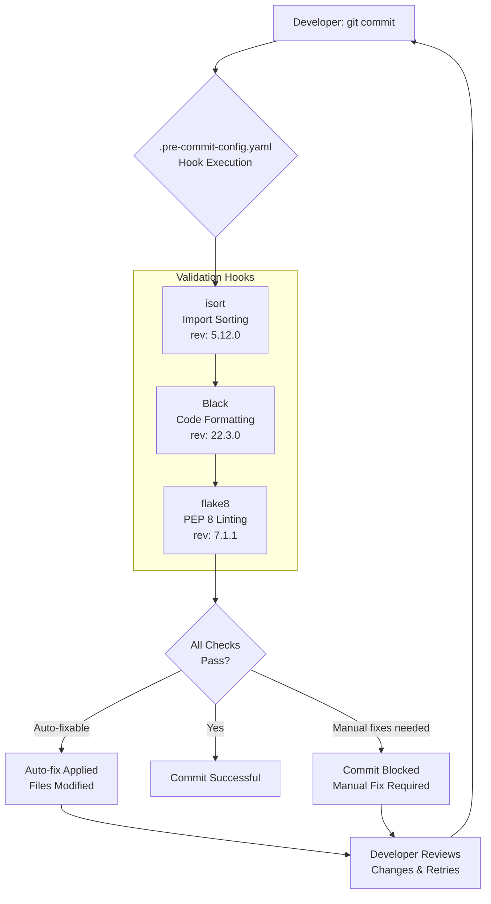
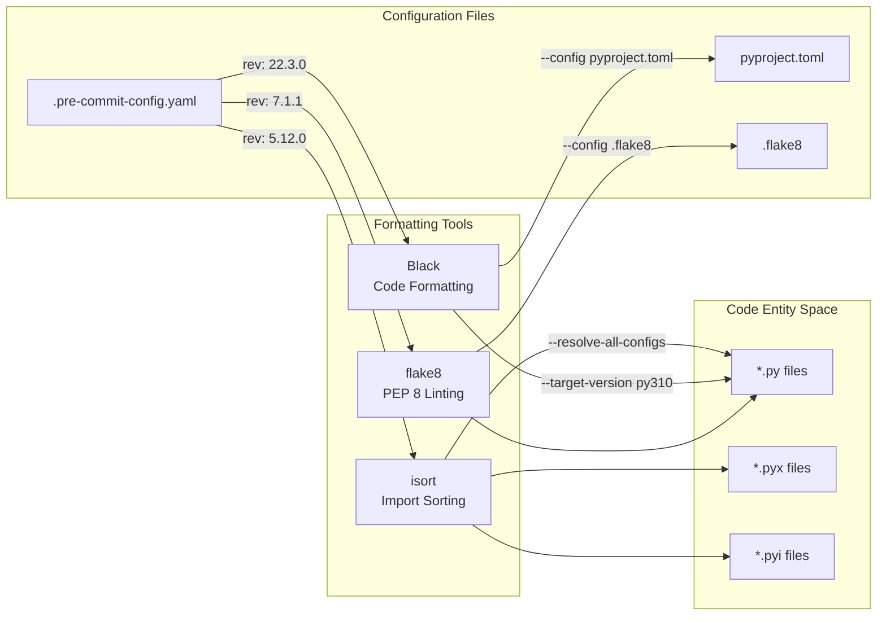

<!-- source: DeepWiki mcp.deepwiki.com · repo NVIDIA/cuopt-examples · page 13.2 Code Quality Standards · fetched 2026-10-26 -->

# Code Quality Standards

<details>
<summary>Relevant source files</summary>

The following files were used as context for generating this wiki page:

- [.github/ISSUE_TEMPLATE/bug_report.yml](.github/ISSUE_TEMPLATE/bug_report.yml)
- [.pre-commit-config.yaml](.pre-commit-config.yaml)
- [CONTRIBUTING.md](CONTRIBUTING.md)
- [LICENSE.md](LICENSE.md)
- [requirements.txt](requirements.txt)

</details>


## Purpose and Scope

This document defines the code quality standards enforced in the `cuopt-examples` repository. It covers automated formatting tools, style guidelines, type hinting, and documentation requirements for Python code and Jupyter notebooks. Adherence to these standards ensures that GPU-accelerated optimization examples—ranging from VRP to MILP—remain maintainable, readable, and reproducible across different environments.

For information about the contribution workflow and pull request process, see [Contribution Workflow](#13.3). For development environment setup instructions, see [Development Environment Setup](#13.1).

**Sources:** [CONTRIBUTING.md:1-11](), [CONTRIBUTING.md:134-135]()

---

## Pre-commit Hook Infrastructure

The repository utilizes `pre-commit` to execute automated code linters and formatters. This infrastructure ensures that linter versions and options are synchronized across all developers, preventing style-related regressions in the codebase.

### Pre-commit Hook Workflow

The following diagram illustrates the lifecycle of a code change from the developer's local environment through the automated validation gates.

**Diagram: Pre-commit Validation Flow**


**Sources:** [.pre-commit-config.yaml:1-33](), [CONTRIBUTING.md:51-54]()

### Installation and Usage

To initialize the pre-commit environment, developers must install the `pre-commit` package via `conda` or `pip` [CONTRIBUTING.md:55-61]().

**Manual Execution:**
Run hooks on staged files or the entire repository to validate changes before a commit attempt:
```bash
# Run on staged files
pre-commit run

# Run on all files
pre-commit run --all-files
```
[CONTRIBUTING.md:63-73]()

**Automatic Integration:**
To ensure hooks run automatically on every `git commit`, execute:
```bash
pre-commit install
```
[CONTRIBUTING.md:75-79]()

---

## Code Formatting Tools

Three primary tools are configured in `.pre-commit-config.yaml` to maintain the code entity space.

### Tool Configuration and Target Space

The diagram below maps the configuration files to the specific tools and the file types they target within the repository.

**Diagram: Formatting Tool Architecture**


**Sources:** [.pre-commit-config.yaml:5-30]()

### Tool Specifications

| Tool | Purpose | Configuration Details |
| :--- | :--- | :--- |
| **isort** | Organizes imports alphabetically and by type (stdlib, 3rd party, local). | Uses `--resolve-all-configs` to handle subproject-specific packages [.pre-commit-config.yaml:6-14](). |
| **Black** | Enforces a deterministic, "uncompromising" code style. | Targets Python 3.10 syntax and references the root `pyproject.toml` [.pre-commit-config.yaml:15-21](). |
| **flake8** | Checks for PEP 8 compliance and logical errors. | Utilizes `.flake8` config and the `flake8-force` dependency [.pre-commit-config.yaml:22-30](). |

---

## Python Code Style Guidelines

Beyond automated formatting, developers must adhere to specific architectural and documentation patterns.

### PEP 8 and Naming
- All code must follow standard PEP 8 guidelines [CONTRIBUTING.md:138]().
- Variable and function names must be meaningful and descriptive [CONTRIBUTING.md:142]().

### Type Hints and Docstrings
- **Type Hints:** Required for all function arguments and return values to improve IDE support and static analysis [CONTRIBUTING.md:139]().
- **Docstrings:** Mandatory for all public functions and classes [CONTRIBUTING.md:140]().

### Code Logic and Organization
- **Focused Functions:** Keep functions single-purpose and modular [CONTRIBUTING.md:141]().
- **Comments:** Add explanatory comments for complex mathematical logic, such as custom constraint formulations in cuOpt [CONTRIBUTING.md:143]().

**Sources:** [CONTRIBUTING.md:136-143]()

---

## Notebook Formatting Guidelines

Jupyter notebooks (`.ipynb`) are the primary delivery vehicle for cuOpt examples. They must be self-contained to ensure they run across different environments (e.g., local Docker, cloud instances).

### Structure and Self-Containment
- **Dependencies:** Logic for fetching data or installing specific dependencies (e.g., via `!pip install`) should ideally be contained within the notebook itself [CONTRIBUTING.md:149-150]().
- **Utility Functions:** Small utility functions should be defined within the notebook rather than in external `.py` files where possible to maintain portability [CONTRIBUTING.md:151]().

### Content Standards
- **Markdown:** Use markdown cells to explain the optimization problem, the data model, and the interpretation of results.
- **Requirements:** If an example requires specific libraries beyond the base environment, a `requirements.txt` may be provided in the example directory [CONTRIBUTING.md:150](), [requirements.txt:1-5]().

**Sources:** [CONTRIBUTING.md:148-151](), [requirements.txt:1-5]()

---

## Legal and Submission Requirements

### Developer Certificate of Origin (DCO)
All contributors must "sign-off" on their commits using the `-s` or `--signoff` flag. This certifies that the contribution is original work or submitted under a compatible license [CONTRIBUTING.md:93-105]().

```bash
git commit -s -m "Add new VRP example"
```

### Bug Reports and Feature Requests
When submitting bug reports via the GitHub template, users are required to provide:
- cuOpt version [/.github/ISSUE_TEMPLATE/bug_report.yml:30-36]().
- Installation method (Docker, Pip, or Source) [/.github/ISSUE_TEMPLATE/bug_report.yml:39-47]().
- A minimum reproducible example [/.github/ISSUE_TEMPLATE/bug_report.yml:58-63]().
- Environment details gathered via `./print_env.sh` [/.github/ISSUE_TEMPLATE/bug_report.yml:72-80]().

**Sources:** [CONTRIBUTING.md:93-132](), [/.github/ISSUE_TEMPLATE/bug_report.yml:1-86]()

---

