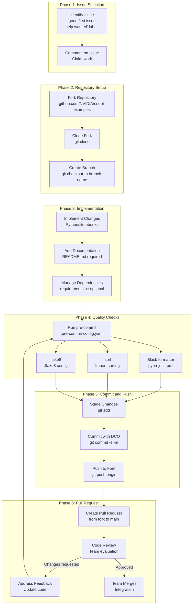
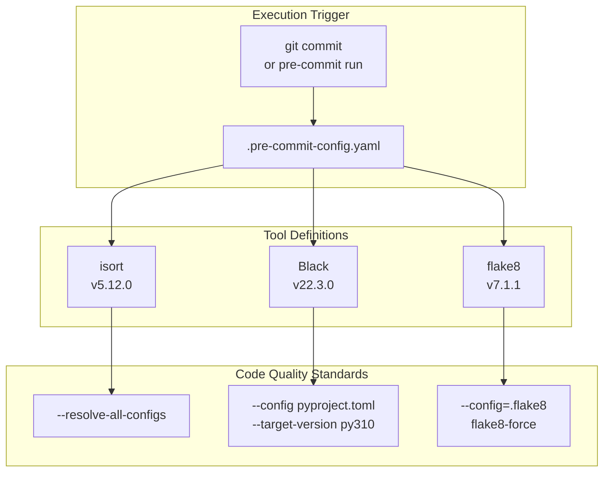

<!-- source: DeepWiki mcp.deepwiki.com · repo NVIDIA/cuopt-examples · page 13.3 Contribution Workflow · fetched 2026-10-26 -->

# Contribution Workflow

<details>
<summary>Relevant source files</summary>

The following files were used as context for generating this wiki page:

- [.github/ISSUE_TEMPLATE/bug_report.yml](.github/ISSUE_TEMPLATE/bug_report.yml)
- [.github/ISSUE_TEMPLATE/documentation-request.md](.github/ISSUE_TEMPLATE/documentation-request.md)
- [.pre-commit-config.yaml](.pre-commit-config.yaml)
- [CONTRIBUTING.md](CONTRIBUTING.md)
- [LICENSE.md](LICENSE.md)
- [requirements.txt](requirements.txt)

</details>


## Purpose and Scope

This page documents the step-by-step process for contributing code changes, new examples, or bug fixes to the `cuopt-examples` repository. It covers forking, branching, implementing changes, running quality checks, creating pull requests, and the Developer Certificate of Origin (DCO) requirement.

For information about setting up your development environment with pre-commit hooks, see [Development Environment Setup](#13.1). For code quality standards and formatting rules, see [Code Quality Standards](#13.2). For reporting bugs or requesting features, see [Issue Templates and Bug Reporting](#13.4).

## Contribution Types and Entry Points

The repository accepts three categories of contributions, each with specific requirements:

| Contribution Type | Purpose | Starting Point | Required Documentation |
|------------------|---------|----------------|----------------------|
| Bug Reports | Report defects or issues | `bug_report.yml` template | Version, installation method, reproducible example |
| Feature Requests | Propose new examples/workflows | Feature request issue | Design discussion, implementation plan |
| Code Contributions | Implement features or fixes | Existing issue or new proposal | `README.md`, code documentation, example data |

**Sources:** [CONTRIBUTING.md:1-10]()

## Complete Contribution Workflow

The following diagram maps the natural language workflow to specific code entities and git actions required for a successful contribution.

**Contribution Process Flow**


**Sources:** [CONTRIBUTING.md:13-26](), [CONTRIBUTING.md:29-36]()

## Issue Selection and Planning

### Finding Issues to Work On

Contributors should start by identifying an appropriate issue. The repository uses GitHub labels to categorize issues:

- **`good first issue`**: Suitable for first-time contributors. [CONTRIBUTING.md:18]()
- **`help wanted`**: Team is actively seeking contributors for this work. [CONTRIBUTING.md:18]()
- **`bug`**: Defect that needs fixing. [.github/ISSUE_TEMPLATE/bug_report.yml:21]()
- **`? - Needs Triage`**: Recently reported, pending team evaluation. [.github/ISSUE_TEMPLATE/bug_report.yml:21]()

After selecting an issue, comment on it to notify others that you are working on it. This prevents duplicate effort. [CONTRIBUTING.md:19]()

### Creating New Feature Proposals

For new examples or workflows not covered by existing issues:

1. File a new feature request issue. [CONTRIBUTING.md:7]()
2. Describe the intended example/workflow and discuss the design with the team. [CONTRIBUTING.md:7]()
3. Wait for team agreement before beginning implementation. [CONTRIBUTING.md:8]()
4. Follow the code contributions guide once approved. [CONTRIBUTING.md:9]()

**Sources:** [CONTRIBUTING.md:7-9](), [CONTRIBUTING.md:15-19](), [.github/ISSUE_TEMPLATE/bug_report.yml:21]()

## Fork and Branch Creation

### Repository Forking

Create a fork of the `cuopt-examples` repository to your personal GitHub account. This creates an independent copy where you can make changes. [CONTRIBUTING.md:20]()

### Branch Naming

Create a descriptive branch name that summarizes your work:

```bash
git checkout -b add-new-workflow-example
```

Good branch names follow patterns like `fix-memory-leak-routing` or `add-portfolio-example`. [CONTRIBUTING.md:20]()

**Sources:** [CONTRIBUTING.md:20]()

## Implementation Requirements

### Core Implementation Guidelines

All contributions must include:

1. **Code Changes**: Implementation addressing the issue. [CONTRIBUTING.md:21]()
2. **Documentation**: Clear `README.md` with setup and usage instructions. [CONTRIBUTING.md:22]()
3. **Self-Contained Examples**: Runnable without complex external setup when possible. [CONTRIBUTING.md:149-150]()
4. **Example Data**: Included data files or generation instructions within the notebook. [CONTRIBUTING.md:149]()

**Sources:** [CONTRIBUTING.md:21-22](), [CONTRIBUTING.md:146-150]()

### Example Structure Requirements

Examples and workflows should follow this directory structure:

```
example-name/
├── README.md                  # Required: Setup and usage documentation
├── notebook.ipynb            # Jupyter notebook with code
├── requirements.txt          # Optional: Python dependencies
├── data/                     # Optional: Input data files
└── utils/                    # Optional: Utility functions
```

**Preferred Approach**: Include dependencies and utility functions directly in notebooks rather than external files. This makes examples portable. [CONTRIBUTING.md:149-150]()

**Sources:** [CONTRIBUTING.md:146-151]()

## Pre-Commit Quality Checks

### Pre-Commit Hook Configuration

The repository uses pre-commit hooks defined in `.pre-commit-config.yaml` to enforce code quality standards. Three tools run automatically:

1. **isort** (v5.12.0): Sorts Python imports. [.pre-commit-config.yaml:6-14]()
2. **Black** (v22.3.0): Formats Python code. [.pre-commit-config.yaml:15-21]()
3. **flake8** (v7.1.1): Checks PEP 8 compliance. [.pre-commit-config.yaml:22-30]()

**Pre-commit Execution and Configuration**


**Sources:** [.pre-commit-config.yaml:5-33](), [CONTRIBUTING.md:84-89]()

### Running Pre-Commit Checks

Install `pre-commit` via `conda` or `pip`:

```bash
conda install -c conda-forge pre-commit
# or
pip install pre-commit
```

Execute checks manually:

```bash
# Run on staged files only
pre-commit run

# Run on all files in repository
pre-commit run --all-files
```

Set up automatic execution on commit:

```bash
pre-commit install
```

**Sources:** [CONTRIBUTING.md:55-81]()

## Developer Certificate of Origin (DCO)

### DCO Requirement

All commits **must** be signed off to certify that the contribution is your original work or you have the rights to submit it. [CONTRIBUTING.md:93]()

### Signing Commits

Use the `--signoff` or `-s` flag when committing:

```bash
git commit -s -m "Add cool feature."
```

This appends the following to your commit message:

```
Signed-off-by: Your Name <your@email.com>
```

**Sources:** [CONTRIBUTING.md:92-104]()

### DCO Certification Clauses

By signing off, you certify that:
- **(a)** The contribution was created by you and you have the right to submit it. [CONTRIBUTING.md:125]()
- **(b)** The contribution is based on previous work covered by an appropriate license. [CONTRIBUTING.md:126-128]()
- **(c)** The contribution was provided to you by someone else who certified (a), (b), or (c). [CONTRIBUTING.md:129]()
- **(d)** You understand that the record of the contribution is maintained indefinitely. [CONTRIBUTING.md:130-132]()

**Sources:** [CONTRIBUTING.md:121-132]()

## Pull Request Creation and Review

### Creating the Pull Request

After pushing your signed commits to your fork, create a pull request (PR) from your feature branch to the main repository. [CONTRIBUTING.md:23]()

### Code Review Process

The team evaluates pull requests based on code quality and repository standards. [CONTRIBUTING.md:24]()
- Wait for reviewers to evaluate your code. [CONTRIBUTING.md:24]()
- Update code as needed based on feedback. [CONTRIBUTING.md:24]()
- Once reviewed and approved, a team member will merge your pull request. [CONTRIBUTING.md:25]()

**Sources:** [CONTRIBUTING.md:23-25]()

## Issue Template Integration

### Bug Report Requirements

The bug report template `bug_report.yml` requires specific fields to ensure the team can triage the issue effectively:

| Field | ID | Requirement | Description |
|-------|----|-------------|-------------|
| Version | `version` | Required | cuOpt version (e.g., 22.12). [.github/ISSUE_TEMPLATE/bug_report.yml:30-36]() |
| Installation | `installation-method` | Required | Docker, Pip, or Source. [.github/ISSUE_TEMPLATE/bug_report.yml:39-47]() |
| Description | `description` | Required | Detailed description of the bug. [.github/ISSUE_TEMPLATE/bug_report.yml:49-55]() |
| Reproduction | `mvr` | Optional | Minimum reproducible code example. [.github/ISSUE_TEMPLATE/bug_report.yml:58-62]() |
| Logs | `logs` | Optional | Relevant error and log output. [.github/ISSUE_TEMPLATE/bug_report.yml:65-69]() |
| Environment | `env-details` | Optional | Output of `./print_env.sh`. [.github/ISSUE_TEMPLATE/bug_report.yml:72-79]() |

**Sources:** [.github/ISSUE_TEMPLATE/bug_report.yml:29-86]()

---

