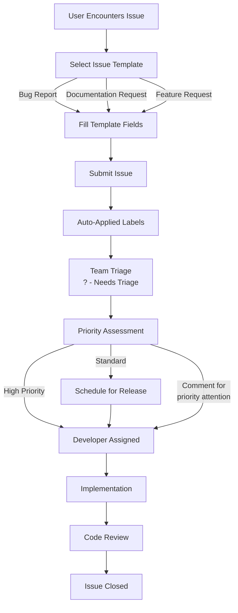
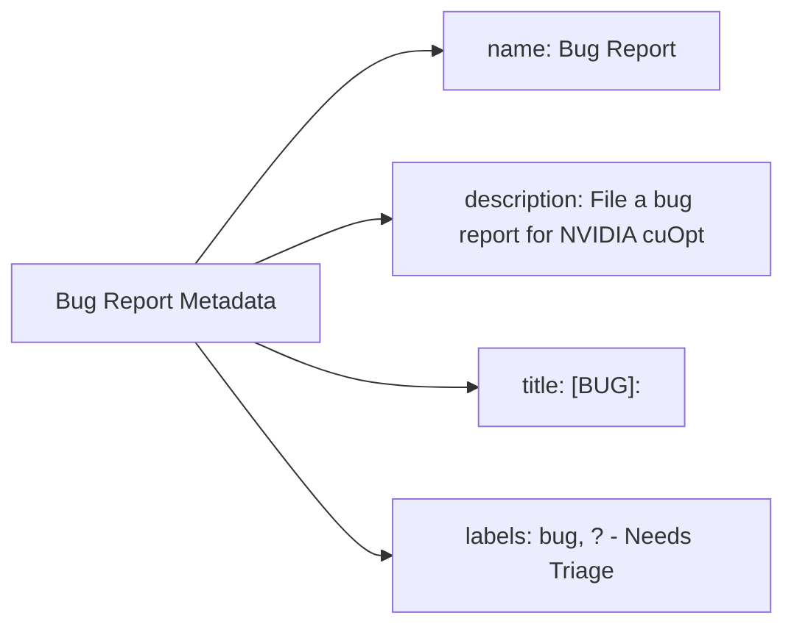
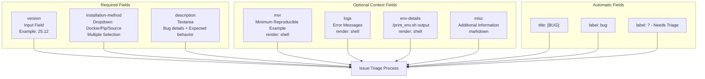
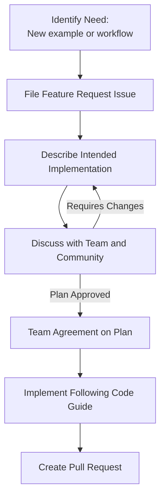

<!-- source: DeepWiki mcp.deepwiki.com · repo NVIDIA/cuopt-examples · page 13.4 Issue Templates and Bug Reporting · fetched 2026-10-26 -->

# Issue Templates and Bug Reporting

Relevant source files

The following files were used as context for generating this wiki page:

- [.github/ISSUE_TEMPLATE/bug_report.yml](.github/ISSUE_TEMPLATE/bug_report.yml)
- [.pre-commit-config.yaml](.pre-commit-config.yaml)
- [CONTRIBUTING.md](CONTRIBUTING.md)
- [LICENSE.md](LICENSE.md)
- [requirements.txt](requirements.txt)

## Purpose and Scope

This document describes the structured issue templates used in the `cuopt-examples` repository for reporting bugs, requesting documentation improvements, and proposing new features. These templates ensure consistent, actionable issue reports that help maintainers efficiently triage and address problems. 

For information about the pull request workflow after an issue is created, see [Contribution Workflow](#13.3). For code quality requirements when implementing fixes, see [Code Quality Standards](#13.2).

---

## Overview of Issue Templates

The repository provides structured issue types to standardize communication between users and maintainers. Each template collects specific information required for efficient issue resolution.

### Issue Template Types

| Template Type | File Path | Purpose | Primary Use Cases |
|--------------|-----------|---------|------------------|
| Bug Report | [.github/ISSUE_TEMPLATE/bug_report.yml:1-86]() | Report functional issues or unexpected behavior | Runtime errors, incorrect outputs, performance problems |
| Documentation Request | `.github/ISSUE_TEMPLATE/documentation-request.md` | Request documentation fixes or additions | Missing examples, unclear instructions, outdated information |
| Feature Request | Described in `CONTRIBUTING.md` | Propose new examples or workflows | New optimization scenarios, integration examples, workflow improvements |

**Sources:** [CONTRIBUTING.md:1-10](), [.github/ISSUE_TEMPLATE/bug_report.yml:1-86]()

---

## Issue Lifecycle and Triage Process

The issue lifecycle begins with template selection and proceeds through triage, priority assessment, and implementation. All issues receive the `? - Needs Triage` label initially. Users can comment on issues to request priority attention from the team.

**Issue Triage and Resolution Flow**

**Sources:** [CONTRIBUTING.md:5-6](), [.github/ISSUE_TEMPLATE/bug_report.yml:21]()

---

## Bug Report Template

The bug report template uses a YAML configuration to create a structured form. The template is located at [.github/ISSUE_TEMPLATE/bug_report.yml:1-86]().

### Template Metadata

The template automatically applies the `bug` and `? - Needs Triage` labels to all bug reports, and prefixes the title with `[BUG]: ` for easy identification.

**Bug Report Template Metadata Configuration**

**Sources:** [.github/ISSUE_TEMPLATE/bug_report.yml:18-21]()

### Required Fields

The bug report template requires three mandatory fields that must be completed before submission.

| Field ID | Label | Type | Validation | Purpose |
|----------|-------|------|------------|---------|
| `version` | Version | input | required: true | Identifies the cuOpt version exhibiting the bug |
| `installation-method` | Which installation method(s) does this occur on? | dropdown | multiple: true | Determines if bug is environment-specific |
| `description` | Describe the bug | textarea | required: true | Provides clear description of issue and expected behavior |

**Field Configuration Examples:**

*   **Version Field** [[.github/ISSUE_TEMPLATE/bug_report.yml:29-36]()]: Captures the release version (e.g., 22.12).
*   **Installation Method Field** [[.github/ISSUE_TEMPLATE/bug_report.yml:38-46]()]: Offers options for `Docker`, `Pip`, or `Source`.
*   **Description Field** [[.github/ISSUE_TEMPLATE/bug_report.yml:48-55]()]: Captures the discrepancy between observed and expected results.

**Sources:** [.github/ISSUE_TEMPLATE/bug_report.yml:29-55]()

### Optional Fields

The template provides four optional fields for detailed bug reports. While not required, these fields significantly improve issue resolution time.

| Field ID | Label | Render Format | Purpose |
|----------|-------|---------------|---------|
| `mvr` | Minimum reproducible example | shell | Code snippet demonstrating the bug |
| `logs` | Relevant log output | shell | Error messages and stack traces |
| `env-details` | Environment details | shell | Output from `./print_env.sh` script |
| `misc` | Other/Misc. | markdown | Additional context or observations |

**Environment Details** [[.github/ISSUE_TEMPLATE/bug_report.yml:71-79]()]:
Users are encouraged to run the `./print_env.sh` script. This script gathers critical hardware and software context such as GPU drivers and library versions.

**Sources:** [.github/ISSUE_TEMPLATE/bug_report.yml:57-86]()

---

## Bug Report Field Mapping

This diagram shows how bug report fields flow into the triage process. Required fields ensure basic reproducibility, optional fields provide debugging context, and automatic fields enable filtering and prioritization.

**Bug Report Template Field Structure and Data Flow**

**Sources:** [.github/ISSUE_TEMPLATE/bug_report.yml:18-86]()

---

## Feature Request Process

Feature requests do not have a dedicated YAML template but follow a structured process documented in `CONTRIBUTING.md`.

### Feature Request Workflow

Feature requests require community discussion before implementation. Users should describe the intended example or workflow and engage with the team to refine the design before beginning development.

**Feature Request Implementation Flow**

**Sources:** [CONTRIBUTING.md:7-9]()

---

## Best Practices for Issue Reporting

### Bug Report Best Practices

| Practice | Rationale | Implementation |
|----------|-----------|----------------|
| **Provide minimal reproducible examples** | Reduces debugging time | Strip down to essential code demonstrating the issue [[.github/ISSUE_TEMPLATE/bug_report.yml:61]()] |
| **Include version numbers** | Isolates version-specific issues | Report cuOpt version (e.g., 22.12) [[.github/ISSUE_TEMPLATE/bug_report.yml:34]()] |
| **Run print_env.sh** | Provides complete environment context | Execute script and paste full output [[.github/ISSUE_TEMPLATE/bug_report.yml:77]()] |

### Feature Request Best Practices

| Practice | Rationale | Implementation |
|----------|-----------|----------------|
| **Describe use case** | Demonstrates value | Explain real-world scenario requiring feature [[CONTRIBUTING.md:7]()] |
| **Engage in discussion** | Refines requirements | Respond to team questions and feedback [[CONTRIBUTING.md:7]()] |
| **Propose implementation** | Shows feasibility | Outline technical approach and complexity [[CONTRIBUTING.md:7]()] |

**Sources:** [CONTRIBUTING.md:1-10](), [.github/ISSUE_TEMPLATE/bug_report.yml:1-86]()

---

## Integration with Contribution Workflow

Issues created from templates integrate with the contribution workflow. After triage and assignment, developers fork the repository and implement fixes, linking their pull requests back to the originating issue for tracking.

**Issue to Pull Request Workflow Integration**

```mermaid
graph LR
    ISSUE_CREATE["Create Issue<br/>Using Template"]
    DISCUSSION["Team Discussion<br/>and Triage"]
    ASSIGNMENT["Issue Assigned"]
    FORK["Fork Repository"]
    IMPLEMENT["Implement Fix"]
    PRECOMMIT["Run pre-commit Hooks"]
    PR["Create Pull Request"]
    LINK["Link PR to Issue"]
    REVIEW["Code Review"]
    MERGE["Merge and Close Issue"]
    
    ISSUE_CREATE --> DISCUSSION
    DISCUSSION --> ASSIGNMENT
    ASSIGNMENT --> FORK
    FORK --> IMPLEMENT
    IMPLEMENT --> PRECOMMIT
    PRECOMMIT --> PR
    PR --> LINK
    LINK --> REVIEW
    REVIEW --> MERGE
```

**Sources:** [CONTRIBUTING.md:13-26]()

---

