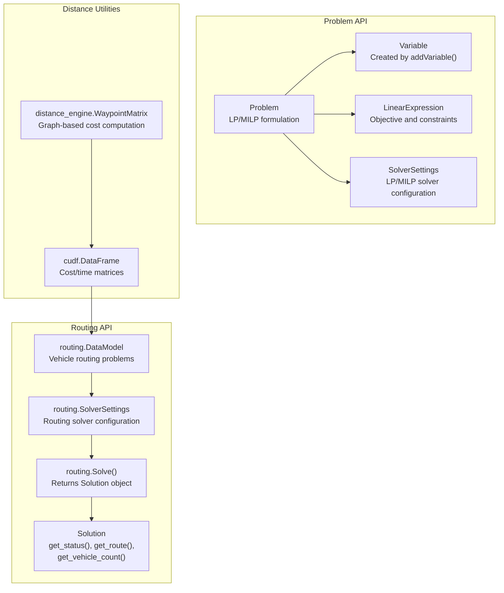
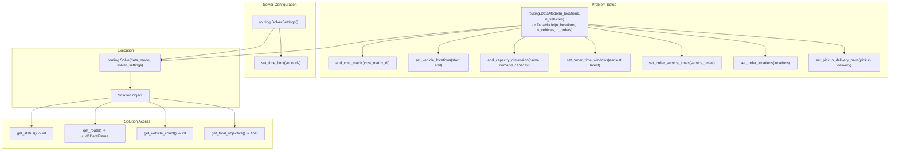
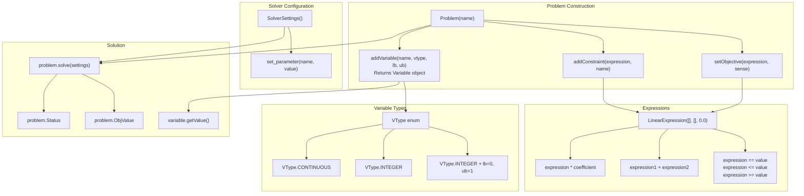
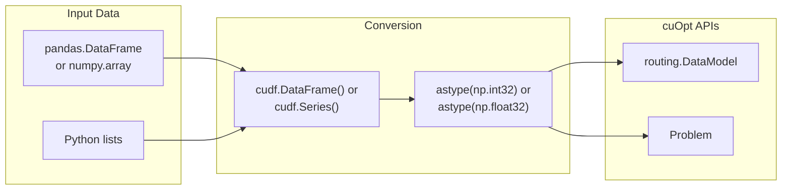
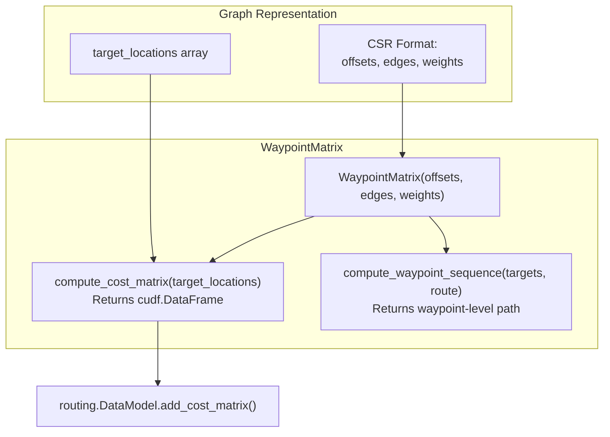

<!-- source: DeepWiki mcp.deepwiki.com · repo NVIDIA/cuopt-examples · page 14 Reference · fetched 2026-10-26 -->

# Reference

<details>
<summary>Relevant source files</summary>

The following files were used as context for generating this wiki page:

- [README.md](README.md)
- [VERSION](VERSION)
- [ci/release/update_version.sh](ci/release/update_version.sh)
- [intra-factory_transport/cost_matrix_and_waypoint_graph_creation.ipynb](intra-factory_transport/cost_matrix_and_waypoint_graph_creation.ipynb)
- [intra-factory_transport/intra-factory_transport.ipynb](intra-factory_transport/intra-factory_transport.ipynb)
- [last_mile_delivery/cvrp_daily_deliveries.ipynb](last_mile_delivery/cvrp_daily_deliveries.ipynb)
- [last_mile_delivery/cvrptw_benchmark_gehring_homberger.ipynb](last_mile_delivery/cvrptw_benchmark_gehring_homberger.ipynb)
- [last_mile_delivery/cvrptw_service_team_routing.ipynb](last_mile_delivery/cvrptw_service_team_routing.ipynb)
- [workforce_optimization/workforce_optimization_milp.ipynb](workforce_optimization/workforce_optimization_milp.ipynb)

</details>


This section provides technical reference documentation for the cuOpt API classes, methods, configuration options, and data structures. It serves as a detailed guide for developers working directly with cuOpt's Python SDK and covers both vehicle routing and mathematical programming APIs.

For application-specific examples and tutorials, see pages [Vehicle Routing Problems](#4) (Vehicle Routing Problems), [Portfolio Optimization](#5) (Portfolio Optimization), and [Linear and Mixed-Integer Programming](#6) (Linear and Mixed-Integer Programming). For service-based deployments, see page [Server-Based Architecture](#7) (Server-Based Architecture). For modeling language integrations, see page [Modeling Language Integrations](#8).

---

## API Architecture Overview

cuOpt provides two primary API surfaces for optimization: the **Routing API** for vehicle routing problems and the **Problem API** for general mathematical programming.

### High-Level API Structure

Actual implementation details for these classes can be found in the `cuopt.routing` and `cuopt.linear_programming` modules.

Titled: "cuOpt API Component Relationships"


**Sources:** [last_mile_delivery/cvrp_daily_deliveries.ipynb:485-488](), [workforce_optimization/workforce_optimization_milp.ipynb:103-112](), [intra-factory_transport/intra-factory_transport.ipynb:133-137]()

---

## Core API Classes by Domain

The following table maps problem types to their primary API classes:

| Problem Type | Primary Class | Solver Configuration | Solution Access |
|--------------|---------------|---------------------|-----------------|
| Vehicle Routing (CVRP, CVRPTW, CPDPTW) | `routing.DataModel` | `routing.SolverSettings` | `Solution.get_route()` |
| Linear Programming | `Problem` | `SolverSettings` | `Problem.ObjValue` |
| Mixed-Integer Programming | `Problem` with `VType.INTEGER` | `SolverSettings` | `Problem.Status` |
| Waypoint Graph Navigation | `distance_engine.WaypointMatrix` | N/A | `compute_cost_matrix()` |

**Sources:** [last_mile_delivery/cvrptw_service_team_routing.ipynb:530-540](), [workforce_optimization/workforce_optimization_milp.ipynb:203-221](), [intra-factory_transport/intra-factory_transport.ipynb:240-256]()

---

## Routing API Class Hierarchy

This diagram shows the key classes and methods in the routing API with their actual code signatures:

Titled: "Routing API Class and Method Map"


**Sources:** [last_mile_delivery/cvrp_daily_deliveries.ipynb:477-553](), [last_mile_delivery/cvrptw_service_team_routing.ipynb:530-618](), [intra-factory_transport/intra-factory_transport.ipynb:360-414]()

---

## Problem API Class Hierarchy

This diagram shows the mathematical programming API with actual method signatures:

Titled: "Linear Programming API Class and Method Map"


**Sources:** [workforce_optimization/workforce_optimization_milp.ipynb:203-246](), [workforce_optimization/workforce_optimization_milp.ipynb:283-314]()

---

## Data Types and Format Requirements

cuOpt requires specific data types for optimal GPU performance:

| Data Category | Required Type | Example Usage |
|---------------|---------------|---------------|
| Cost matrices | `cudf.DataFrame` with `np.float32` | [last_mile_delivery/cvrp_daily_deliveries.ipynb:433]() |
| Integer demands/capacities | `cudf.Series` with `np.int32` | [last_mile_delivery/cvrp_daily_deliveries.ipynb:461-464]() |
| Time windows | `cudf.Series` with `np.int32` | [last_mile_delivery/cvrptw_service_team_routing.ipynb:580-608]() |
| Location indices | `cudf.Series` (integer) | [last_mile_delivery/cvrptw_service_team_routing.ipynb:577]() |
| Variable bounds | `float` | [workforce_optimization/workforce_optimization_milp.ipynb:216]() |
| Objective coefficients | Numeric scalars | [workforce_optimization/workforce_optimization_milp.ipynb:232-235]() |

### Data Type Conversion Pattern

Titled: "Data Flow from Python to cuOpt"


**Sources:** [last_mile_delivery/cvrp_daily_deliveries.ipynb:433-434](), [last_mile_delivery/cvrptw_service_team_routing.ipynb:558-559]()

---

## Solution Status Codes

The `get_status()` method returns integer codes indicating solution quality:

| Status Code | Meaning | Next Steps |
|-------------|---------|------------|
| `0` | Success - optimal or feasible solution found | Access solution via `get_route()` or variable values |
| Non-zero | Failed to find solution | Check problem formulation, constraints, time limits |

Status checking pattern from examples:

```python
solution = routing.Solve(data_model, solver_settings)
if solution.get_status() == 0:  # Success
    print("Solution found")
    routes = solution.get_route()
else:
    print(f"Failed with status: {solution.get_status()}")
```

**Sources:** [last_mile_delivery/cvrp_daily_deliveries.ipynb:596-610](), [last_mile_delivery/cvrptw_benchmark_gehring_homberger.ipynb:452-459]()

---

## Common Configuration Patterns

### Time Limit Configuration

All solvers support time limits to control solution time vs. quality tradeoffs:

```python
# Routing API
solver_settings = routing.SolverSettings()
solver_settings.set_time_limit(60.0)  # 60 seconds

# Problem API  
settings = SolverSettings()
settings.set_parameter("time_limit", 60.0)
```

**Sources:** [last_mile_delivery/cvrp_daily_deliveries.ipynb:573-574](), [workforce_optimization/workforce_optimization_milp.ipynb:288-293]()

### Large-Scale Problem Configuration

For problems with 1000+ locations:

```python
# Longer time limits for better solutions
solver_settings = routing.SolverSettings()
solver_settings.set_time_limit(120.0)  # 2 minutes

# Cost matrix must use float32
cost_matrix_df = cudf.DataFrame(cost_matrix.astype(np.float32))
```

**Sources:** [last_mile_delivery/cvrptw_benchmark_gehring_homberger.ipynb:445-446](), [last_mile_delivery/cvrptw_benchmark_gehring_homberger.ipynb:299]()

---

## Detailed Reference Pages

For complete API documentation including all methods, parameters, and return types, see:

- **[Problem Class Reference](#14.1) Problem Class Reference** - Complete reference for `Problem`, `Variable`, and `LinearExpression` classes for LP/MILP formulation
- **[DataModel Class Reference](#14.2) DataModel Class Reference** - Complete reference for `routing.DataModel` including all constraint methods for vehicle routing
- **[Solution Object Reference](#14.3) Solution Object Reference** - Detailed documentation of solution access methods and status codes
- **[Configuration Parameters](#14.4) Configuration Parameters** - Comprehensive list of all `SolverSettings` parameters, EARLI configuration, and environment variables

---

## Quick Reference: Method Signatures

### Routing DataModel Methods

| Method | Parameters | Returns | Purpose |
|--------|------------|---------|---------|
| `DataModel()` | `n_locations: int, n_vehicles: int` | `DataModel` | Create routing problem |
| `add_cost_matrix()` | `cost_matrix: cudf.DataFrame` | `None` | Set travel costs |
| `set_vehicle_locations()` | `start: cudf.Series, end: cudf.Series` | `None` | Set depot locations |
| `add_capacity_dimension()` | `name: str, demand: cudf.Series, capacity: cudf.Series` | `None` | Add capacity constraints |
| `set_order_time_windows()` | `earliest: cudf.Series, latest: cudf.Series` | `None` | Set time windows |
| `set_order_service_times()` | `service_times: cudf.Series` | `None` | Set service durations |
| `set_pickup_delivery_pairs()` | `pickup: cudf.Series, delivery: cudf.Series` | `None` | Define PDP pairs |

**Sources:** [last_mile_delivery/cvrp_daily_deliveries.ipynb:485-553](), [intra-factory_transport/intra-factory_transport.ipynb:360-473]()

### Problem Class Methods

| Method | Parameters | Returns | Purpose |
|--------|------------|---------|---------|
| `Problem()` | `name: str` | `Problem` | Create LP/MILP problem |
| `addVariable()` | `name: str, vtype: VType, lb: float, ub: float` | `Variable` | Add decision variable |
| `setObjective()` | `expression: LinearExpression, sense: sense` | `None` | Set optimization goal |
| `addConstraint()` | `expression: LinearExpression, name: str` | `Constraint` | Add constraint |
| `solve()` | `settings: SolverSettings` | `None` | Solve problem |

**Sources:** [workforce_optimization/workforce_optimization_milp.ipynb:203-314]()

### Solution Object Methods

| Method | Parameters | Returns | Purpose |
|--------|------------|---------|---------|
| `get_status()` | None | `int` | Get solve status (0 = success) |
| `get_route()` | None | `cudf.DataFrame` | Get route details |
| `get_vehicle_count()` | None | `int` | Get vehicles used |
| `get_total_objective()` | None | `float` | Get objective value |

**Sources:** [last_mile_delivery/cvrp_daily_deliveries.ipynb:596-610]()

---

## Distance Utilities

### WaypointMatrix Class

For graph-based navigation in warehouses or factories:

Titled: "WaypointMatrix Data Processing"


**Sources:** [intra-factory_transport/intra-factory_transport.ipynb:240-256](), [intra-factory_transport/cost_matrix_and_waypoint_graph_creation.ipynb:336-409]()

### Graph Format Requirements

Waypoint graphs must be provided in Compressed Sparse Row (CSR) format:

- **offsets**: Array of length `n_nodes + 1` indicating edge ranges
- **edges**: Array of destination node indices
- **weights**: Array of edge costs/distances

Example from [intra-factory_transport/intra-factory_transport.ipynb:195-198]():

```python
offsets = np.array([0, 1, 3, 7, 9, 11, 13, 15, 17, 20, 22])
edges =   np.array([2, 2, 4, 0, 1, 3, 5, 2, 6, 1, 7, 2, 8, 3, 9, 4, 8, 5, 7, 9, 6, 8])
weights = np.array([2, 2, 2, 2, 2, 2, 2, 2, 2, 2, 1, 2, 1, 2, 1, 1, 2, 1, 2, 2, 1, 2])
```

**Sources:** [intra-factory_transport/cost_matrix_and_waypoint_graph_creation.ipynb:336-409]()

---

## Version Information

Current cuOpt version: `25.12.00`

Version information is tracked in [VERSION:1]() and synchronized across Docker images via [ci/release/update_version.sh:1-130]().

**Sources:** [VERSION:1](), [README.md:37-43]()

---

