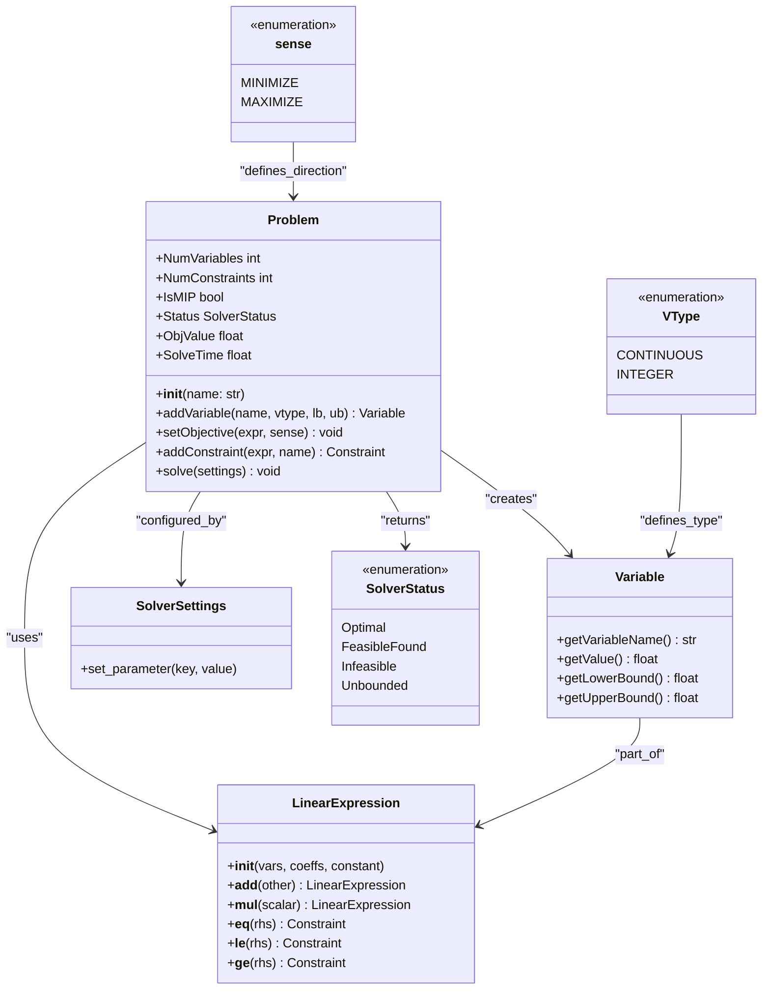
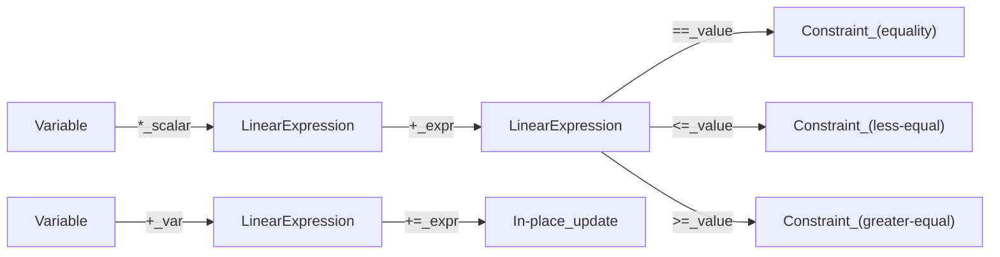
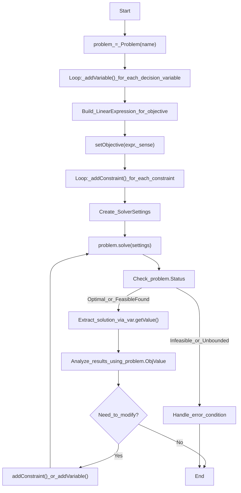
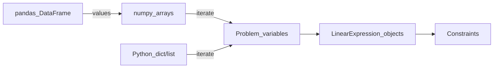

<!-- source: DeepWiki mcp.deepwiki.com · repo NVIDIA/cuopt-examples · page 14.1 Problem Class Reference · fetched 2026-10-26 -->

# Problem Class Reference

<details>
<summary>Relevant source files</summary>

The following files were used as context for generating this wiki page:

- [AI-accelerated-routing/initializing_cuopt_with_rl_solutions.ipynb](AI-accelerated-routing/initializing_cuopt_with_rl_solutions.ipynb)
- [AI-accelerated-routing/training_rl_agent_for_vrp.ipynb](AI-accelerated-routing/training_rl_agent_for_vrp.ipynb)
- [README.md](README.md)
- [VERSION](VERSION)
- [ci/release/update_version.sh](ci/release/update_version.sh)
- [diet_optimization/diet_optimization_lp.ipynb](diet_optimization/diet_optimization_lp.ipynb)
- [diet_optimization/diet_optimization_milp.ipynb](diet_optimization/diet_optimization_milp.ipynb)
- [portfolio_optimization/cvar_portfolio_optimization.ipynb](portfolio_optimization/cvar_portfolio_optimization.ipynb)
- [workforce_optimization/workforce_optimization_milp.ipynb](workforce_optimization/workforce_optimization_milp.ipynb)

</details>


This document provides complete API reference documentation for the `Problem` class and related constructs in the cuOpt Python SDK for mathematical programming. The `Problem` class is the primary interface for formulating and solving Linear Programming (LP) and Mixed Integer Linear Programming (MILP) problems using cuOpt's GPU-accelerated solver.

For vehicle routing problems, see [Routing DataModel API](#4.1). For server-based problem submission, see [DataModel API for Server](#7.3). For solver configuration, see [SolverSettings and Configuration](#3.2).

**Sources:** [workforce_optimization/workforce_optimization_milp.ipynb:1-18](), [diet_optimization/diet_optimization_lp.ipynb:1-18]()

---

## Problem Class Overview

The `Problem` class represents an optimization problem with variables, an objective function, and constraints. It provides methods to construct the problem incrementally and solve it using cuOpt's GPU-accelerated engine.

### Class Hierarchy and Dependencies



**Sources:** [workforce_optimization/workforce_optimization_milp.ipynb:109](), [portfolio_optimization/cvar_portfolio_optimization.ipynb:161-163]()

---

## Import Statement

```python
from cuopt.linear_programming.problem import Problem, VType, sense, LinearExpression
from cuopt.linear_programming.solver_settings import SolverSettings
```

**Sources:** [workforce_optimization/workforce_optimization_milp.ipynb:109-110](), [diet_optimization/diet_optimization_lp.ipynb:113-114]()

---

## Problem Constructor

### `Problem(name: str)`

Creates a new optimization problem instance.

| Parameter | Type | Description |
|-----------|------|-------------|
| `name` | `str` | Unique identifier for the problem, used in logging and diagnostics |

**Returns:** A new `Problem` object

**Example:**
```python
problem = Problem("workforce_optimization")
```

**Sources:** [workforce_optimization/workforce_optimization_milp.ipynb:209]()

---

## Variable Management

### `addVariable(name: str, vtype: VType, lb: float, ub: float) -> Variable`

Adds a decision variable to the problem.

| Parameter | Type | Description |
|-----------|------|-------------|
| `name` | `str` | Unique identifier for the variable |
| `vtype` | `VType` | Variable type: `VType.CONTINUOUS` or `VType.INTEGER` |
| `lb` | `float` | Lower bound for the variable (np.float32 compatible) |
| `ub` | `float` | Upper bound for the variable (np.float32 compatible) |

**Returns:** A `Variable` object that can be used in expressions

**Common Patterns:**

| Use Case | Variable Type | Bounds |
|----------|---------------|--------|
| Binary decision | `VType.INTEGER` | `lb=0.0, ub=1.0` |
| Non-negative continuous | `VType.CONTINUOUS` | `lb=0.0, ub=inf` |
| Signed continuous | `VType.CONTINUOUS` | `lb=-inf, ub=inf` |
| Integer count | `VType.INTEGER` | `lb=0.0, ub=max_count` |

**Example:**
```python
# Binary variable for assignment decision
x = problem.addVariable(name="worker_A_shift_1", vtype=VType.INTEGER, lb=0.0, ub=1.0)

# Continuous variable for allocation
y = problem.addVariable(name="resource_amount", vtype=VType.CONTINUOUS, lb=0.0, ub=100.0)
```

**Sources:** [workforce_optimization/workforce_optimization_milp.ipynb:216-217](), [diet_optimization/diet_optimization_lp.ipynb:225-231]()

---

## Variable Class Methods

Variables returned by `addVariable` support the following methods:

### `Variable.getVariableName() -> str`

Returns the name assigned to the variable.

### `Variable.getValue() -> float`

Returns the optimal value of the variable after solving. Should only be called after `solve()` completes successfully.

**Example:**
```python
if var.getValue() > 0.5:  # Check if binary variable is 1
    print(f"{var.getVariableName()} is selected")
```

**Sources:** [workforce_optimization/workforce_optimization_milp.ipynb:341]()

### `Variable.getLowerBound() -> float`

Returns the lower bound of the variable.

### `Variable.getUpperBound() -> float`

Returns the upper bound of the variable.

---

## Objective Function

### `setObjective(expr: LinearExpression, sense: sense) -> None`

Sets the objective function to minimize or maximize.

| Parameter | Type | Description |
|-----------|------|-------------|
| `expr` | `LinearExpression` | Linear combination of variables |
| `sense` | `sense` | `sense.MINIMIZE` or `sense.MAXIMIZE` |

**Example:**
```python
# Minimize total cost
objective = LinearExpression([], [], 0.0)
for var, cost in zip(variables, costs):
    objective += var * cost

problem.setObjective(objective, sense.MINIMIZE)
```

**Sources:** [workforce_optimization/workforce_optimization_milp.ipynb:230-238](), [diet_optimization/diet_optimization_lp.ipynb:244-249]()

---

## LinearExpression Class

The `LinearExpression` class represents linear combinations of variables. It supports operator overloading for intuitive problem formulation.

### Constructor

```python
LinearExpression(variables: List[Variable], coefficients: List[float], constant: float)
```

| Parameter | Type | Description |
|-----------|------|-------------|
| `variables` | `List[Variable]` | List of Variable objects |
| `coefficients` | `List[float]` | Corresponding coefficients (must match length of variables) |
| `constant` | `float` | Constant term in the expression |

**Empty Expression Pattern:**
```python
expr = LinearExpression([], [], 0.0)  # Start with zero
```

**Sources:** [workforce_optimization/workforce_optimization_milp.ipynb:230](), [diet_optimization/diet_optimization_lp.ipynb:244]()

### Operator Overloading



| Operation | Description | Example |
|-----------|-------------|---------|
| `var * coefficient` | Multiply variable by scalar | `x * 5.0` |
| `expr1 + expr2` | Add expressions | `expr1 + expr2` |
| `expr1 += expr2` | In-place addition | `total += var * cost` |
| `expr == value` | Equality constraint | `expr == 10.0` |
| `expr <= value` | Less-than-or-equal constraint | `expr <= 100.0` |
| `expr >= value` | Greater-than-or-equal constraint | `expr >= 5.0` |

**Example Usage Patterns:**

```python
# Pattern 1: Building expressions incrementally
total_cost = LinearExpression([], [], 0.0)
for var, cost in zip(variables, costs):
    if cost != 0:
        total_cost += var * cost

# Pattern 2: Creating expressions from summation
demand_expr = LinearExpression([], [], 0.0)
for assignment_var in shift_assignments:
    demand_expr += assignment_var
```

**Sources:** [workforce_optimization/workforce_optimization_milp.ipynb:232-235](), [diet_optimization/diet_optimization_lp.ipynb:246-248]()

---

## Constraint Management

### `addConstraint(constraint_expr, name: str = None) -> Constraint`

Adds a constraint to the problem.

| Parameter | Type | Description |
|-----------|------|-------------|
| `constraint_expr` | Comparison of `LinearExpression` | Expression with `==`, `<=`, or `>=` operator |
| `name` | `str` (optional) | Identifier for the constraint, used in diagnostics |

**Returns:** A `Constraint` object

**Constraint Types:**

| Type | Syntax | Description |
|------|--------|-------------|
| Equality | `expr == value` | Variable sum must equal exactly `value` |
| Less-than-or-equal | `expr <= value` | Variable sum cannot exceed `value` |
| Greater-than-or-equal | `expr >= value` | Variable sum must be at least `value` |

**Example:**
```python
# Equality constraint: exactly 3 workers per shift
shift_expr = LinearExpression([], [], 0.0)
for var in shift_workers:
    shift_expr += var
problem.addConstraint(shift_expr == 3, name="shift_Mon1")

# Upper bound constraint: at most 4 shifts per worker
worker_expr = LinearExpression([], [], 0.0)
for var in worker_shifts:
    worker_expr += var
problem.addConstraint(worker_expr <= 4, name="max_shifts_Amy")
```

**Sources:** [workforce_optimization/workforce_optimization_milp.ipynb:264](), [diet_optimization/diet_optimization_lp.ipynb:266-278]()

---

## Problem Solution

### `solve(settings: SolverSettings = None) -> None`

Solves the optimization problem using cuOpt's GPU-accelerated solver.

| Parameter | Type | Description |
|-----------|------|-------------|
| `settings` | `SolverSettings` (optional) | Solver configuration (time limits, logging, etc.) |

**Side Effects:**
- Updates `Status`, `ObjValue`, and `SolveTime` properties
- Computes optimal values for all variables (accessible via `Variable.getValue()`)

**Example:**
```python
settings = SolverSettings()
settings.set_parameter("time_limit", 60.0)
settings.set_parameter("log_to_console", True)

problem.solve(settings)
```

**Sources:** [workforce_optimization/workforce_optimization_milp.ipynb:289-309](), [diet_optimization/diet_optimization_lp.ipynb:301-307]()

---

## Problem Properties

After calling `solve()`, the following properties are available:

### Read-Only Properties

| Property | Type | Description |
|----------|------|-------------|
| `NumVariables` | `int` | Total number of decision variables in the problem |
| `NumConstraints` | `int` | Total number of constraints in the problem |
| `IsMIP` | `bool` | `True` if problem has integer variables, `False` for pure LP |
| `Status` | `SolverStatus` | Solution status (see status codes below) |
| `ObjValue` | `float` | Optimal objective function value |
| `SolveTime` | `float` | Total solve time in seconds |

**Example:**
```python
print(f"Problem type: {'MIP' if problem.IsMIP else 'LP'}")
print(f"Variables: {problem.NumVariables}, Constraints: {problem.NumConstraints}")
print(f"Solved in {problem.SolveTime:.3f} seconds")
print(f"Status: {problem.Status.name}, Objective: {problem.ObjValue:.2f}")
```

**Sources:** [workforce_optimization/workforce_optimization_milp.ipynb:305-313](), [diet_optimization/diet_optimization_lp.ipynb:309-317]()

---

## Solver Status Codes

The `Status` property returns one of the following values:

| Status | Meaning |
|--------|---------|
| `Optimal` | Optimal solution found (best possible solution) |
| `FeasibleFound` | Feasible solution found but may not be optimal (e.g., time limit reached) |
| `Infeasible` | No feasible solution exists (constraints are contradictory) |
| `Unbounded` | Problem is unbounded (objective can be improved infinitely) |

**Example:**
```python
if problem.Status.name == "Optimal" or problem.Status.name == "FeasibleFound":
    print(f"Solution found with objective value: {problem.ObjValue}")
else:
    print(f"No solution: {problem.Status.name}")
```

**Sources:** [workforce_optimization/workforce_optimization_milp.ipynb:333](), [diet_optimization/diet_optimization_lp.ipynb:337]()

---

## Complete Workflow Example

### Problem Formulation Flow



**Sources:** [workforce_optimization/workforce_optimization_milp.ipynb:209-372](), [diet_optimization/diet_optimization_lp.ipynb:223-345]()

### Code Example: Complete Workflow

```python
import numpy as np
from cuopt.linear_programming.problem import Problem, VType, sense, LinearExpression
from cuopt.linear_programming.solver_settings import SolverSettings

# 1. Create problem
problem = Problem("example_problem")

# 2. Add variables
x = problem.addVariable(name="x1", vtype=VType.CONTINUOUS, lb=0.0, ub=10.0)
y = problem.addVariable(name="x2", vtype=VType.INTEGER, lb=0.0, ub=1.0)

# 3. Set objective: minimize 3*x + 5*y
objective = LinearExpression([], [], 0.0)
objective += x * 3.0
objective += y * 5.0
problem.setObjective(objective, sense.MINIMIZE)

# 4. Add constraints
# Constraint 1: x + 2*y >= 4
constraint1 = LinearExpression([], [], 0.0)
constraint1 += x * 1.0
constraint1 += y * 2.0
problem.addConstraint(constraint1 >= 4.0, name="min_requirement")

# Constraint 2: x <= 8
constraint2 = LinearExpression([], [], 0.0)
constraint2 += x * 1.0
problem.addConstraint(constraint2 <= 8.0, name="max_x")

# 5. Solve
settings = SolverSettings()
settings.set_parameter("time_limit", 30.0)
settings.set_parameter("log_to_console", True)

print(f"Solving {problem.NumVariables} variables, {problem.NumConstraints} constraints...")
problem.solve(settings)

# 6. Extract solution
if problem.Status.name in ["Optimal", "FeasibleFound"]:
    print(f"Status: {problem.Status.name}")
    print(f"Objective: {problem.ObjValue:.2f}")
    print(f"x = {x.getValue():.2f}")
    print(f"y = {y.getValue():.2f}")
    print(f"Solve time: {problem.SolveTime:.3f}s")
else:
    print(f"Failed: {problem.Status.name}")
```

**Sources:** [workforce_optimization/workforce_optimization_milp.ipynb:209-313](), [diet_optimization/diet_optimization_lp.ipynb:223-317]()

---

## VType Enumeration

The `VType` enumeration specifies variable types:

| Value | Description | Use Cases |
|-------|-------------|-----------|
| `VType.CONTINUOUS` | Real-valued variables (floating point) | Quantities, percentages, allocations |
| `VType.INTEGER` | Integer-valued variables | Counts, binary decisions (with bounds 0-1) |

**Note:** Binary variables are modeled as `VType.INTEGER` with `lb=0.0, ub=1.0`.

**Sources:** [workforce_optimization/workforce_optimization_milp.ipynb:216](), [diet_optimization/diet_optimization_milp.ipynb:113]()

---

## sense Enumeration

The `sense` enumeration specifies optimization direction:

| Value | Description |
|-------|-------------|
| `sense.MINIMIZE` | Find minimum objective value (e.g., minimize cost) |
| `sense.MAXIMIZE` | Find maximum objective value (e.g., maximize profit) |

**Sources:** [workforce_optimization/workforce_optimization_milp.ipynb:238](), [diet_optimization/diet_optimization_lp.ipynb:249]()

---

## Incremental Problem Modification

The `Problem` class supports incremental modification after an initial solve. This is useful for:
- Adding new constraints based on initial results
- Performing sensitivity analysis
- Implementing iterative solution refinement

### Pattern: Adding Constraints After Initial Solve

```python
# Initial solve
problem.solve(settings)
initial_objective = problem.ObjValue

# Add new constraint
additional_constraint = LinearExpression([], [], 0.0)
for var in some_variables:
    additional_constraint += var
problem.addConstraint(additional_constraint <= max_value, name="new_limit")

# Re-solve with additional constraint
problem.solve(settings)
new_objective = problem.ObjValue

print(f"Objective changed from {initial_objective} to {new_objective}")
```

**Sources:** [workforce_optimization/workforce_optimization_milp.ipynb:419-456]()

---

## Type Requirements and Data Preparation

### Numeric Types

cuOpt requires specific numeric types for GPU compatibility:

| Python Type | Required Type | Usage |
|-------------|---------------|-------|
| Bounds (`lb`, `ub`) | `float` or `np.float32` | Variable bounds |
| Coefficients | `float` or `np.float32` | Expression coefficients |
| RHS values | `float` or `np.float32` | Constraint right-hand sides |

**Best Practice:** Use standard Python `float` types. cuOpt automatically handles type conversion.

### Data Structure Compatibility



**Sources:** [workforce_optimization/workforce_optimization_milp.ipynb:107-111](), [diet_optimization/diet_optimization_lp.ipynb:198-218]()

---

## Common Patterns and Idioms

### Pattern 1: Binary Assignment Variables

```python
# Create binary variables for assignment decisions
assignments = {}
for worker in workers:
    for shift in shifts:
        var = problem.addVariable(
            name=f"{worker}_{shift}",
            vtype=VType.INTEGER,
            lb=0.0,
            ub=1.0
        )
        assignments[(worker, shift)] = var
```

**Sources:** [workforce_optimization/workforce_optimization_milp.ipynb:212-217]()

### Pattern 2: Building Expressions with Non-Zero Coefficients

```python
# Efficiently build objective with sparse coefficients
objective = LinearExpression([], [], 0.0)
for var, cost in zip(variables, costs):
    if cost != 0:  # Skip zero coefficients for efficiency
        objective += var * cost
```

**Sources:** [workforce_optimization/workforce_optimization_milp.ipynb:232-235](), [diet_optimization/diet_optimization_lp.ipynb:246-248]()

---

## Performance Considerations

### Variable Ordering

Variables are internally indexed in the order they are added. For optimal performance:
- Add variables in logical groups
- Use consistent naming conventions
- Avoid excessive variable count (millions of variables may require special handling)

### Expression Construction

For best performance when building expressions:
- Use in-place operators (`+=`) when possible
- Skip zero coefficients in loops
- Pre-allocate variables before building expressions

**Sources:** [workforce_optimization/workforce_optimization_milp.ipynb:232-265](), [diet_optimization/diet_optimization_lp.ipynb:244-249]()

---

## Integration with SolverSettings

The `Problem.solve()` method accepts a `SolverSettings` object for configuration. Common parameters:

| Parameter | Type | Description |
|-----------|------|-------------|
| `"time_limit"` | `float` | Maximum solve time in seconds |
| `"log_to_console"` | `bool` | Enable solver output logging |
| `"method"` | `int` | Solver method selection |

**Example:**
```python
settings = SolverSettings()
settings.set_parameter("time_limit", 60.0)
settings.set_parameter("log_to_console", True)
```

**Sources:** [workforce_optimization/workforce_optimization_milp.ipynb:289-292](), [diet_optimization/diet_optimization_lp.ipynb:301-304]()

---

## Error Handling

### Checking Solution Status

Always check `problem.Status` before accessing solution values:

```python
if problem.Status.name == "Optimal":
    # Best possible solution found
    optimal_value = problem.ObjValue
    
elif problem.Status.name == "FeasibleFound":
    # Good solution found, but time limit may have prevented proving optimality
    feasible_value = problem.ObjValue
    print("Warning: Solution may not be optimal")
    
elif problem.Status.name == "Infeasible":
    # No solution exists - constraints are contradictory
    print("Error: Problem has no feasible solution")
```

**Sources:** [workforce_optimization/workforce_optimization_milp.ipynb:333](), [diet_optimization/diet_optimization_lp.ipynb:337]()

---

## Comparison to Other APIs

### Problem API vs. Routing DataModel

| Aspect | Problem API | Routing DataModel |
|--------|-------------|-------------------|
| Use case | General LP/MILP | Vehicle routing problems |
| Variable management | Manual via `addVariable()` | Automatic (routes, schedules) |
| Constraints | Manual via `addConstraint()` | Implicit (capacity, time windows) |
| Module | `cuopt.linear_programming.problem` | `cuopt.routing` |

**Sources:** [README.md:1-83](), [portfolio_optimization/cvar_portfolio_optimization.ipynb:161-163]()

---

