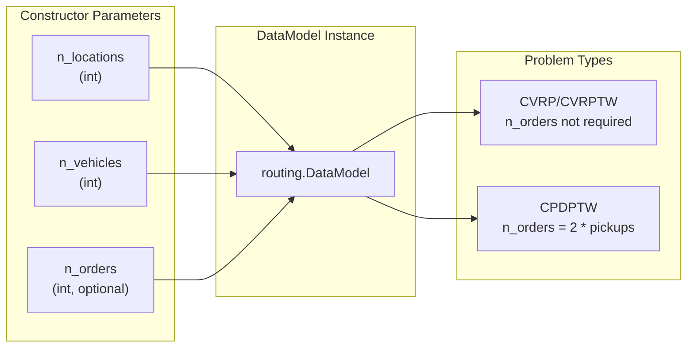
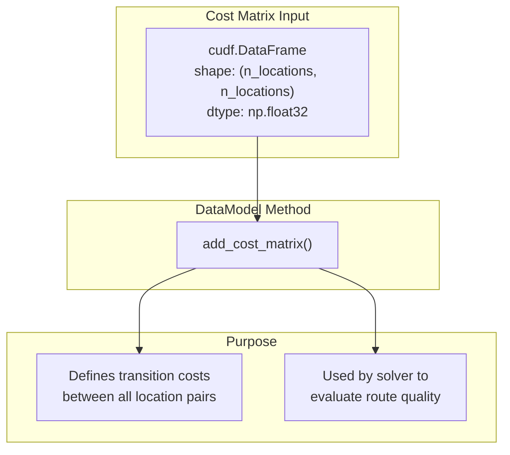
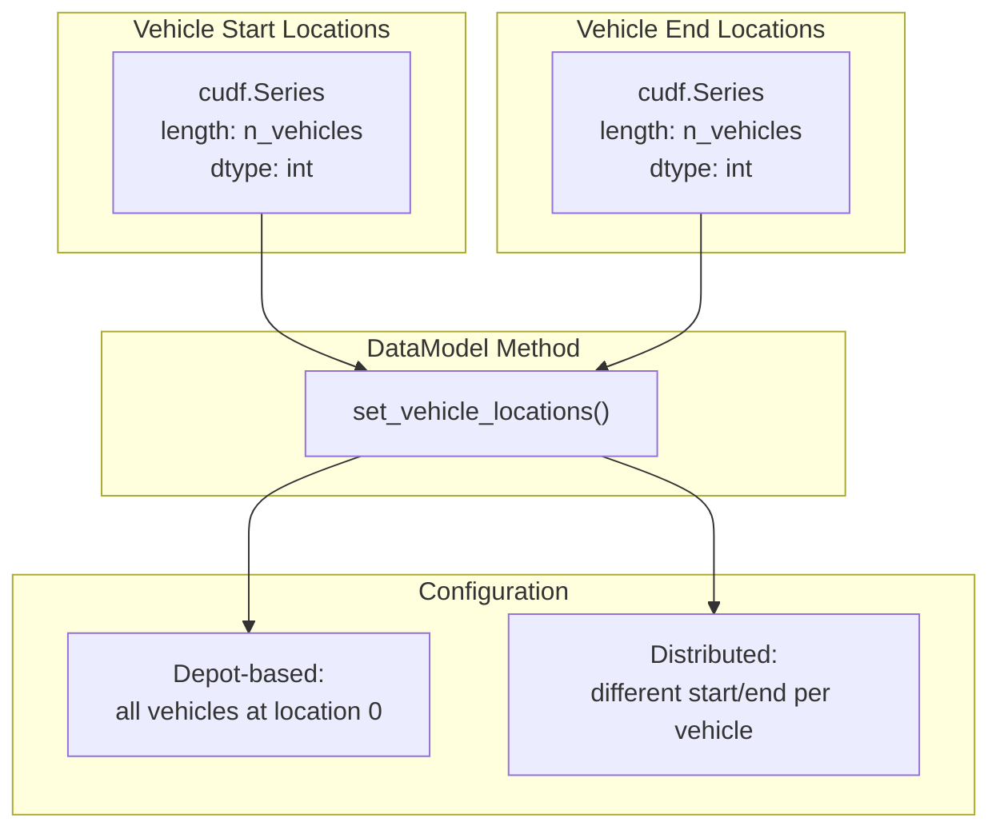
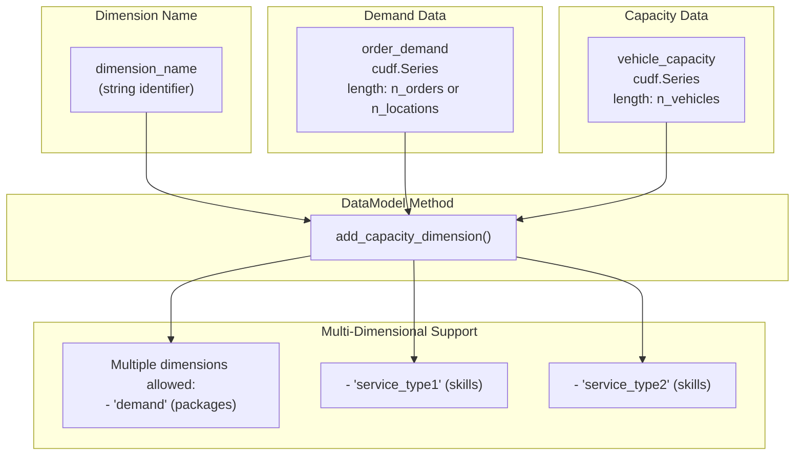
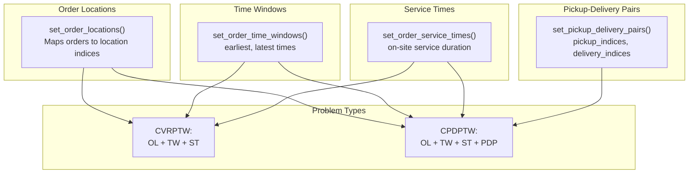
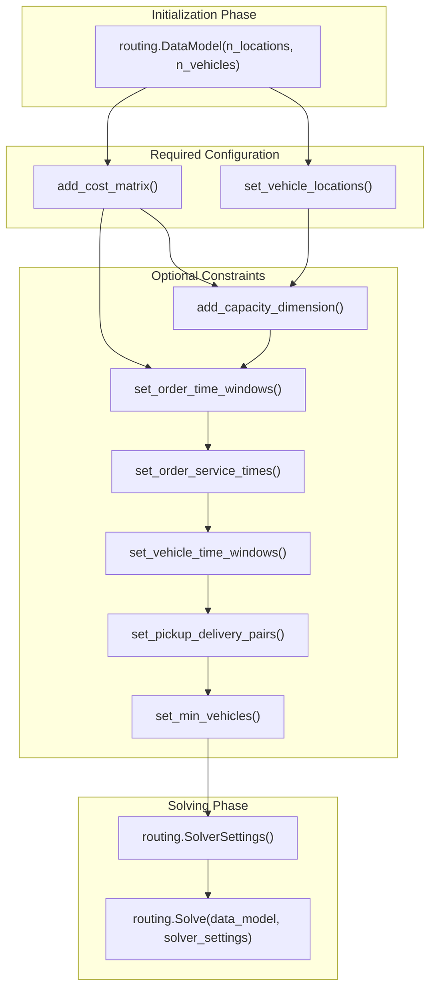
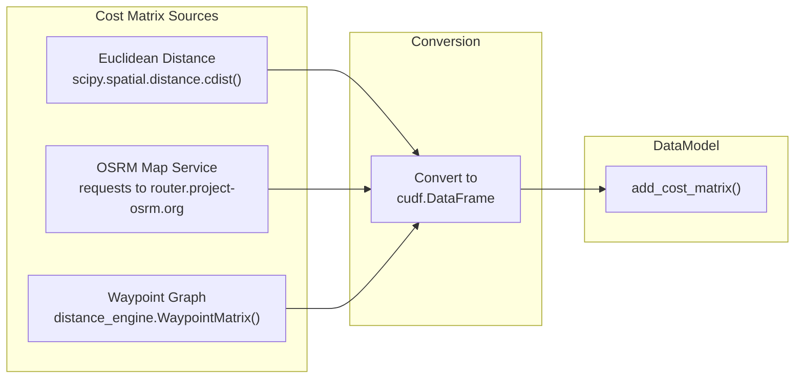

<!-- source: DeepWiki mcp.deepwiki.com · repo NVIDIA/cuopt-examples · page 14.2 DataModel Class Reference · fetched 2026-10-26 -->

# DataModel Class Reference

Relevant source files

The following files were used as context for generating this wiki page:

- [intra-factory_transport/cost_matrix_and_waypoint_graph_creation.ipynb](intra-factory_transport/cost_matrix_and_waypoint_graph_creation.ipynb)
- [intra-factory_transport/intra-factory_transport.ipynb](intra-factory_transport/intra-factory_transport.ipynb)
- [last_mile_delivery/cvrp_daily_deliveries.ipynb](last_mile_delivery/cvrp_daily_deliveries.ipynb)
- [last_mile_delivery/cvrptw_benchmark_gehring_homberger.ipynb](last_mile_delivery/cvrptw_benchmark_gehring_homberger.ipynb)
- [last_mile_delivery/cvrptw_service_team_routing.ipynb](last_mile_delivery/cvrptw_service_team_routing.ipynb)

This page provides a complete API reference for the `routing.DataModel` class, which is the primary interface for defining vehicle routing problems (VRP) in cuOpt. For information about using DataModel for linear programming problems in the server-based architecture, see [DataModel API for Server](). For conceptual understanding of the routing DataModel interface, see [Routing DataModel API]().

## Purpose and Scope

The `routing.DataModel` class encapsulates all problem data for vehicle routing optimization, including locations, vehicles, orders, capacity constraints, time windows, and cost matrices. It provides a structured interface for building CVRP, CVRPTW, and CPDPTW problem instances that are passed to the `routing.Solve()` function.

## Class Overview

The DataModel class is instantiated with problem dimensions and then populated with constraint data through configuration methods. All data is provided as cuDF Series or DataFrames to leverage GPU acceleration.

### Initialization

The DataModel constructor accepts problem dimensions that define the scale of the routing problem:

**Problem Initialization Logic**

**Constructor Signatures:**
- `DataModel(n_locations, n_vehicles)` - For basic routing problems where all locations are visited. [last_mile_delivery/cvrp_daily_deliveries.ipynb:487]()
- `DataModel(n_locations, n_vehicles, n_orders)` - For pickup-delivery problems where orders are a subset of locations. [intra-factory_transport/intra-factory_transport.ipynb:370]()

Sources: [last_mile_delivery/cvrp_daily_deliveries.ipynb:487](), [last_mile_delivery/cvrptw_service_team_routing.ipynb:539](), [intra-factory_transport/intra-factory_transport.ipynb:370]()

## Configuration Methods by Category

### Cost Matrix Configuration

**Cost Matrix Data Flow**

**Method:** `add_cost_matrix(cost_matrix)` [last_mile_delivery/cvrp_daily_deliveries.ipynb:508]()

**Parameters:**
- `cost_matrix`: `cudf.DataFrame` of shape `(n_locations, n_locations)` with dtype `np.float32`. [last_mile_delivery/cvrptw_benchmark_gehring_homberger.ipynb:318]()

**Description:** Sets the cost matrix representing the cost (distance, time, or other metric) of traveling between each pair of locations. When time windows are used, the cost matrix is typically assumed to represent time unless multiple cost matrices are provided.

Sources: [last_mile_delivery/cvrp_daily_deliveries.ipynb:508](), [last_mile_delivery/cvrptw_benchmark_gehring_homberger.ipynb:318](), [last_mile_delivery/cvrptw_service_team_routing.ipynb:559]()

### Vehicle Configuration

**Vehicle Constraints Setup**

**Method:** `set_vehicle_locations(start_locations, end_locations)` [last_mile_delivery/cvrp_daily_deliveries.ipynb:552]()

**Parameters:**
- `start_locations`: `cudf.Series` of length `n_vehicles` containing location indices where each vehicle begins.
- `end_locations`: `cudf.Series` of length `n_vehicles` containing location indices where each vehicle must end.

**Method:** `set_vehicle_time_windows(earliest_time, latest_time)` [last_mile_delivery/cvrptw_service_team_routing.ipynb:608]()

**Parameters:**
- `earliest_time`: `cudf.Series` of length `n_vehicles` with dtype `np.int32`.
- `latest_time`: `cudf.Series` of length `n_vehicles` with dtype `np.int32`.

**Method:** `set_min_vehicles(min_vehicles)` [last_mile_delivery/cvrp_daily_deliveries.ipynb:658]()

Sources: [last_mile_delivery/cvrp_daily_deliveries.ipynb:552](), [last_mile_delivery/cvrptw_benchmark_gehring_homberger.ipynb:339](), [last_mile_delivery/cvrptw_service_team_routing.ipynb:608](), [last_mile_delivery/cvrp_daily_deliveries.ipynb:658]()

### Capacity Dimensions

**Capacity Modeling**

**Method:** `add_capacity_dimension(name, demand, capacity)` [last_mile_delivery/cvrp_daily_deliveries.ipynb:529]()

**Parameters:**
- `name`: String identifier for this capacity dimension (e.g., "demand", "weight").
- `demand`: `cudf.Series` representing demand at each order/location, dtype `np.int32`.
- `capacity`: `cudf.Series` representing capacity for each vehicle, dtype `np.int32`.

Sources: [last_mile_delivery/cvrp_daily_deliveries.ipynb:529](), [last_mile_delivery/cvrptw_benchmark_gehring_homberger.ipynb:364](), [last_mile_delivery/cvrptw_service_team_routing.ipynb:613-617]()

### Order Configuration

**Order and Task Specification**

**Method:** `set_order_locations(location_indices)` [last_mile_delivery/cvrptw_service_team_routing.ipynb:578]()

**Method:** `set_order_time_windows(earliest_time, latest_time)` [last_mile_delivery/cvrptw_benchmark_gehring_homberger.ipynb:385]()

**Method:** `set_order_service_times(service_time)` [last_mile_delivery/cvrptw_benchmark_gehring_homberger.ipynb:389]()

**Method:** `set_pickup_delivery_pairs(pickup_order_indices, delivery_order_indices)` [intra-factory_transport/intra-factory_transport.ipynb:472]()

Sources: [last_mile_delivery/cvrptw_service_team_routing.ipynb:578](), [intra-factory_transport/intra-factory_transport.ipynb:448](), [last_mile_delivery/cvrptw_benchmark_gehring_homberger.ipynb:385](), [last_mile_delivery/cvrptw_service_team_routing.ipynb:583](), [last_mile_delivery/cvrptw_benchmark_gehring_homberger.ipynb:389](), [last_mile_delivery/cvrptw_service_team_routing.ipynb:587](), [intra-factory_transport/intra-factory_transport.ipynb:472]()

## Data Type Requirements

All numeric data passed to `DataModel` must conform to specific types for GPU compatibility:

| Data Category | Required Type | Notes |
|---------------|---------------|-------|
| Cost matrices | `cudf.DataFrame`, `np.float32` | Square matrix of size `(n_locations, n_locations)` |
| Location indices | `cudf.Series`, `int` | Integer values from 0 to `n_locations - 1` |
| Time values | `cudf.Series`, `np.int32` | Time windows, service times, availability |
| Demand values | `cudf.Series`, `np.int32` | Capacity dimensions |
| Capacity values | `cudf.Series`, `np.int32` | Vehicle capacities |

Sources: [last_mile_delivery/cvrp_daily_deliveries.ipynb:433-434, 461-465](), [last_mile_delivery/cvrptw_benchmark_gehring_homberger.ipynb:299-300]()

## Method Call Patterns

**Execution Pipeline**

Sources: [last_mile_delivery/cvrp_daily_deliveries.ipynb:487-574](), [last_mile_delivery/cvrptw_service_team_routing.ipynb:530-638](), [intra-factory_transport/intra-factory_transport.ipynb:360-538]()

## Integration with Cost Matrix Generation

The `DataModel` accepts cost matrices from multiple sources, including the `distance_engine` for waypoint graphs:

**Cost Matrix Source Abstraction**

Sources: [intra-factory_transport/intra-factory_transport.ipynb:246-256, 620-622](), [intra-factory_transport/cost_matrix_and_waypoint_graph_creation.ipynb:246-256]()

## See Also

- [Routing DataModel API]() - Conceptual overview and usage patterns.
- [SolverSettings and Configuration]() - Configuring solver behavior.
- [CVRP - Capacitated Vehicle Routing]() - Basic CVRP examples.
- [CVRPTW - Vehicle Routing with Time Windows]() - Time window examples.
- [CPDPTW - Pickup and Delivery with Time Windows]() - Pickup-delivery examples.
- [Solution Object Reference]() - Accessing solution data.

---

