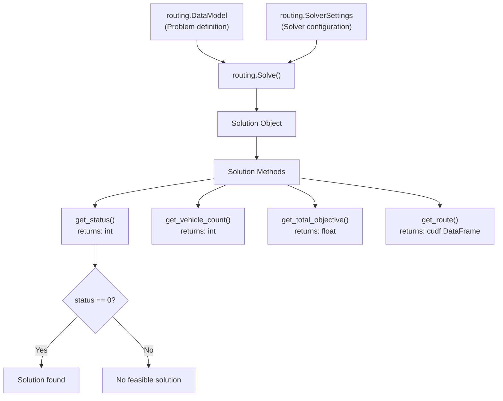
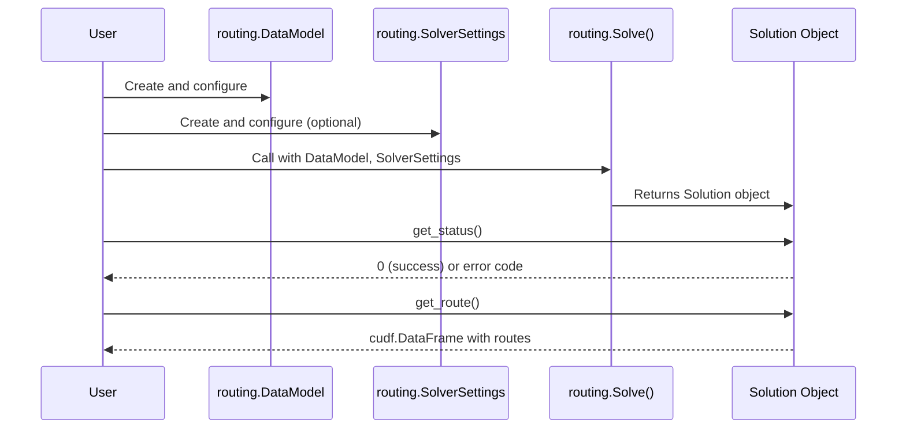
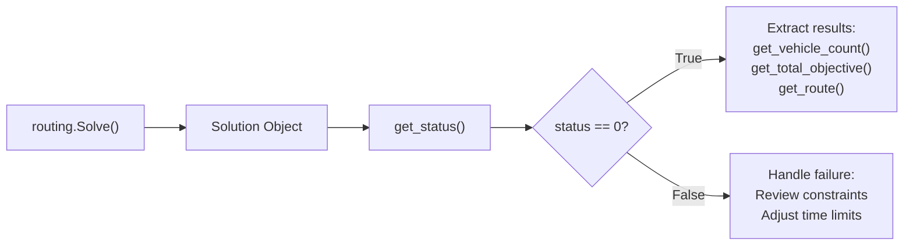
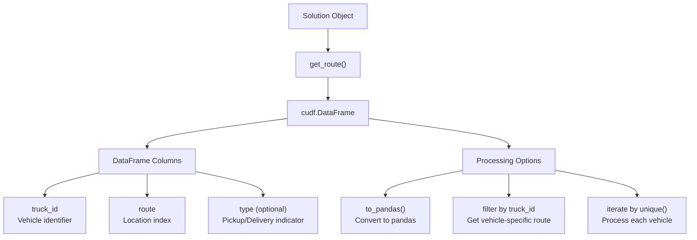
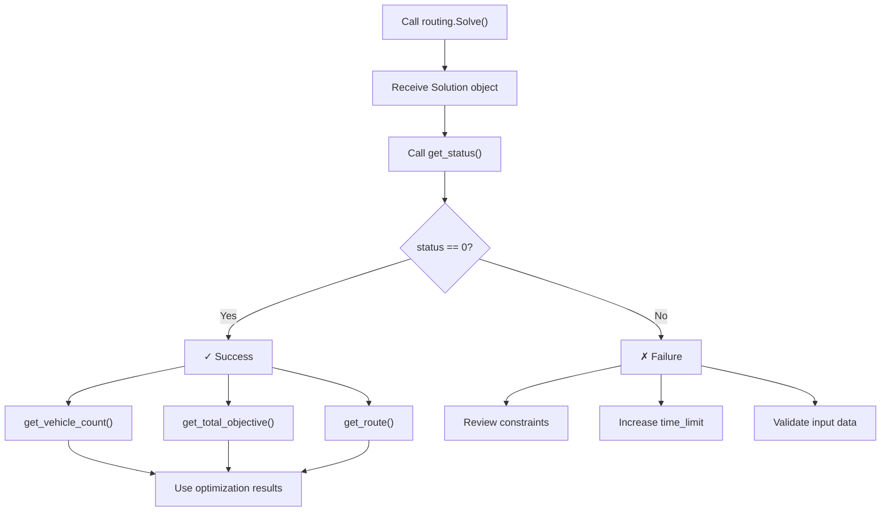
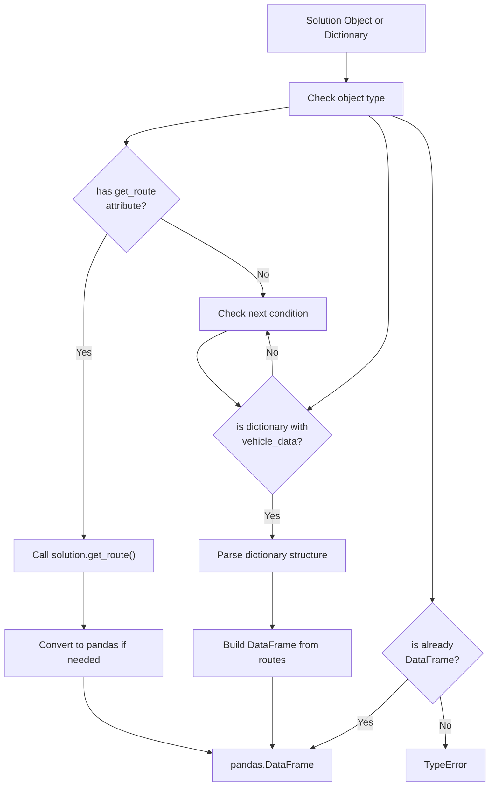
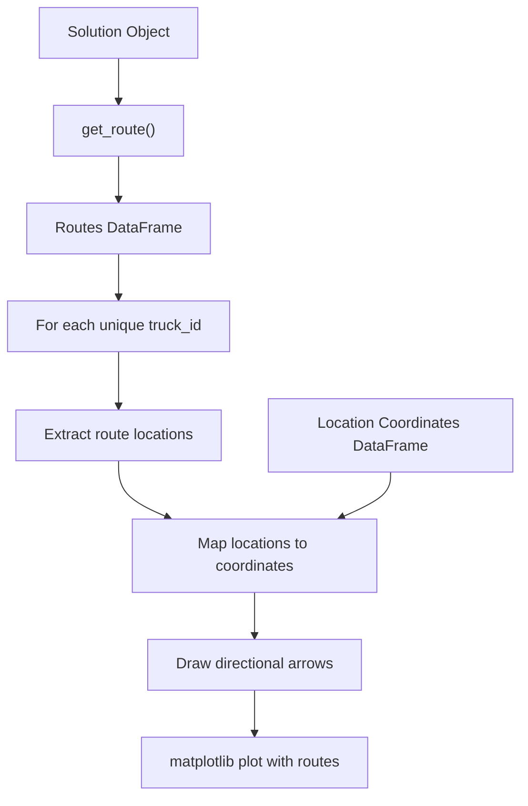
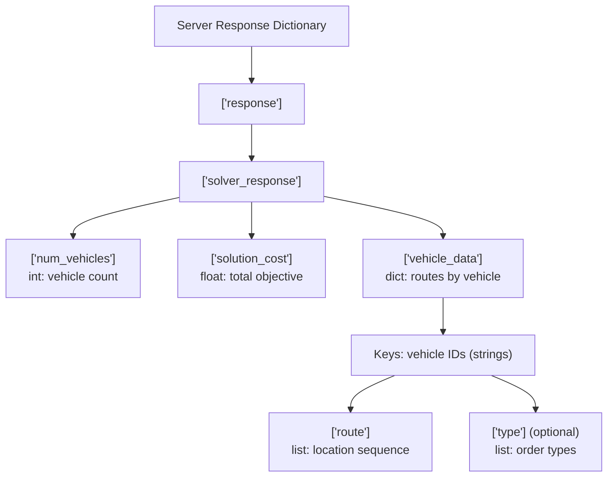
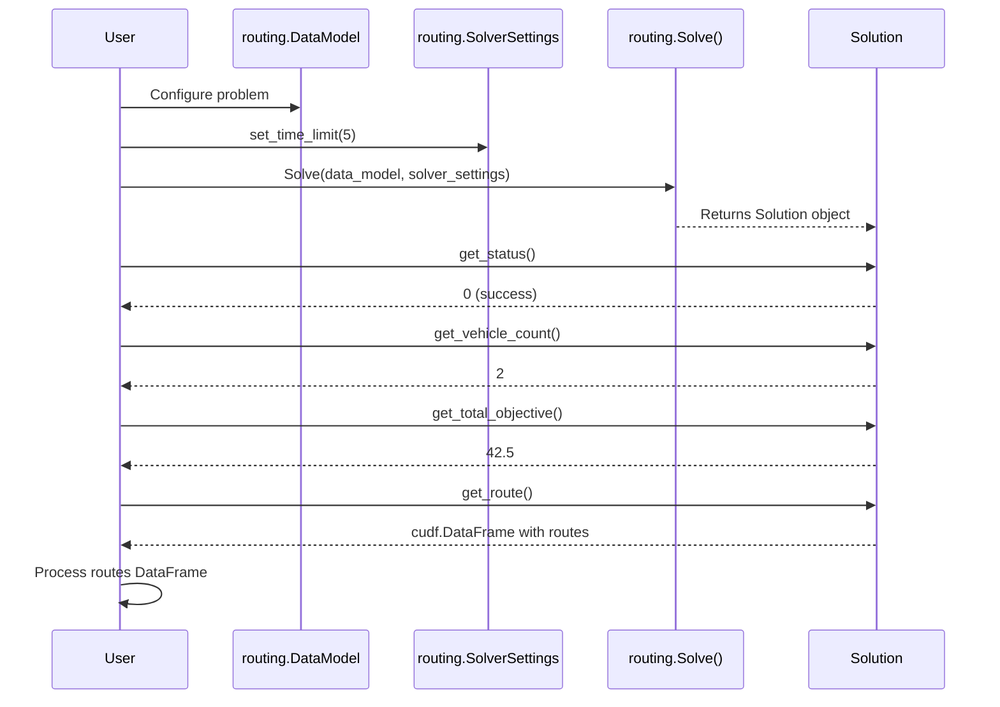

<!-- source: DeepWiki mcp.deepwiki.com · repo NVIDIA/cuopt-examples · page 14.3 Solution Object Reference · fetched 2026-10-26 -->

# Solution Object Reference

<details>
<summary>Relevant source files</summary>

The following files were used as context for generating this wiki page:

- [intra-factory_transport/cost_matrix_and_waypoint_graph_creation.ipynb](intra-factory_transport/cost_matrix_and_waypoint_graph_creation.ipynb)
- [intra-factory_transport/intra-factory_transport.ipynb](intra-factory_transport/intra-factory_transport.ipynb)
- [last_mile_delivery/cvrp_daily_deliveries.ipynb](last_mile_delivery/cvrp_daily_deliveries.ipynb)
- [last_mile_delivery/cvrptw_benchmark_gehring_homberger.ipynb](last_mile_delivery/cvrptw_benchmark_gehring_homberger.ipynb)
- [last_mile_delivery/cvrptw_service_team_routing.ipynb](last_mile_delivery/cvrptw_service_team_routing.ipynb)
- [routing_optimization_over_server/cvrptw_benchmark_gehring_homberger.ipynb](routing_optimization_over_server/cvrptw_benchmark_gehring_homberger.ipynb)
- [routing_optimization_over_server/cvrptw_service_team_routing.ipynb](routing_optimization_over_server/cvrptw_service_team_routing.ipynb)
- [sample_lp_sever_notebooks/linear-programming-with-datamodel.ipynb](sample_lp_sever_notebooks/linear-programming-with-datamodel.ipynb)
- [sample_lp_sever_notebooks/linear-programming.ipynb](sample_lp_sever_notebooks/linear-programming.ipynb)
- [sample_lp_sever_notebooks/mixed-integer-linear-programming-with-datamodel.ipynb](sample_lp_sever_notebooks/mixed-integer-linear-programming-with-datamodel.ipynb)
- [sample_lp_sever_notebooks/mixed-integer-linear-programming.ipynb](sample_lp_sever_notebooks/mixed-integer-linear-programming.ipynb)

</details>


This page documents the `Solution` object returned by cuOpt's routing solver, including its methods, status codes, and data structures. The Solution object provides access to optimized routes, objective values, and solution metadata.

For information about configuring solver behavior, see [SolverSettings and Configuration](#3.2). For details on the routing problem setup, see [Routing DataModel API](#4.1).

---

## Solution Object Overview

The `Solution` object is returned by `routing.Solve()` after solving a vehicle routing problem. It encapsulates the optimization results and provides methods to query solution status, objective values, vehicle usage, and detailed route information.

### Code Entity Relationship Diagram
The following diagram illustrates the relationship between the problem definition classes and the resulting `Solution` object.



**Sources:** [last_mile_delivery/cvrptw_benchmark_gehring_homberger.ipynb:449-460](), [last_mile_delivery/cvrp_daily_deliveries.ipynb:593-611]()

---

## Obtaining a Solution Object

### Direct SDK Usage

The Solution object is obtained by calling `routing.Solve()` with a configured `DataModel` and optional `SolverSettings`:

| Component | Type | Purpose |
|-----------|------|---------|
| `data_model` | `routing.DataModel` | Problem definition including locations, vehicles, constraints |
| `solver_settings` | `routing.SolverSettings` | Optional solver configuration (time limits, methods) |
| Return value | `Solution` | Object containing optimization results |

### Solver Execution Flow
This sequence diagram shows the interaction between the user code and the cuOpt routing components.



**Sources:** [last_mile_delivery/cvrp_daily_deliveries.ipynb:593-611](), [last_mile_delivery/cvrptw_service_team_routing.ipynb:656-669]()

---

## Core Methods

### get_status()

Returns the solver status code indicating whether a solution was found.

**Method Signature:**
```python
solution.get_status() -> int
```

**Return Values:**

| Status Code | Meaning | Action |
|-------------|---------|--------|
| `0` | Success - feasible solution found | Proceed to extract results |
| Non-zero | Failure - no feasible solution | Check problem constraints |

**Usage Pattern:**



**Sources:** [last_mile_delivery/cvrptw_benchmark_gehring_homberger.ipynb:452-459](), [last_mile_delivery/cvrp_daily_deliveries.ipynb:596-610]()

---

### get_vehicle_count()

Returns the number of vehicles used in the solution.

**Method Signature:**
```python
solution.get_vehicle_count() -> int
```

**Returns:** Integer count of vehicles utilized in the optimized routing plan.

**Note:** The returned count may be less than the number of vehicles available in the fleet if not all vehicles are needed to satisfy the routing requirements.

**Sources:** [last_mile_delivery/cvrptw_benchmark_gehring_homberger.ipynb:453](), [last_mile_delivery/cvrp_daily_deliveries.ipynb:598]()

---

### get_total_objective()

Returns the total objective function value for the solution.

**Method Signature:**
```python
solution.get_total_objective() -> float
```

**Returns:** Float value representing the total cost/objective. The interpretation depends on the cost matrix used:
- If cost matrix represents distance: total distance traveled
- If cost matrix represents time: total time required
- If cost matrix represents custom costs: sum of custom cost values

**Sources:** [last_mile_delivery/cvrptw_benchmark_gehring_homberger.ipynb:454](), [last_mile_delivery/cvrp_daily_deliveries.ipynb:597]()

---

### get_route()

Returns a DataFrame containing detailed route information for all vehicles.

**Method Signature:**
```python
solution.get_route() -> cudf.DataFrame
```

**Returns:** A `cudf.DataFrame` with the following structure:

| Column | Type | Description |
|--------|------|-------------|
| `truck_id` | int | Vehicle identifier (0-indexed) |
| `route` | int | Location index in the sequence |
| `type` | int | Optional: order type (pickup=1, delivery=2) for CPDPTW problems |

**Route DataFrame Structure:**



**Common Operations:**

The DataFrame can be converted to pandas for further processing:
```python
routes_df = solution.get_route()
pandas_df = routes_df.to_pandas()  # Convert to pandas if needed
```

Extract routes for a specific vehicle:
```python
vehicle_route = routes_df[routes_df['truck_id'] == vehicle_id]
locations = vehicle_route['route'].to_arrow().to_pylist()
```

Iterate over all vehicles:
```python
for vehicle_id in routes_df['truck_id'].unique():
    vehicle_route = routes_df[routes_df['truck_id'] == vehicle_id]
    # Process vehicle-specific route
```

**Sources:** [last_mile_delivery/cvrp_daily_deliveries.ipynb:600-608](), [last_mile_delivery/cvrptw_service_team_routing.ipynb:662-666](), [last_mile_delivery/cvrp_daily_deliveries.ipynb:268-310]()

---

## Status Codes

The `get_status()` method returns an integer code indicating the solver outcome.

| Status Code | Category | Description | Next Steps |
|-------------|----------|-------------|------------|
| `0` | Success | Feasible solution found and optimized | Extract and use results |
| Non-zero | Failure | No feasible solution exists or solver error | Review problem constraints, increase time limit, check data validity |

**Typical Status Check Pattern:**



**Sources:** [last_mile_delivery/cvrptw_benchmark_gehring_homberger.ipynb:452-459](), [last_mile_delivery/cvrp_daily_deliveries.ipynb:596-610]()

---

## Working with Route Data

### Converting Solution to DataFrame

The examples include utility functions for working with Solution objects across different API versions. These functions often normalize data from SDK objects or server dictionaries.



The conversion function handles multiple formats for backward compatibility with different API versions and server responses.

**Sources:** [last_mile_delivery/cvrp_daily_deliveries.ipynb:268-310](), [last_mile_delivery/cvrptw_service_team_routing.ipynb:269-311]()

---

### Displaying Vehicle Routes

Common pattern for printing human-readable route information:

```mermaid
graph LR
    Solution["Solution Object"]
    Solution --> get_route["get_route()"]
    get_route --> RoutesDF["Routes DataFrame"]
    RoutesDF --> unique["Get unique truck_ids"]
    unique --> Iterate["For each vehicle"]
    Iterate --> Filter["Filter by truck_id"]
    Filter --> ExtractLocs["Extract location indices"]
    ExtractLocs --> MapNames["Map to location names"]
    MapNames --> Format["Format as string path"]
    Format --> Print["Print route"]
```



This pattern iterates through each vehicle and extracts its sequential route as a list of location indices, which are then mapped to human-readable location names.

**Sources:** [last_mile_delivery/cvrp_daily_deliveries.ipynb:313-338](), [last_mile_delivery/cvrptw_service_team_routing.ipynb:314-339]()

---

### Visualizing Routes

The route DataFrame integrates with visualization utilities that overlay vehicle routes on maps:



Visualization functions combine the route sequence from the Solution object with geographic or layout coordinates to produce visual representations of the optimized routes.

**Sources:** [last_mile_delivery/cvrp_daily_deliveries.ipynb:341-381](), [last_mile_delivery/cvrptw_service_team_routing.ipynb:342-382]()

---

## Server API Response Format

When using the cuOpt server via `CuOptServiceSelfHostClient`, the response format differs from the direct SDK Solution object.

### Response Structure Comparison

| Aspect | SDK Solution Object | Server API Response |
|--------|-------------------|---------------------|
| Type | `Solution` object with methods | Dictionary with nested structure |
| Status | `solution.get_status()` | Access via response keys |
| Vehicle count | `solution.get_vehicle_count()` | `response["response"]["solver_response"]["num_vehicles"]` |
| Total cost | `solution.get_total_objective()` | `response["response"]["solver_response"]["solution_cost"]` |
| Routes | `solution.get_route()` returns DataFrame | `response["response"]["solver_response"]["vehicle_data"]` dict |

### Server Response Structure



### Server Response Access Pattern

```python
# Server API call using CuOptServiceSelfHostClient
solver_response = client.get_optimized_routes(cuopt_problem_data)

# Access response data from nested dictionary
solver_resp = solver_response["response"]["solver_response"]
num_vehicles = solver_resp["num_vehicles"]
solution_cost = solver_resp["solution_cost"]
vehicle_data = solver_resp["vehicle_data"]
```

The `vehicle_data` dictionary contains routes keyed by vehicle ID (as strings):
```python
{
    "0": {"route": [0, 1, 5, 0], "type": [0, 1, 2, 0]},
    "1": {"route": [0, 3, 4, 0], "type": [0, 1, 2, 0]}
}
```

**Sources:** [routing_optimization_over_server/cvrptw_benchmark_gehring_homberger.ipynb:517-523](), [routing_optimization_over_server/cvrptw_service_team_routing.ipynb:320-341]()

---

## Complete Usage Example

### SDK Example



**Typical workflow:**
1. Create and configure `DataModel` with problem data.
2. Optionally create `SolverSettings` to control solver behavior.
3. Call `routing.Solve(data_model, solver_settings)` to get `Solution` object.
4. Check `solution.get_status()` to verify success (status == 0).
5. Extract metrics: `get_vehicle_count()`, `get_total_objective()`.
6. Get detailed routes: `get_route()` returns DataFrame with `truck_id` and `route` columns.
7. Process routes for visualization, reporting, or execution.

**Sources:** [last_mile_delivery/cvrp_daily_deliveries.ipynb:593-623](), [last_mile_delivery/cvrptw_benchmark_gehring_homberger.ipynb:449-471](), [last_mile_delivery/cvrptw_service_team_routing.ipynb:656-669]()

---

## Summary

The `Solution` object provides a unified interface for accessing optimization results through four primary methods:

| Method | Return Type | Purpose |
|--------|-------------|---------|
| `get_status()` | `int` | Check if solution is feasible (0 = success) |
| `get_vehicle_count()` | `int` | Number of vehicles used in solution |
| `get_total_objective()` | `float` | Total cost/objective value |
| `get_route()` | `cudf.DataFrame` | Detailed route sequences per vehicle |

The route DataFrame contains `truck_id` and `route` columns, with an optional `type` column for pickup/delivery problems. Server API responses follow a different dictionary-based structure but provide equivalent information.

**Sources:** [last_mile_delivery/cvrptw_benchmark_gehring_homberger.ipynb:449-471](), [last_mile_delivery/cvrp_daily_deliveries.ipynb:593-623](), [routing_optimization_over_server/cvrptw_benchmark_gehring_homberger.ipynb:517-533]()

---

