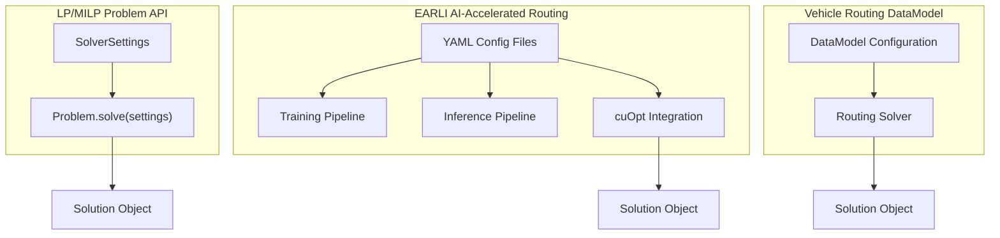
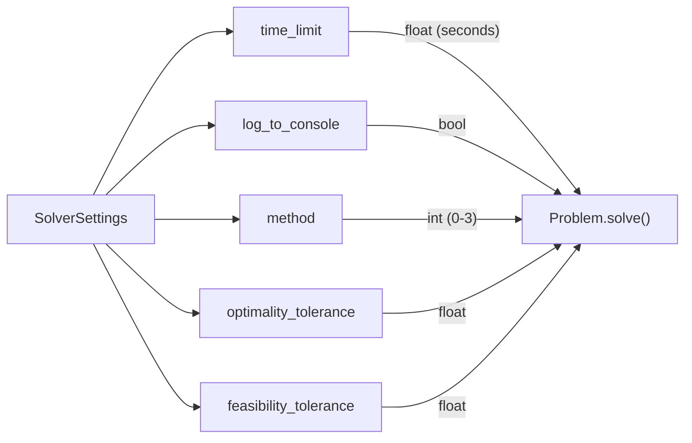
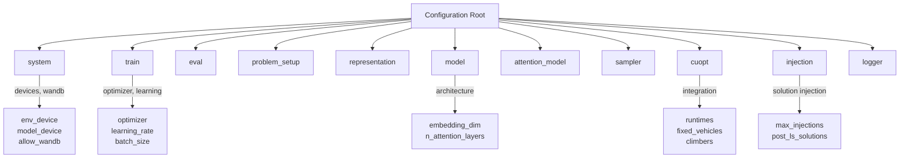
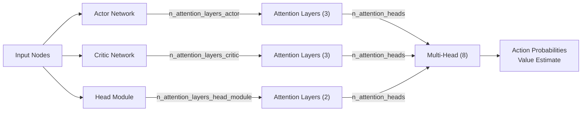
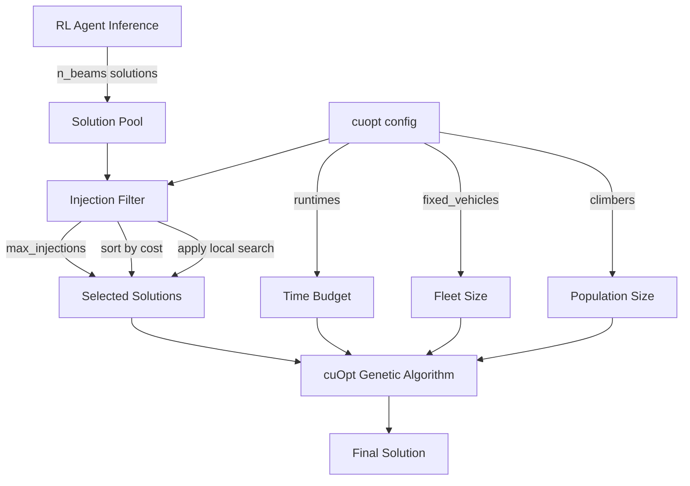

<!-- source: DeepWiki mcp.deepwiki.com · repo NVIDIA/cuopt-examples · page 14.4 Configuration Parameters · fetched 2026-10-26 -->

# Configuration Parameters

<details>
<summary>Relevant source files</summary>

The following files were used as context for generating this wiki page:

- [AI-accelerated-routing/README.md](AI-accelerated-routing/README.md)
- [AI-accelerated-routing/configs/config.yaml](AI-accelerated-routing/configs/config.yaml)
- [AI-accelerated-routing/configs/config_cuopt.yaml](AI-accelerated-routing/configs/config_cuopt.yaml)
- [AI-accelerated-routing/configs/config_initialization.yaml](AI-accelerated-routing/configs/config_initialization.yaml)
- [AI-accelerated-routing/configs/config_test.yaml](AI-accelerated-routing/configs/config_test.yaml)
- [AI-accelerated-routing/configs/config_train.yaml](AI-accelerated-routing/configs/config_train.yaml)
- [AI-accelerated-routing/constraints.txt](AI-accelerated-routing/constraints.txt)
- [AI-accelerated-routing/outputs/.gitkeep](AI-accelerated-routing/outputs/.gitkeep)
- [AI-accelerated-routing/photos/diagram.png](AI-accelerated-routing/photos/diagram.png)
- [AI-accelerated-routing/photos/sample_sp2rio_100_cuOpt_1s_85.png](AI-accelerated-routing/photos/sample_sp2rio_100_cuOpt_1s_85.png)
- [README.md](README.md)
- [VERSION](VERSION)
- [ci/release/update_version.sh](ci/release/update_version.sh)
- [workforce_optimization/workforce_optimization_milp.ipynb](workforce_optimization/workforce_optimization_milp.ipynb)

</details>


## Purpose and Scope

This page provides a comprehensive reference for all configuration parameters used throughout the cuOpt ecosystem. This includes:

- **SolverSettings parameters** for the Problem API (LP/MILP optimization).
- **EARLI configuration options** for AI-accelerated routing workflows.
- **DataModel configuration** for vehicle routing problems.

For information about the Problem API class itself, see [Problem Class Reference](#14.1). For DataModel methods and routing-specific configuration, see [DataModel Class Reference](#14.2). For interpreting solution outputs, see [Solution Object Reference](#14.3).

---

## Configuration System Overview

The cuOpt examples repository uses two primary configuration mechanisms:

Title: Configuration and Data Flow


**Sources:** [workforce_optimization/workforce_optimization_milp.ipynb:107-111](), [AI-accelerated-routing/configs/config.yaml:1-141]()

---

## SolverSettings Parameters

### Overview

The `SolverSettings` class configures solver behavior for LP and MILP problems solved via the `Problem` API.

Title: SolverSettings Parameter Mapping


**Sources:** [workforce_optimization/workforce_optimization_milp.ipynb:110-110](), [workforce_optimization/workforce_optimization_milp.ipynb:289-293]()

### Parameter Reference

| Parameter | Type | Default | Description |
|-----------|------|---------|-------------|
| `time_limit` | float | None | Maximum solve time in seconds. When reached, solver returns best solution found. |
| `log_to_console` | bool | False | Enable real-time solver logging to console output. |
| `method` | int | 0 | Solver algorithm selection: 0=auto, 1=primal simplex, 2=dual simplex, 3=barrier. |
| `optimality_tolerance` | float | 1e-6 | Convergence threshold for declaring optimality. |
| `feasibility_tolerance` | float | 1e-6 | Constraint violation threshold for declaring feasibility. |

### Usage Example

```python
from cuopt.linear_programming.solver_settings import SolverSettings

settings = SolverSettings()
settings.set_parameter("time_limit", 60.0)  # 60 second limit
settings.set_parameter("log_to_console", True)  # Show progress
settings.set_parameter("method", 0)  # Auto-select method

problem.solve(settings)
```

**Sources:** [workforce_optimization/workforce_optimization_milp.ipynb:110-110](), [workforce_optimization/workforce_optimization_milp.ipynb:288-294]()

### Method Selection Guide

| Method ID | Algorithm | Best For | Typical Use Case |
|-----------|-----------|----------|------------------|
| 0 | Auto | Unknown problem structure | Default - let solver choose |
| 1 | Primal Simplex | Few constraints, many variables | Production planning |
| 2 | Dual Simplex | Many constraints, few variables | Portfolio optimization |
| 3 | Barrier | Large-scale problems | Networks, transportation |

**Sources:** [workforce_optimization/workforce_optimization_milp.ipynb:289-293]()

---

## EARLI Configuration System

### Configuration File Structure

EARLI (Evolutionary Algorithm with RL Initialization) uses YAML configuration files organized into logical sections to control the hybrid RL-GA workflow.

Title: EARLI YAML Configuration Hierarchy


**Sources:** [AI-accelerated-routing/configs/config.yaml:1-141](), [AI-accelerated-routing/README.md:1-15]()

### Primary Configuration Files

| File | Purpose | Usage |
|------|---------|-------|
| `config.yaml` | Default configuration | Standard inference with pretrained model |
| `config_train.yaml` | Training configuration | RL agent training from scratch |
| `config_test.yaml` | Testing configuration | Model evaluation without cuOpt |
| `config_cuopt.yaml` | cuOpt integration | Baseline cuOpt performance testing |
| `config_initialization.yaml` | Solution injection | Hybrid RL + cuOpt optimization |

**Sources:** [AI-accelerated-routing/configs/config.yaml:1](), [AI-accelerated-routing/configs/config_train.yaml:1](), [AI-accelerated-routing/configs/config_test.yaml:1](), [AI-accelerated-routing/configs/config_cuopt.yaml:1](), [AI-accelerated-routing/configs/config_initialization.yaml:1]()

---

## System Configuration

Controls device placement, logging infrastructure, and experiment tracking.

### Parameters

| Parameter | Type | Values | Description |
|-----------|------|--------|-------------|
| `env_device` | string | cpu, cuda | Device for environment simulation |
| `model_device` | string | cpu, cuda | Device for neural network inference |
| `tree_device` | string | cpu, cuda | Device for beam search tree |
| `buffer_device` | string | cpu, cuda | Device for replay buffer storage |
| `save_obs_on_gpu` | bool | true, false | Keep observations in GPU memory |
| `use_tensordict` | bool | true, false | Use TensorDict for efficient batching |
| `allow_wandb` | bool | true, false | Enable Weights & Biases logging |
| `wandb_user` | string | - | W&B username |
| `wandb_project` | string | - | W&B project name |
| `run_name` | string | null, <name> | Custom run identifier |
| `compatibility_mode` | string | null, gym, stable_baselines | API compatibility layer |

**Sources:** [AI-accelerated-routing/configs/config.yaml:2-12](), [AI-accelerated-routing/configs/config_train.yaml:2-12]()

---

## Training Configuration

Parameters controlling the RL training loop.

### Core Training Parameters

| Parameter | Type | Default | Description |
|-----------|------|---------|-------------|
| `method` | string | tree_based | Training algorithm (tree_based for MCTS/KPPO) |
| `optimizer` | string | adam | Optimizer: adam, sgd, adamw |
| `seed` | int | 0 | Random seed for reproducibility |
| `deterministic_algo` | bool | True | Use deterministic GPU operations |
| `gamma` | float | 1 | Discount factor for returns |
| `epochs` | int | - | Number of training epochs (0 for inference only) |
| `batch_size` | int | 1024 | Minibatch size for gradient updates |
| `n_beams` | int | 8 | Beam width for beam search |
| `pretrained_fname` | string | null | Path to pretrained model checkpoint |
| `save_model_path` | string | - | Output path for trained model |
| `n_parallel_problems` | int | 256 | Number of problems processed in parallel |
| `learning_rate` | float | 3e-4 | Initial learning rate |

**Sources:** [AI-accelerated-routing/configs/config.yaml:14-28](), [AI-accelerated-routing/configs/config_train.yaml:14-33]()

### Pretrained Model Paths

| Model | Problem Size | Distance Metric | Path |
|-------|--------------|-----------------|------|
| VRP 100 L2 | 100 customers | Euclidean | `earli/pretrained_models/model_vrp_100_L2.m` |
| VRP 500 L2 | 500 customers | Euclidean | `earli/pretrained_models/model_vrp_500_L2.m` |
| VRP 100 São Paulo | 100 customers | Road network | `earli/pretrained_models/model_vrp_100_sp.m` |
| VRP 500 São Paulo | 500 customers | Road network | `earli/pretrained_models/model_vrp_500_sp.m` |

**Sources:** [AI-accelerated-routing/configs/config_train.yaml:26-29](), [AI-accelerated-routing/configs/config_test.yaml:25-28]()

---

## Evaluation Configuration

Parameters for model evaluation and testing.

| Parameter | Type | Description |
|-----------|------|-------------|
| `data_file` | string | Path to test problem instances (.pkl file) |
| `max_problems` | int/null | Limit number of problems evaluated (null = all) |
| `apply_local_search` | bool | Apply local search post-processing to solutions |
| `deterministic_test_beam` | bool | Use deterministic beam search during evaluation |
| `detailed_test_log` | bool | Save detailed logs of beam search process |
| `save_full_tree` | bool | Save complete search tree (large memory usage) |
| `naive_greedy` | bool | Include naive greedy baseline in evaluation |

**Sources:** [AI-accelerated-routing/configs/config.yaml:30-40](), [AI-accelerated-routing/configs/config_test.yaml:34-45]()

---

## Problem Setup Configuration

Defines the VRP problem structure and constraints.

### Parameters

| Parameter | Type | Default | Description |
|-----------|------|---------|-------------|
| `env` | string | vrp | Problem type (vrp = Vehicle Routing Problem) |
| `problem_range` | list/null | null | [start, end] indices to load subset of problems |
| `minimize_vehicles` | bool | True | Objective includes minimizing fleet size |
| `last_return_to_depot` | bool | True | Require vehicles to return to depot |
| `distance_Lp_norm` | int | 2 | Distance metric (1=Manhattan, 2=Euclidean) |
| `vehicle_penalty` | float | 0 | Cost penalty per vehicle used |
| `unused_capacity_penalty` | float | 0 | Penalty for unused vehicle capacity |
| `spare_numeric_capacity` | float | 0.1 | Numerical tolerance for capacity constraints |
| `single_site_visit` | bool | True | Each customer visited exactly once |

**Sources:** [AI-accelerated-routing/configs/config.yaml:42-56](), [AI-accelerated-routing/configs/config_train.yaml:48-57]()

---

## Representation Configuration

Controls input representation and normalization for the neural network.

| Parameter | Type | Default | Description |
|-----------|------|---------|-------------|
| `input_repr` | string | Graph | Input representation type |
| `k_connectivity` | int | 8 | Number of nearest neighbors in graph |
| `self_loops` | bool | True | Include self-connections in graph |
| `normalize` | bool | True | Normalize input features |
| `normalize_pos_obs_like_reward` | bool | True | Position-based normalization |
| `normalize_reward_by_problem_size` | bool | False | Scale rewards by problem size |
| `add_distance_to_head` | bool | True | Include distance to current vehicle location |

**Note:** Setting both `normalize_pos_obs_like_reward` and `normalize_reward_by_problem_size` to True is not recommended as it empirically degrades performance.

**Sources:** [AI-accelerated-routing/configs/config.yaml:58-68](), [AI-accelerated-routing/configs/config_train.yaml:63-69]()

---

## Model Architecture Configuration

### Core Model Parameters

| Parameter | Type | Default | Description |
|-----------|------|---------|-------------|
| `model_type` | string | attention | Neural network architecture type |
| `head_model_type` | string | attention | Vehicle head selection model type |
| `embedding_dim` | int | 128 | Dimension of node embeddings |
| `use_pair_norm` | bool | True | Apply PairNorm for stable training |
| `use_batch_norm` | bool | False | Apply batch normalization |
| `num_intermediate_features` | int | 64 | Hidden layer dimensions |
| `use_bias` | bool | True | Use bias terms in linear layers |
| `agg_type` | string | sum | Graph aggregation: sum, mean, max |
| `edge_model_layers` | int | 1 | Number of edge update layers |
| `attention` | bool | True | Use attention mechanism |
| `lazy` | bool | True | Lazy initialization for efficiency |

**Sources:** [AI-accelerated-routing/configs/config.yaml:70-93](), [AI-accelerated-routing/configs/config_train.yaml:75-93]()

---

## Attention Model Configuration

Detailed configuration for attention-based architectures.

Title: Attention Model Architecture Parameters


### Parameters

| Parameter | Type | Default | Description |
|-----------|------|---------|-------------|
| `layer_normalization` | string | batch | Normalization type: batch, layer, none |
| `n_attention_layers_actor` | int | 3 | Depth of actor network |
| `n_attention_layers_critic` | int | 3 | Depth of critic network |
| `n_attention_layers_head_module` | int | 2 | Depth of head selection network |
| `n_attention_heads` | int | 8 | Number of parallel attention heads |
| `reweight_by_distance` | bool | False | Distance-weighted attention |
| `reweight_function` | string | exponential | Weighting function: exponential, linear |
| `use_basic_head_encoding` | bool | True | Simplified head encoding |
| `separate_head_and_action_model` | bool | False | Separate networks for head/action |
| `num_head_encoder_layers` | int | 2 | Head encoder depth |

**Sources:** [AI-accelerated-routing/configs/config.yaml:95-105](), [AI-accelerated-routing/configs/config_train.yaml:95-105]()

---

## cuOpt Integration Configuration

Parameters for integrating EARLI with cuOpt's genetic algorithm solver.

Title: RL Solution Injection Flow


### Core Parameters

| Parameter | Type | Default | Description |
|-----------|------|---------|-------------|
| `use_cuopt` | bool | False | Enable cuOpt integration |
| `runtimes` | list[float] | [1.0] | Time budgets in seconds (can specify multiple) |
| `climbers` | int | 2048 | Population size for genetic algorithm |
| `fixed_vehicles` | bool | True | Use fixed number of vehicles from problem |
| `spare_vehicles` | int | 0 | Additional vehicles beyond problem minimum |
| `use_reference_for_num_vehicles` | bool | False | Use reference solution for fleet size |
| `normalization` | float/null | null | Distance normalization factor |
| `pull_freq` | int | 0 | Frequency of pulling solutions from GA |
| `repetitions` | int | 1 | Number of independent runs per problem |

**Sources:** [AI-accelerated-routing/configs/config.yaml:131-133](), [AI-accelerated-routing/configs/config_cuopt.yaml:41-49](), [AI-accelerated-routing/configs/config_initialization.yaml:40-48]()

---

## Solution Injection Configuration

Controls how RL-generated solutions are injected into cuOpt's initial population.

### Parameters

| Parameter | Type | Default | Description |
|-----------|------|---------|-------------|
| `max_injections` | int/list/null | null | Maximum solutions to inject (null = all) |
| `can_choose_injections` | bool | False | Sort before filtering to best k solutions |
| `post_ls_solutions` | int | 1 | Apply local search: 0=never, 1=RL only, 2=both |
| `both_rl_and_naive` | int | 0 | Mix RL and naive: 0=RL only, 1=naive if needed, 2=both |
| `avoid_suboptimal` | bool | True | Filter out inferior solutions |
| `sort` | string | cost | Sorting criterion: rand, cost, diversity |
| `n_naives` | int | 1 | Number of naive greedy solutions to include |
| `use_greedy` | bool | True | Include greedy construction heuristic |
| `rl_runtime` | float/null | null | RL inference time (subtracted from cuOpt budget) |
| `naive_runtime` | float/null | null | Naive heuristic time (subtracted from budget) |

**Sources:** [AI-accelerated-routing/configs/config_initialization.yaml:50-61](), [AI-accelerated-routing/configs/config_cuopt.yaml:51-61]()

---

## Path Configuration

File paths for input data and output results (EARLI-specific).

| Parameter | Type | Description |
|-----------|------|-------------|
| `problems` | string | Path to problem instances (.pkl file) |
| `solutions` | string/null | Path to saved solutions file |
| `solutions_source` | string/null | Weights & Biases run ID for solutions |
| `out_summary` | string | Output filename for results summary |

### Dataset File Format

Problem files should be pickled dictionaries with the following structure:

| Key | Type | Shape | Description |
|-----|------|-------|-------------|
| `positions` | numpy.ndarray | (n_problems, problem_size, 2) | Customer coordinates |
| `distance_matrix` | numpy.ndarray | (n_problems, problem_size, problem_size) | Pairwise distances |
| `demands` | numpy.ndarray | (n_problems, problem_size) | Customer demands |
| `capacities` | numpy.ndarray | (n_problems,) | Vehicle capacities |

**Sources:** [AI-accelerated-routing/configs/config_initialization.yaml:24-32](), [AI-accelerated-routing/README.md:42-46]()

---

## MuZero-Style Tree Search Configuration

Advanced tree search parameters used during training.

| Parameter | Type | Default | Description |
|-----------|------|---------|-------------|
| `expansion_method` | string | KPPO | Expansion algorithm: KPPO, UCT |
| `deterministic_branch_in_k_beams` | bool | True | Deterministic branching in beam search |
| `loss_type` | string | ppo | Training loss: ppo, reinforce, a2c |
| `max_leaves` | int | 10 | Maximum leaf nodes in search tree |
| `data_steps_per_epoch` | int | 256 | Steps collected per training epoch |
| `hash_states` | bool | True | Use state hashing to avoid duplicates |
| `max_moves` | int | 5000 | Maximum moves per episode |

**Sources:** [AI-accelerated-routing/configs/config.yaml:111-119](), [AI-accelerated-routing/configs/config_train.yaml:117-125]()

---

