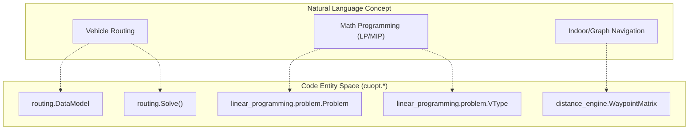
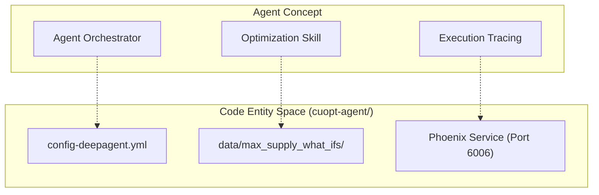

<!-- source: DeepWiki mcp.deepwiki.com · repo NVIDIA/cuopt-examples · page 15 Glossary · fetched 2026-10-26 -->

# Glossary

Relevant source files

The following files were used as context for generating this wiki page:

- [AI-accelerated-routing/initializing_cuopt_with_rl_solutions.ipynb](AI-accelerated-routing/initializing_cuopt_with_rl_solutions.ipynb)
- [AI-accelerated-routing/training_rl_agent_for_vrp.ipynb](AI-accelerated-routing/training_rl_agent_for_vrp.ipynb)
- [README.md](README.md)
- [VERSION](VERSION)
- [ci/release/update_version.sh](ci/release/update_version.sh)
- [cuopt-agent/.env.example](cuopt-agent/.env.example)
- [cuopt-agent/AGENTS.md](cuopt-agent/AGENTS.md)
- [cuopt-agent/README.md](cuopt-agent/README.md)
- [cuopt-agent/cuopt_agent/configs/config-deepagent-eval.yml](cuopt-agent/cuopt_agent/configs/config-deepagent-eval.yml)
- [cuopt-agent/cuopt_agent/configs/config-deepagent.yml](cuopt-agent/cuopt_agent/configs/config-deepagent.yml)
- [cuopt-agent/cuopt_agent/data/max_supply_what_ifs/eval/max_supply_what_ifs.csv](cuopt-agent/cuopt_agent/data/max_supply_what_ifs/eval/max_supply_what_ifs.csv)
- [cuopt-agent/cuopt_agent/data/max_supply_what_ifs/sample_prompts/scenario_0.md](cuopt-agent/cuopt_agent/data/max_supply_what_ifs/sample_prompts/scenario_0.md)
- [cuopt-agent/cuopt_agent/data/max_supply_what_ifs/sample_prompts/scenario_1.md](cuopt-agent/cuopt_agent/data/max_supply_what_ifs/sample_prompts/scenario_1.md)
- [cuopt-agent/cuopt_agent/data/max_supply_what_ifs/sample_prompts/scenario_2.md](cuopt-agent/cuopt_agent/data/max_supply_what_ifs/sample_prompts/scenario_2.md)
- [cuopt-agent/cuopt_agent/data/max_supply_what_ifs/sample_prompts/scenario_3.md](cuopt-agent/cuopt_agent/data/max_supply_what_ifs/sample_prompts/scenario_3.md)
- [diet_optimization/diet_optimization_lp.ipynb](diet_optimization/diet_optimization_lp.ipynb)
- [diet_optimization/diet_optimization_milp.ipynb](diet_optimization/diet_optimization_milp.ipynb)
- [intra-factory_transport/cost_matrix_and_waypoint_graph_creation.ipynb](intra-factory_transport/cost_matrix_and_waypoint_graph_creation.ipynb)
- [intra-factory_transport/intra-factory_transport.ipynb](intra-factory_transport/intra-factory_transport.ipynb)
- [last_mile_delivery/cvrp_daily_deliveries.ipynb](last_mile_delivery/cvrp_daily_deliveries.ipynb)
- [last_mile_delivery/cvrptw_benchmark_gehring_homberger.ipynb](last_mile_delivery/cvrptw_benchmark_gehring_homberger.ipynb)
- [last_mile_delivery/cvrptw_service_team_routing.ipynb](last_mile_delivery/cvrptw_service_team_routing.ipynb)
- [portfolio_optimization/cvar_portfolio_optimization.ipynb](portfolio_optimization/cvar_portfolio_optimization.ipynb)
- [workforce_optimization/workforce_optimization_milp.ipynb](workforce_optimization/workforce_optimization_milp.ipynb)

This page provides definitions for codebase-specific terms, jargon, abbreviations, and domain concepts used throughout the cuOpt examples. It covers optimization terminology, cuOpt API components, framework acronyms, and agent system terms.

## Core Optimization Concepts

| Term | Definition | Code Pointer |
| :--- | :--- | :--- |
| **CVRP** | Capacitated Vehicle Routing Problem. Routing where vehicles have limited capacity. | [last_mile_delivery/cvrp_daily_deliveries.ipynb:9-19]() |
| **CVRPTW** | CVRP with Time Windows. Adds constraints on when a location can be visited. | [last_mile_delivery/cvrptw_service_team_routing.ipynb:9-19]() |
| **CPDPTW** | Capacitated Pickup and Delivery Problem with Time Windows. Items must be picked up before delivery. | [intra-factory_transport/intra-factory_transport.ipynb:10-22]() |
| **LP / MILP** | Linear Programming / Mixed-Integer Linear Programming. Optimization with linear constraints and objective. | [workforce_optimization/workforce_optimization_milp.ipynb:9-18]() |
| **CSR** | Compressed Sparse Row. An efficient format for representing sparse matrices or graphs. | [intra-factory_transport/intra-factory_transport.ipynb:184-198]() |
| **Cost Matrix** | A 2D array where cell `[i][j]` represents the cost/distance from location `i` to `j`. | [intra-factory_transport/cost_matrix_and_waypoint_graph_creation.ipynb:124-134]() |
| **CVaR** | Conditional Value at Risk. A risk measure quantifying expected loss in worst-case scenarios. | [portfolio_optimization/cvar_portfolio_optimization.ipynb:13-32]() |

**Sources:** [last_mile_delivery/cvrp_daily_deliveries.ipynb:9-19](), [last_mile_delivery/cvrptw_service_team_routing.ipynb:9-19](), [intra-factory_transport/intra-factory_transport.ipynb:10-22](), [workforce_optimization/workforce_optimization_milp.ipynb:9-18](), [intra-factory_transport/cost_matrix_and_waypoint_graph_creation.ipynb:124-134](), [portfolio_optimization/cvar_portfolio_optimization.ipynb:13-32]()

---

## cuOpt API Entities

This diagram maps the natural language optimization concepts to the specific Python classes and functions found in the `cuopt` package.

### Natural Language to Code Entity Space: Core SDK

**Sources:** [last_mile_delivery/cvrp_daily_deliveries.ipynb:160-165](), [workforce_optimization/workforce_optimization_milp.ipynb:109-111](), [intra-factory_transport/intra-factory_transport.ipynb:133-137]()

### API Terms

*   **`DataModel`**: The primary interface for defining routing problems, including locations, vehicles, and constraints. [last_mile_delivery/cvrp_daily_deliveries.ipynb:485-488]()
*   **`SolverSettings`**: Configuration object for tuning solver behavior like time limits or GPU resource usage. [last_mile_delivery/cvrp_daily_deliveries.ipynb:573-574]()
*   **`VType`**: Enumeration defining variable types (CONTINUOUS, INTEGER, BINARY). [workforce_optimization/workforce_optimization_milp.ipynb:109-111]()
*   **`LinearExpression`**: A mathematical representation of terms (coefficient * variable) used in objectives and constraints. [workforce_optimization/workforce_optimization_milp.ipynb:109-111]()
*   **`Solution`**: The result object returned by the solver, containing status codes and optimized routes. [last_mile_delivery/cvrp_daily_deliveries.ipynb:596-610]()

---

## AI Agent & EARLI Terms

The `cuopt-agent` and `EARLI` directories introduce terms related to LLM-driven optimization and hybrid AI-heuristic solvers.

### Natural Language to Code Entity Space: cuOpt Agent

**Sources:** [cuopt-agent/README.md:24-36](), [cuopt-agent/README.md:86-90]()

### Glossary of Agent Terms

*   **EARLI**: Evolutionary Algorithm with RL Initialization. A hybrid approach where a Reinforcement Learning agent provides a "warm start" for cuOpt's evolutionary solver. [AI-accelerated-routing/initializing_cuopt_with_rl_solutions.ipynb:8-9]()
*   **NAT**: NVIDIA NeMo Agent Toolkit. The framework used to build and serve the cuOpt Agent. [cuopt-agent/README.md:3-4]()
*   **Skill**: A modular set of rules and reference models that allow the agent to handle specific domains (e.g., `max-supply` for supply chain). [cuopt-agent/README.md:24-36]()
*   **Phoenix**: An OpenTelemetry tracing tool used to inspect agent reasoning and tool calls. [cuopt-agent/README.md:40-48]()
*   **Orchestrator-Subagent Pattern**: An architecture where a high-level agent delegates specific optimization tasks to a specialized sub-agent. [cuopt-agent/README.md:24-36]()

---

## Technical Infrastructure & Data Formats

*   **cudf**: A GPU-accelerated DataFrame library (part of RAPIDS) used by cuOpt for high-performance data input. [last_mile_delivery/cvrptw_benchmark_gehring_homberger.ipynb:136]()
*   **Waypoint Graph**: A network representation of an environment (like a warehouse floor) used to calculate costs between target locations. [intra-factory_transport/cost_matrix_and_waypoint_graph_creation.ipynb:19-24]()
*   **NIM**: NVIDIA Inference Microservice. Used by the agent to run LLMs like `minimax-m2.5`. [cuopt-agent/README.md:40-48]()
*   **NGC**: NVIDIA GPU Cloud. The container registry hosting the cuOpt Docker images. [cuopt-agent/README.md:50-55]()

**Sources:** [last_mile_delivery/cvrptw_benchmark_gehring_homberger.ipynb:136](), [intra-factory_transport/cost_matrix_and_waypoint_graph_creation.ipynb:19-24](), [cuopt-agent/README.md:40-48](), [cuopt-agent/README.md:50-55]()