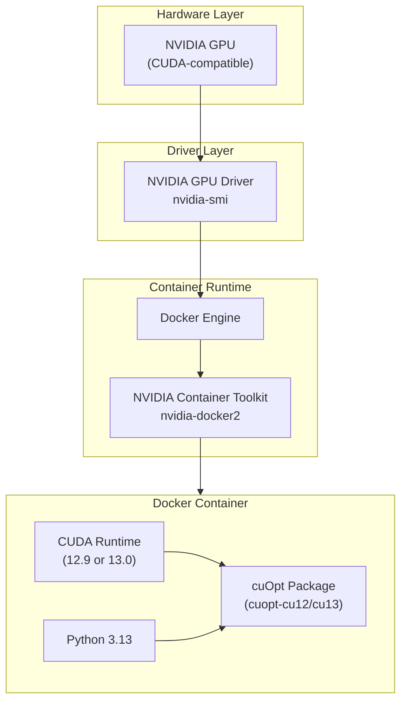
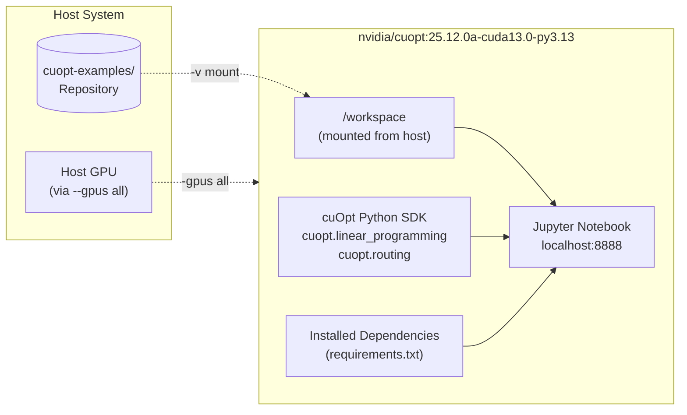
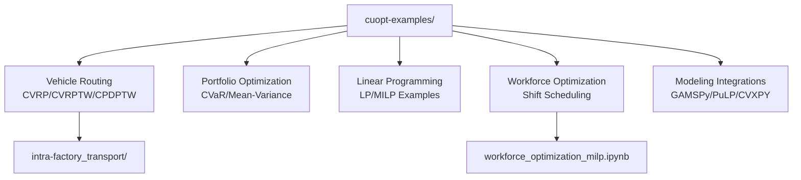

<!-- source: DeepWiki mcp.deepwiki.com · repo NVIDIA/cuopt-examples · page 2 Getting Started · fetched 2026-10-26 -->

# Getting Started

<details>
<summary>Relevant source files</summary>

The following files were used as context for generating this wiki page:

- [.github/ISSUE_TEMPLATE/bug_report.yml](.github/ISSUE_TEMPLATE/bug_report.yml)
- [.pre-commit-config.yaml](.pre-commit-config.yaml)
- [CONTRIBUTING.md](CONTRIBUTING.md)
- [LICENSE.md](LICENSE.md)
- [README.md](README.md)
- [VERSION](VERSION)
- [ci/release/update_version.sh](ci/release/update_version.sh)
- [requirements.txt](requirements.txt)
- [workforce_optimization/workforce_optimization_milp.ipynb](workforce_optimization/workforce_optimization_milp.ipynb)

</details>


This page guides users through initial setup of the `cuopt-examples` repository, including Docker installation, GPU requirements, environment configuration, and running your first optimization example. For detailed environment configuration options, see [Environment Setup](#2.1). For a complete walkthrough of a workforce optimization problem, see [Quick Start Tutorial](#2.2).

## Purpose and Scope

This document covers the essential steps to:
- Verify system prerequisites (GPU hardware, NVIDIA drivers, container runtime).
- Install and run cuOpt using the recommended Docker-based approach.
- Verify GPU acceleration is working correctly via `nvidia-smi`.
- Access and execute example notebooks using the provided Docker images.
- Understand basic cuOpt API entry points for Linear Programming (LP), Mixed-Integer Programming (MILP), and Vehicle Routing Problems (VRP).

This page focuses on getting the environment operational. For in-depth coverage of cuOpt's core concepts and APIs, see [Core Concepts](#3). For specific problem types, see [Vehicle Routing Problems](#4), [Portfolio Optimization](#5), or [Linear and Mixed-Integer Programming](#6).

---

## System Prerequisites

### Required Hardware and Software

cuOpt requires GPU acceleration to function. The following components must be present:

| Component | Requirement | Verification Command |
|-----------|-------------|---------------------|
| **NVIDIA GPU** | CUDA-compatible GPU | `nvidia-smi` |
| **NVIDIA Drivers** | Appropriate for your GPU | `nvidia-smi` shows driver version |
| **CUDA Runtime** | CUDA 12.x or CUDA 13.x | Provided by Docker image |
| **Docker** | Version with GPU support | `docker --version` |
| **NVIDIA Container Toolkit** | For GPU passthrough | `docker run --gpus all nvidia/cuda:12.0.0-base-ubuntu22.04 nvidia-smi` |

Title: cuOpt Stack Dependencies

Sources: [README.md:19-21](), [CONTRIBUTING.md:43]()

---

## Docker-Based Installation (Recommended)

Docker provides a pre-configured environment with all dependencies, eliminating manual setup of CUDA, Python packages, and library versions.

### Step 1: Clone Repository

```bash
git clone https://github.com/NVIDIA/cuopt-examples.git
cd cuopt-examples
```
Sources: [README.md:26-30]()

### Step 2: Pull cuOpt Docker Image

Two Docker images are available based on CUDA version. Choose the appropriate version for your system:

**CUDA 13.0 (Recommended for newer GPUs):**
```bash
docker pull nvidia/cuopt:25.12.0a-cuda13.0-py3.13
```

**CUDA 12.9 (For broader compatibility):**
```bash
docker pull nvidia/cuopt:25.12.0a-cuda12.9-py3.13
```

The version `25.12.0a` corresponds to the pre-release version tracked in `VERSION`. The `a` suffix indicates alpha/pre-release status.

Sources: [README.md:32-43](), [VERSION:1](), [ci/release/update_version.sh:76-89]()

### Step 3: Launch Container with Jupyter

The following command starts the Docker container with GPU access, installs notebook dependencies, and launches Jupyter:

**For CUDA 13.0:**
```bash
docker run -it --rm --gpus all --network=host \
  -v $(pwd):/workspace -w /workspace \
  nvidia/cuopt:25.12.0a-cuda13.0-py3.13 \
  /bin/bash -c "pip install -r requirements.txt; jupyter-notebook"
```

The container installs dependencies from `requirements.txt`, which includes `jupyter`, `notebook`, and `ipykernel`.

Sources: [README.md:45-55](), [requirements.txt:1-4]()

---

## Docker Container Architecture

Title: Docker Container Runtime Architecture

Sources: [README.md:45-55]()

The container provides:
- **Pre-installed cuOpt SDK**: Includes `cuopt.linear_programming.problem.Problem` and `cuopt.routing.DataModel`.
- **CUDA Runtime**: Optimized for GPU acceleration.
- **Python 3.13**: Environment pre-configured for optimization workflows.

---

## GPU Verification

Before running optimization problems, verify GPU access is working correctly within your environment.

### Verification Script

The following code (available in example notebooks) checks for GPU availability:

```python
import subprocess
def check_gpu():
    try:
        output = subprocess.check_output(["nvidia-smi"], shell=False).decode()
        print("✅ GPU is enabled")
    except Exception:
        print("⚠️ GPU not detected!")
```

Sources: [workforce_optimization/workforce_optimization_milp.ipynb:39-78]()

---

## Running Your First Example

### Available Example Categories

The repository organizes examples by problem domain:

Title: Example Repository Structure

Sources: [README.md:65-74]()

### Example: Workforce Optimization

The workforce optimization example demonstrates core cuOpt API usage for a Mixed Integer Linear Program (MILP) using the `Problem` class.

Title: cuOpt Problem API Workflow

Sources: [workforce_optimization/workforce_optimization_milp.ipynb:109-110](), [workforce_optimization/workforce_optimization_milp.ipynb:208-313]()

To run this:
1. Navigate to the Jupyter interface.
2. Open `workforce_optimization/workforce_optimization_milp.ipynb`.
3. Execute the cells to see how `cuopt.linear_programming.problem.Problem` is used to define and solve the assignment.

---

## Next Steps

- **Detailed Setup**: For non-Docker environments or driver troubleshooting, see [Environment Setup](#2.1).
- **Step-by-Step Guide**: For a guided walkthrough of the code, see [Quick Start Tutorial](#2.2).
- **Core APIs**: Learn about the `Problem` and `DataModel` classes in [Core Concepts](#3).

---

