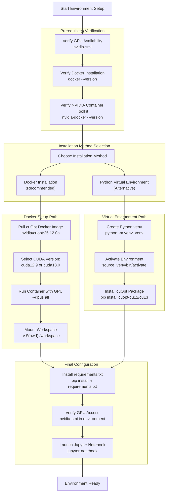
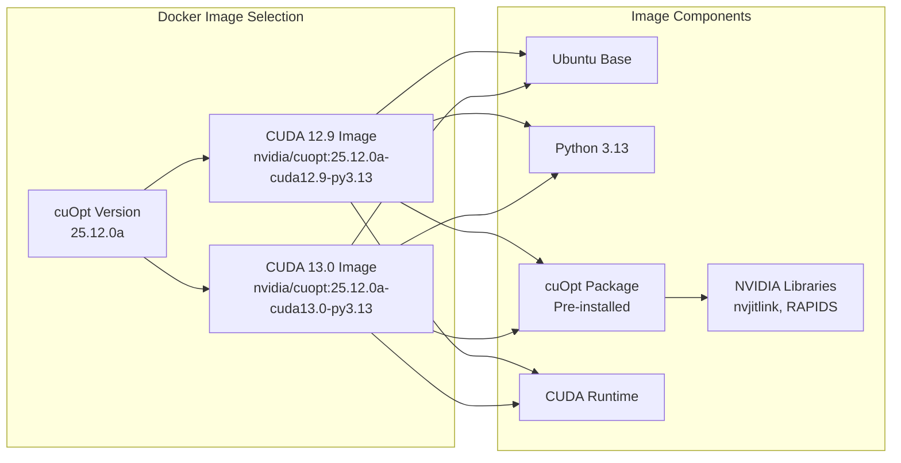
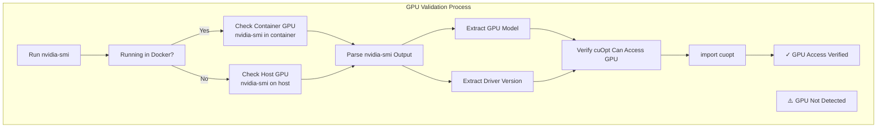

<!-- source: DeepWiki mcp.deepwiki.com · repo NVIDIA/cuopt-examples · page 2.1 Environment Setup · fetched 2026-10-26 -->

# Environment Setup

<details>
<summary>Relevant source files</summary>

The following files were used as context for generating this wiki page:

- [.github/ISSUE_TEMPLATE/bug_report.yml](.github/ISSUE_TEMPLATE/bug_report.yml)
- [.pre-commit-config.yaml](.pre-commit-config.yaml)
- [CONTRIBUTING.md](CONTRIBUTING.md)
- [LICENSE.md](LICENSE.md)
- [README.md](README.md)
- [VERSION](VERSION)
- [ci/release/update_version.sh](ci/release/update_version.sh)
- [requirements.txt](requirements.txt)
- [workforce_optimization/workforce_optimization_milp.ipynb](workforce_optimization/workforce_optimization_milp.ipynb)

</details>


## Purpose and Scope

This document provides detailed instructions for setting up a development environment to run the cuOpt examples. It covers Docker-based installation (recommended), Python virtual environment setup (alternative), GPU driver configuration, and dependency management. After completing this setup, you will be able to run notebooks and scripts from the repository.

For instructions on running your first example after setup, see [Quick Start Tutorial](#2.2). For information on contributing to the repository with development tools, see [Development Environment Setup](#13.1).

---

## Environment Setup Overview

The cuOpt examples repository supports multiple installation methods, with Docker being the primary and recommended approach due to its consistent environment and pre-configured dependencies. The setup process follows this general workflow:

Title: Environment Setup Workflow


Sources: [README.md:9-58](), [workforce_optimization/workforce_optimization_milp.ipynb:31-92]()

---

## Prerequisites

Before setting up the cuOpt examples environment, ensure the following prerequisites are met:

| Prerequisite | Purpose | Verification Command | Documentation Link |
|--------------|---------|---------------------|-------------------|
| **NVIDIA GPU** | GPU acceleration for cuOpt solver | `nvidia-smi` | [cuOpt System Requirements](https://docs.nvidia.com/cuopt/user-guide/latest/system-requirements.html) |
| **NVIDIA GPU Drivers** | Interface between OS and GPU hardware | `nvidia-smi` output shows driver version | NVIDIA Driver Downloads |
| **Docker** | Container runtime for cuOpt image | `docker --version` | [NVIDIA Docker Guide](https://docs.nvidia.com/ai-enterprise/deployment/vmware/latest/docker.html) |
| **NVIDIA Container Toolkit** | GPU support in Docker containers | `nvidia-docker --version` or `docker run --gpus all ...` | [Container Toolkit Install Guide](https://docs.nvidia.com/datacenter/cloud-native/container-toolkit/latest/install-guide.html) |

**Detailed System Requirements**: The cuOpt engine has specific GPU compute capability and memory requirements. Refer to the official [NVIDIA cuOpt System Requirements documentation](https://docs.nvidia.com/cuopt/user-guide/latest/system-requirements.html#) for detailed specifications.

Sources: [README.md:13-22](), [workforce_optimization/workforce_optimization_milp.ipynb:63-69]()

---

## Docker-Based Setup (Recommended)

Docker is the primary installation method for cuOpt examples. It provides a pre-configured environment with all dependencies and eliminates compatibility issues.

### Pulling the cuOpt Docker Image

The cuOpt Docker images are versioned and available for different CUDA versions. The current release version is **25.12.0a**.

Title: cuOpt Docker Image Components


**Pull Commands:**

For CUDA 12.9:
```bash
docker pull nvidia/cuopt:25.12.0a-cuda12.9-py3.13
```

For CUDA 13.0:
```bash
docker pull nvidia/cuopt:25.12.0a-cuda13.0-py3.13
```

Sources: [README.md:32-43](), [VERSION:1](), [ci/release/update_version.sh:76-94]()

### Running the Docker Container

The cuOpt container requires GPU access, workspace mounting, and network access for Jupyter notebooks.

**Container Runtime Configuration:**

| Flag | Purpose | Example Value |
|------|---------|---------------|
| `--gpus all` | Enable all GPU devices in container | Required for cuOpt GPU acceleration |
| `-v $(pwd):/workspace` | Mount current directory as /workspace | Allows editing notebooks on host |
| `-w /workspace` | Set working directory | Start in mounted workspace |
| `--network=host` | Use host network stack | Enables Jupyter access at localhost |
| `-it` | Interactive terminal | Allows shell interaction |
| `--rm` | Remove container on exit | Clean up after session |

**Run Command for CUDA 12.9:**
```bash
docker run -it --rm --gpus all --network=host \
  -v $(pwd):/workspace -w /workspace \
  nvidia/cuopt:25.12.0a-cuda12.9-py3.13 \
  /bin/bash -c "pip install -r requirements.txt; jupyter-notebook"
```

**Run Command for CUDA 13.0:**
```bash
docker run -it --rm --gpus all --network=host \
  -v $(pwd):/workspace -w /workspace \
  nvidia/cuopt:25.12.0a-cuda13.0-py3.13 \
  /bin/bash -c "pip install -r requirements.txt; jupyter-notebook"
```

The container will:
1. Install additional dependencies from `requirements.txt` [requirements.txt:1-5]()
2. Start Jupyter Notebook server
3. Display a URL with token for browser access [README.md:57]()
4. Mount the repository directory at `/workspace` for file access [README.md:49-54]()

Sources: [README.md:45-57](), [requirements.txt:1-5]()

---

## Alternative: Python Virtual Environment Setup

For users who cannot use Docker or prefer a native Python installation, cuOpt can be installed via pip in a virtual environment.

### Installing cuOpt Package

Install cuOpt from the NVIDIA PyPI index. Choose the CUDA version matching your system's CUDA installation:

**For CUDA 12:**
```bash
pip install --upgrade --extra-index-url https://pypi.nvidia.com \
  cuopt-cu12 nvidia-nvjitlink-cu12 rapids-logger==0.1.19
```

**For CUDA 13:**
```bash
pip install --upgrade --extra-index-url https://pypi.nvidia.com \
  cuopt-cu13 nvidia-nvjitlink-cu13 rapids-logger==0.1.19
```

**Important**: Before installing cuOpt, you may need to uninstall conflicting CUDA packages:
```bash
pip uninstall -y cuda-python cuda-bindings cuda-core
```

Sources: [workforce_optimization/workforce_optimization_milp.ipynb:87-91]()

### Installing Repository Dependencies

After installing cuOpt, install additional dependencies required by the examples:

```bash
pip install -r requirements.txt
```

The `requirements.txt` file specifies packages needed across all examples, including `jupyter`, `notebook`, and `ipykernel` [requirements.txt:1-5]().

Sources: [README.md:23](), [requirements.txt:1-5]()

---

## GPU Validation and Verification

Verifying GPU access is critical for cuOpt's GPU-accelerated solving.

Title: GPU Validation Logic


### Running nvidia-smi

The `nvidia-smi` command provides GPU status information. Example notebooks include a `check_gpu()` function that parses this output to ensure a **GPU runtime** is enabled [workforce_optimization/workforce_optimization_milp.ipynb:39-78]().

**Key checks performed:**
- `subprocess.CalledProcessError`: nvidia-smi command failed
- `FileNotFoundError`: nvidia-smi not in PATH
- Provides troubleshooting for Google Colab and Docker runtimes [workforce_optimization/workforce_optimization_milp.ipynb:56-69]()

Sources: [workforce_optimization/workforce_optimization_milp.ipynb:36-78]()

---

## Development Tools and Versioning

### Pre-commit Hooks

For contributors, the project uses `pre-commit` to ensure code quality.

| Hook | Tool | Purpose |
|------|------|---------|
| `isort` | isort | Sort imports consistently |
| `black` | Black | Format Python code |
| `flake8` | flake8 | Check for PEP 8 compliance |

To set up:
```bash
pip install pre-commit
pre-commit install
```

Sources: [CONTRIBUTING.md:51-79](), [.pre-commit-config.yaml:5-30]()

### Version Management

The repository uses a `VERSION` file [VERSION:1]() and an automated script [ci/release/update_version.sh]() to maintain version consistency across documentation and Docker tags.

The script `update_version.sh` handles:
1. Updating the `VERSION` file [ci/release/update_version.sh:68-70]().
2. Transforming semantic versions (e.g., `25.12.00`) to pre-release container tags (e.g., `25.12.0a`) [ci/release/update_version.sh:76-86]().
3. Updating Docker image references in `README.md` via `sed` [ci/release/update_version.sh:103]().

Sources: [VERSION:1](), [ci/release/update_version.sh:1-130]()

---

## Troubleshooting Common Issues

### GPU Not Detected in Docker

**Symptoms**: `nvidia-smi` fails inside container.
**Solutions**:
1. Verify NVIDIA Container Toolkit installation [workforce_optimization/workforce_optimization_milp.ipynb:73]().
2. Ensure you run with `--gpus all` [README.md:49]().
3. Test with a base image: `docker run --gpus all nvidia/cuda:12.0.0-base-ubuntu22.04 nvidia-smi` [workforce_optimization/workforce_optimization_milp.ipynb:68]().

### CUDA Version Mismatch

**Symptoms**: Import errors when loading cuOpt.
**Solutions**:
1. Verify host CUDA version via `nvidia-smi`.
2. Pull the matching Docker image: `cuda12.9` or `cuda13.0` [README.md:37-43]().

Sources: [README.md:37-55](), [workforce_optimization/workforce_optimization_milp.ipynb:63-75]()

---

