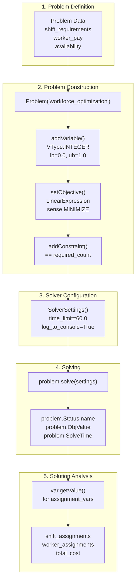
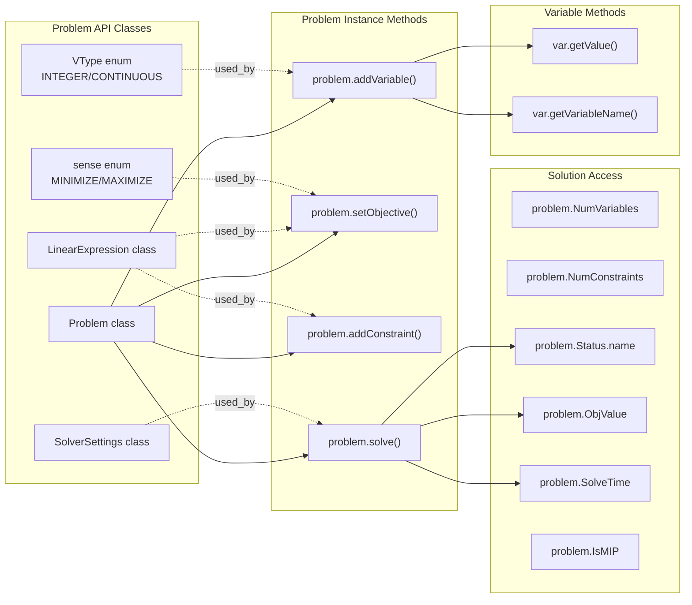
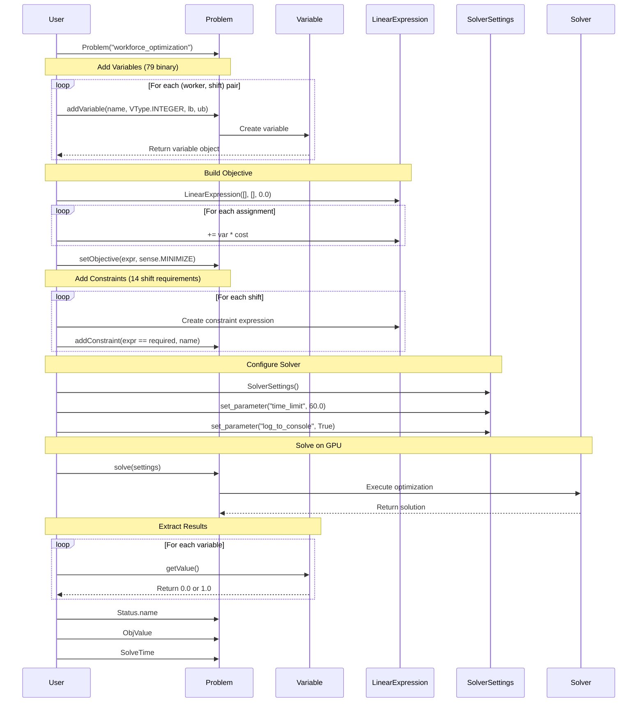

<!-- source: DeepWiki mcp.deepwiki.com · repo NVIDIA/cuopt-examples · page 2.2 Quick Start Tutorial · fetched 2026-10-26 -->

# Quick Start Tutorial

<details>
<summary>Relevant source files</summary>

The following files were used as context for generating this wiki page:

- [README.md](README.md)
- [VERSION](VERSION)
- [ci/release/update_version.sh](ci/release/update_version.sh)
- [workforce_optimization/workforce_optimization_milp.ipynb](workforce_optimization/workforce_optimization_milp.ipynb)

</details>


## Purpose and Scope

This page provides a hands-on introduction to cuOpt by walking through a complete workforce optimization example. It demonstrates the fundamental workflow of formulating an optimization problem, setting constraints, and solving with the cuOpt Python API. This tutorial assumes you have already completed the environment setup described in [Environment Setup](2.1).

For detailed documentation of the Problem API methods and classes, see [Problem API](3.1). For information on solver configuration options, see [SolverSettings and Configuration](3.2). For more complex optimization scenarios including vehicle routing and portfolio optimization, see [Vehicle Routing Problems](4) and [Portfolio Optimization](5).

---

## Tutorial Overview

The quick start tutorial demonstrates a **workforce scheduling problem**: assigning workers to shifts while minimizing labor costs and satisfying shift requirements. This classic assignment problem illustrates the core workflow for solving Mixed Integer Linear Programs (MILP) with cuOpt.

The complete tutorial is implemented in [workforce_optimization/workforce_optimization_milp.ipynb:1-546]() and covers:

1. Problem definition and data setup
2. Creating decision variables
3. Defining the objective function
4. Adding constraints
5. Configuring and running the solver
6. Analyzing the solution
7. Adding additional constraints

Sources: [workforce_optimization/workforce_optimization_milp.ipynb:1-19](), [README.md:1-83]()

---

## Workflow Diagram



**Diagram: cuOpt Problem-Solving Workflow**

This diagram maps the five-stage workflow to specific cuOpt API methods. Each stage builds on the previous, creating a complete optimization model that can be solved on GPU.

Sources: [workforce_optimization/workforce_optimization_milp.ipynb:95-314]()

---

## Problem Definition

The workforce optimization problem requires three key data structures:

| Data Structure | Description | Example |
|---------------|-------------|---------|
| `shift_requirements` | Number of workers needed per shift | `{"Mon1": 3, "Tue2": 2, ...}` |
| `worker_pay` | Cost per shift for each worker | `{"Amy": 10, "Bob": 12, ...}` |
| `availability` | Shifts each worker can work | `{"Amy": ["Tue2", "Wed3", ...], ...}` |

The tutorial defines 14 shifts, 7 workers, and 79 possible worker-shift assignments based on availability constraints.

**Key Problem Characteristics:**
- **Problem Type**: Mixed Integer Linear Program (MILP)
- **Decision Variables**: Binary (0 or 1) assignments
- **Objective**: Minimize total labor cost
- **Constraints**: Each shift must have exactly the required number of workers

Sources: [workforce_optimization/workforce_optimization_milp.ipynb:122-172]()

---

## Creating the Problem and Variables

### Problem Instance

The optimization problem begins by instantiating the `Problem` class:

```python
problem = Problem("workforce_optimization")
```

This creates a new optimization problem object that will hold variables, constraints, and the objective function. See [workforce_optimization/workforce_optimization_milp.ipynb:209]().

### Decision Variables

Binary decision variables represent each possible worker-shift assignment. For each worker and each shift they are available for, a variable is created:

```python
var = problem.addVariable(name=var_name, vtype=VType.INTEGER, lb=0.0, ub=1.0)
```

The `addVariable` method parameters:
- `name`: String identifier (e.g., `"Amy_Tue2"`)
- `vtype`: `VType.INTEGER` for integer variables
- `lb`: Lower bound (0.0 = not assigned)
- `ub`: Upper bound (1.0 = assigned)

Setting `lb=0.0` and `ub=1.0` with `VType.INTEGER` creates binary variables. The tutorial creates 79 such variables stored in the `assignment_vars` dictionary.

Sources: [workforce_optimization/workforce_optimization_milp.ipynb:203-221]()

---

## Setting the Objective Function

The objective function defines what to optimize. For workforce scheduling, this is minimizing total labor cost:

$$\text{minimize} \sum_{worker, shift} cost_{worker} \times assignment_{worker,shift}$$

This is implemented using `LinearExpression` and the `setObjective` method:

```python
objective_expr = LinearExpression([], [], 0.0)
for (worker, shift), var in assignment_vars.items():
    cost = worker_pay[worker]
    objective_expr += var * cost

problem.setObjective(objective_expr, sense.MINIMIZE)
```

The `LinearExpression` accumulates coefficient-variable products, then `setObjective` installs it as the optimization objective with `sense.MINIMIZE` to indicate cost minimization.

Sources: [workforce_optimization/workforce_optimization_milp.ipynb:224-240]()

---

## Adding Constraints

Constraints ensure the solution satisfies business requirements. The primary constraint is that each shift must have exactly the required number of workers:

$$\sum_{worker} assignment_{worker,shift} = required\_count_{shift} \quad \forall shift$$

Implementation:

```python
shift_expr = LinearExpression([], [], 0.0)
for var in shift_assignments:
    shift_expr += var

constraint = problem.addConstraint(shift_expr == required_count, name=f"shift_{shift}")
```

For 14 shifts, this creates 14 equality constraints. The `addConstraint` method accepts:
- A comparison expression (`==`, `<=`, `>=`)
- An optional `name` parameter for identification

The tutorial later demonstrates adding inequality constraints to limit workers to a maximum of 4 shifts each. See [workforce_optimization/workforce_optimization_milp.ipynb:413-438]().

Sources: [workforce_optimization/workforce_optimization_milp.ipynb:243-271]()

---

## Code Entity Mapping



**Diagram: cuOpt Problem API Class and Method Relationships**

This diagram shows how the key classes and methods from `cuopt.linear_programming.problem` and `cuopt.linear_programming.solver_settings` modules interact during problem construction and solving.

Sources: [workforce_optimization/workforce_optimization_milp.ipynb:107-112](), [workforce_optimization/workforce_optimization_milp.ipynb:203-314]()

---

## Solver Configuration and Execution

### Configuring SolverSettings

The `SolverSettings` class controls solver behavior:

```python
settings = SolverSettings()
settings.set_parameter("time_limit", 60.0)
settings.set_parameter("log_to_console", True)
settings.set_parameter("method", 0)
```

Common parameters:
- `time_limit`: Maximum solve time in seconds (60.0 = 1 minute)
- `log_to_console`: Enable/disable solver output (True/False)
- `method`: Solver method selection (0 = default)

### Solving the Problem

The `solve` method executes the optimization:

```python
problem.solve(settings)
```

This triggers GPU-accelerated solving. After completion, the solution can be accessed through problem properties:
- `problem.Status.name`: Solution status (`"Optimal"`, `"FeasibleFound"`, etc.)
- `problem.ObjValue`: Optimal objective value (total cost)
- `problem.SolveTime`: Time taken in seconds
- `problem.NumVariables`: Number of decision variables
- `problem.NumConstraints`: Number of constraints
- `problem.IsMIP`: Boolean indicating if problem is mixed-integer

Sources: [workforce_optimization/workforce_optimization_milp.ipynb:283-314]()

---

## Solution Analysis

### Extracting Solution Values

After solving, decision variable values are accessed via `getValue()`:

```python
for (worker, shift), var in assignment_vars.items():
    if var.getValue() > 0.5:  # Binary variable is 1
        # Worker is assigned to shift
```

For binary variables, values > 0.5 indicate assignment (due to numerical tolerance).

### Solution Structure

The tutorial organizes results into two views:

**Shift-Centric View:**
| Shift | Required | Assigned | Workers | Cost |
|-------|----------|----------|---------|------|
| Mon1 | 3 | 3 | Bob, Ed, Fred | $29 |
| Tue2 | 2 | 2 | Amy, Bob | $22 |
| ... | ... | ... | ... | ... |

**Worker-Centric View:**
| Worker | Shifts Assigned | Total Shifts | Total Cost |
|--------|----------------|--------------|------------|
| Amy | [Tue2, Wed3, Fri5, Sun7] | 4 | $40 |
| Bob | [Mon1, Tue2, Fri5, Sat6] | 4 | $48 |
| ... | ... | ... | ... |

The solution shows the optimal total cost and verifies that all shift requirements are met.

Sources: [workforce_optimization/workforce_optimization_milp.ipynb:326-401]()

---

## Adding Additional Constraints

The tutorial demonstrates extending an existing model by adding maximum shift constraints:

```python
worker_expr = LinearExpression([], [], 0.0)
for var in worker_shifts:
    worker_expr += var

constraint = problem.addConstraint(worker_expr <= max_shifts_per_worker, 
                                  name=f"max_shifts_{worker}")
```

This adds 7 new inequality constraints (one per worker) limiting each worker to at most 4 shifts. After adding constraints:
1. The problem is re-solved with the same `solve()` call
2. New solution is extracted and compared
3. The `problem.NumConstraints` property reflects the additional constraints

This demonstrates the incremental problem-building capability of cuOpt.

Sources: [workforce_optimization/workforce_optimization_milp.ipynb:407-466]()

---

## Complete Tutorial Workflow



**Diagram: Sequential Workflow of Workforce Optimization Tutorial**

This sequence diagram shows the order of API calls and data flow from problem construction through solution extraction.

Sources: [workforce_optimization/workforce_optimization_milp.ipynb:95-466]()

---

## Key Takeaways

The workforce optimization tutorial demonstrates:

1. **Problem Construction Pattern**: Create `Problem` → Add variables → Set objective → Add constraints
2. **Binary Variable Formulation**: Using `VType.INTEGER` with bounds `[0.0, 1.0]` for 0/1 decisions
3. **Expression Building**: `LinearExpression` accumulates terms via `+=` operator
4. **Constraint Types**: Equality (`==`) and inequality (`<=`, `>=`) constraints
5. **Solver Control**: `SolverSettings` configures time limits and logging
6. **Solution Access**: Post-solve properties (`Status`, `ObjValue`, `SolveTime`) and `getValue()` for variables
7. **Incremental Modeling**: Adding constraints to existing problems and re-solving

**Performance Note**: The tutorial solves a 79-variable, 21-constraint MILP in under 1 second on GPU, demonstrating cuOpt's computational efficiency for small-to-medium scale problems.

Sources: [workforce_optimization/workforce_optimization_milp.ipynb:469-499]()

---

## Running the Tutorial

To execute the tutorial yourself:

1. **Ensure GPU access**: The tutorial requires an NVIDIA GPU with CUDA support. Verify with `nvidia-smi`. [workforce_optimization/workforce_optimization_milp.ipynb:36-78]()

2. **Start Jupyter**: From the repository root with Docker:
   ```bash
   docker run -it --rm --gpus all --network=host \
     -v $(pwd):/workspace -w /workspace \
     nvidia/cuopt:25.12.0a-cuda13.0-py3.13 \
     /bin/bash -c "pip install -r requirements.txt; jupyter-notebook"
   ```
   (Note: Use the appropriate image tag for your CUDA version, e.g., `cuda12.9` or `cuda13.0`). [README.md:47-55]()

3. **Navigate to notebook**: Open [workforce_optimization/workforce_optimization_milp.ipynb]() in the Jupyter interface.

4. **Execute cells sequentially**: Run each cell in order to follow the tutorial progression.

The notebook includes GPU detection logic at [workforce_optimization/workforce_optimization_milp.ipynb:36-78]() that provides setup guidance if GPU is not available.

Sources: [README.md:25-58](), [workforce_optimization/workforce_optimization_milp.ipynb:36-92](), [VERSION:1]()

---

## Next Steps

After completing this tutorial, explore:

- **[Problem API](3.1)**: Detailed documentation of all `Problem` class methods
- **[SolverSettings and Configuration](3.2)**: Advanced solver configuration options
- **[Mixed-Integer Programming Examples](6.2)**: More complex MILP formulations
- **[Linear Programming Examples](6.1)**: Continuous variable problems
- **[Vehicle Routing Problems](4)**: Specialized routing API for logistics optimization
- **[Portfolio Optimization](5)**: Financial optimization use cases

The workforce optimization notebook is located at [workforce_optimization/workforce_optimization_milp.ipynb:1-546]() in the repository.

Sources: [README.md:65-83]()

---

