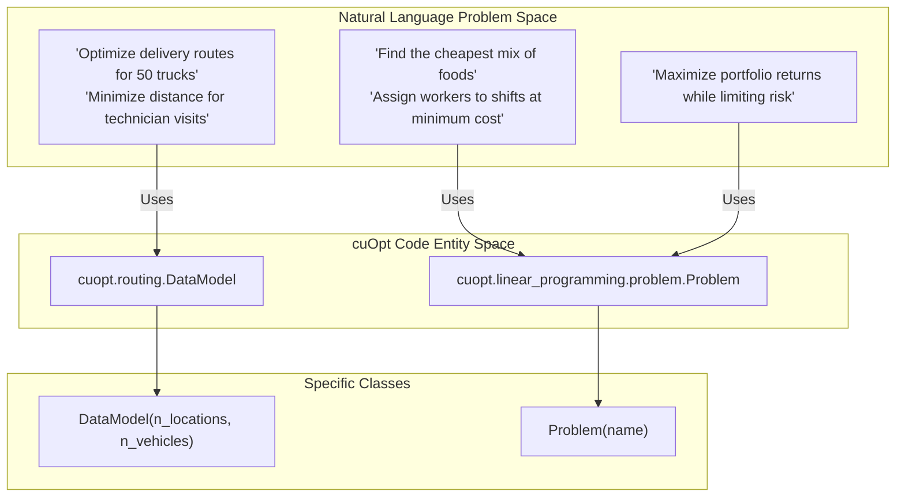
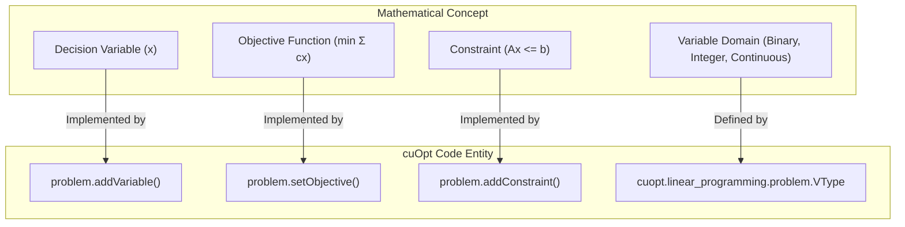
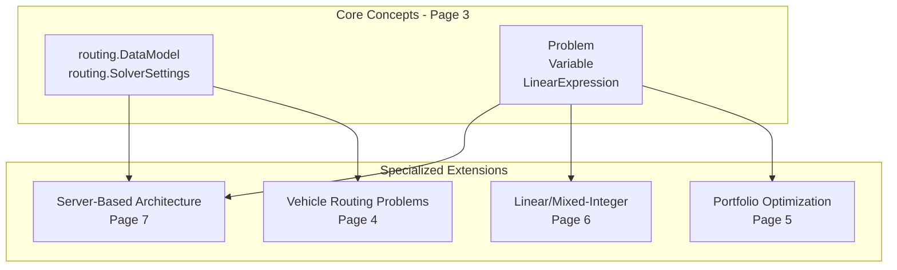

<!-- source: DeepWiki mcp.deepwiki.com · repo NVIDIA/cuopt-examples · page 3 Core Concepts · fetched 2026-10-26 -->

# Core Concepts

<details>
<summary>Relevant source files</summary>

The following files were used as context for generating this wiki page:

- [AI-accelerated-routing/initializing_cuopt_with_rl_solutions.ipynb](AI-accelerated-routing/initializing_cuopt_with_rl_solutions.ipynb)
- [AI-accelerated-routing/training_rl_agent_for_vrp.ipynb](AI-accelerated-routing/training_rl_agent_for_vrp.ipynb)
- [README.md](README.md)
- [VERSION](VERSION)
- [ci/release/update_version.sh](ci/release/update_version.sh)
- [diet_optimization/diet_optimization_lp.ipynb](diet_optimization/diet_optimization_lp.ipynb)
- [diet_optimization/diet_optimization_milp.ipynb](diet_optimization/diet_optimization_milp.ipynb)
- [portfolio_optimization/cvar_portfolio_optimization.ipynb](portfolio_optimization/cvar_portfolio_optimization.ipynb)
- [workforce_optimization/workforce_optimization_milp.ipynb](workforce_optimization/workforce_optimization_milp.ipynb)

</details>


## Purpose and Scope

This page introduces the fundamental concepts of the NVIDIA cuOpt Python API, covering the two primary programming interfaces, their core abstractions, and common usage patterns. This material provides the conceptual foundation needed to build optimization problems using cuOpt.

For detailed API reference documentation, see:
- [Problem API](#3.1) — Complete reference for the `Problem` class and linear programming methods.
- [SolverSettings and Configuration](#3.2) — Solver parameters and optimization control.
- [Data Types and GPU Acceleration](#3.3) — GPU data structures and type requirements.

For domain-specific implementations, see:
- [Vehicle Routing Problems](#4) — Routing-specific modeling patterns.
- [Linear and Mixed-Integer Programming](#6) — General mathematical programming examples.

---

## Two Primary APIs

cuOpt provides two distinct Python APIs designed for different problem types. Understanding which API to use is the first step in problem formulation.

### API Mapping: Problem Space to Code Entities



**API Selection Criteria:**

| Problem Type | API | Import Path | Key Class |
|--------------|-----|-------------|-----------|
| Vehicle routing with locations, vehicles, and orders | Routing | `cuopt.routing` | `DataModel` |
| Mathematical programs with variables and constraints | Linear Programming | `cuopt.linear_programming.problem` | `Problem` |

Sources: [workforce_optimization/workforce_optimization_milp.ipynb:109-110](), [diet_optimization/diet_optimization_lp.ipynb:113-114](), [portfolio_optimization/cvar_portfolio_optimization.ipynb:161-163]()

---

## Routing API Fundamentals

The Routing API uses the `DataModel` class to represent vehicle routing problems. This API provides domain-specific methods for expressing routing constraints.

### DataModel Structure and Workflow

```mermaid
graph LR
    subgraph "Problem Setup"
        INIT["routing.DataModel(n_locations, n_vehicles)"]
        COST["add_cost_matrix(cudf.DataFrame)"]
        VEHICLE["set_vehicle_locations(start, end)"]
    end
    
    subgraph "Constraint Specification"
        CAPACITY["add_capacity_dimension(name, demand, capacity)"]
        TIME_ORD["set_order_time_windows(earliest, latest)"]
        TIME_VEH["set_vehicle_time_windows(earliest, latest)"]
        SERVICE["set_order_service_times(times)"]
    end
    
    subgraph "Solve and Extract"
        SETTINGS["routing.SolverSettings()"]
        SOLVE["routing.Solve(data_model, settings)"]
        RESULT["solution.get_route()<br/>solution.get_total_objective()"]
    end
    
    INIT --> COST
    COST --> VEHICLE
    VEHICLE --> CAPACITY
    CAPACITY --> TIME_ORD
    TIME_ORD --> TIME_VEH
    TIME_VEH --> SERVICE
    SERVICE --> SETTINGS
    SETTINGS --> SOLVE
    SOLVE --> RESULT
```



**Routing API Initialization Pattern:**

```python
from cuopt import routing
import cudf
import numpy as np

# Initialize with problem dimensions
n_locations = 8  # Including depot
n_vehicles = 3
data_model = routing.DataModel(n_locations, n_vehicles)
```

Sources: [AI-accelerated-routing/training_rl_agent_for_vrp.ipynb:191-196]()

---

## Linear Programming API Fundamentals

The Linear Programming API uses the `Problem` class to build mathematical optimization problems with variables, objectives, and constraints.

### LP API: Mathematical Space to Code Entities



**Problem Class Initialization:**

```python
from cuopt.linear_programming.problem import Problem, VType, sense, LinearExpression
from cuopt.linear_programming.solver_settings import SolverSettings

# Create problem instance
problem = Problem("workforce_optimization")
```

Sources: [workforce_optimization/workforce_optimization_milp.ipynb:109-110](), [workforce_optimization/workforce_optimization_milp.ipynb:209]()

### Variable Declaration

Variables are the decision variables of the optimization problem. Each variable has a type, name, and bounds.

| Variable Type | `VType` Enum | Bounds | Use Case |
|---------------|--------------|--------|----------|
| Continuous | `VType.CONTINUOUS` | `[lb, ub]` | Fractional quantities, allocations |
| Integer | `VType.INTEGER` | `[lb, ub]` | Discrete counts, assignments |
| Binary | `VType.INTEGER` | `[0.0, 1.0]` | Yes/no decisions |

```python
# Binary variable for assignment decisions
assignment_var = problem.addVariable(
    name="worker_Amy_shift_Mon1",
    vtype=VType.INTEGER,
    lb=0.0,
    ub=1.0
)
```

Sources: [workforce_optimization/workforce_optimization_milp.ipynb:213-218](), [diet_optimization/diet_optimization_lp.ipynb:113]()

### Objective Functions and Constraints

`LinearExpression` objects represent mathematical expressions composed of variables, coefficients, and constants.

```python
# Build objective expression
objective_expr = LinearExpression([], [], 0.0)
for (worker, shift), var in assignment_vars.items():
    cost = worker_pay[worker]
    objective_expr += var * cost

# Set objective: minimize or maximize
problem.setObjective(objective_expr, sense.MINIMIZE)

# Add constraints
problem.addConstraint(shift_expr == required_count, name=f"shift_{shift}")
```

Sources: [workforce_optimization/workforce_optimization_milp.ipynb:230-239](), [workforce_optimization/workforce_optimization_milp.ipynb:260-270]()

---

## Solution Objects and Status Codes

Both APIs return solution details that encapsulate optimization results and provide methods for extracting solution details.

### Linear Programming Solution Interface

```python
# Solve LP/MILP problem
problem.solve(settings)

# Check solution status
if problem.Status.name == "Optimal":
    # Extract objective value
    total_cost = problem.ObjValue
    
    # Extract variable values
    for (worker, shift), var in assignment_vars.items():
        if var.getValue() > 0.5:
            print(f"{worker} assigned to {shift}")
```

Sources: [workforce_optimization/workforce_optimization_milp.ipynb:309-314](), [workforce_optimization/workforce_optimization_milp.ipynb:340-344]()

---

## SolverSettings Configuration

Both APIs use `SolverSettings` classes to control solver behavior, though they have different import paths and parameters.

### Linear Programming SolverSettings

```python
from cuopt.linear_programming.solver_settings import SolverSettings

settings = SolverSettings()
settings.set_parameter("time_limit", 60.0)      # Time limit in seconds
settings.set_parameter("log_to_console", True)  # Enable logging
```

Sources: [workforce_optimization/workforce_optimization_milp.ipynb:289-293](), [portfolio_optimization/cvar_portfolio_optimization.ipynb:162]()

---

## GPU Data Handling with cuDF

cuOpt leverages GPU acceleration through the `cudf` library. All data passed to cuOpt must use appropriate data types.

**Type Requirements:**

| Data Category | Required Type | Rationale |
|---------------|---------------|-----------|
| Cost matrices, distances, times | `np.float32` | GPU performance optimization |
| Capacities, demands, counts | `np.int32` | Integer arithmetic precision |

Sources: [portfolio_optimization/cvar_portfolio_optimization.ipynb:40-44](), [README.md:49]()

---

## Relationship to Other cuOpt Components



- **Vehicle Routing Problems** ([Vehicle Routing Problems](#4)) — Specialized routing constraints.
- **Portfolio Optimization** ([Portfolio Optimization](#5)) — Financial modeling using the LP API.
- **Linear/Mixed-Integer Programming** ([Linear and Mixed-Integer Programming](#6)) — General mathematical programming patterns.
- **Server-Based Architecture** ([Server-Based Architecture](#7)) — Client-server deployment using the same core APIs.

Sources: [README.md:1-83]()

---

