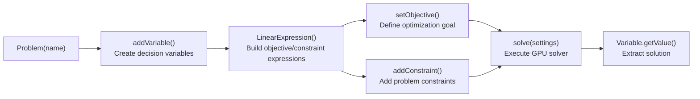
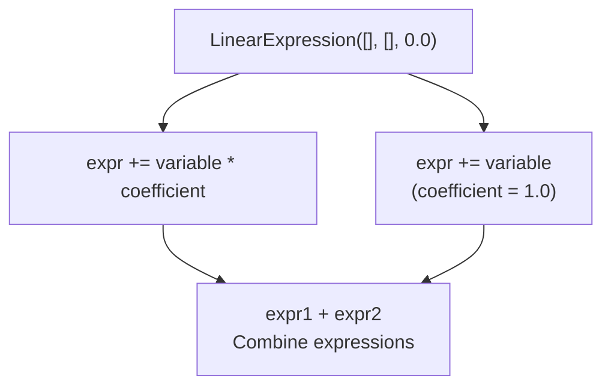
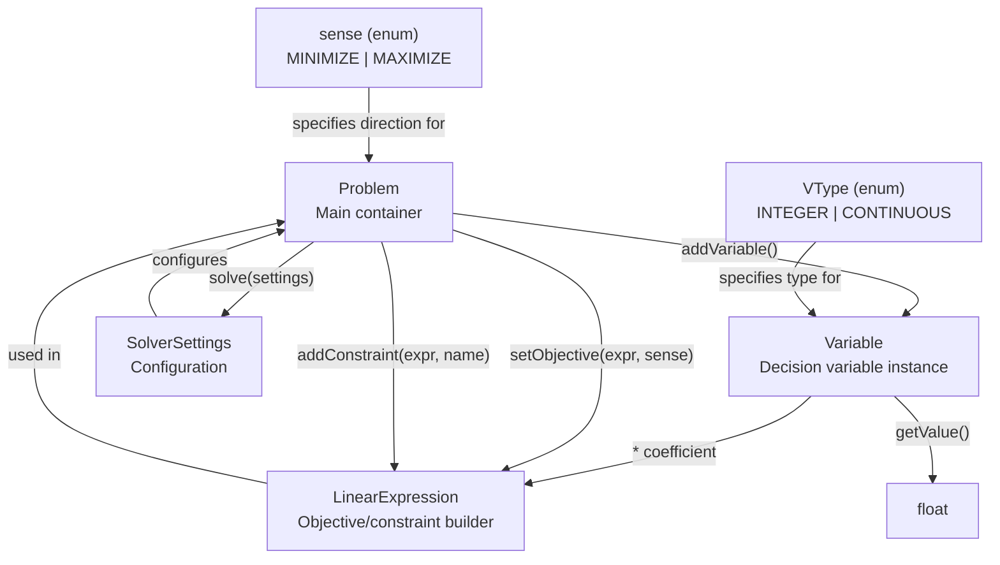

<!-- source: DeepWiki mcp.deepwiki.com · repo NVIDIA/cuopt-examples · page 3.1 Problem API · fetched 2026-10-26 -->

# Problem API

<details>
<summary>Relevant source files</summary>

The following files were used as context for generating this wiki page:

- [AI-accelerated-routing/initializing_cuopt_with_rl_solutions.ipynb](AI-accelerated-routing/initializing_cuopt_with_rl_solutions.ipynb)
- [AI-accelerated-routing/training_rl_agent_for_vrp.ipynb](AI-accelerated-routing/training_rl_agent_for_vrp.ipynb)
- [README.md](README.md)
- [VERSION](VERSION)
- [ci/release/update_version.sh](ci/release/update_version.sh)
- [diet_optimization/diet_optimization_lp.ipynb](diet_optimization/diet_optimization_lp.ipynb)
- [diet_optimization/diet_optimization_milp.ipynb](diet_optimization/diet_optimization_milp.ipynb)
- [portfolio_optimization/cvar_portfolio_optimization.ipynb](portfolio_optimization/cvar_portfolio_optimization.ipynb)
- [workforce_optimization/workforce_optimization_milp.ipynb](workforce_optimization/workforce_optimization_milp.ipynb)

</details>


## Purpose and Scope

The Problem API provides a programmatic interface for constructing and solving Linear Programming (LP) and Mixed Integer Linear Programming (MILP) problems using cuOpt's GPU-accelerated solver. This page documents the `cuopt.linear_programming.problem.Problem` class and its methods for defining decision variables, objective functions, and constraints.

For vehicle routing problems, see [Routing DataModel API](#4.1). For solver configuration options, see [SolverSettings and Configuration](#3.2). For server-based LP/MILP solving, see [DataModel API for Server](#7.3).

---

## Problem Class Overview

The `Problem` class is the primary entry point for formulating LP and MILP optimization problems. It manages the problem structure, including variables, constraints, and the objective function, then interfaces with cuOpt's GPU solver.

### Problem Creation Workflow



**Sources:** [workforce_optimization/workforce_optimization_milp.ipynb:209-312](), [portfolio_optimization/cvar_portfolio_optimization.ipynb:161-163]()

---

## Core API Components

The Problem API consists of several classes and enums that work together:

| Component | Module Path | Purpose |
|-----------|------------|---------|
| `Problem` | `cuopt.linear_programming.problem` | Main problem container |
| `VType` | `cuopt.linear_programming.problem` | Enum for variable types (INTEGER, CONTINUOUS) |
| `sense` | `cuopt.linear_programming.problem` | Enum for optimization direction (MINIMIZE, MAXIMIZE) |
| `LinearExpression` | `cuopt.linear_programming.problem` | Builder for objective functions and constraints |
| `SolverSettings` | `cuopt.linear_programming.solver_settings` | Configuration for solver behavior |

### Import Pattern

```python
from cuopt.linear_programming.problem import Problem, VType, sense, LinearExpression
from cuopt.linear_programming.solver_settings import SolverSettings
```

**Sources:** [workforce_optimization/workforce_optimization_milp.ipynb:107-111](), [diet_optimization/diet_optimization_lp.ipynb:111-115]()

---

## Creating a Problem Instance

### Constructor

```python
problem = Problem(name: str)
```

**Parameters:**
- `name` (str): Identifier for the problem, used in logging and status messages

**Example:**

```python
problem = Problem("workforce_optimization")
```

**Sources:** [workforce_optimization/workforce_optimization_milp.ipynb:209](), [diet_optimization/diet_optimization_lp.ipynb:213]()

---

## Adding Variables: `addVariable()` Method

### Method Signature

```python
variable = problem.addVariable(
    name: str,
    vtype: VType,
    lb: float,
    ub: float
) -> Variable
```

### Parameters

| Parameter | Type | Description | Required |
|-----------|------|-------------|----------|
| `name` | `str` | Unique identifier for the variable | Yes |
| `vtype` | `VType` | Variable type: `VType.INTEGER` or `VType.CONTINUOUS` | Yes |
| `lb` | `float` | Lower bound for variable value | Yes |
| `ub` | `float` | Upper bound for variable value | Yes |

### VType Enum Values

| Value | Description | Use Case |
|-------|-------------|----------|
| `VType.INTEGER` | Discrete integer values | Count variables, binary decisions (with bounds 0-1) |
| `VType.CONTINUOUS` | Real-valued variables | Quantities, fractions, portfolio weights |

### Examples

**Binary Decision Variable (Worker-Shift Assignment):**
```python
# Binary variable: 0 or 1
var = problem.addVariable(
    name="Amy_Mon1",
    vtype=VType.INTEGER,
    lb=0.0,
    ub=1.0
)
```

**Continuous Variable (Portfolio Weight):**
```python
# Weight between 0.0 and 1.0
weight = problem.addVariable(
    name="AAPL_weight",
    vtype=VType.CONTINUOUS,
    lb=0.0,
    ub=1.0
)
```

**Sources:** [workforce_optimization/workforce_optimization_milp.ipynb:211-220](), [diet_optimization/diet_optimization_lp.ipynb:215-225]()

---

## Building Expressions: `LinearExpression` Class

`LinearExpression` is used to construct objective functions and constraints by combining variables with coefficients.

### Constructor

```python
expr = LinearExpression(
    variables: list,
    coefficients: list,
    constant: float
)
```

### Expression Building



### Example: Building Objective Function

```python
# Minimize total labor cost
objective_expr = LinearExpression([], [], 0.0)

for (worker, shift), var in assignment_vars.items():
    cost = worker_pay[worker]
    objective_expr += var * cost
```

**Sources:** [workforce_optimization/workforce_optimization_milp.ipynb:229-239](), [diet_optimization/diet_optimization_lp.ipynb:231-240]()

---

## Setting the Objective: `setObjective()` Method

### Method Signature

```python
problem.setObjective(
    expression: LinearExpression,
    sense: sense
)
```

### Parameters

| Parameter | Type | Description |
|-----------|------|-------------|
| `expression` | `LinearExpression` | The objective function to optimize |
| `sense` | `sense` | Optimization direction: `sense.MINIMIZE` or `sense.MAXIMIZE` |

**Sources:** [workforce_optimization/workforce_optimization_milp.ipynb:237-239](), [diet_optimization/diet_optimization_lp.ipynb:239-241]()

---

## Adding Constraints: `addConstraint()` Method

### Method Signature

```python
constraint = problem.addConstraint(
    expression: LinearExpression or comparison,
    name: str
) -> Constraint
```

### Examples

**Equality Constraint (Meet Shift Requirements):**
```python
# Exactly required workers for a shift
shift_expr = LinearExpression([], [], 0.0)
for worker_var in workers_on_shift:
    shift_expr += worker_var

problem.addConstraint(shift_expr == required_count, name="shift_req")
```

**Inequality Constraint (Nutritional Minimum):**
```python
# Protein must be >= minimum requirement
problem.addConstraint(protein_expr >= min_protein, name="min_protein")
```

**Sources:** [workforce_optimization/workforce_optimization_milp.ipynb:248-270](), [diet_optimization/diet_optimization_lp.ipynb:250-275]()

---

## Solving the Problem: `solve()` Method

### Method Signature

```python
problem.solve(settings: SolverSettings)
```

### Basic Solver Configuration

```python
from cuopt.linear_programming.solver_settings import SolverSettings

settings = SolverSettings()
settings.set_parameter("time_limit", 60.0)

problem.solve(settings)
```

**Sources:** [workforce_optimization/workforce_optimization_milp.ipynb:288-312](), [diet_optimization/diet_optimization_lp.ipynb:290-310]()

---

## Accessing Solution Values

After calling `solve()`, solution data is available through problem properties and variable methods.

### Problem Properties

| Property | Type | Description |
|----------|------|-------------|
| `problem.Status` | Enum | Solution status (Optimal, FeasibleFound, Infeasible, etc.) |
| `problem.ObjValue` | `float` | Objective function value at solution |
| `problem.SolveTime` | `float` | Time spent solving (seconds) |

### Extracting Solution

```python
if problem.Status.name == "Optimal":
    print(f"Objective value: {problem.ObjValue}")
    # Extract variable values
    val = var.getValue()
```

**Sources:** [workforce_optimization/workforce_optimization_milp.ipynb:331-372](), [diet_optimization/diet_optimization_lp.ipynb:320-350]()

---

## Problem API Class Hierarchy



**Sources:** [workforce_optimization/workforce_optimization_milp.ipynb:107-111](), [diet_optimization/diet_optimization_lp.ipynb:111-115]()

---

## Related Components

- **[SolverSettings and Configuration](#3.2)**: Configure solver behavior, time limits, logging
- **[Data Types and GPU Acceleration](#3.3)**: GPU data handling with cuDF
- **[Routing DataModel API](#4.1)**: Alternative API for vehicle routing problems

---

**Sources:** [workforce_optimization/workforce_optimization_milp.ipynb:1-372](), [diet_optimization/diet_optimization_lp.ipynb:1-350](), [README.md:1-83]()

---

