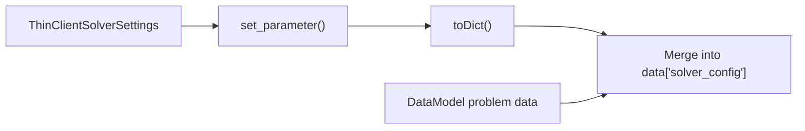
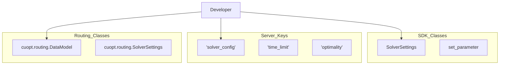

<!-- source: DeepWiki mcp.deepwiki.com · repo NVIDIA/cuopt-examples · page 3.2 SolverSettings and Configuration · fetched 2026-10-26 -->

# SolverSettings and Configuration

<details>
<summary>Relevant source files</summary>

The following files were used as context for generating this wiki page:

- [README.md](README.md)
- [VERSION](VERSION)
- [ci/release/update_version.sh](ci/release/update_version.sh)
- [intra-factory_transport/cost_matrix_and_waypoint_graph_creation.ipynb](intra-factory_transport/cost_matrix_and_waypoint_graph_creation.ipynb)
- [intra-factory_transport/intra-factory_transport.ipynb](intra-factory_transport/intra-factory_transport.ipynb)
- [last_mile_delivery/cvrp_daily_deliveries.ipynb](last_mile_delivery/cvrp_daily_deliveries.ipynb)
- [last_mile_delivery/cvrptw_benchmark_gehring_homberger.ipynb](last_mile_delivery/cvrptw_benchmark_gehring_homberger.ipynb)
- [last_mile_delivery/cvrptw_service_team_routing.ipynb](last_mile_delivery/cvrptw_service_team_routing.ipynb)
- [workforce_optimization/workforce_optimization_milp.ipynb](workforce_optimization/workforce_optimization_milp.ipynb)

</details>


## Purpose and Scope

This page documents how to configure solver behavior in cuOpt through various settings interfaces. Solver configuration controls execution parameters such as time limits, logging verbosity, optimality tolerances, and solver method selection. Different cuOpt APIs provide distinct configuration mechanisms that are appropriate for their respective usage patterns, ranging from direct SDK usage to remote service calls.

For information about the Problem API itself, see [Problem API](#3.1). For details on routing-specific configuration through DataModel, see [Routing DataModel API](#4.1).

---

## Configuration Approaches by API

cuOpt provides three distinct configuration mechanisms corresponding to its primary access patterns:

### Configuration Flow Diagram
"Natural Language Space" to "Code Entity Space" mapping for configuration entry points:

```mermaid
graph TB
    subgraph "SDK_Direct_API [cuopt.linear_programming]"
        SolverSettings["SolverSettings Class"]
        ProblemSolve["Problem.solve(settings)"]
        SolverSettings --> ["set_parameter()"] --> ProblemSolve
    end
    
    subgraph "Server_Based_API [cuopt_sh_client]"
        SolverDict["solver_config Dictionary"]
        ServerEndpoint["/cuopt/LP_solve"]
        SolverDict --> ["problem_data['solver_config']"] --> ServerEndpoint
    end
    
    subgraph "DataModel_API [cuopt_sh_client]"
        ThinClientSettings["ThinClientSolverSettings Class"]
        DataModel["DataModel Instance"]
        ThinClientSettings --> ["toDict()"] --> DataModel
    end
```

**Configuration Approach Mapping**

| API Type | Configuration Class/Structure | Usage Context |
|----------|------------------------------|---------------|
| SDK Direct API | `SolverSettings` | Mathematical programming via `Problem` class |
| Server-Based API | Dictionary with `"solver_config"` key | JSON payloads to cuOpt service endpoints |
| DataModel API | `ThinClientSolverSettings` | LP/MILP problems with structured `DataModel` |

Sources: [workforce_optimization/workforce_optimization_milp.ipynb:109-110](), [workforce_optimization/workforce_optimization_milp.ipynb:289-292]()

---

## SolverSettings Class (SDK Direct API)

The `SolverSettings` class provides configuration for problems solved through the direct Python SDK API using the `Problem` class [workforce_optimization/workforce_optimization_milp.ipynb:109-110]().

### Basic Usage Pattern

```python
from cuopt.linear_programming.solver_settings import SolverSettings

settings = SolverSettings()
settings.set_parameter("time_limit", 60.0)
settings.set_parameter("log_to_console", True)
settings.set_parameter("method", 0)

problem.solve(settings)
```

### Configuration Parameters

| Parameter | Type | Description | Default |
|-----------|------|-------------|---------|
| `time_limit` | float | Maximum solve time in seconds | No limit |
| `log_to_console` | bool | Enable solver output logging | False |
| `method` | int | Solver method selection (0=default) | 0 |

**Example: Workforce Optimization**
The workforce optimization example demonstrates standard `SolverSettings` configuration for a Mixed Integer Linear Program (MILP) [workforce_optimization/workforce_optimization_milp.ipynb:289-292]().

Sources: [workforce_optimization/workforce_optimization_milp.ipynb:109-110](), [workforce_optimization/workforce_optimization_milp.ipynb:289-292]()

---

## Solver Config Dictionaries (Server-Based API)

When submitting problems to the cuOpt service via the `/cuopt/optimized_routes` or `/cuopt/LP_solve` endpoints, solver configuration is provided as a dictionary under the `"solver_config"` key.

### Dictionary Structure for LP/MILP
For LP/MILP problems, nested tolerance settings are supported:

```python
problem_data["solver_config"] = {
    "time_limit": 1.0,
    "tolerances": {
        "optimality": 0.0001
    }
}
```

### Dictionary Structure for Routing
For Vehicle Routing Problems (VRP), the configuration typically focuses on the time limit:

```python
cuopt_problem_data["solver_config"] = {
    "time_limit": 60.0
}
```

**Example: CVRPTW Benchmark**
Benchmark examples for large-scale problems (e.g., Gehring & Homberger 1000 locations) demonstrate adjusting the `time_limit` to balance speed and solution quality [last_mile_delivery/cvrptw_benchmark_gehring_homberger.ipynb:512-514]().

Sources: [last_mile_delivery/cvrptw_benchmark_gehring_homberger.ipynb:512-514](), [last_mile_delivery/cvrptw_benchmark_gehring_homberger.ipynb:551-553]()

---

## ThinClientSolverSettings (DataModel API)

The `ThinClientSolverSettings` class is used when constructing LP/MILP problems with the `DataModel` abstraction for server-based solving.

### Configuration Methods

| Method | Parameters | Description |
|--------|------------|-------------|
| `set_parameter(key, value)` | key: str, value: any | Set general solver parameters |
| `set_optimality_tolerance(tol)` | tol: float | Set optimality tolerance directly |
| `toDict()` | None | Convert to dictionary for JSON serialization |

### Integration with DataModel
The configuration is merged into the final problem dictionary before submission:



Sources: [workforce_optimization/workforce_optimization_milp.ipynb:289-292]()

---

## Common Configuration Parameters

### Time Limits
Time limits control the maximum duration the solver will execute before terminating. This is the most critical parameter for performance tuning.

| Time Limit | Use Case | Example Context |
|------------|----------|---------|
| 5 seconds | Small problems, quick iterations | Service team routing [last_mile_delivery/cvrptw_service_team_routing.ipynb:632-634]() |
| 60 seconds | Medium problems, development testing | Workforce optimization [workforce_optimization/workforce_optimization_milp.ipynb:290]() |
| 120+ seconds | Large-scale problems, production solving | Gehring & Homberger benchmarks [last_mile_delivery/cvrptw_benchmark_gehring_homberger.ipynb:552]() |

### Optimality Tolerances
Optimality tolerances define the convergence criteria for LP/MILP solvers. Tighter tolerances produce more accurate solutions but may require longer solve times.

### Logging Control
Logging control enables or disables solver output to the console, primarily used in the SDK API via `log_to_console` [workforce_optimization/workforce_optimization_milp.ipynb:291]().

---

## Configuration API Comparison

### Code Entity Reference Map
Mapping system names to code entities for developers:



| Aspect | `SolverSettings` (SDK) | Dictionary Config (Server) |
|--------|----------------|-------------------|
| **Import Path** | `cuopt.linear_programming.solver_settings` [workforce_optimization/workforce_optimization_milp.ipynb:110]() | N/A (JSON/Dict) |
| **Usage** | `problem.solve(settings)` [workforce_optimization/workforce_optimization_milp.ipynb:301]() | `client.get_optimized_routes(data)` [last_mile_delivery/cvrptw_benchmark_gehring_homberger.ipynb:517]() |
| **Primary Method** | `set_parameter(key, value)` | Direct assignment |

Sources: [workforce_optimization/workforce_optimization_milp.ipynb:110](), [workforce_optimization/workforce_optimization_milp.ipynb:301](), [last_mile_delivery/cvrptw_benchmark_gehring_homberger.ipynb:517](), [last_mile_delivery/cvrptw_service_team_routing.ipynb:165]()

---

