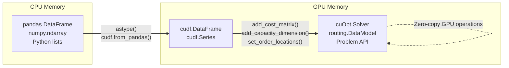
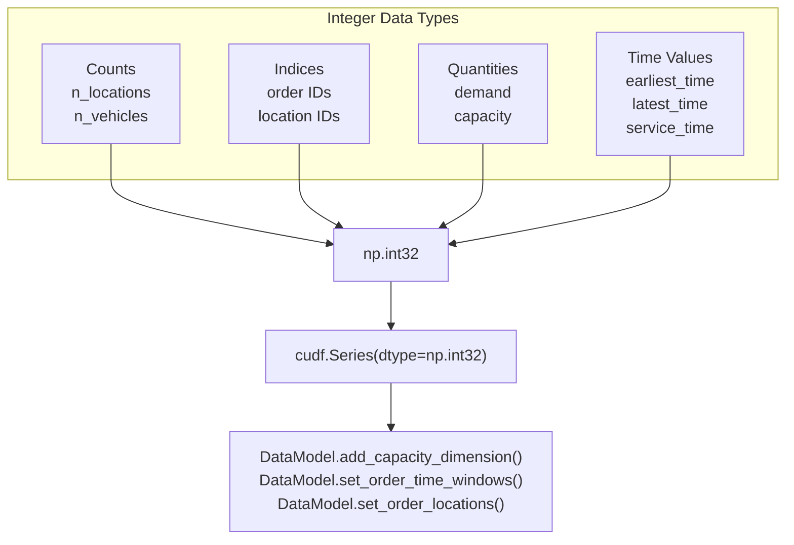
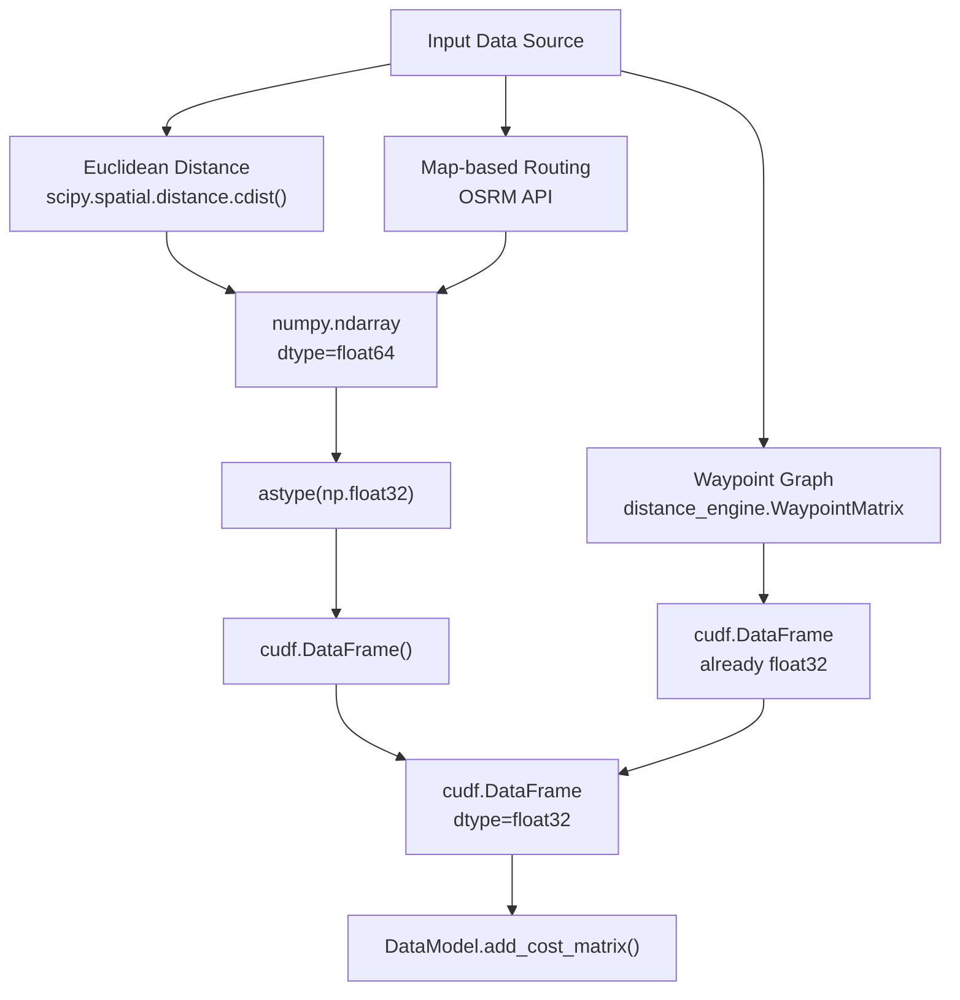
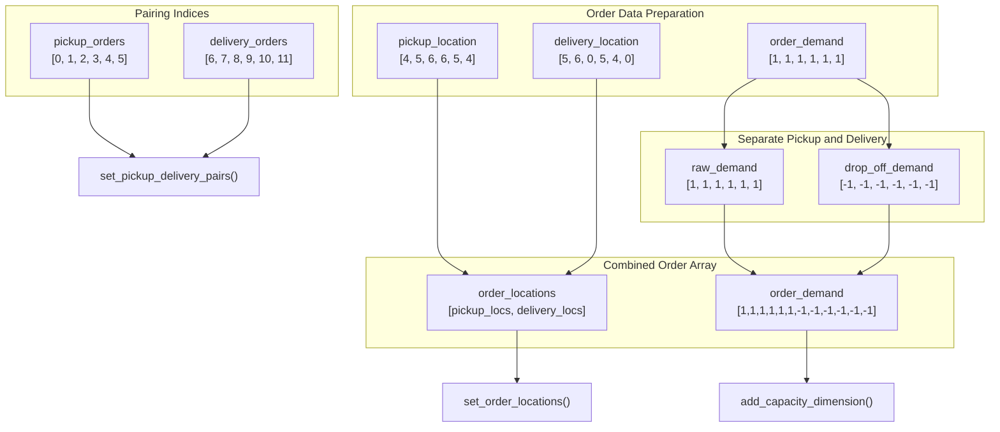
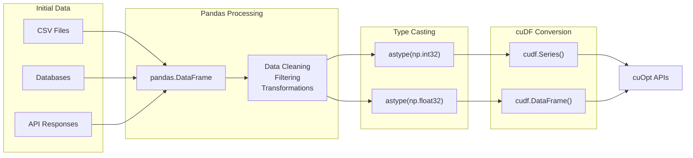
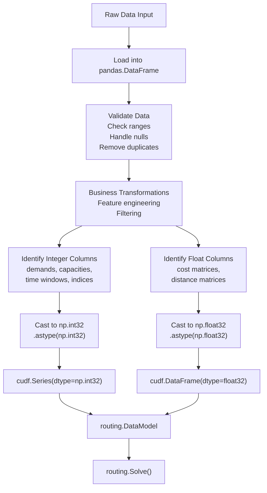

<!-- source: DeepWiki mcp.deepwiki.com · repo NVIDIA/cuopt-examples · page 3.3 Data Types and GPU Acceleration · fetched 2026-10-26 -->

# Data Types and GPU Acceleration

<details>
<summary>Relevant source files</summary>

The following files were used as context for generating this wiki page:

- [AI-accelerated-routing/initializing_cuopt_with_rl_solutions.ipynb](AI-accelerated-routing/initializing_cuopt_with_rl_solutions.ipynb)
- [AI-accelerated-routing/training_rl_agent_for_vrp.ipynb](AI-accelerated-routing/training_rl_agent_for_vrp.ipynb)
- [diet_optimization/diet_optimization_lp.ipynb](diet_optimization/diet_optimization_lp.ipynb)
- [diet_optimization/diet_optimization_milp.ipynb](diet_optimization/diet_optimization_milp.ipynb)
- [intra-factory_transport/cost_matrix_and_waypoint_graph_creation.ipynb](intra-factory_transport/cost_matrix_and_waypoint_graph_creation.ipynb)
- [intra-factory_transport/intra-factory_transport.ipynb](intra-factory_transport/intra-factory_transport.ipynb)
- [last_mile_delivery/cvrp_daily_deliveries.ipynb](last_mile_delivery/cvrp_daily_deliveries.ipynb)
- [last_mile_delivery/cvrptw_benchmark_gehring_homberger.ipynb](last_mile_delivery/cvrptw_benchmark_gehring_homberger.ipynb)
- [last_mile_delivery/cvrptw_service_team_routing.ipynb](last_mile_delivery/cvrptw_service_team_routing.ipynb)
- [portfolio_optimization/cvar_portfolio_optimization.ipynb](portfolio_optimization/cvar_portfolio_optimization.ipynb)

</details>


## Purpose and Scope

This page documents the data type requirements and GPU acceleration mechanisms used throughout the cuOpt Python SDK. All cuOpt routing and optimization problems require GPU-resident data structures with specific numeric types to achieve optimal performance. Understanding these requirements is essential for proper data preparation and efficient solver execution.

For information about the Problem class API that consumes these data types, see [Problem API](). For routing-specific data structures, see [Routing DataModel API]().

---

## GPU-Accelerated Data Structures

cuOpt leverages **cuDF** (CUDA DataFrames) to keep data on the GPU throughout the optimization process, eliminating expensive CPU-GPU data transfers during solving. All input data to cuOpt APIs must be provided as `cudf.DataFrame` or `cudf.Series` objects rather than their pandas equivalents.



**Data Flow Architecture**

Sources: [last_mile_delivery/cvrptw_benchmark_gehring_homberger.ipynb:131-137](), [last_mile_delivery/cvrp_daily_deliveries.ipynb:156-163](), [intra-factory_transport/intra-factory_transport.ipynb:132-138]()

### cudf.DataFrame

The primary container for structured tabular data. Cost matrices, constraint matrices, and multi-column data all use `cudf.DataFrame`.

| Data Structure | cuOpt API Method | Purpose |
|----------------|------------------|---------|
| Cost Matrix | `DataModel.add_cost_matrix()` | Travel costs between locations |
| Time Matrix | `DataModel.add_cost_matrix()` | Travel times when using time windows |
| Multiple Columns | `Problem.addConstraint()` | Constraint coefficient data |

### cudf.Series

The primary container for single-column vector data. Demands, capacities, time windows, and location indices all use `cudf.Series`.

| Data Structure | cuOpt API Method | Purpose |
|----------------|------------------|---------|
| Demands | `DataModel.add_capacity_dimension()` | Resource requirements per location |
| Capacities | `DataModel.add_capacity_dimension()` | Resource limits per vehicle |
| Time Windows | `DataModel.set_order_time_windows()` | Earliest/latest service times |
| Locations | `DataModel.set_order_locations()` | Location indices for orders |
| Service Times | `DataModel.set_order_service_times()` | Time spent at each location |

Sources: [last_mile_delivery/cvrp_daily_deliveries.ipynb:455-466](), [last_mile_delivery/cvrptw_service_team_routing.ipynb:571-588]()

---

## Type Requirements

cuOpt requires **explicit numeric types** to ensure consistent GPU memory layout and computational precision. All numeric data must be cast to the appropriate type before passing to cuOpt APIs.

### Integer Data: np.int32

All integer-valued data must use the **`np.int32`** dtype. This includes:

- Location counts
- Vehicle counts
- Demand quantities
- Capacity values
- Time window bounds (when measured in integer units)
- Service time durations
- Order indices
- Vehicle indices



**Type Casting Pattern for Integers**

Sources: [last_mile_delivery/cvrptw_benchmark_gehring_homberger.ipynb:361-389](), [last_mile_delivery/cvrptw_service_team_routing.ipynb:581-616]()

### Float Data: np.float32

All floating-point data must use the **`np.float32`** dtype. This includes:

- Cost matrix entries
- Distance matrix entries  
- Time matrix entries (when fractional)
- Objective coefficients
- Constraint coefficients

**Type Casting Pattern for Floats**

The most common pattern for cost matrices:

[last_mile_delivery/cvrptw_benchmark_gehring_homberger.ipynb:299-299]()
```python
cost_matrix_df = cudf.DataFrame(cost_matrix.astype(np.float32))
```

[last_mile_delivery/cvrp_daily_deliveries.ipynb:433-433]()
```python
distance_matrix_df = cudf.DataFrame(np.array(distance_matrix).astype(np.float32))
```

[last_mile_delivery/cvrptw_service_team_routing.ipynb:558-558]()
```python
cost_matrix = cudf.DataFrame(time_matrix).astype(np.float32)
```

Sources: [last_mile_delivery/cvrptw_benchmark_gehring_homberger.ipynb:295-300](), [last_mile_delivery/cvrp_daily_deliveries.ipynb:421-435](), [last_mile_delivery/cvrptw_service_team_routing.ipynb:552-560]()

### Type Requirement Summary

| Data Category | Required Type | cudf Container | Example API |
|---------------|---------------|----------------|-------------|
| Cost matrices | `np.float32` | `cudf.DataFrame` | `add_cost_matrix()` |
| Demands | `np.int32` | `cudf.Series` | `add_capacity_dimension()` |
| Capacities | `np.int32` | `cudf.Series` | `add_capacity_dimension()` |
| Time windows | `np.int32` | `cudf.Series` | `set_order_time_windows()` |
| Service times | `np.int32` | `cudf.Series` | `set_order_service_times()` |
| Location indices | `np.int32` | `cudf.Series` | `set_order_locations()` |
| Vehicle locations | `int` | `cudf.Series` | `set_vehicle_locations()` |

---

## Data Type Patterns by DataModel Component

### Cost Matrix Construction

Cost matrices are the foundation of routing problems, encoding the cost (distance, time, or other metric) of traveling between locations.



**Pattern 1: From Euclidean Distance**

[last_mile_delivery/cvrptw_benchmark_gehring_homberger.ipynb:295-300]()
```python
coords = list(zip(orders['xcord'].to_list(), orders['ycord'].to_list()))
cost_matrix = distance.cdist(coords, coords, 'euclidean')
cost_matrix_df = cudf.DataFrame(cost_matrix.astype(np.float32))
```

**Pattern 2: From Pre-computed Array**

[last_mile_delivery/cvrp_daily_deliveries.ipynb:421-434]()
```python
distance_matrix = [
    [0.0, 3.1, 5.0, ...],
    [3.1, 0.0, 7.3, ...],
    ...
]
distance_matrix_df = cudf.DataFrame(np.array(distance_matrix).astype(np.float32))
```

**Pattern 3: From Waypoint Graph**

[intra-factory_transport/intra-factory_transport.ipynb:241-252]()
```python
waypoint_graph = distance_engine.WaypointMatrix(offsets, edges, weights)
time_matrix = waypoint_graph.compute_cost_matrix(target_locations)
# time_matrix is already a cudf.DataFrame with float32
```

Sources: [last_mile_delivery/cvrptw_benchmark_gehring_homberger.ipynb:285-300](), [intra-factory_transport/cost_matrix_and_waypoint_graph_creation.ipynb:236-252]()

### Capacity Dimensions

Capacity constraints require both demand and capacity vectors with `np.int32` dtype.

[last_mile_delivery/cvrptw_benchmark_gehring_homberger.ipynb:355-365]()
```python
# Location demand
location_demand = cudf.Series(orders['demand'].values, dtype=np.int32)

# Vehicle capacities
vehicle_capacities = cudf.Series([vehicle_capacity] * n_vehicles, dtype=np.int32)

# Add to model
data_model.add_capacity_dimension("demand", location_demand, vehicle_capacities)
```

**Multi-Dimensional Capacity Example**

[last_mile_delivery/cvrptw_service_team_routing.ipynb:605-618]()
```python
# First capacity dimension (service type 1)
service_type1_demand = cudf.Series(
    service_location_data["service_type1_demand"]
).astype(np.int32)
service_type1_capacity = cudf.Series(
    vehicle_data["capacity_service_type1"]
).astype(np.int32)
data_model.add_capacity_dimension("service_type1", service_type1_demand, service_type1_capacity)

# Second capacity dimension (service type 2)
service_type2_demand = cudf.Series(
    service_location_data["service_type2_demand"]
).astype(np.int32)
service_type2_capacity = cudf.Series(
    vehicle_data["capacity_service_type2"]
).astype(np.int32)
data_model.add_capacity_dimension("service_type2", service_type2_demand, service_type2_capacity)
```

Sources: [last_mile_delivery/cvrptw_benchmark_gehring_homberger.ipynb:350-365](), [last_mile_delivery/cvrptw_service_team_routing.ipynb:595-618]()

### Time Windows and Service Times

Time window constraints require integer-typed `cudf.Series` for earliest times, latest times, and service durations.

[last_mile_delivery/cvrptw_benchmark_gehring_homberger.ipynb:372-390]()
```python
# Order time windows
earliest_times = cudf.Series(orders['earliest_time'].values, dtype=np.int32)
latest_times = cudf.Series(orders['latest_time'].values, dtype=np.int32)
data_model.set_order_time_windows(earliest_times, latest_times)

# Service times at each location
service_times = cudf.Series(orders['service_time'].values, dtype=np.int32)
data_model.set_order_service_times(service_times)
```

**Vehicle Time Windows**

[last_mile_delivery/cvrptw_service_team_routing.ipynb:605-609]()
```python
vehicle_earliest = cudf.Series(
    vehicle_data["vehicle_availability_earliest"]
).astype(np.int32)
vehicle_latest = cudf.Series(
    vehicle_data["vehicle_availability_latest"]
).astype(np.int32)
data_model.set_vehicle_time_windows(vehicle_earliest, vehicle_latest)
```

Sources: [last_mile_delivery/cvrptw_benchmark_gehring_homberger.ipynb:372-390](), [last_mile_delivery/cvrptw_service_team_routing.ipynb:600-609]()

### Pickup-Delivery Pairs

Pickup-delivery problems require careful handling of order indices and paired locations.



[intra-factory_transport/intra-factory_transport.ipynb:388-413]()
```python
# Pickup has positive demand, delivery has negative demand
raw_demand = transport_order_data["order_demand"]
drop_off_demand = raw_demand * -1
order_demand = cudf.concat([raw_demand, drop_off_demand], ignore_index=True)

# Combine pickup and delivery locations
pickup_order_locations = cudf.Series([target_map[loc] for loc in transport_order_data['pickup_location'].to_arrow().to_pylist()])
delivery_order_locations = cudf.Series([target_map[loc] for loc in transport_order_data['delivery_location'].to_arrow().to_pylist()])
order_locations = cudf.concat([pickup_order_locations, delivery_order_locations], ignore_index=True)

data_model.set_order_locations(order_locations)

# Create pickup-delivery pairs (indexed into order array)
npair_orders = int(len(order_locations)/2)
pickup_orders = cudf.Series([i for i in range(npair_orders)])
delivery_orders = cudf.Series([i + npair_orders for i in range(npair_orders)])
data_model.set_pickup_delivery_pairs(pickup_orders, delivery_orders)
```

Sources: [intra-factory_transport/intra-factory_transport.ipynb:382-473]()

---

## Conversion and Data Preparation

### From Pandas to cuDF

The most common workflow starts with pandas DataFrames and requires conversion to cudf.



**Pattern 1: Direct Series Conversion**

[last_mile_delivery/cvrp_daily_deliveries.ipynb:460-464]()
```python
# Direct construction with explicit type
location_demand = cudf.Series([0, 4, 4, 2, 2, 1, 2, 1], dtype=np.int32)
vehicle_capacity = cudf.Series([8, 8, 4], dtype=np.int32)
```

**Pattern 2: From Pandas Column with Type Cast**

[last_mile_delivery/cvrptw_benchmark_gehring_homberger.ipynb:361-361]()
```python
location_demand = cudf.Series(orders['demand'].values, dtype=np.int32)
```

**Pattern 3: DataFrame Construction**

[intra-factory_transport/intra-factory_transport.ipynb:292-303]()
```python
transport_order_data = cudf.DataFrame({
    "pickup_location":       [4,  5,  6,  6,  5,  4],
    "delivery_location":     [5,  6,  0,  5,  4,  0],
    "order_demand":          [1,  1,  1,  1,  1,  1],
    "earliest_pickup":       [0,  0,  0,  0,  0,  0],
    "latest_pickup":         [10, 20, 30, 10, 20, 30],
    "pickup_service_time":   [2,  2,  2,  2,  2,  2],
    "earliest_delivery":     [0,  0,  0,  0,  0,  0],
    "latest_delivery":       [45, 45, 45, 45, 45, 45],
    "delivery_serivice_time":[2,  2,  2,  2,  2,  2]
})
```

Sources: [last_mile_delivery/cvrp_daily_deliveries.ipynb:454-466](), [last_mile_delivery/cvrptw_benchmark_gehring_homberger.ipynb:350-390](), [intra-factory_transport/intra-factory_transport.ipynb:286-339]()

### Concatenation Operations

When combining multiple data series (e.g., for pickup-delivery problems), use `cudf.concat()`.

[intra-factory_transport/intra-factory_transport.ipynb:400-403]()
```python
order_demand = cudf.concat([raw_demand, drop_off_demand], ignore_index=True)
```

[intra-factory_transport/intra-factory_transport.ipynb:492-503]()
```python
# Concatenate time windows
vehicle_earliest_time = cudf.Series([factory_open_time] * n_vehicles)
order_time_window_earliest = cudf.concat(
    [transport_order_data["earliest_pickup"], 
     transport_order_data["earliest_delivery"]], 
    ignore_index=True
)

vehicle_latest_time = cudf.Series([factory_close_time] * n_vehicles)
order_time_window_latest = cudf.concat(
    [transport_order_data["latest_pickup"], 
     transport_order_data["latest_delivery"]], 
    ignore_index=True
)
```

Sources: [intra-factory_transport/intra-factory_transport.ipynb:388-506]()

---

## Performance Considerations

### GPU Memory Efficiency

Using cudf DataFrames keeps all data GPU-resident throughout the optimization, avoiding CPU-GPU memory transfers during solver execution. This is critical for large-scale problems.

| Problem Size | Data Structure Impact |
|--------------|----------------------|
| Small (< 100 locations) | Minimal difference, CPU overhead acceptable |
| Medium (100-500 locations) | 2-5x speedup from GPU data structures |
| Large (500-1000 locations) | 5-10x speedup, GPU-resident data essential |
| Very Large (> 1000 locations) | 10x+ speedup, CPU-GPU transfers become bottleneck |

### Type Precision Trade-offs

**Why float32 instead of float64?**
- GPU computation is optimized for 32-bit operations
- 50% memory savings over float64
- Sufficient precision for routing cost calculations
- Typical cost ranges (0.1 to 10000) well within float32 precision (~7 decimal digits)

**Why int32 instead of int64?**
- 50% memory savings
- Adequate range for typical problem sizes (max value: 2,147,483,647)
- Location counts, vehicle counts, and demand values rarely exceed int32 range
- GPU integer operations optimized for 32-bit

### Data Transfer Patterns to Avoid

**Anti-Pattern 1: Repeated Conversions**
```python
# BAD: Converting back and forth
for iteration in range(num_iterations):
    pandas_data = cudf_data.to_pandas()  # GPU -> CPU
    # ... modify pandas_data ...
    cudf_data = cudf.from_pandas(pandas_data)  # CPU -> GPU
    solution = routing.Solve(data_model, settings)
```

**Anti-Pattern 2: Mixed Data Types**
```python
# BAD: Inconsistent types
demands = cudf.Series([1.0, 2.0, 3.0], dtype=np.float32)  # Should be int32
capacities = cudf.Series([10, 20, 30])  # No explicit dtype
```

Sources: Inferred from common patterns across [last_mile_delivery/cvrptw_benchmark_gehring_homberger.ipynb](), [last_mile_delivery/cvrp_daily_deliveries.ipynb](), [last_mile_delivery/cvrptw_service_team_routing.ipynb]()

---

## Best Practices

### Type Safety Checklist

| Data Category | Validation Check |
|---------------|------------------|
| **Cost matrices** | `assert cost_matrix.dtype == np.float32` |
| **Demands** | `assert demands.dtype == np.int32` |
| **Capacities** | `assert capacities.dtype == np.int32` |
| **Time windows** | `assert earliest.dtype == np.int32 and latest.dtype == np.int32` |
| **Container type** | `assert isinstance(data, (cudf.DataFrame, cudf.Series))` |

### Recommended Data Preparation Workflow



**Complete Example from Data Load to Solve**

```python
# Step 1: Load and clean data (pandas)
import pandas as pd
import numpy as np
import cudf
from cuopt import routing

orders_df = pd.read_csv('orders.csv')
orders_df = orders_df.dropna()

# Step 2: Type casting (pandas)
orders_df['demand'] = orders_df['demand'].astype(np.int32)
orders_df['earliest_time'] = orders_df['earliest_time'].astype(np.int32)
orders_df['latest_time'] = orders_df['latest_time'].astype(np.int32)

# Step 3: Convert to cudf
demand = cudf.Series(orders_df['demand'].values, dtype=np.int32)
earliest = cudf.Series(orders_df['earliest_time'].values, dtype=np.int32)
latest = cudf.Series(orders_df['latest_time'].values, dtype=np.int32)

# Step 4: Create cost matrix with float32
cost_matrix = distance.cdist(coords, coords, 'euclidean')
cost_matrix_df = cudf.DataFrame(cost_matrix.astype(np.float32))

# Step 5: Build DataModel
n_locations = len(orders_df)
n_vehicles = 10
data_model = routing.DataModel(n_locations, n_vehicles)

data_model.add_cost_matrix(cost_matrix_df)
vehicle_capacity = cudf.Series([100] * n_vehicles, dtype=np.int32)
data_model.add_capacity_dimension("demand", demand, vehicle_capacity)
data_model.set_order_time_windows(earliest, latest)

# Step 6: Solve
solver_settings = routing.SolverSettings()
solution = routing.Solve(data_model, solver_settings)
```

Sources: Pattern synthesized from [last_mile_delivery/cvrptw_benchmark_gehring_homberger.ipynb:186-460](), [last_mile_delivery/cvrp_daily_deliveries.ipynb:384-593]()

### Common Pitfalls and Solutions

| Pitfall | Symptom | Solution |
|---------|---------|----------|
| **Forgetting dtype specification** | Type inference errors, performance degradation | Always specify `dtype=np.int32` or `dtype=np.float32` |
| **Using pandas instead of cudf** | Slow data transfers, reduced performance | Convert to cudf before calling cuOpt APIs |
| **Mixed int types** | Inconsistent behavior, type errors | Standardize on `np.int32` for all integer data |
| **Float64 in cost matrices** | Increased memory usage, slower GPU ops | Cast to `np.float32` before creating `cudf.DataFrame` |
| **Missing astype() calls** | Runtime type errors from cuOpt | Add explicit `.astype()` after data transformations |
| **Direct numpy array passing** | API rejection, type errors | Wrap in `cudf.Series()` or `cudf.DataFrame()` |

### Memory Management Tips

For extremely large problems (> 10,000 locations):

1. **Sparse Matrices**: For cost matrices with many zero/infinite entries, consider sparse representations before conversion to cudf.
2. **Batch Processing**: Split large datasets into smaller sub-problems when feasible.
3. **Data Compression**: Use `np.int16` for intermediate calculations if ranges permit, then cast to `np.int32` for cuOpt.
4. **GPU Memory Monitoring**: Use `cudf.utils.get_gpu_memory_usage()` to track allocations.

**Example: Efficient Large-Scale Data Preparation**

```python
# For 1000+ location problems
n_locations = 1000
n_vehicles = 250

# Pre-allocate with correct types
demands = cudf.Series(np.zeros(n_locations, dtype=np.int32))
capacities = cudf.Series(np.full(n_vehicles, 200, dtype=np.int32))

# Build cost matrix in chunks if needed
chunk_size = 100
cost_matrix = np.zeros((n_locations, n_locations), dtype=np.float32)
for i in range(0, n_locations, chunk_size):
    for j in range(0, n_locations, chunk_size):
        cost_matrix[i:i+chunk_size, j:j+chunk_size] = compute_cost_chunk(i, j, chunk_size)

cost_matrix_df = cudf.DataFrame(cost_matrix)
```

Sources: Pattern inferred from [last_mile_delivery/cvrptw_benchmark_gehring_homberger.ipynb:240-365]()

---

## Type Mapping Reference

Complete mapping of Python/NumPy types to cuOpt-compatible types:

| Input Type | Convert To | cudf Container | Example Use Case |
|------------|-----------|----------------|------------------|
| `int`, `list[int]` | `np.int32` | `cudf.Series` | Order indices, vehicle IDs |
| `float`, `list[float]` | `np.float32` | `cudf.Series` or `cudf.DataFrame` | Cost values |
| `list[list[float]]` | `np.array(dtype=np.float32)` | `cudf.DataFrame` | Cost matrices |
| `pandas.Series[int]` | `.astype(np.int32)` → `cudf.Series` | `cudf.Series` | Demands, capacities |
| `pandas.Series[float]` | `.astype(np.float32)` → `cudf.Series` | `cudf.Series` | Single cost vector |
| `pandas.DataFrame` | `.astype(np.float32)` → `cudf.DataFrame` | `cudf.DataFrame` | Multi-column data |
| `numpy.ndarray[int]` | `.astype(np.int32)` → `cudf.Series` | `cudf.Series` | Computed demands |
| `numpy.ndarray[float]` | `.astype(np.float32)` → `cudf.DataFrame` | `cudf.DataFrame` | Distance matrices |

Sources: Synthesized from type casting patterns across [last_mile_delivery/cvrptw_benchmark_gehring_homberger.ipynb](), [last_mile_delivery/cvrp_daily_deliveries.ipynb](), [last_mile_delivery/cvrptw_service_team_routing.ipynb](), [intra-factory_transport/intra-factory_transport.ipynb]()

---

