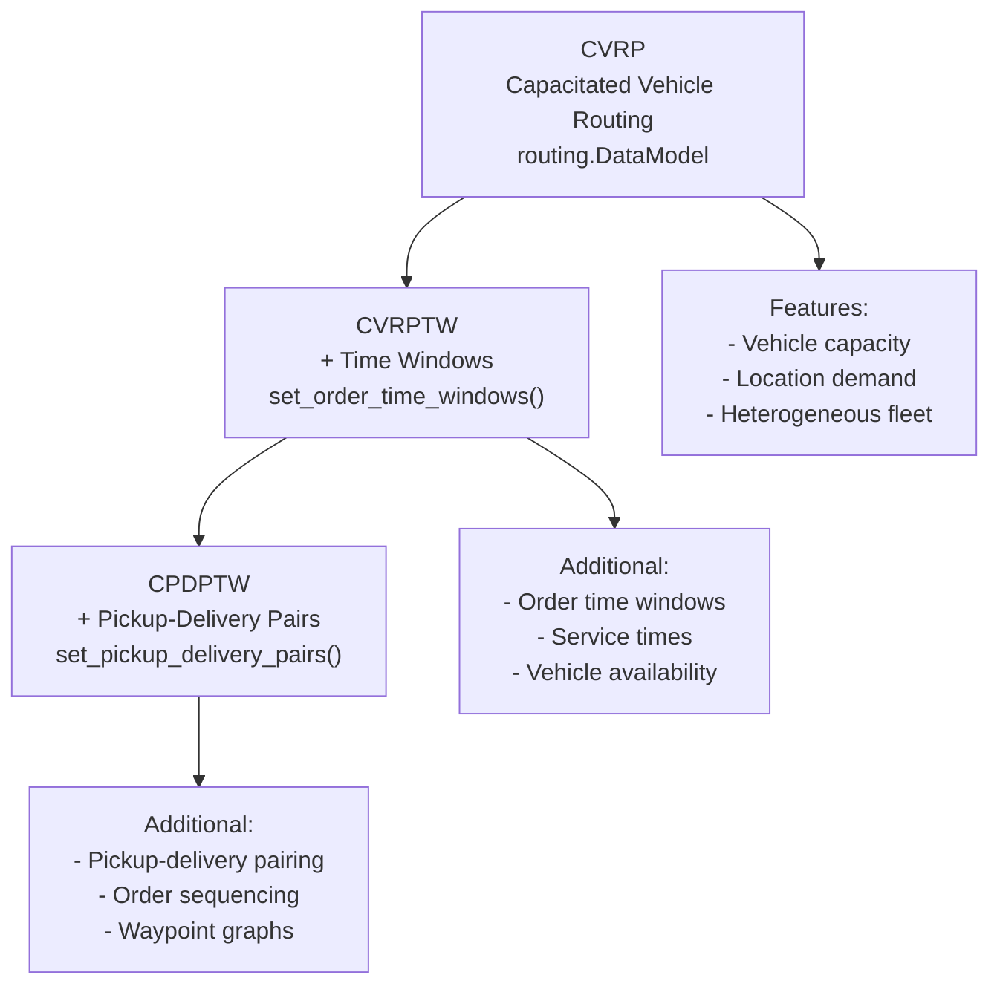
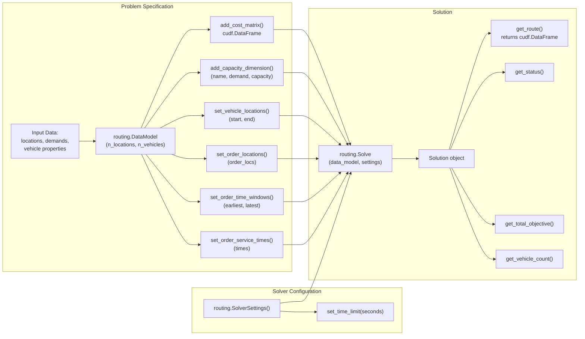
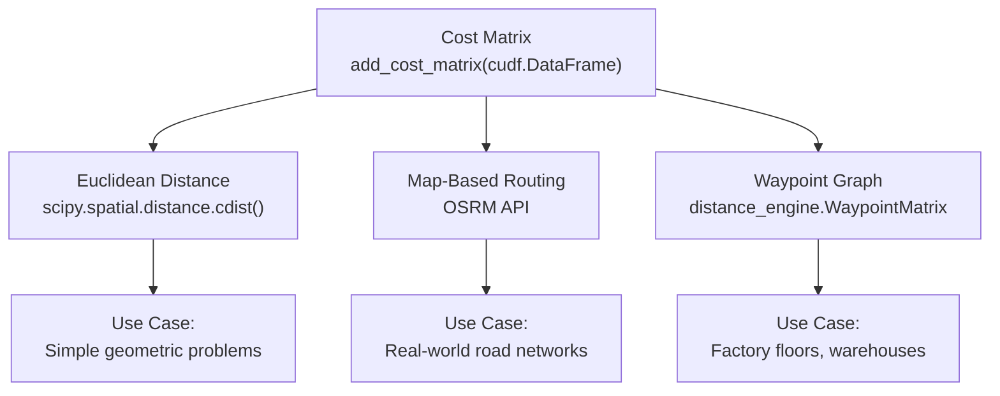
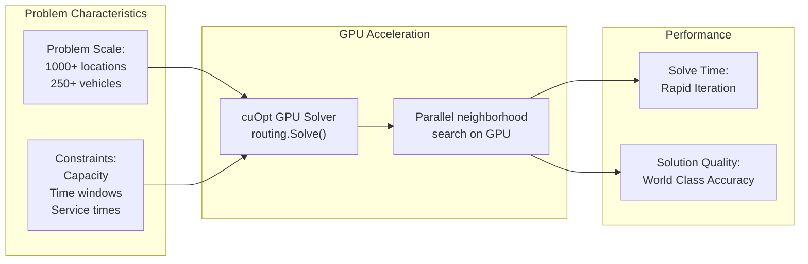

<!-- source: DeepWiki mcp.deepwiki.com · repo NVIDIA/cuopt-examples · page 4 Vehicle Routing Problems · fetched 2026-10-26 -->

# Vehicle Routing Problems

<details>
<summary>Relevant source files</summary>

The following files were used as context for generating this wiki page:

- [intra-factory_transport/README.md](intra-factory_transport/README.md)
- [intra-factory_transport/cost_matrix_and_waypoint_graph_creation.ipynb](intra-factory_transport/cost_matrix_and_waypoint_graph_creation.ipynb)
- [intra-factory_transport/intra-factory_transport.ipynb](intra-factory_transport/intra-factory_transport.ipynb)
- [last_mile_delivery/README.md](last_mile_delivery/README.md)
- [last_mile_delivery/cvrp_daily_deliveries.ipynb](last_mile_delivery/cvrp_daily_deliveries.ipynb)
- [last_mile_delivery/cvrptw_benchmark_gehring_homberger.ipynb](last_mile_delivery/cvrptw_benchmark_gehring_homberger.ipynb)
- [last_mile_delivery/cvrptw_service_team_routing.ipynb](last_mile_delivery/cvrptw_service_team_routing.ipynb)
- [routing_optimization_over_server/README.md](routing_optimization_over_server/README.md)
- [sample_lp_sever_notebooks/README.md](sample_lp_sever_notebooks/README.md)

</details>


## Purpose and Scope

This page provides an overview of Vehicle Routing Problem (VRP) variants supported by cuOpt and demonstrated in the repository examples. It covers the fundamental problem types, their constraints, and how they relate to real-world logistics scenarios.

For specific API documentation of the routing module, see [Routing DataModel API](#4.1). For mathematical programming problems (LP/MILP), see [Linear and Mixed-Integer Programming](#6). For server-based deployments, see [Server-Based Architecture](#7).

## VRP Variant Hierarchy

cuOpt supports three primary VRP variants that build upon each other in complexity:



**Sources:** [last_mile_delivery/cvrp_daily_deliveries.ipynb:8-19](), [last_mile_delivery/cvrptw_service_team_routing.ipynb:8-19](), [intra-factory_transport/intra-factory_transport.ipynb:9-21]()

## Problem Characteristics

| Variant | Constraints | Primary Use Cases | Example Scale |
|---------|------------|-------------------|---------------|
| CVRP | Capacity limits | Daily deliveries, last-mile logistics | 8 locations, 3 vehicles [last_mile_delivery/cvrp_daily_deliveries.ipynb:27-41]() |
| CVRPTW | Capacity + time windows | Service team routing, technician scheduling | 8 locations, 3 vehicles, time windows [last_mile_delivery/cvrptw_service_team_routing.ipynb:27-44]() |
| CPDPTW | Capacity + time windows + pairing | Intra-factory AMR routing, part transport | 1000 locations, 250 vehicles [last_mile_delivery/README.md:58-58]() |

**Sources:** [last_mile_delivery/README.md:11-64](), [intra-factory_transport/README.md:9-17]()

## Core cuOpt Routing API

### API Components and Data Flow



**Sources:** [last_mile_delivery/cvrptw_service_team_routing.ipynb:165-165](), [last_mile_delivery/cvrp_daily_deliveries.ipynb:156-160]()

### DataModel Initialization

All VRP problems begin with creating a `routing.DataModel` instance:

```python
# CVRP/CVRPTW initialization
data_model = routing.DataModel(n_locations, n_vehicles)

# CPDPTW initialization with orders
data_model = routing.DataModel(n_locations, n_vehicles, n_orders)
```

The `n_locations` parameter includes all points in the routing space (depot + service locations). For CPDPTW, `n_orders` represents the total number of distinct pickup and delivery transactions.

**Sources:** [last_mile_delivery/cvrptw_service_team_routing.ipynb:165-165](), [intra-factory_transport/intra-factory_transport.ipynb:133-133]()

## Cost Matrix Specification

### Cost Matrix Types



**Sources:** [intra-factory_transport/cost_matrix_and_waypoint_graph_creation.ipynb:16-25](), [last_mile_delivery/cvrp_daily_deliveries.ipynb:48-48]()

### Euclidean Distance Calculation

Simple problems can compute cost matrices directly from coordinates:

```python
from scipy.spatial import distance
cost_matrix = distance.cdist(points.values, points.values, "euclidean")
```

The distance matrix is converted to `cudf.DataFrame` with `np.float32` dtype before being passed to `add_cost_matrix()`.

**Sources:** [intra-factory_transport/cost_matrix_and_waypoint_graph_creation.ipynb:179-181](), [last_mile_delivery/cvrptw_benchmark_gehring_homberger.ipynb:131-137]()

### Waypoint Graph for Indoor Navigation

Factory and warehouse environments use waypoint graphs represented in Compressed Sparse Row (CSR) format [intra-factory_transport/intra-factory_transport.ipynb:184-185]():

```python
offsets = np.array([0, 1, 3, 7, 9, 11, 13, 15, 17, 20, 22])
edges =   np.array([2, 2, 4, 0, 1, 3, 5, 2, 6, 1, 7, 2, 8, 3, 9, 4, 8, 5, 7, 9, 6, 8])
weights = np.array([2, 2, 2, 2, 2, 2, 2, 2, 2, 2, 1, 2, 1, 2, 1, 1, 2, 1, 2, 2, 1, 2])
```

The `distance_engine.WaypointMatrix` computes shortest paths between target locations within the graph:

```python
waypoint_graph = distance_engine.WaypointMatrix(offsets, edges, weights)
```

**Sources:** [intra-factory_transport/intra-factory_transport.ipynb:195-197](), [intra-factory_transport/cost_matrix_and_waypoint_graph_creation.ipynb:24-24]()

## Capacity Constraints

### Single Capacity Dimension (CVRP)

Basic vehicle routing problems define one capacity dimension. The `add_capacity_dimension()` method incorporates varying demand requirements for different delivery locations and heterogeneous fleets [last_mile_delivery/README.md:23-25]().

**Sources:** [last_mile_delivery/README.md:23-25]()

### Multi-Dimensional Capacity (CVRPTW)

Service team routing demonstrates multiple capacity dimensions representing different skill types [last_mile_delivery/README.md:41-41](). cuOpt ensures vehicles only visit locations they can service based on matched technician capabilities.

**Sources:** [last_mile_delivery/README.md:41-43]()

## Time Window Constraints

### Order Time Windows

Time windows specify valid arrival times at service locations. Service times (duration at each location) are also incorporated into the model [last_mile_delivery/README.md:40-42]().

**Sources:** [last_mile_delivery/README.md:40-42]()

### Vehicle Time Windows

Vehicle availability is constrained through technician availability windows [last_mile_delivery/README.md:40-40](). This models scenarios where technicians have specific shifts or vehicles have limited operational hours.

**Sources:** [last_mile_delivery/README.md:40-40]()

## Pickup-Delivery Pairing (CPDPTW)

### Order Structure for Pickup-Delivery

CPDPTW problems treat pickups and deliveries as pairs. Each transport order has specific pickup and delivery locations with associated time windows [intra-factory_transport/README.md:13-14]().

**Sources:** [intra-factory_transport/README.md:13-14]()

### Pairing Specification

The solver enforces that each pickup occurs before its paired delivery on the same vehicle [intra-factory_transport/README.md:11-16]().

**Sources:** [intra-factory_transport/README.md:11-16]()

## Performance and Scalability

### Benchmark Problem Scale

cuOpt handles large-scale VRP instances efficiently:

| Problem | Locations | Vehicles | Objective |
|---------|-----------|----------|-----------|
| Gehring & Homberger C1_10_1 | 1000 | 100 | ~42478.95 |

The Gehring & Homberger benchmarks are well-established academic test problems used to compare VRP algorithms [last_mile_delivery/cvrptw_benchmark_gehring_homberger.ipynb:21-21]().

**Sources:** [last_mile_delivery/cvrptw_benchmark_gehring_homberger.ipynb:21-21](), [last_mile_delivery/README.md:58-58]()

### GPU Acceleration Benefits



**Sources:** [last_mile_delivery/cvrptw_benchmark_gehring_homberger.ipynb:19-21]()

cuOpt's GPU acceleration enables rapid re-optimization in dynamic environments where new orders arrive or conditions change during execution [last_mile_delivery/cvrptw_benchmark_gehring_homberger.ipynb:19-19]().

## Use Case Examples

### CVRP: Daily Deliveries

Micro fulfillment centers optimize last-mile delivery with heterogeneous vehicle fleets:

- **Problem**: 7 delivery locations, 1 depot, 3 vehicles (2 trucks, 1 van) [last_mile_delivery/cvrp_daily_deliveries.ipynb:27-41]()
- **Objective**: Minimize total distance [last_mile_delivery/cvrp_daily_deliveries.ipynb:19-19]()
- **Constraints**: Vehicle capacity varies (8, 8, 4 packages) [last_mile_delivery/cvrp_daily_deliveries.ipynb:35-39]()

**Sources:** [last_mile_delivery/cvrp_daily_deliveries.ipynb:1-42](), [last_mile_delivery/README.md:11-27]()

### CVRPTW: Service Team Routing

Field service organizations schedule technicians with different skills and availability:

- **Problem**: 7 service locations, 1 headquarters, 3 technicians [last_mile_delivery/cvrptw_service_team_routing.ipynb:27-44]()
- **Objective**: Minimize total travel time [last_mile_delivery/README.md:36-36]()
- **Constraints**: 
  - Skill-based capacity [last_mile_delivery/README.md:34-34]()
  - Location and technician time windows [last_mile_delivery/README.md:33-35]()

**Sources:** [last_mile_delivery/cvrptw_service_team_routing.ipynb:1-45](), [last_mile_delivery/README.md:29-45]()

### CPDPTW: Intra-Factory Transport

Autonomous mobile robots (AMRs) transport parts between processing stations:

- **Problem**: 3 processing stations, 1 depot, 3 AMRs [intra-factory_transport/intra-factory_transport.ipynb:30-37]()
- **Objective**: Minimize total transport time [intra-factory_transport/README.md:23-23]()
- **Constraints**: Pickup-delivery pairing and waypoint graph navigation [intra-factory_transport/README.md:13-15]()

**Sources:** [intra-factory_transport/intra-factory_transport.ipynb:1-37](), [intra-factory_transport/README.md:10-23]()

## Integration with Other cuOpt Features

VRP problems can leverage additional cuOpt capabilities:

- **Cost Matrix Generation**: Euclidean, OSRM, or Waypoint Graph methods [intra-factory_transport/cost_matrix_and_waypoint_graph_creation.ipynb:22-24]().
- **Server Deployment**: VRP problems can be solved via the cuOpt self-hosted service [routing_optimization_over_server/README.md:10-10]().
- **Benchmarking**: Performance comparison against best-known solutions [last_mile_delivery/cvrptw_benchmark_gehring_homberger.ipynb:21-21]().

**Sources:** [routing_optimization_over_server/README.md:1-18](), [intra-factory_transport/cost_matrix_and_waypoint_graph_creation.ipynb:1-25]()

---

