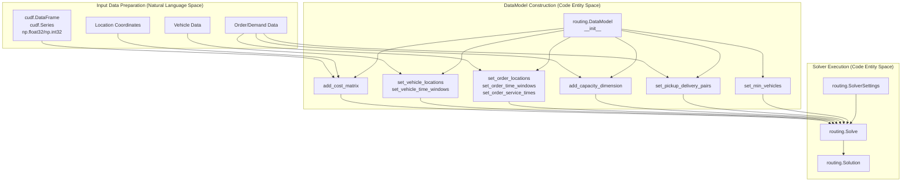
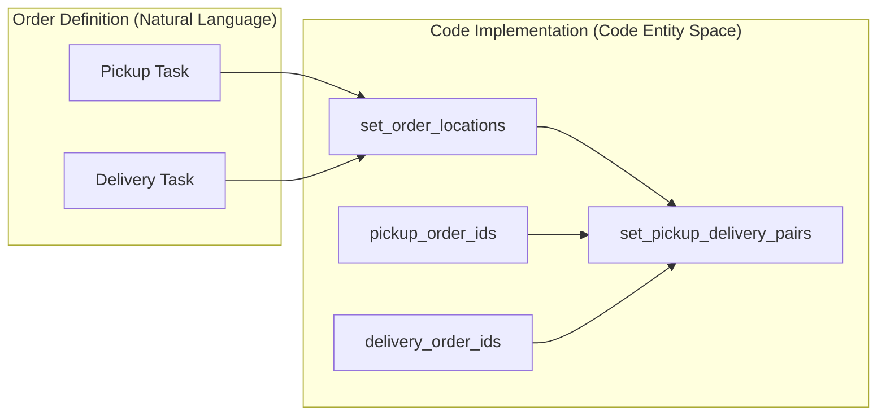
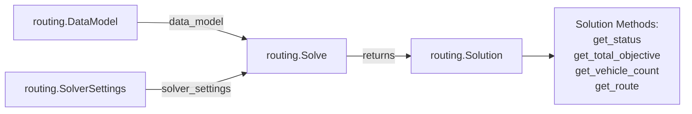

<!-- source: DeepWiki mcp.deepwiki.com · repo NVIDIA/cuopt-examples · page 4.1 Routing DataModel API · fetched 2026-10-26 -->

# Routing DataModel API

<details>
<summary>Relevant source files</summary>

The following files were used as context for generating this wiki page:

- [intra-factory_transport/cost_matrix_and_waypoint_graph_creation.ipynb](intra-factory_transport/cost_matrix_and_waypoint_graph_creation.ipynb)
- [intra-factory_transport/intra-factory_transport.ipynb](intra-factory_transport/intra-factory_transport.ipynb)
- [last_mile_delivery/cvrp_daily_deliveries.ipynb](last_mile_delivery/cvrp_daily_deliveries.ipynb)
- [last_mile_delivery/cvrptw_benchmark_gehring_homberger.ipynb](last_mile_delivery/cvrptw_benchmark_gehring_homberger.ipynb)
- [last_mile_delivery/cvrptw_service_team_routing.ipynb](last_mile_delivery/cvrptw_service_team_routing.ipynb)

</details>


The `routing.DataModel` class is the primary interface for defining Vehicle Routing Problems (VRP) in cuOpt. This page documents the DataModel API for specifying CVRP, CVRPTW, CPDPTW, and related routing problems through a structured, object-oriented interface.

**Scope**: This page covers the `routing.DataModel` class, its constructor, and all configuration methods. For general mathematical programming (LP/MILP) problems, see [Problem API](#3.1). For cost matrix generation techniques, see [Cost Matrix Generation](#4.5). For specific VRP variant implementations, see [CVRP - Capacitated Vehicle Routing](#4.2), [CVRPTW - Vehicle Routing with Time Windows](#4.3), and [CPDPTW - Pickup and Delivery with Time Windows](#4.4).

## Purpose and Design

The `routing.DataModel` encapsulates all problem-specific data for vehicle routing optimization:

- **Problem Structure**: Locations, vehicles, and orders.
- **Cost Metrics**: Travel time/distance matrices.
- **Constraints**: Capacity, time windows, pickup-delivery pairing.
- **Fleet Configuration**: Vehicle start/end locations and availability.

The DataModel separates problem specification from solver configuration (handled by `routing.SolverSettings` [last_mile_delivery/cvrptw_service_team_routing.ipynb:165-165]()) and solution generation (handled by `routing.Solve` [last_mile_delivery/cvrptw_service_team_routing.ipynb:165-165]()).

**Sources**: [last_mile_delivery/cvrp_daily_deliveries.ipynb:485-488](), [last_mile_delivery/cvrptw_service_team_routing.ipynb:536-540]()

---

## DataModel Workflow

**Diagram: Natural Language to Code Entity Mapping (Workflow)**



**Typical workflow**: (1) Create `DataModel` instance with problem dimensions [last_mile_delivery/cvrptw_service_team_routing.ipynb:536-540](), (2) Configure cost matrix and constraints via method calls [last_mile_delivery/cvrp_daily_deliveries.ipynb:485-593](), (3) Pass to `routing.Solve()` along with `SolverSettings` [last_mile_delivery/cvrptw_benchmark_gehring_homberger.ipynb:444-449](), (4) Retrieve `Solution` object.

**Sources**: [last_mile_delivery/cvrp_daily_deliveries.ipynb:485-593](), [last_mile_delivery/cvrptw_benchmark_gehring_homberger.ipynb:271-449]()

---

## Class Initialization

### Constructor Signatures

The `routing.DataModel` class supports two initialization patterns:

**Basic VRP (CVRP, CVRPTW)**:
```python
data_model = routing.DataModel(n_locations, n_vehicles)
```

**Pickup-Delivery Problems (CPDPTW)**:
```python
data_model = routing.DataModel(n_locations, n_vehicles, n_orders)
```

### Parameters

| Parameter | Type | Description |
|-----------|------|-------------|
| `n_locations` | `int` | Total number of locations including depot(s) |
| `n_vehicles` | `int` | Number of vehicles in the fleet |
| `n_orders` | `int` (optional) | Number of distinct order transactions |

**When to specify `n_orders`**: Required for pickup-delivery problems where orders represent transactions at locations [intra-factory_transport/intra-factory_transport.ipynb:365-371](). For CPDPTW, `n_orders` typically equals twice the number of pickup-delivery pairs [intra-factory_transport/intra-factory_transport.ipynb:441-448]().

**Sources**: [last_mile_delivery/cvrp_daily_deliveries.ipynb:485-488](), [last_mile_delivery/cvrptw_service_team_routing.ipynb:536-540](), [intra-factory_transport/intra-factory_transport.ipynb:365-371]()

---

## Cost Matrix Configuration

### add_cost_matrix()

```python
data_model.add_cost_matrix(cost_matrix_df)
```

Sets the cost matrix defining travel cost between all location pairs.

**Parameters**:
- `cost_matrix_df`: `cudf.DataFrame` of shape `(n_locations, n_locations)` with `dtype=np.float32` [last_mile_delivery/cvrptw_benchmark_gehring_homberger.ipynb:295-318]().

**Cost Matrix Properties**:
- **Rows and columns**: Indexed by location IDs (0-indexed).
- **Diagonal**: Typically zero (cost from location to itself) [intra-factory_transport/cost_matrix_and_waypoint_graph_creation.ipynb:141-141]().
- **Asymmetry**: Allowed - `cost[i,j]` need not equal `cost[j,i]` [intra-factory_transport/cost_matrix_and_waypoint_graph_creation.ipynb:142-142]().
- **Interpretation**: When time windows are used, cost represents time units.

**Sources**: [last_mile_delivery/cvrptw_benchmark_gehring_homberger.ipynb:295-318](), [last_mile_delivery/cvrp_daily_deliveries.ipynb:421-508](), [intra-factory_transport/cost_matrix_and_waypoint_graph_creation.ipynb:141-142]()

---

## Vehicle Configuration

### set_vehicle_locations()

```python
data_model.set_vehicle_locations(start_locations, end_locations)
```

Defines where vehicles begin and end their routes.

**Parameters**:
| Parameter | Type | Description |
|-----------|------|-------------|
| `start_locations` | `cudf.Series` | Starting location ID for each vehicle |
| `end_locations` | `cudf.Series` | Ending location ID for each vehicle |

**Common Patterns**:
- **Depot-based routing**: All vehicles start and end at location 0 [last_mile_delivery/cvrp_daily_deliveries.ipynb:549-552]().
- **Multi-depot**: Different vehicles have different start locations.
- **Open routes**: Start ≠ end location.

**Sources**: [last_mile_delivery/cvrptw_benchmark_gehring_homberger.ipynb:336-339](), [last_mile_delivery/cvrp_daily_deliveries.ipynb:549-552]()

### set_vehicle_time_windows()

```python
data_model.set_vehicle_time_windows(earliest_times, latest_times)
```

Constrains vehicle availability periods (for CVRPTW).

**Parameters**:
| Parameter | Type | Description |
|-----------|------|-------------|
| `earliest_times` | `cudf.Series`, `dtype=np.int32` | Earliest time vehicle can depart |
| `latest_times` | `cudf.Series`, `dtype=np.int32` | Latest time vehicle must return |

**Sources**: [last_mile_delivery/cvrptw_service_team_routing.ipynb:605-608](), [intra-factory_transport/intra-factory_transport.ipynb:492-505]()

---

## Order and Location Configuration

### Order Locations

For pickup-delivery problems, orders are distinct from locations.

```python
data_model.set_order_locations(order_location_ids)
```

**Parameters**:
- `order_location_ids`: `cudf.Series` of length `n_orders` mapping each order to a location ID [intra-factory_transport/intra-factory_transport.ipynb:441-448]().

**Sources**: [last_mile_delivery/cvrptw_service_team_routing.ipynb:577-578](), [intra-factory_transport/intra-factory_transport.ipynb:441-448]()

### Time Windows

#### set_order_time_windows()

```python
data_model.set_order_time_windows(earliest_times, latest_times)
```

Defines time window constraints for service at each location or order.

**Parameters**:
| Parameter | Type | Description |
|-----------|------|-------------|
| `earliest_times` | `cudf.Series`, `dtype=np.int32` | Earliest service time |
| `latest_times` | `cudf.Series`, `dtype=np.int32` | Latest service time |

**Sources**: [last_mile_delivery/cvrptw_benchmark_gehring_homberger.ipynb:382-385](), [last_mile_delivery/cvrptw_service_team_routing.ipynb:580-583]()

#### set_order_service_times()

```python
data_model.set_order_service_times(service_times)
```

Specifies time required to service each location/order.

**Parameters**:
- `service_times`: `cudf.Series`, `dtype=np.int32` - Service duration [last_mile_delivery/cvrptw_benchmark_gehring_homberger.ipynb:387-389]().

**Sources**: [last_mile_delivery/cvrptw_benchmark_gehring_homberger.ipynb:387-389](), [last_mile_delivery/cvrptw_service_team_routing.ipynb:585-587]()

---

## Capacity Dimensions

### add_capacity_dimension()

```python
data_model.add_capacity_dimension(dimension_name, demands, capacities)
```

Adds a capacity constraint dimension. Multiple dimensions can be added for multi-commodity problems [last_mile_delivery/cvrptw_service_team_routing.ipynb:610-617]().

**Parameters**:
| Parameter | Type | Description |
|-----------|------|-------------|
| `dimension_name` | `str` | Identifier for this capacity dimension |
| `demands` | `cudf.Series`, `dtype=np.int32` | Demand at each location/order |
| `capacities` | `cudf.Series`, `dtype=np.int32` | Capacity of each vehicle |

**Sources**: [last_mile_delivery/cvrptw_benchmark_gehring_homberger.ipynb:360-364](), [last_mile_delivery/cvrptw_service_team_routing.ipynb:610-617]()

---

## Pickup-Delivery Pairing

### set_pickup_delivery_pairs()

```python
data_model.set_pickup_delivery_pairs(pickup_order_ids, delivery_order_ids)
```

Defines pickup-delivery relationships for CPDPTW problems.

**Parameters**:
| Parameter | Type | Description |
|-----------|------|-------------|
| `pickup_order_ids` | `cudf.Series` | Order IDs of pickup transactions |
| `delivery_order_ids` | `cudf.Series` | Order IDs of corresponding delivery transactions |

**Indexing**: Order IDs are indices into the `order_locations` array set by `set_order_locations()` [intra-factory_transport/intra-factory_transport.ipynb:467-472]().

**Diagram: Pickup-Delivery Logic Mapping**



**Sources**: [intra-factory_transport/intra-factory_transport.ipynb:467-472]()

---

## Additional Constraints

### set_min_vehicles()

```python
data_model.set_min_vehicles(min_vehicle_count)
```

Forces the solution to use at least the specified number of vehicles [last_mile_delivery/cvrp_daily_deliveries.ipynb:657-658]().

**Sources**: [last_mile_delivery/cvrp_daily_deliveries.ipynb:657-658]()

---

## Data Type Requirements

### GPU DataFrame Format

All cuOpt DataModel methods expect GPU-resident data structures:

| Python Type | Required cuOpt Type | Common Source |
|-------------|---------------------|---------------|
| DataFrames | `cudf.DataFrame` | `cudf.DataFrame(pandas_df)` |
| Series | `cudf.Series` | `cudf.Series(list)` |
| Floating point | `np.float32` | `.astype(np.float32)` |
| Integer | `np.int32` | `.astype(np.int32)` |

**Sources**: [last_mile_delivery/cvrptw_benchmark_gehring_homberger.ipynb:299-300](), [last_mile_delivery/cvrp_daily_deliveries.ipynb:433-434]()

---

## Integration with Solver



The `DataModel` is passed to `routing.Solve()` along with a `SolverSettings` object [last_mile_delivery/cvrptw_service_team_routing.ipynb:165-165]().

**Sources**: [last_mile_delivery/cvrptw_benchmark_gehring_homberger.ipynb:444-459](), [last_mile_delivery/cvrp_daily_deliveries.ipynb:587-611](), [last_mile_delivery/cvrptw_service_team_routing.ipynb:165-165]()

---

