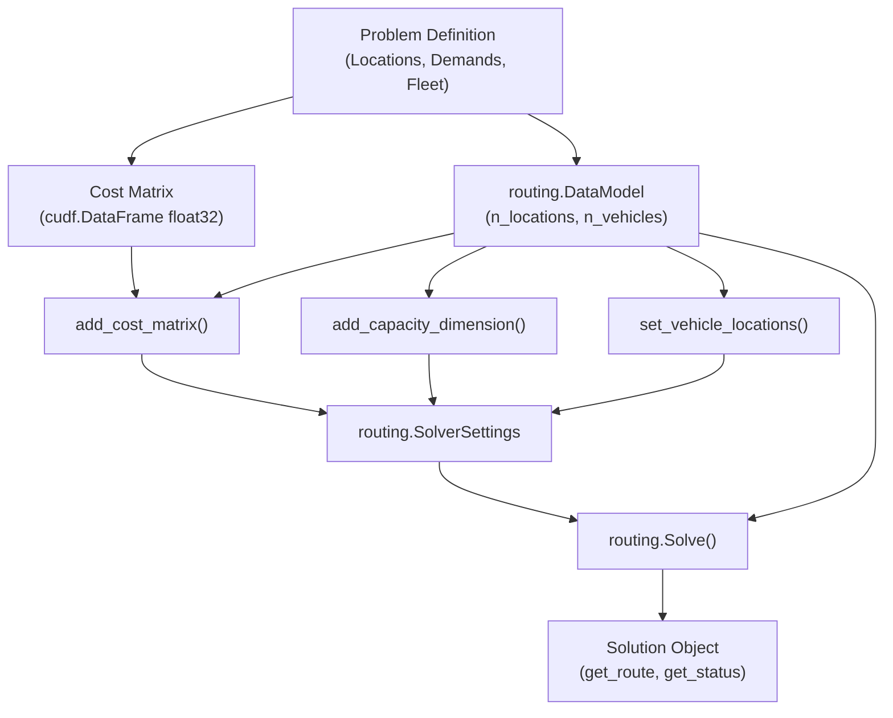
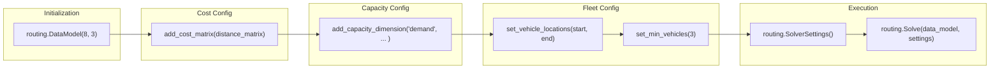

<!-- source: DeepWiki mcp.deepwiki.com · repo NVIDIA/cuopt-examples · page 4.2 CVRP - Capacitated Vehicle Routing · fetched 2026-10-26 -->

# CVRP - Capacitated Vehicle Routing

Relevant source files

The following files were used as context for generating this wiki page:

- [intra-factory_transport/cost_matrix_and_waypoint_graph_creation.ipynb](intra-factory_transport/cost_matrix_and_waypoint_graph_creation.ipynb)
- [intra-factory_transport/intra-factory_transport.ipynb](intra-factory_transport/intra-factory_transport.ipynb)
- [last_mile_delivery/cvrp_daily_deliveries.ipynb](last_mile_delivery/cvrp_daily_deliveries.ipynb)
- [last_mile_delivery/cvrptw_benchmark_gehring_homberger.ipynb](last_mile_delivery/cvrptw_benchmark_gehring_homberger.ipynb)
- [last_mile_delivery/cvrptw_service_team_routing.ipynb](last_mile_delivery/cvrptw_service_team_routing.ipynb)

## Purpose and Scope

This page documents the Capacitated Vehicle Routing Problem (CVRP) formulation and implementation using cuOpt. CVRP is the foundational variant of vehicle routing where vehicles with limited capacity must serve customer locations with specific demands while minimizing total travel cost. This page covers basic CVRP with heterogeneous fleets and demand modeling, using a daily delivery scenario as a primary technical example.

**Related Topics:**
- For time window constraints, see [4.3 CVRPTW - Vehicle Routing with Time Windows]()
- For pickup-delivery pairs, see [4.4 CPDPTW - Pickup and Delivery with Time Windows]()
- For the routing DataModel API reference, see [4.1 Routing DataModel API]()
- For cost matrix generation methods, see [4.5 Cost Matrix Generation]()

---

## Problem Formulation

CVRP extends the classical routing problem by introducing capacity constraints. Each vehicle has a maximum capacity, and each customer location has a demand that must be satisfied. The objective is to find routes for all vehicles that:

1. Visit all required customer locations.
2. Start and end at designated depot location(s).
3. Respect vehicle capacity constraints (total demand on a route $\leq$ vehicle capacity).
4. Minimize total travel cost (typically distance or time).

**Key Characteristics:**
- **Heterogeneous Fleets**: Support for vehicles with varying capacities (e.g., trucks vs. vans) [last_mile_delivery/cvrp_daily_deliveries.ipynb:35-41]().
- **Single or Multi-Depot**: Vehicles typically start and end at a Micro Fulfillment Center (MFC) or depot [last_mile_delivery/cvrp_daily_deliveries.ipynb:27-32]().
- **Demand Modeling**: Each location is assigned a demand value (e.g., number of packages) [last_mile_delivery/cvrp_daily_deliveries.ipynb:31-32]().

Sources: [last_mile_delivery/cvrp_daily_deliveries.ipynb:8-41]()

---

## CVRP Workflow

The following diagram illustrates the data flow from raw problem definition to the final optimized solution using the cuOpt routing API.

**Diagram: CVRP Problem to Solution Pipeline**

Sources: [last_mile_delivery/cvrp_daily_deliveries.ipynb:473-610](), [last_mile_delivery/cvrptw_service_team_routing.ipynb:165-166]()

---

## Core Components

### Locations and Demand
In CVRP, locations are indexed starting from 0 (usually the depot). Demand is represented as a `cudf.Series` of type `np.int32`.

| Component | Code Entity | Description |
|-----------|-------------|-------------|
| **Depot** | `location 0` | The starting and ending point for the fleet [last_mile_delivery/cvrp_daily_deliveries.ipynb:29-30](). |
| **Demand** | `location_demand` | `cudf.Series` defining items per location [last_mile_delivery/cvrp_daily_deliveries.ipynb:463-465](). |

Sources: [last_mile_delivery/cvrp_daily_deliveries.ipynb:384-466]()

### Fleet Configuration
The fleet defines the available transport resources. cuOpt allows for heterogeneous capacities within a single problem instance.

- **Vehicle Capacity**: Defined via `vehicle_capacity` as a `cudf.Series` [last_mile_delivery/cvrp_daily_deliveries.ipynb:460-461]().
- **Start/End Locations**: Set using `set_vehicle_locations(start, end)` [last_mile_delivery/cvrp_daily_deliveries.ipynb:544-552]().

Sources: [last_mile_delivery/cvrp_daily_deliveries.ipynb:35-41](), [last_mile_delivery/cvrp_daily_deliveries.ipynb:544-552]()

### Cost Matrix
The cost matrix is a square `n x n` matrix representing the travel cost between every pair of locations. It must be a `cudf.DataFrame` with `float32` values [last_mile_delivery/cvrp_daily_deliveries.ipynb:433-434]().

- **Generation**: Can be generated via Euclidean distance [intra-factory_transport/cost_matrix_and_waypoint_graph_creation.ipynb:179-180]() or waypoint graphs [intra-factory_transport/cost_matrix_and_waypoint_graph_creation.ipynb:24-25]().
- **Asymmetry**: Supports asymmetric costs (e.g., $Cost(A,B) \neq Cost(B,A)$) [intra-factory_transport/cost_matrix_and_waypoint_graph_creation.ipynb:142-142]().

Sources: [last_mile_delivery/cvrp_daily_deliveries.ipynb:433-434](), [intra-factory_transport/cost_matrix_and_waypoint_graph_creation.ipynb:116-182]()

---

## API Methods for CVRP

The following diagram maps the natural language requirements to the specific cuOpt API calls used in the `cvrp_daily_deliveries.ipynb` implementation.

**Diagram: DataModel API Call Sequence**

Sources: [last_mile_delivery/cvrp_daily_deliveries.ipynb:478-587](), [last_mile_delivery/cvrp_daily_deliveries.ipynb:692-698]()

---

## Implementation Example: Daily Deliveries

This walkthrough uses the scenario from `cvrp_daily_deliveries.ipynb` where a fulfillment center serves 7 delivery locations with 3 vehicles (2 trucks, 1 van).

### Step 1: Initialize DataModel
Initialize the `routing.DataModel` with the number of locations and vehicles.
[last_mile_delivery/cvrp_daily_deliveries.ipynb:478-487]()

### Step 2: Add Cost Matrix
Provide the travel costs.
[last_mile_delivery/cvrp_daily_deliveries.ipynb:502-508]()

### Step 3: Add Capacity Dimension
This is the core of CVRP. The `add_capacity_dimension` function links the `location_demand` to the `vehicle_capacity`.
[last_mile_delivery/cvrp_daily_deliveries.ipynb:523-529]()

### Step 4: Set Vehicle Constraints
Define where vehicles start and end, and optionally force the use of all vehicles using `set_min_vehicles`.
[last_mile_delivery/cvrp_daily_deliveries.ipynb:544-552](), [last_mile_delivery/cvrp_daily_deliveries.ipynb:692-698]()

### Step 5: Solve and Extract
Call `routing.Solve` and process the `Solution` object.
[last_mile_delivery/cvrp_daily_deliveries.ipynb:587-610]()

---

## The Solution Object

The `Solution` object provides methods to query the results of the optimization.

| Method | Return Type | Description |
|--------|-------------|-------------|
| `get_status()` | `int` | `0` indicates a successful solve [last_mile_delivery/cvrp_daily_deliveries.ipynb:593-594](). |
| `get_total_objective()` | `float` | The total minimized cost (e.g., total distance) [last_mile_delivery/cvrp_daily_deliveries.ipynb:603-603](). |
| `get_route()` | `cudf.DataFrame` | Detailed route per vehicle with `truck_id` and `location` [last_mile_delivery/cvrp_daily_deliveries.ipynb:610-610](). |

Sources: [last_mile_delivery/cvrp_daily_deliveries.ipynb:587-623]()

---

## Advanced Capacity Features

### Multiple Capacity Dimensions
cuOpt supports multiple independent capacity constraints (e.g., Weight and Volume). This is achieved by calling `add_capacity_dimension` multiple times with different dimension names.
[last_mile_delivery/cvrptw_service_team_routing.ipynb:595-617]()

### Minimum Vehicle Enforcement
By default, the solver minimizes the total number of vehicles. To force the use of a specific fleet size, use `set_min_vehicles`.
[last_mile_delivery/cvrp_daily_deliveries.ipynb:692-698]()

---

## Data Type Requirements

To leverage GPU acceleration, data must be cast to specific types:
- **Cost/Distance**: `np.float32` [last_mile_delivery/cvrp_daily_deliveries.ipynb:433-434]().
- **Demand/Capacity**: `np.int32` [last_mile_delivery/cvrp_daily_deliveries.ipynb:460-465]().

Sources: [last_mile_delivery/cvrp_daily_deliveries.ipynb:433-465]()

---

