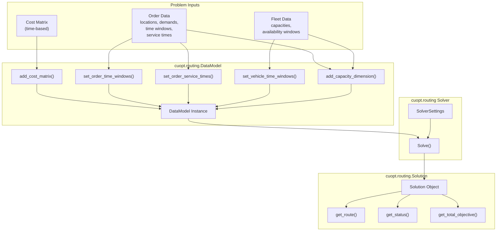
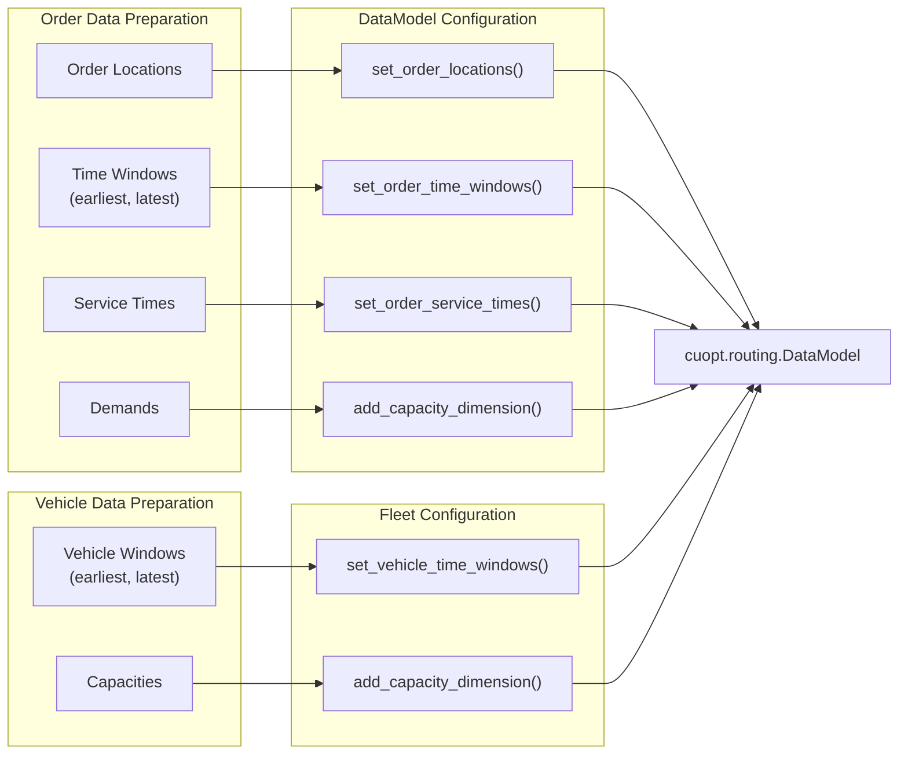

<!-- source: DeepWiki mcp.deepwiki.com · repo NVIDIA/cuopt-examples · page 4.3 CVRPTW - Vehicle Routing with Time Windows · fetched 2026-10-26 -->

# CVRPTW - Vehicle Routing with Time Windows

<details>
<summary>Relevant source files</summary>

The following files were used as context for generating this wiki page:

- [intra-factory_transport/cost_matrix_and_waypoint_graph_creation.ipynb](intra-factory_transport/cost_matrix_and_waypoint_graph_creation.ipynb)
- [intra-factory_transport/intra-factory_transport.ipynb](intra-factory_transport/intra-factory_transport.ipynb)
- [last_mile_delivery/cvrp_daily_deliveries.ipynb](last_mile_delivery/cvrp_daily_deliveries.ipynb)
- [last_mile_delivery/cvrptw_benchmark_gehring_homberger.ipynb](last_mile_delivery/cvrptw_benchmark_gehring_homberger.ipynb)
- [last_mile_delivery/cvrptw_service_team_routing.ipynb](last_mile_delivery/cvrptw_service_team_routing.ipynb)
- [routing_optimization_over_server/cvrptw_benchmark_gehring_homberger.ipynb](routing_optimization_over_server/cvrptw_benchmark_gehring_homberger.ipynb)
- [routing_optimization_over_server/cvrptw_service_team_routing.ipynb](routing_optimization_over_server/cvrptw_service_team_routing.ipynb)
- [sample_lp_sever_notebooks/linear-programming-with-datamodel.ipynb](sample_lp_sever_notebooks/linear-programming-with-datamodel.ipynb)
- [sample_lp_sever_notebooks/linear-programming.ipynb](sample_lp_sever_notebooks/linear-programming.ipynb)
- [sample_lp_sever_notebooks/mixed-integer-linear-programming-with-datamodel.ipynb](sample_lp_sever_notebooks/mixed-integer-linear-programming-with-datamodel.ipynb)
- [sample_lp_sever_notebooks/mixed-integer-linear-programming.ipynb](sample_lp_sever_notebooks/mixed-integer-linear-programming.ipynb)

</details>


## Purpose and Scope

This document describes the Capacitated Vehicle Routing Problem with Time Windows (CVRPTW) as implemented in cuOpt. CVRPTW extends the basic CVRP formulation by adding temporal constraints: time windows for order fulfillment and vehicle availability, plus service times at each location. This enables realistic scheduling scenarios such as service appointments, delivery windows, and shift-based operations.

For basic capacitated routing without time windows, see [CVRP - Capacitated Vehicle Routing](#4.2). For pickup-delivery problems with time windows, see [CPDPTW - Pickup and Delivery with Time Windows](#4.4). For general routing concepts and the DataModel API, see [Routing DataModel API](#4.1).

---

## Problem Definition

CVRPTW adds temporal constraints to CVRP:

| Constraint Type | Description | CVRP | CVRPTW |
|----------------|-------------|------|--------|
| Vehicle Capacity | Maximum load per vehicle | ✓ | ✓ |
| Order Demand | Resource consumption per location | ✓ | ✓ |
| Order Time Windows | Earliest/latest service times | ✗ | ✓ |
| Vehicle Time Windows | Vehicle availability periods | ✗ | ✓ |
| Service Times | Time required at each location | ✗ | ✓ |

**Key Characteristics:**
- Routes must respect temporal feasibility [last_mile_delivery/cvrptw_service_team_routing.ipynb:17-20]().
- Vehicles may wait if arriving before time window opens [last_mile_delivery/cvrptw_service_team_routing.ipynb:17-20]().
- Infeasible if arrival after time window closes [last_mile_delivery/cvrptw_service_team_routing.ipynb:17-20]().
- Service time accrued at each stop before proceeding [last_mile_delivery/cvrptw_service_team_routing.ipynb:17-20]().
- Cost matrices typically represent travel time (not distance) when time windows are used [last_mile_delivery/cvrptw_benchmark_gehring_homberger.ipynb:17-24]().

**Sources:** [last_mile_delivery/cvrptw_service_team_routing.ipynb:1-46](), [last_mile_delivery/cvrptw_benchmark_gehring_homberger.ipynb:1-24]()

---

## CVRPTW Components and Data Flow

The following diagram illustrates the data flow from raw inputs to the cuOpt `routing.DataModel` and final solution.

### Data Flow to Code Entity Mapping


**Sources:** [last_mile_delivery/cvrptw_service_team_routing.ipynb:165-166](), [last_mile_delivery/cvrptw_service_team_routing.ipynb:530-637](), [last_mile_delivery/cvrptw_benchmark_gehring_homberger.ipynb:267-446]()

---

## Time Window Constraints

### Order Time Windows

Order time windows define the allowable service period for each order. These are set using `set_order_time_windows()` [last_mile_delivery/cvrptw_service_team_routing.ipynb:571-583]():

```python
# Example from service team routing
order_earliest = cudf.Series([9, 9, 11, 13, 13, 13, 13]).astype(np.int32)
order_latest = cudf.Series([12, 12, 14, 16, 16, 16, 16]).astype(np.int32)
data_model.set_order_time_windows(order_earliest, order_latest)
```

**Semantics:**
- Vehicle may arrive before `earliest_time` but must wait.
- Service begins at `max(arrival_time, earliest_time)`.
- Vehicle must arrive before `latest_time` (hard constraint).
- Arrival at or after `latest_time` renders route infeasible.

**Sources:** [last_mile_delivery/cvrptw_service_team_routing.ipynb:571-583](), [last_mile_delivery/cvrptw_benchmark_gehring_homberger.ipynb:372-390]()

### Vehicle Time Windows

Vehicle time windows constrain when vehicles are available for operation [last_mile_delivery/cvrptw_service_team_routing.ipynb:600-608]():

```python
# Technician availability in service team example
vehicle_earliest = cudf.Series([9, 11, 9]).astype(np.int32)
vehicle_latest = cudf.Series([17, 15, 17]).astype(np.int32)
data_model.set_vehicle_time_windows(vehicle_earliest, vehicle_latest)
```

**Semantics:**
- Vehicle cannot depart depot before `earliest_time`.
- Vehicle must return to depot by `latest_time`.
- Effectively constrains route duration per vehicle.

**Sources:** [last_mile_delivery/cvrptw_service_team_routing.ipynb:600-608]()

### Service Times

Service times represent the time required to complete service at each location [last_mile_delivery/cvrptw_benchmark_gehring_homberger.ipynb:382-390]():

```python
# Service times from benchmark data
service_times = cudf.Series(orders['service_time'].values).astype(np.int32)
data_model.set_order_service_times(service_times)
```

**Behavior:**
- Accrued after arrival at location.
- Total time at location = `wait_time + service_time`.
- Affects downstream arrivals in the route.
- Typically non-zero for delivery/service locations, zero for depot.

**Sources:** [last_mile_delivery/cvrptw_benchmark_gehring_homberger.ipynb:382-390](), [last_mile_delivery/cvrptw_service_team_routing.ipynb:580-587]()

---

## API Methods for CVRPTW

### DataModel Time Window Methods

| Method | Parameters | Description |
|--------|-----------|-------------|
| `set_order_time_windows()` | `earliest: cudf.Series`, `latest: cudf.Series` | Set time windows for each order location |
| `set_vehicle_time_windows()` | `earliest: cudf.Series`, `latest: cudf.Series` | Set availability windows for each vehicle |
| `set_order_service_times()` | `service_times: cudf.Series` | Set service duration at each order location |

**Type Requirements:**
- All time series must use `np.int32` dtype [last_mile_delivery/cvrptw_service_team_routing.ipynb:571-583]().
- Time units are user-defined but must be consistent.
- Series length must match number of orders/vehicles respectively.

### Example: Complete CVRPTW Setup Workflow



**Sources:** [last_mile_delivery/cvrptw_service_team_routing.ipynb:530-617](), [last_mile_delivery/cvrptw_benchmark_gehring_homberger.ipynb:267-390]()

---

## Application Scenario: Service Team Routing

### Problem Description

Service provider schedules technicians with specialized skills to customer locations. Each technician has availability windows, skill-based capacity, and customers have appointment time windows [last_mile_delivery/cvrptw_service_team_routing.ipynb:17-20]().

**Problem Characteristics [last_mile_delivery/cvrptw_service_team_routing.ipynb:27-44]():**
- 8 locations (1 headquarters + 7 service locations).
- 3 technicians with different specializations.
- Multi-dimensional capacity: `service_type1` and `service_type2`.
- Heterogeneous vehicle availability: `[9,17]`, `[12,15]`, `[9,17]`.
- Order time windows: morning `[9,12]`, midday `[11,14]`, afternoon `[13,16]`.

### Data Structure

**Service Location Data [last_mile_delivery/cvrptw_service_team_routing.ipynb:27-37]():**

| Location | Service Type 1 Demand | Service Type 2 Demand | Time Window | Service Time |
|----------|---------------|---------------|-------------|--------------|
| Loc 1 | 1 | 0 | [9, 12] | 1 |
| Loc 2 | 1 | 0 | [9, 12] | 1 |
| Loc 3 | 1 | 1 | [11, 14] | 1.5 |
| Loc 4 | 0 | 1 | [13, 16] | 0.5 |
| Loc 5 | 0 | 1 | [13, 16] | 0.5 |
| Loc 6 | 0 | 1 | [13, 16] | 0.5 |
| Loc 7 | 0 | 1 | [13, 16] | 0.5 |

**Technician Capacity [last_mile_delivery/cvrptw_service_team_routing.ipynb:39-44]():**

| Technician | Service Type 1 Capacity | Service Type 2 Capacity | Availability |
|-----------|------------------------|------------------------|--------------|
| Tech 0 | 2 | 0 | [9, 17] |
| Tech 1 | 1 | 1 | [12, 15] |
| Tech 2 | 0 | 4 | [9, 17] |

**Sources:** [last_mile_delivery/cvrptw_service_team_routing.ipynb:1-668]()

---

## Application Scenario: Gehring & Homberger Benchmarks

### Benchmark Overview

Academic benchmark dataset for evaluating VRP solver performance at scale [last_mile_delivery/cvrptw_benchmark_gehring_homberger.ipynb:21-24](). Instance `C1_10_1` characteristics [last_mile_delivery/cvrptw_benchmark_gehring_homberger.ipynb:164-167]():

| Property | Value |
|----------|-------|
| Locations | 1000 (+ 1 depot) |
| Best Known Vehicles | 100 |
| Best Known Cost | 42478.95 |
| Problem Type | Clustered customers |

### Data Parsing

The Gehring & Homberger files are parsed to extract vertex, coordinates, demand, and temporal constraints [last_mile_delivery/cvrptw_benchmark_gehring_homberger.ipynb:186-242]().

**Cost Matrix Generation:**
Euclidean distance matrix is computed from coordinates using `scipy.spatial.distance.cdist` and converted to `cudf.DataFrame` [last_mile_delivery/cvrptw_benchmark_gehring_homberger.ipynb:285-318]().

### Performance Results

Solver performance on 1000 location problem [last_mile_delivery/cvrptw_benchmark_gehring_homberger.ipynb:474-517]():
- GPU-accelerated solve achieves world-class accuracy in seconds to minutes.
- Demonstrates rapid iteration for dynamic environments.

**Sources:** [last_mile_delivery/cvrptw_benchmark_gehring_homberger.ipynb:1-564]()

---

## Server-Based CVRPTW

### CuOptServiceSelfHostClient Usage

For client-server deployments, use `CuOptServiceSelfHostClient` [routing_optimization_over_server/cvrptw_service_team_routing.ipynb:157]():

```python
from cuopt_sh_client import CuOptServiceSelfHostClient

client = CuOptServiceSelfHostClient(host="localhost", port="5000")

# Problem data structure for server
cuopt_problem_data = {
    "cost_matrix_data": {"data": {"0": cost_matrix_list}},
    "task_data": {
        "task_locations": order_locations,
        "demand": [demands],
        "task_time_windows": time_windows_list,
        "service_times": service_times
    },
    "fleet_data": {
        "vehicle_locations": vehicle_locations,
        "capacities": [capacities],
        "vehicle_time_windows": vehicle_windows
    }
}

response = client.get_optimized_routes(cuopt_problem_data)
```

**Sources:** [routing_optimization_over_server/cvrptw_service_team_routing.ipynb:528-561](), [routing_optimization_over_server/cvrptw_benchmark_gehring_homberger.ipynb:351-523]()

---

## Multi-Dimensional Capacity with Time Windows

CVRPTW supports multiple capacity dimensions (e.g., weight, volume, or skills) simultaneously [last_mile_delivery/cvrptw_service_team_routing.ipynb:600-617]():

```python
# Service type 1 (e.g., skill 1)
data_model.add_capacity_dimension("service_type1", demand1, capacity1)

# Service type 2 (e.g., skill 2)
data_model.add_capacity_dimension("service_type2", demand2, capacity2)
```

**Sources:** [last_mile_delivery/cvrptw_service_team_routing.ipynb:600-617]()

---

## Common Data Types and Patterns

### Required Data Types

| Data Element | Python Type | cudf dtype | Notes |
|--------------|-------------|------------|-------|
| Time values | int | `np.int32` | Earliest, latest, service times [last_mile_delivery/cvrptw_service_team_routing.ipynb:571-583]() |
| Locations | int | `np.int32` | Order and vehicle location indices |
| Demands | int | `np.int32` | Per-order resource consumption |
| Cost matrix | float | `np.float32` | Travel time between locations [last_mile_delivery/cvrptw_benchmark_gehring_homberger.ipynb:304]() |

**Sources:** [last_mile_delivery/cvrptw_service_team_routing.ipynb:552-617](), [last_mile_delivery/cvrptw_benchmark_gehring_homberger.ipynb:354-390]()

---

## Solution Object Methods

Extract results using `Solution` object methods [last_mile_delivery/cvrptw_service_team_routing.ipynb:655-668]():

| Method | Return Type | Description |
|--------|-------------|-------------|
| `get_status()` | int | 0=success, non-zero=failure |
| `get_vehicle_count()` | int | Number of vehicles used |
| `get_total_objective()` | float | Total travel cost/time |
| `get_route(v_id)` | cudf.DataFrame | Route details for vehicle `v_id` |

**Sources:** [last_mile_delivery/cvrptw_service_team_routing.ipynb:655-668](), [last_mile_delivery/cvrptw_benchmark_gehring_homberger.ipynb:438-472]()

---

## Performance Considerations

### Scale Characteristics

- **Small Scale (Service Team):** 8 locations, 3 vehicles. Solve time: < 1 second [last_mile_delivery/cvrptw_service_team_routing.ipynb:642]().
- **Large Scale (Gehring & Homberger):** 1000 locations, 250 vehicles. Solve time: 60-120 seconds for near-optimal results [last_mile_delivery/cvrptw_benchmark_gehring_homberger.ipynb:432-517]().

**Sources:** [last_mile_delivery/cvrptw_benchmark_gehring_homberger.ipynb:432-517](), [last_mile_delivery/cvrptw_service_team_routing.ipynb:625-637]()

---

