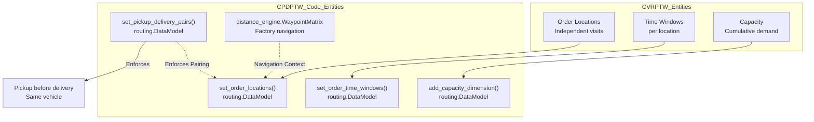
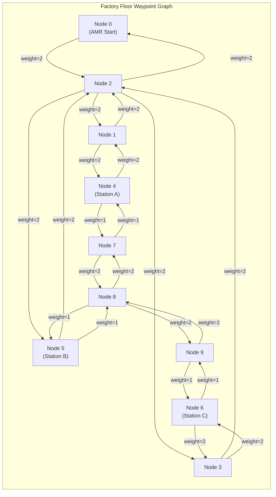
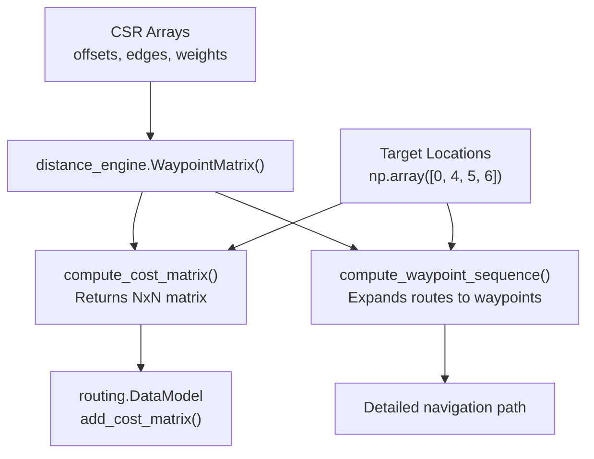
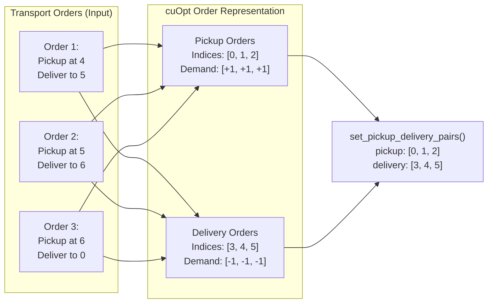

<!-- source: DeepWiki mcp.deepwiki.com · repo NVIDIA/cuopt-examples · page 4.4 CPDPTW - Pickup and Delivery with Time Windows · fetched 2026-10-26 -->

# CPDPTW - Pickup and Delivery with Time Windows

<details>
<summary>Relevant source files</summary>

The following files were used as context for generating this wiki page:

- [diet_optimization/README.md](diet_optimization/README.md)
- [intra-factory_transport/cost_matrix.png](intra-factory_transport/cost_matrix.png)
- [intra-factory_transport/cost_matrix_and_waypoint_graph_creation.ipynb](intra-factory_transport/cost_matrix_and_waypoint_graph_creation.ipynb)
- [intra-factory_transport/intra-factory_transport.ipynb](intra-factory_transport/intra-factory_transport.ipynb)
- [intra-factory_transport/waypoint_graph.png](intra-factory_transport/waypoint_graph.png)
- [last_mile_delivery/cvrp_daily_deliveries.ipynb](last_mile_delivery/cvrp_daily_deliveries.ipynb)
- [last_mile_delivery/cvrptw_benchmark_gehring_homberger.ipynb](last_mile_delivery/cvrptw_benchmark_gehring_homberger.ipynb)
- [last_mile_delivery/cvrptw_service_team_routing.ipynb](last_mile_delivery/cvrptw_service_team_routing.ipynb)

</details>


## Purpose and Scope

This page documents the **Capacitated Pickup and Delivery Problem with Time Windows (CPDPTW)**, the most complex vehicle routing variant in the cuOpt examples repository. CPDPTW extends CVRPTW by adding **pickup-delivery pairing constraints**, where each delivery order must be preceded by its corresponding pickup order on the same vehicle route. This problem type is commonly used for intra-factory transport with autonomous mobile robots (AMRs), part shuttling between processing stations, and same-vehicle pickup-delivery logistics.

For simpler routing problems without pickup-delivery constraints, see [CVRP - Capacitated Vehicle Routing](#4.2) and [CVRPTW - Vehicle Routing with Time Windows](#4.3). For information about generating cost matrices and waypoint graphs used in CPDPTW, see [Cost Matrix Generation](#4.5).

---

## Problem Formulation

CPDPTW adds the following constraints to CVRPTW:

| Constraint Type | Description |
|----------------|-------------|
| **Pickup-Delivery Pairing** | Each delivery order must be serviced by the same vehicle that performed the corresponding pickup |
| **Precedence** | Pickup must occur before delivery in the vehicle route |
| **Time Windows** | Both pickup and delivery locations have earliest/latest time constraints |
| **Service Times** | Time spent at pickup and delivery locations |
| **Capacity** | Vehicle capacity must accommodate cumulative demand along the route |

The objective remains to minimize total travel cost while satisfying all constraints.

**Sources:** [intra-factory_transport/intra-factory_transport.ipynb:9-37]()

---

## CPDPTW vs CVRPTW Comparison

### Feature Mapping Diagram
"This diagram maps high-level VRP concepts to specific cuOpt code entities."



**Key Differences:**
- **Order Structure**: CPDPTW treats pickup and delivery as separate orders (2× the number of transactions) [intra-factory_transport/intra-factory_transport.ipynb:360-372]().
- **Demand Representation**: Pickups have positive demand, deliveries have negative demand [intra-factory_transport/intra-factory_transport.ipynb:388-403]().
- **Pairing Constraint**: `set_pickup_delivery_pairs()` links pickup order indices to delivery order indices [intra-factory_transport/intra-factory_transport.ipynb:461-473]().
- **Navigation**: Often uses waypoint graphs instead of direct distance matrices [intra-factory_transport/intra-factory_transport.ipynb:175-186]().

**Sources:** [intra-factory_transport/intra-factory_transport.ipynb:273-304](), [intra-factory_transport/intra-factory_transport.ipynb:382-403]()

---

## Waypoint Graphs for Factory Navigation

CPDPTW problems in factory environments typically use **waypoint graphs** instead of direct cost matrices. A waypoint graph represents the factory floor as a network where only certain nodes are target locations (processing stations, loading docks), while others are traversal points [intra-factory_transport/cost_matrix_and_waypoint_graph_creation.ipynb:19-25]().

### Waypoint Graph Structure



**Target Locations:** `[0, 4, 5, 6]` - Only these nodes are order locations; others are traversal points [intra-factory_transport/intra-factory_transport.ipynb:214-218]().

**Sources:** [intra-factory_transport/intra-factory_transport.ipynb:175-198](), [intra-factory_transport/cost_matrix_and_waypoint_graph_creation.ipynb:314-373]()

### CSR (Compressed Sparse Row) Representation

Waypoint graphs must be encoded in CSR format for cuOpt [intra-factory_transport/intra-factory_transport.ipynb:184-186]():

| Array | Purpose | Example |
|-------|---------|---------|
| **offsets** | Starting index in edges array for each node | `[0, 1, 3, 7, 9, 11, 13, 15, 17, 20, 22]` |
| **edges** | Destination nodes for all edges | `[2, 2, 4, 0, 1, 3, 5, 2, 6, ...]` |
| **weights** | Edge weights (time/distance) | `[2, 2, 2, 2, 2, 2, 2, 2, 2, ...]` |

**Sources:** [intra-factory_transport/intra-factory_transport.ipynb:189-198](), [intra-factory_transport/cost_matrix_and_waypoint_graph_creation.ipynb:336-373]()

### WaypointMatrix Class

### Navigation Data Flow
"How graph data is processed by distance_engine into routing constraints."



The `distance_engine.WaypointMatrix` class provides two key operations:
1. **Cost Matrix Computation**: Calculates shortest paths between target locations [intra-factory_transport/intra-factory_transport.ipynb:240-246]().
2. **Route Expansion**: Converts high-level routes to detailed waypoint sequences [intra-factory_transport/intra-factory_transport.ipynb:608-623]().

**Sources:** [intra-factory_transport/intra-factory_transport.ipynb:240-256](), [intra-factory_transport/intra-factory_transport.ipynb:608-623]()

---

## DataModel Configuration for CPDPTW

### Order Structure and Demand Representation



**Key Principle**: Each transport order becomes **two separate orders** in cuOpt:
- **Pickup order**: Positive demand (adds load to vehicle) [intra-factory_transport/intra-factory_transport.ipynb:388-393]().
- **Delivery order**: Negative demand (removes load from vehicle) [intra-factory_transport/intra-factory_transport.ipynb:395-399]().

**Sources:** [intra-factory_transport/intra-factory_transport.ipynb:286-304](), [intra-factory_transport/intra-factory_transport.ipynb:388-403]()

### DataModel Initialization

The DataModel for CPDPTW requires specifying the total number of distinct orders (pickup count + delivery count) [intra-factory_transport/intra-factory_transport.ipynb:360-372]():

```python
n_locations = 4  # Target locations in waypoint graph
n_vehicles = 2   # Number of AMRs
n_orders = 6     # 3 transport orders × 2 (pickup + delivery)

data_model = routing.DataModel(n_locations, n_vehicles, n_orders)
```

**Sources:** [intra-factory_transport/intra-factory_transport.ipynb:360-372]()

### Setting Order Locations

Order locations must map waypoint graph nodes to cost matrix indices [intra-factory_transport/intra-factory_transport.ipynb:436-449]().

**Sources:** [intra-factory_transport/intra-factory_transport.ipynb:436-449]()

### Pickup-Delivery Pairing

The critical step that distinguishes CPDPTW from CVRPTW [intra-factory_transport/intra-factory_transport.ipynb:461-473]():

```python
# Indices into order_locations array
npair_orders = 3  # Number of transport orders
pickup_orders = cudf.Series([0, 1, 2])        # First half
delivery_orders = cudf.Series([3, 4, 5])      # Second half

data_model.set_pickup_delivery_pairs(pickup_orders, delivery_orders)
```

This enforces that pickup must precede delivery and both must be on the same vehicle [intra-factory_transport/intra-factory_transport.ipynb:461-473]().

**Sources:** [intra-factory_transport/intra-factory_transport.ipynb:461-473]()

### Capacity Dimension with Signed Demand

**Capacity Constraint Behavior**:
- At pickup: Vehicle load increases by `+1` [intra-factory_transport/intra-factory_transport.ipynb:388-393]().
- At delivery: Vehicle load decreases by `-1` [intra-factory_transport/intra-factory_transport.ipynb:395-399]().
- Load must stay within `[0, vehicle_capacity]` throughout route [intra-factory_transport/intra-factory_transport.ipynb:406-414]().

**Sources:** [intra-factory_transport/intra-factory_transport.ipynb:388-414]()

---

## Solution Interpretation and Route Expansion

### Converting Matrix Indices to Waypoint Graph Nodes

The solution initially references cost matrix indices. These must be mapped back to the original graph node IDs [intra-factory_transport/intra-factory_transport.ipynb:586-594]().

**Sources:** [intra-factory_transport/intra-factory_transport.ipynb:586-594]()

### Expanding to Detailed Waypoint Sequences

For each vehicle route, expand to full waypoint sequence using the graph data [intra-factory_transport/intra-factory_transport.ipynb:603-623](). This produces the actual navigation path through the factory floor, including all intermediate waypoints [intra-factory_transport/intra-factory_transport.ipynb:617-623]().

**Sources:** [intra-factory_transport/intra-factory_transport.ipynb:603-623]()

---

## API Reference Summary

### Core Classes and Methods

| Class | Method | Purpose |
|-------|--------|---------|
| `routing.DataModel` | `__init__(n_locations, n_vehicles, n_orders)` | Initialize with 2× orders for pickups+deliveries [intra-factory_transport/intra-factory_transport.ipynb:360-372]() |
| | `set_order_locations(locations)` | Set locations for all orders (pickups then deliveries) [intra-factory_transport/intra-factory_transport.ipynb:447-449]() |
| | `set_pickup_delivery_pairs(pickups, deliveries)` | Link pickup order indices to delivery order indices [intra-factory_transport/intra-factory_transport.ipynb:471-473]() |
| | `set_order_time_windows(earliest, latest)` | Separate time windows for pickups and deliveries [intra-factory_transport/intra-factory_transport.ipynb:496-498]() |
| | `set_order_service_times(times)` | Service times for pickups and deliveries [intra-factory_transport/intra-factory_transport.ipynb:504-506]() |
| | `add_capacity_dimension(name, demand, capacity)` | Positive demand for pickups, negative for deliveries [intra-factory_transport/intra-factory_transport.ipynb:406-414]() |
| `distance_engine.WaypointMatrix` | `__init__(offsets, edges, weights)` | Create from CSR graph representation [intra-factory_transport/intra-factory_transport.ipynb:240-243]() |
| | `compute_cost_matrix(target_locations)` | Generate cost matrix for subset of graph nodes [intra-factory_transport/intra-factory_transport.ipynb:245-246]() |
| | `compute_waypoint_sequence(targets, route)` | Expand high-level route to detailed waypoint path [intra-factory_transport/intra-factory_transport.ipynb:617-623]() |

**Sources:** [intra-factory_transport/intra-factory_transport.ipynb:360-506](), [intra-factory_transport/intra-factory_transport.ipynb:240-256]()

---

## Best Practices for CPDPTW Problems

### Order Indexing

**Critical Rule**: Order indices in `set_pickup_delivery_pairs()` refer to positions in the `order_locations` array, **not** to location IDs [intra-factory_transport/intra-factory_transport.ipynb:461-473]().

### Demand Sign Convention

Always use:
- **Positive demand** for pickups (adds load) [intra-factory_transport/intra-factory_transport.ipynb:388-393]().
- **Negative demand** for deliveries (removes load) [intra-factory_transport/intra-factory_transport.ipynb:395-399]().

### Waypoint Graph vs Cost Matrix

**Use Waypoint Graphs when**:
- Navigation constrained to specific paths (factory aisles, corridors) [intra-factory_transport/cost_matrix_and_waypoint_graph_creation.ipynb:19-25]().
- Many intermediate waypoints between service locations.
- Need detailed navigation instructions [intra-factory_transport/intra-factory_transport.ipynb:617-623]().

**Use Cost Matrices when**:
- Direct point-to-point travel (open roads, aerial) [intra-factory_transport/cost_matrix_and_waypoint_graph_creation.ipynb:19-25]().
- No intermediate waypoints needed.

**Sources:** [intra-factory_transport/cost_matrix_and_waypoint_graph_creation.ipynb:14-25]()

---

