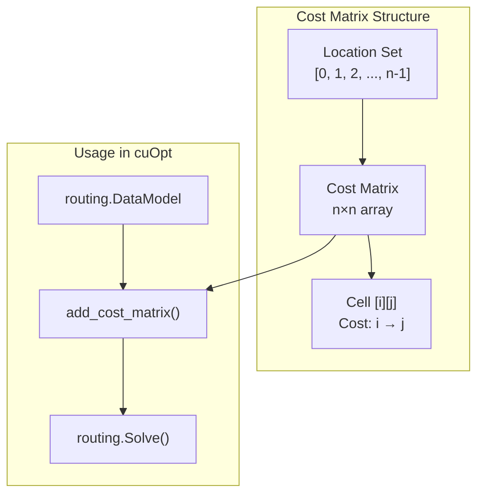
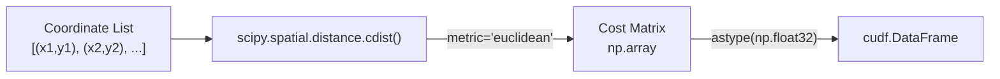
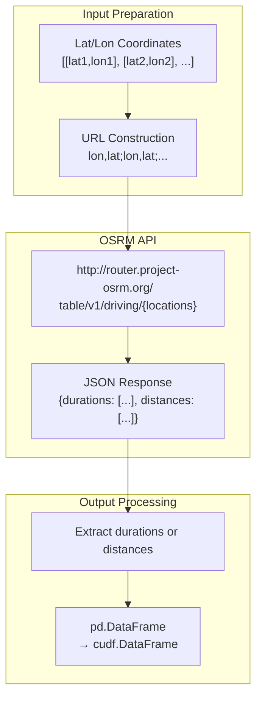
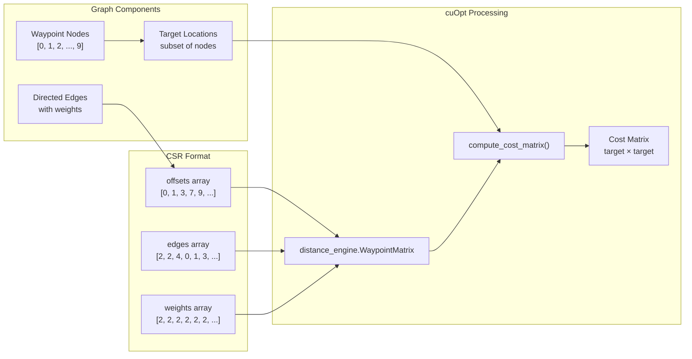
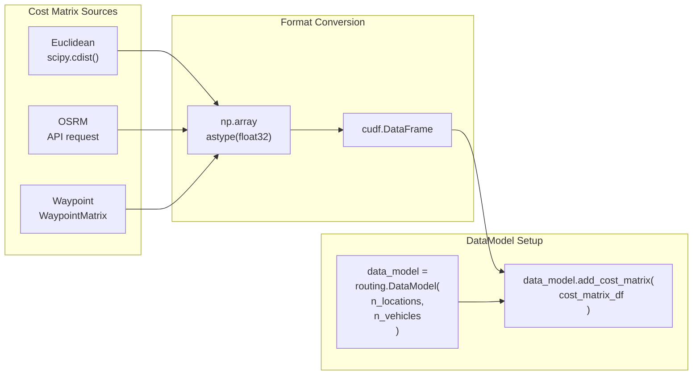

<!-- source: DeepWiki mcp.deepwiki.com · repo NVIDIA/cuopt-examples · page 4.5 Cost Matrix Generation · fetched 2026-10-26 -->

# Cost Matrix Generation

<details>
<summary>Relevant source files</summary>

The following files were used as context for generating this wiki page:

- [diet_optimization/README.md](diet_optimization/README.md)
- [intra-factory_transport/cost_matrix.png](intra-factory_transport/cost_matrix.png)
- [intra-factory_transport/cost_matrix_and_waypoint_graph_creation.ipynb](intra-factory_transport/cost_matrix_and_waypoint_graph_creation.ipynb)
- [intra-factory_transport/intra-factory_transport.ipynb](intra-factory_transport/intra-factory_transport.ipynb)
- [intra-factory_transport/waypoint_graph.png](intra-factory_transport/waypoint_graph.png)
- [last_mile_delivery/cvrp_daily_deliveries.ipynb](last_mile_delivery/cvrp_daily_deliveries.ipynb)
- [last_mile_delivery/cvrptw_benchmark_gehring_homberger.ipynb](last_mile_delivery/cvrptw_benchmark_gehring_homberger.ipynb)
- [last_mile_delivery/cvrptw_service_team_routing.ipynb](last_mile_delivery/cvrptw_service_team_routing.ipynb)

</details>


## Purpose and Scope

This document describes the three primary approaches for generating cost matrices in cuOpt vehicle routing problems. A cost matrix represents the transition costs (distance, time, or other metrics) between locations and is a fundamental input to the `routing.DataModel` class. This page covers simple Euclidean distance calculation, map-based routing via OSRM, and waypoint graph-based approaches using cuOpt's `distance_engine.WaypointMatrix` class.

For information about using the generated cost matrix within a routing problem, see [Routing DataModel API](#4.1). For details on CPDPTW problems that commonly use waypoint graphs, see [CPDPTW - Pickup and Delivery with Time Windows](#4.4).

## What is a Cost Matrix?

A cost matrix is a two-dimensional array where each cell `[i][j]` represents the cost of transitioning from location `i` to location `j`. The "cost" metric can represent:
- Physical distance (meters, kilometers)
- Travel time (seconds, minutes)
- Fuel consumption
- Monetary cost
- Any other domain-specific metric

### Cost Matrix Properties

| Property | Description | Example |
|----------|-------------|---------|
| **Dimensionality** | n × n where n is the number of locations | 8×8 for 8 locations |
| **Diagonal** | Cost from location to itself, typically 0 | `cost_matrix[i][i] = 0` [intra-factory_transport/cost_matrix_and_waypoint_graph_creation.ipynb:141-141]() |
| **Symmetry** | May be symmetric or asymmetric | `cost_matrix[i][j]` ≠ `cost_matrix[j][i]` allowed [intra-factory_transport/cost_matrix_and_waypoint_graph_creation.ipynb:142-142]() |
| **Data Type** | Must be `np.float32` for cuOpt | `cost_matrix.astype(np.float32)` |
| **Format** | Provided as `cudf.DataFrame` to cuOpt | `cudf.DataFrame(cost_matrix)` |

Title: Cost Matrix Data Flow


**Sources:** [intra-factory_transport/cost_matrix_and_waypoint_graph_creation.ipynb:115-144]()

## Approach 1: Euclidean Distance Calculation

The simplest approach computes cost as straight-line Euclidean distance between coordinate points. This is suitable for scenarios where:
- Actual road networks are not critical [intra-factory_transport/cost_matrix_and_waypoint_graph_creation.ipynb:157-160]()
- The problem space is unrestricted (e.g., drone delivery)
- Quick prototyping is needed

### Implementation with scipy.spatial.distance

Title: Euclidean Calculation Pipeline


The key function is `scipy.spatial.distance.cdist()`, which computes pairwise distances between all points:

[last_mile_delivery/cvrptw_benchmark_gehring_homberger.ipynb:295-300]() demonstrates this pattern:

```python
coords = list(zip(orders['xcord'].to_list(), orders['ycord'].to_list()))
cost_matrix = distance.cdist(coords, coords, 'euclidean')
cost_matrix_df = cudf.DataFrame(cost_matrix.astype(np.float32))
```

### Example: Gehring & Homberger Benchmark

For large-scale routing problems like the 1000-location Gehring & Homberger benchmark, Euclidean distance provides a standard cost metric [last_mile_delivery/cvrptw_benchmark_gehring_homberger.ipynb:21-23]().

[last_mile_delivery/cvrptw_benchmark_gehring_homberger.ipynb:252-259]() shows order data extraction from benchmark files, followed by coordinate-based cost matrix generation.

**Key Code Entities:**
- `scipy.spatial.distance.cdist(coords, coords, 'euclidean')` [last_mile_delivery/cvrptw_benchmark_gehring_homberger.ipynb:298-298]()
- `cudf.DataFrame(cost_matrix.astype(np.float32))` [last_mile_delivery/cvrptw_benchmark_gehring_homberger.ipynb:300-300]()
- `data_model.add_cost_matrix(cost_matrix_df)` [last_mile_delivery/cvrptw_benchmark_gehring_homberger.ipynb:427-427]()

**Sources:** [intra-factory_transport/cost_matrix_and_waypoint_graph_creation.ipynb:150-181](), [last_mile_delivery/cvrptw_benchmark_gehring_homberger.ipynb:285-300]()

## Approach 2: Map-Based Routing with OSRM

For real-world logistics problems, map-based routing accounts for actual road networks and realistic travel times [intra-factory_transport/cost_matrix_and_waypoint_graph_creation.ipynb:188-193](). The Open Source Routing Machine (OSRM) provides an API for computing road distance and time matrices.

### OSRM Table Service Integration

Title: OSRM Table API Interaction


### API Request Pattern

[intra-factory_transport/cost_matrix_and_waypoint_graph_creation.ipynb:209-247]() demonstrates the complete OSRM integration pattern:

1. **Define Location Coordinates:** Latitude/longitude pairs for all locations [intra-factory_transport/cost_matrix_and_waypoint_graph_creation.ipynb:214-222]().
2. **Build Request URL:** Format coordinates as `lon,lat;lon,lat;...` (note: longitude first) [intra-factory_transport/cost_matrix_and_waypoint_graph_creation.ipynb:234-237]().
3. **Query OSRM Table Endpoint:** `http://router.project-osrm.org/table/v1/driving/{locations}` [intra-factory_transport/cost_matrix_and_waypoint_graph_creation.ipynb:238-238]().
4. **Parse Response:** Extract `durations` (seconds) or `distances` (meters) array [intra-factory_transport/cost_matrix_and_waypoint_graph_creation.ipynb:240-241]().
5. **Convert to DataFrame:** Create cost matrix with proper indexing [intra-factory_transport/cost_matrix_and_waypoint_graph_creation.ipynb:242-246]().

### Visualization of Routes

OSRM also provides route geometry for visualization via the `/route/v1/driving/` endpoint. This enables mapping of actual road paths between locations using polyline decoding [intra-factory_transport/cost_matrix_and_waypoint_graph_creation.ipynb:266-307]().

**Key Code Entities:**
- OSRM table endpoint: `http://router.project-osrm.org/table/v1/driving/` [intra-factory_transport/cost_matrix_and_waypoint_graph_creation.ipynb:238-238]()
- `requests.get()` for API calls [intra-factory_transport/cost_matrix_and_waypoint_graph_creation.ipynb:238-238]()
- `polyline.decode()` for route geometry visualization [intra-factory_transport/cost_matrix_and_waypoint_graph_creation.ipynb:296-296]()

**Sources:** [intra-factory_transport/cost_matrix_and_waypoint_graph_creation.ipynb:188-307]()

## Approach 3: Waypoint Graph with distance_engine.WaypointMatrix

For constrained environments like factories or warehouses, a waypoint graph represents navigable paths where vehicles only travel along defined edges [intra-factory_transport/cost_matrix_and_waypoint_graph_creation.ipynb:314-325]().

### Waypoint Graph Representation

Title: Waypoint Graph to Cost Matrix


### Compressed Sparse Row (CSR) Format

Waypoint graphs are encoded in CSR format, which efficiently represents sparse directed graphs [intra-factory_transport/intra-factory_transport.ipynb:184-185]():

| Array | Purpose | Example |
|-------|---------|---------|
| `offsets` | Starting index in edges array for each node | `[0, 1, 3, 7, 9, ...]` |
| `edges` | Destination nodes for all edges | `[2, 2, 4, 0, 1, 3, ...]` |
| `weights` | Edge weights (costs) | `[2, 2, 2, 2, 2, 2, ...]` |

[intra-factory_transport/intra-factory_transport.ipynb:195-198]() defines the CSR representation:

```python
offsets = np.array([0, 1, 3, 7, 9, 11, 13, 15, 17, 20, 22])
edges =   np.array([2, 2, 4, 0, 1, 3, 5, 2, 6, 1, 7, 2, 8, 3, 9, 4, 8, 5, 7, 9, 6, 8])
weights = np.array([2, 2, 2, 2, 2, 2, 2, 2, 2, 2, 1, 2, 1, 2, 1, 1, 2, 1, 2, 2, 1, 2])
```

### Using distance_engine.WaypointMatrix

The `distance_engine.WaypointMatrix` class constructs a waypoint graph and computes cost matrices between target locations [intra-factory_transport/intra-factory_transport.ipynb:242-248]():

1. **Define Target Locations:** Select subset of graph nodes that represent actual service locations [intra-factory_transport/intra-factory_transport.ipynb:211-211]().
2. **Create WaypointMatrix:** `distance_engine.WaypointMatrix(offsets, edges, weights)` [intra-factory_transport/intra-factory_transport.ipynb:242-242]().
3. **Compute Cost Matrix:** `waypoint_graph.compute_cost_matrix(target_locations)` [intra-factory_transport/intra-factory_transport.ipynb:248-248]().

### Waypoint-Level Route Expansion

After optimization, the `compute_waypoint_sequence()` method expands routes into full waypoint-level paths [intra-factory_transport/intra-factory_transport.ipynb:617-622]():

```python
for robot in unique_robot_ids:
    route = all_routes[all_routes['truck_id']==robot]
    waypoint_route = waypoint_graph.compute_waypoint_sequence(target_locations, route)
```

**Key Code Entities:**
- `distance_engine.WaypointMatrix` [intra-factory_transport/intra-factory_transport.ipynb:134-134]()
- `compute_cost_matrix()` [intra-factory_transport/intra-factory_transport.ipynb:248-248]()
- `compute_waypoint_sequence()` [intra-factory_transport/intra-factory_transport.ipynb:621-621]()

**Sources:** [intra-factory_transport/intra-factory_transport.ipynb:175-256](), [intra-factory_transport/cost_matrix_and_waypoint_graph_creation.ipynb:314-423]()

## Integration with routing.DataModel

Regardless of generation method, all cost matrices are added to the routing problem via the same interface.

Title: Final DataModel Integration


### Common Pattern

1. **Generate cost matrix**
2. **Convert to `np.float32`**
3. **Wrap in `cudf.DataFrame`** [last_mile_delivery/cvrptw_service_team_routing.ipynb:557-557]()
4. **Call `add_cost_matrix()`** on the `routing.DataModel` instance [last_mile_delivery/cvrp_daily_deliveries.ipynb:507-507]()

**Key Code Entities:**
- `routing.DataModel` [last_mile_delivery/cvrptw_service_team_routing.ipynb:165-165]()
- `add_cost_matrix()` [last_mile_delivery/cvrp_daily_deliveries.ipynb:507-507]()

**Sources:** [last_mile_delivery/cvrp_daily_deliveries.ipynb:507-508](), [last_mile_delivery/cvrptw_service_team_routing.ipynb:557-559](), [intra-factory_transport/intra-factory_transport.ipynb:365-371]()

---

