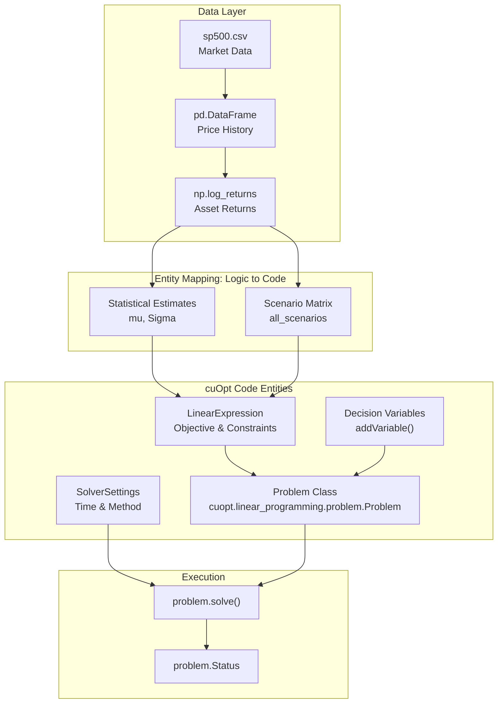
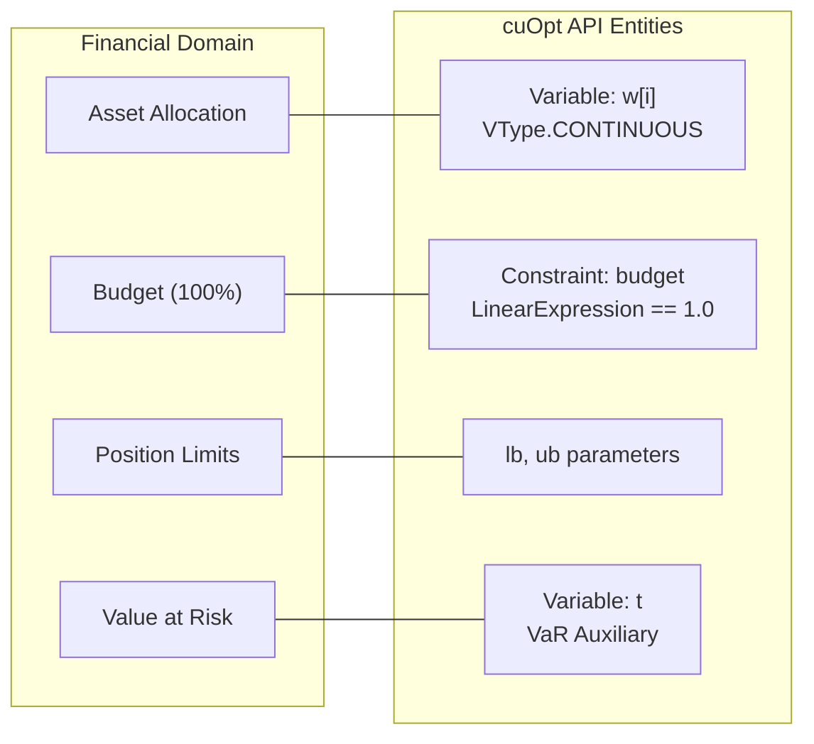

<!-- source: DeepWiki mcp.deepwiki.com · repo NVIDIA/cuopt-examples · page 5 Portfolio Optimization · fetched 2026-10-26 -->

# Portfolio Optimization

Relevant source files

The following files were used as context for generating this wiki page:

- [AI-accelerated-routing/initializing_cuopt_with_rl_solutions.ipynb](AI-accelerated-routing/initializing_cuopt_with_rl_solutions.ipynb)
- [AI-accelerated-routing/training_rl_agent_for_vrp.ipynb](AI-accelerated-routing/training_rl_agent_for_vrp.ipynb)
- [diet_optimization/diet_optimization_lp.ipynb](diet_optimization/diet_optimization_lp.ipynb)
- [diet_optimization/diet_optimization_milp.ipynb](diet_optimization/diet_optimization_milp.ipynb)
- [portfolio_optimization/README.md](portfolio_optimization/README.md)
- [portfolio_optimization/cvar_portfolio_optimization.ipynb](portfolio_optimization/cvar_portfolio_optimization.ipynb)

## Purpose and Scope

This page documents the portfolio optimization capabilities of cuOpt, specifically focusing on Conditional Value at Risk (CVaR) and Mean-Variance optimization using cuOpt's linear and quadratic programming interfaces. These examples demonstrate how to construct and solve financial optimization problems on GPU-accelerated hardware.

For details on specific implementations, see:
- [CVaR Portfolio Optimization](#5.1) — Detailed explanation of Conditional Value at Risk formulation as a linear program.
- [Portfolio Data Preparation](#5.2) — Guide for preparing financial data, including historical returns and Monte Carlo scenario generation.
- [Advanced Portfolio Topics](#5.3) — Covers QP-based mean-variance optimization, backtesting, and efficient frontier construction.

---

## Overview

Portfolio optimization in cuOpt addresses the challenge of selecting optimal asset allocations to maximize expected returns while controlling risk. The repository provides multiple approaches, ranging from linear programming (LP) for CVaR to quadratic programming (QP) for traditional mean-variance optimization.

**Key Features:**
- **CVaR Risk Measure:** Quantifies expected loss in worst-case scenarios beyond a confidence level [portfolio_optimization/cvar_portfolio_optimization.ipynb:13-13]().
- **Mean-Variance Optimization:** Traditional risk-return balancing using Quadratic Programming [portfolio_optimization/README.md:13-15]().
- **GPU Acceleration:** Uses cuOpt's accelerated solvers for large-scale portfolios with thousands of assets or scenarios [portfolio_optimization/cvar_portfolio_optimization.ipynb:40-43]().
- **Scenario-Based Modeling:** Combines historical data with Monte Carlo simulations for robust risk assessment [portfolio_optimization/cvar_portfolio_optimization.ipynb:34-35]().

Sources: [portfolio_optimization/README.md:1-26](), [portfolio_optimization/cvar_portfolio_optimization.ipynb:7-50]()

---

## System Architecture

The portfolio optimization workflow bridges financial data processing with the `cuopt.linear_programming` API.

### Portfolio Optimization Data Flow

Sources: [portfolio_optimization/cvar_portfolio_optimization.ipynb:151-167](), [portfolio_optimization/cvar_portfolio_optimization.ipynb:196-267](), [portfolio_optimization/cvar_portfolio_optimization.ipynb:322-425]()

---

## Core Approaches

### 1. CVaR Portfolio Optimization (LP)
Conditional Value at Risk (CVaR) is formulated as a linear program by introducing auxiliary variables for each scenario. This allows the solver to maximize expected return minus a weighted risk penalty ($\lambda$) [portfolio_optimization/cvar_portfolio_optimization.ipynb:19-31]().

For details, see [CVaR Portfolio Optimization](#5.1).

### 2. Mean-Variance Optimization (QP)
This approach aims to balance expected return with the variance of losses (risk). Unlike the linear CVaR model, this uses a quadratic objective function to model the covariance between assets [portfolio_optimization/README.md:13-15]().

### 3. Data Preparation and Scenarios
Effective optimization requires high-quality inputs. The examples demonstrate fetching S&P 500 data and generating thousands of Monte Carlo scenarios to simulate market uncertainty [portfolio_optimization/cvar_portfolio_optimization.ipynb:34-35]().

For details, see [Portfolio Data Preparation](#5.2).

---

## Programming Interface

The portfolio examples primarily interact with the `cuopt.linear_programming` module.

### Variable and Constraint Mapping

Sources: [portfolio_optimization/cvar_portfolio_optimization.ipynb:161-163](), [portfolio_optimization/cvar_portfolio_optimization.ipynb:352-365](), [portfolio_optimization/cvar_portfolio_optimization.ipynb:386-391]()

### Solver Configuration
Solvers are configured using the `SolverSettings` class, which controls execution parameters such as `time_limit` and `log_to_console` [portfolio_optimization/cvar_portfolio_optimization.ipynb:162-163]().

| Parameter | Purpose | Code Reference |
|-----------|---------|----------------|
| `time_limit` | Max seconds for GPU solve | [portfolio_optimization/cvar_portfolio_optimization.ipynb:182-182]() |
| `log_to_console` | Verbose solver output | [portfolio_optimization/cvar_portfolio_optimization.ipynb:183-183]() |
| `method` | Solver algorithm selection | [portfolio_optimization/cvar_portfolio_optimization.ipynb:186-186]() |

---

## Advanced Quantitative Workflows

For users requiring enterprise-grade quantitative features, cuOpt integrates into broader workflows including:
- **Efficient Frontier:** Constructing the curve of optimal portfolios for various risk levels [portfolio_optimization/README.md:19-20]().
- **Backtesting:** Evaluating how an optimized strategy would have performed historically [portfolio_optimization/README.md:21-21]().
- **Turnover Optimization:** Adding constraints to limit trading costs during rebalancing [portfolio_optimization/README.md:22-22]().

For details, see [Advanced Portfolio Topics](#5.3).

Sources: [portfolio_optimization/README.md:17-26](), [portfolio_optimization/cvar_portfolio_optimization.ipynb:37-38]()

---

