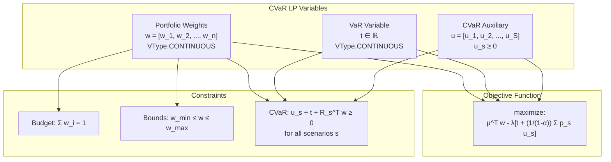
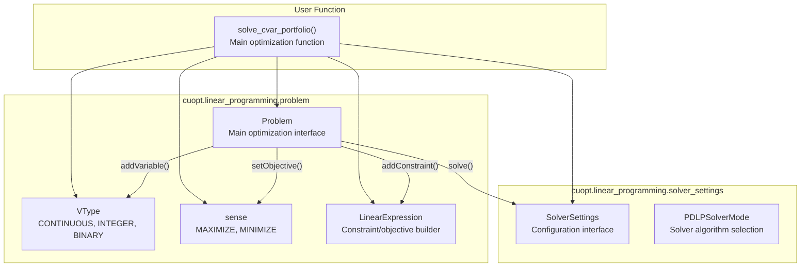
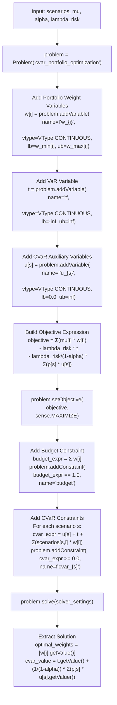

<!-- source: DeepWiki mcp.deepwiki.com · repo NVIDIA/cuopt-examples · page 5.1 CVaR Portfolio Optimization · fetched 2026-10-26 -->

# CVaR Portfolio Optimization

<details>
<summary>Relevant source files</summary>

The following files were used as context for generating this wiki page:

- [AI-accelerated-routing/initializing_cuopt_with_rl_solutions.ipynb](AI-accelerated-routing/initializing_cuopt_with_rl_solutions.ipynb)
- [AI-accelerated-routing/training_rl_agent_for_vrp.ipynb](AI-accelerated-routing/training_rl_agent_for_vrp.ipynb)
- [diet_optimization/diet_optimization_lp.ipynb](diet_optimization/diet_optimization_lp.ipynb)
- [diet_optimization/diet_optimization_milp.ipynb](diet_optimization/diet_optimization_milp.ipynb)
- [portfolio_optimization/README.md](portfolio_optimization/README.md)
- [portfolio_optimization/cvar_portfolio_optimization.ipynb](portfolio_optimization/cvar_portfolio_optimization.ipynb)

</details>


## Purpose and Scope

This page documents the Conditional Value at Risk (CVaR) portfolio optimization implementation using cuOpt's linear programming API. CVaR is a coherent risk measure that quantifies expected losses in worst-case scenarios beyond a specified confidence level, making it suitable for risk-aware portfolio construction. This implementation formulates the CVaR optimization problem as a linear program (LP) and leverages GPU acceleration for fast solution times with large-scale portfolios.

The examples in this repository utilize historical S&P 500 stock data to demonstrate practical application in financial contexts.

**Sources**: [portfolio_optimization/cvar_portfolio_optimization.ipynb:1-49](), [portfolio_optimization/README.md:1-12]()

## CVaR Risk Measure

CVaR (Conditional Value at Risk), also known as Expected Shortfall, measures the expected loss in the worst (1-α)% of scenarios. For a confidence level α (typically 95% or 99%), CVaR_α represents the average loss exceeding the Value at Risk (VaR) threshold. Unlike VaR, CVaR is a coherent risk measure that accounts for tail risk and is convex, making it suitable for optimization.

The CVaR portfolio optimization problem maximizes expected return while minimizing tail risk:

```
maximize: μ^T w - λ CVaR_α(w)
subject to: 
  - 1^T w = 1                                    (budget constraint)
  - w_i^min ≤ w_i ≤ w_i^max, for all i          (position bounds)
```

Where:
- `w` is the n-dimensional portfolio weight vector
- `μ` is the expected return vector
- `λ` is the risk aversion parameter (higher values prioritize risk reduction)
- `α` is the confidence level (e.g., 0.95 for 95% confidence)

**Sources**: [portfolio_optimization/cvar_portfolio_optimization.ipynb:11-31]()

## Linear Programming Reformulation

The CVaR optimization problem is reformulated as a linear program using the Rockafellar-Uryasev formulation. This reformulation introduces auxiliary variables to express CVaR as a linear function.

**CVaR Decomposition**:

```
CVaR_α(w) = t + (1/(1-α)) * E[max(0, -R^T w - t)]
```

Where:
- `t` represents the VaR at confidence level α
- `R` is a random vector of portfolio returns across scenarios
- The expectation is computed over all scenarios

**Discrete Scenario Formulation**:

For S scenarios with probabilities p_s and returns R_s:

```
CVaR_α(w) = t + (1/(1-α)) * Σ_s p_s * u_s
```

Subject to:
```
u_s ≥ -R_s^T w - t, for all scenarios s
u_s ≥ 0, for all scenarios s
```

The auxiliary variable `u_s` captures the loss beyond VaR in scenario s.

### CVaR LP Variables and Constraints



**Sources**: [portfolio_optimization/cvar_portfolio_optimization.ipynb:322-424]()

## Implementation Architecture

The CVaR optimization is implemented using cuOpt's `Problem` API for linear programming. The implementation constructs the LP formulation programmatically and leverages GPU acceleration for solving large-scale problems.

### Core Classes and Methods



**Key Components**:

| Component | Purpose | Key Methods |
|-----------|---------|-------------|
| `Problem` | Main optimization interface | `addVariable()`, `setObjective()`, `addConstraint()`, `solve()` |
| `LinearExpression` | Build linear terms for constraints/objectives | `__add__()`, `__mul__()`, equality/inequality operators |
| `SolverSettings` | Configure solver behavior | `set_parameter()` with time_limit, log_to_console, method |
| `VType.CONTINUOUS` | Specify continuous decision variables | Used for portfolio weights, VaR, and CVaR auxiliaries |
| `sense.MAXIMIZE` | Optimization direction | Maximize expected return - risk penalty |

**Sources**: [portfolio_optimization/cvar_portfolio_optimization.ipynb:151-167](), [portfolio_optimization/cvar_portfolio_optimization.ipynb:177-187]()

### Function: solve_cvar_portfolio

The `solve_cvar_portfolio` function encapsulates the complete CVaR optimization workflow.

**Function Signature**:
```python
def solve_cvar_portfolio(scenarios, scenario_probs, mu, alpha=0.95, 
                        lambda_risk=1.0, w_min=None, w_max=None, 
                        solver_settings=None)
```

**Parameters**:
- `scenarios`: numpy array of shape (n_scenarios, n_assets) containing return scenarios.
- `scenario_probs`: probability weights for each scenario (must sum to 1).
- `mu`: expected returns vector (n_assets,).
- `alpha`: confidence level for CVaR (default 0.95).
- `lambda_risk`: risk aversion parameter (default 1.0).
- `w_min`, `w_max`: lower/upper bounds on portfolio weights.
- `solver_settings`: optional `SolverSettings` instance.

**Returns**:
- `optimal_weights`: optimal portfolio allocation (n_assets,).
- `cvar_value`: CVaR at the optimal portfolio.
- `expected_return`: expected return of optimal portfolio.
- `problem`: solved `Problem` instance with status information.

**Sources**: [portfolio_optimization/cvar_portfolio_optimization.ipynb:322-424]()

## Problem Construction Workflow

The following diagram illustrates how the CVaR LP is constructed using cuOpt's API:



**Implementation Details**:

1. **Variable Creation**: Portfolio weights `w[i]` with bounds, VaR variable `t` (unbounded), and auxiliary variables `u[s]` (lb=0) are added using `problem.addVariable()`. [portfolio_optimization/cvar_portfolio_optimization.ipynb:352-366]()
2. **Objective Construction**: A `LinearExpression` is built by adding expected return terms and subtracting the CVaR penalty weighted by `lambda_risk`. [portfolio_optimization/cvar_portfolio_optimization.ipynb:368-383]()
3. **Budget Constraint**: Added using `problem.addConstraint(budget_expr == 1.0)`. [portfolio_optimization/cvar_portfolio_optimization.ipynb:387-391]()
4. **CVaR Constraints**: For each scenario, a constraint `u[s] + t + scenarios[s,:] @ w >= 0` is added to the problem. [portfolio_optimization/cvar_portfolio_optimization.ipynb:394-404]()

**Sources**: [portfolio_optimization/cvar_portfolio_optimization.ipynb:349-410]()

## Scenario Generation

CVaR optimization requires a discrete set of return scenarios representing possible future outcomes. The implementation combines historical simulation and Monte Carlo simulation.

**Historical Simulation**: Uses actual historical log returns as scenarios. [portfolio_optimization/cvar_portfolio_optimization.ipynb:283-285]()

**Monte Carlo Simulation**: Generates synthetic scenarios from an estimated multivariate normal distribution based on historical mean `μ` and covariance `Σ`. [portfolio_optimization/cvar_portfolio_optimization.ipynb:291-295]()

**Probability Weighting**: Typically equal weights are assigned: `p_s = 1 / n_scenarios`. [portfolio_optimization/cvar_portfolio_optimization.ipynb:298-301]()

**Sources**: [portfolio_optimization/cvar_portfolio_optimization.ipynb:283-304]()

## Data Preparation

### Loading and Processing Financial Data

The example uses S&P 500 historical price data:

1. **Load Price Data**: Read CSV from repository. [portfolio_optimization/cvar_portfolio_optimization.ipynb:202-211]()
2. **Data Cleaning**: Remove assets with missing data using `dropna()`. [portfolio_optimization/cvar_portfolio_optimization.ipynb:214-221]()
3. **Return Calculation**: Log returns are calculated via `np.log(price_data / price_data.shift(1))`. [portfolio_optimization/cvar_portfolio_optimization.ipynb:237-245]()
4. **Annualization**: Daily returns and covariances are annualized using a 252-day trading year factor. [portfolio_optimization/cvar_portfolio_optimization.ipynb:254-265]()

**Sources**: [portfolio_optimization/cvar_portfolio_optimization.ipynb:197-265]()

## Solver Configuration

The `SolverSettings` class configures the LP solver behavior:

| Parameter | Value | Purpose |
|-----------|-------|---------|
| `time_limit` | 300.0 | Maximum solve time in seconds. |
| `log_to_console` | True | Enable solver progress logging. |
| `method` | 0 | Solver algorithm selection (0 = default). |

**Sources**: [portfolio_optimization/cvar_portfolio_optimization.ipynb:177-187]()

## Output and Solution Status

After calling `problem.solve()`, the `Problem` object provides the solution status:

- **'Optimal'**: Feasible solution found; optimality guaranteed.
- **'Feasible'**: Feasible solution found but not necessarily optimal (e.g., time limit reached).
- **'Infeasible'**: No feasible solution exists for the given constraints.

**Accessing Solution**:
- `variable.getValue()`: Returns optimal value of a decision variable. [portfolio_optimization/cvar_portfolio_optimization.ipynb:413-415]()
- `problem.ObjValue`: Returns optimal objective function value. [portfolio_optimization/cvar_portfolio_optimization.ipynb:485]()
- `problem.Status`: Solver termination status. [portfolio_optimization/cvar_portfolio_optimization.ipynb:412]()

**Sources**: [portfolio_optimization/cvar_portfolio_optimization.ipynb:412-424](), [portfolio_optimization/cvar_portfolio_optimization.ipynb:483-488]()

## Integration with Advanced Workflows

The notebook references the **NVIDIA Quantitative Portfolio Optimization repository** for advanced features such as:
- Efficient frontier construction.
- Backtesting strategies.
- Turnover optimization.
- Multi-period optimization.

**Sources**: [portfolio_optimization/cvar_portfolio_optimization.ipynb:37](), [portfolio_optimization/README.md:19-25]()

## Best Practices

### Data Preparation
- **Handle Missing Data**: Remove assets with incomplete histories to ensure consistency. [portfolio_optimization/cvar_portfolio_optimization.ipynb:214-221]()
- **Stationarity**: Use log returns to improve distributional properties for optimization. [portfolio_optimization/cvar_portfolio_optimization.ipynb:237-245]()

### Scenario Generation
- **Scenario Count**: Use a sufficient number of scenarios (e.g., 1,000-5,000) for stable CVaR approximation. [portfolio_optimization/cvar_portfolio_optimization.ipynb:291-295]()
- **Diversification**: Combine historical and synthetic scenarios to capture both real tail events and a broader range of potential outcomes. [portfolio_optimization/cvar_portfolio_optimization.ipynb:302-304]()

### Constraint Design
- **Position Limits**: Use `w_max` to enforce diversification and prevent single-asset domination. [portfolio_optimization/cvar_portfolio_optimization.ipynb:444-450]()
- **Risk Aversion**: Calibrate `lambda_risk` based on specific risk tolerance requirements. [portfolio_optimization/cvar_portfolio_optimization.ipynb:462-463]()

**Sources**: [portfolio_optimization/cvar_portfolio_optimization.ipynb:227-245](), [portfolio_optimization/cvar_portfolio_optimization.ipynb:283-304](), [portfolio_optimization/cvar_portfolio_optimization.ipynb:440-467]()

---

