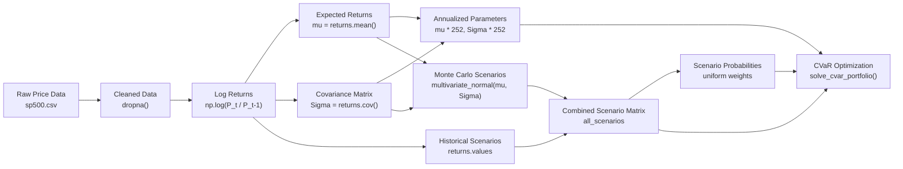
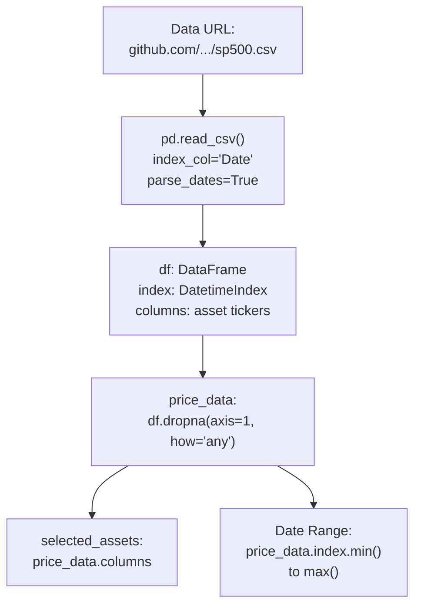
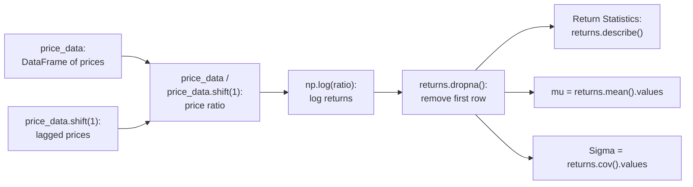
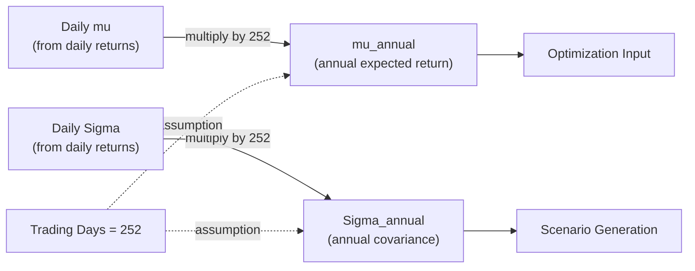
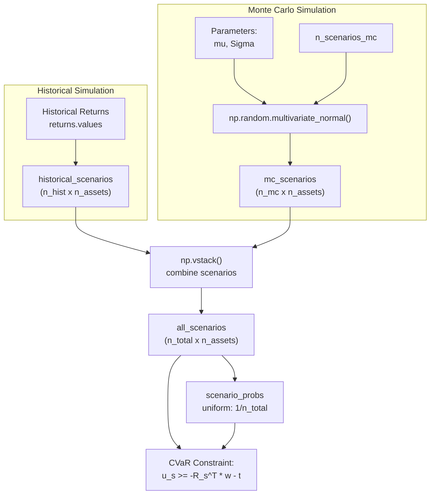
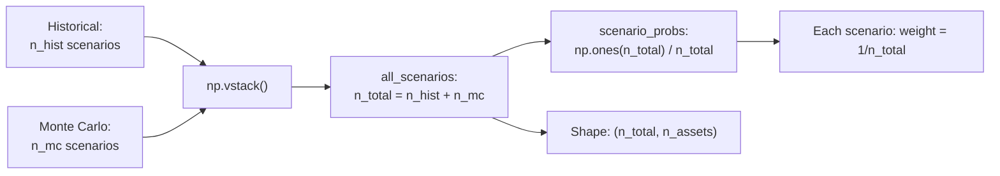
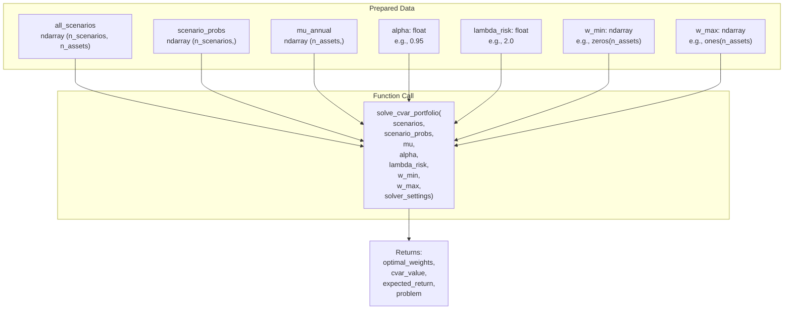
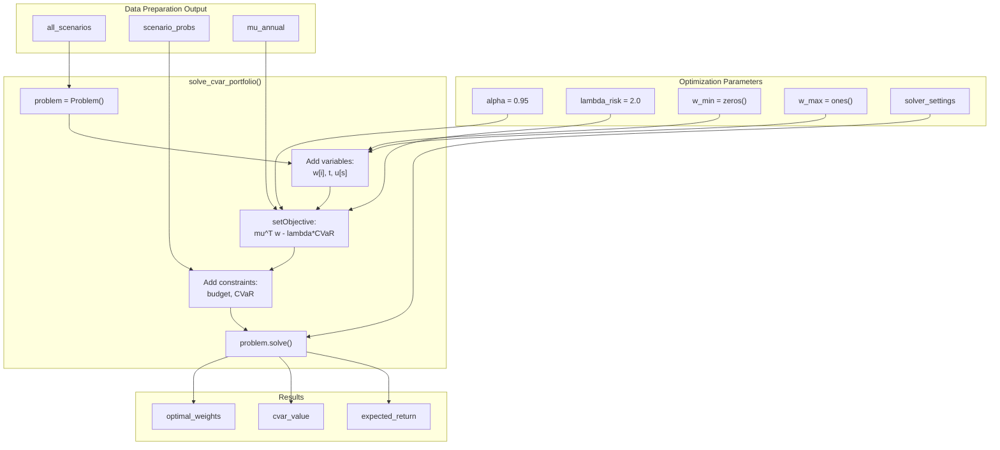

<!-- source: DeepWiki mcp.deepwiki.com · repo NVIDIA/cuopt-examples · page 5.2 Portfolio Data Preparation · fetched 2026-10-26 -->

# Portfolio Data Preparation

<details>
<summary>Relevant source files</summary>

The following files were used as context for generating this wiki page:

- [AI-accelerated-routing/initializing_cuopt_with_rl_solutions.ipynb](AI-accelerated-routing/initializing_cuopt_with_rl_solutions.ipynb)
- [AI-accelerated-routing/training_rl_agent_for_vrp.ipynb](AI-accelerated-routing/training_rl_agent_for_vrp.ipynb)
- [diet_optimization/diet_optimization_lp.ipynb](diet_optimization/diet_optimization_lp.ipynb)
- [diet_optimization/diet_optimization_milp.ipynb](diet_optimization/diet_optimization_milp.ipynb)
- [portfolio_optimization/cvar_portfolio_optimization.ipynb](portfolio_optimization/cvar_portfolio_optimization.ipynb)
- [portfolio_optimization/data/sp500.csv](portfolio_optimization/data/sp500.csv)

</details>


## Purpose and Scope

This page documents the data preparation pipeline for portfolio optimization problems in cuOpt, specifically focusing on transforming raw financial price data into optimization-ready inputs. The material covers return calculation, statistical parameter estimation, scenario generation, and data format requirements for CVaR and mean-variance optimization.

For the optimization formulation and solving using the prepared data, see [CVaR Portfolio Optimization](#5.1). For backtesting, efficient frontier construction, and turnover optimization, see [Advanced Portfolio Topics](#5.3).

## Overview: Data Preparation Pipeline

The data preparation pipeline transforms historical price data into the statistical inputs required by portfolio optimization models. The process involves calculating returns, estimating expected returns and covariances, and generating scenario sets for risk evaluation.



**Data Preparation Pipeline Flow**

Sources: [portfolio_optimization/cvar_portfolio_optimization.ipynb:202-305]()

## Data Sources and Loading

### S&P 500 Historical Data

The primary data source is historical price data for S&P 500 constituents, loaded from a CSV file hosted in the cuopt-examples repository. The data contains daily closing prices indexed by date.

| Configuration | Value |
|--------------|-------|
| Data URL | `https://raw.githubusercontent.com/NVIDIA/cuopt-examples/refs/heads/main/portfolio_optimization/data/sp500.csv` |
| Index Column | `Date` |
| Parse Dates | `True` |
| Format | Pandas DataFrame with dates as index, ticker symbols as columns |



**S&P 500 Data Loading Process**

The data cleaning step removes any assets with incomplete data using `dropna(axis=1, how='any')`, ensuring that all selected assets have a complete price history over the entire date range [portfolio_optimization/cvar_portfolio_optimization.ipynb:227-235]().

Sources: [portfolio_optimization/cvar_portfolio_optimization.ipynb:202-246](), [portfolio_optimization/data/sp500.csv:1-2]()

### Data Quality Requirements

| Requirement | Implementation |
|-------------|----------------|
| Missing Values | Assets with any NaN values are dropped entirely |
| Date Range | Must have consistent date coverage across all assets |
| Price Data Type | Numeric (float) values |
| Minimum Assets | No explicit minimum, but typically uses 100+ assets |

Sources: [portfolio_optimization/cvar_portfolio_optimization.ipynb:227-235]()

## Return Calculation

### Log Returns

Portfolio optimization requires return data rather than raw prices. The implementation uses logarithmic returns, which have desirable statistical properties for continuous compounding [portfolio_optimization/cvar_portfolio_optimization.ipynb:237-238]().

**Calculation Formula:**

$$r_t = \ln\left(\frac{P_t}{P_{t-1}}\right)$$

where:
- $r_t$ = return at time $t$
- $P_t$ = price at time $t$
- $P_{t-1}$ = price at previous period



**Log Return Calculation Pipeline**

The implementation code:
`returns = np.log(price_data / price_data.shift(1)).dropna()` [portfolio_optimization/cvar_portfolio_optimization.ipynb:244-246]().

The first row is dropped because it contains NaN values (no previous price for comparison). The resulting `returns` DataFrame has the same columns (assets) but one fewer row than the price data.

Sources: [portfolio_optimization/cvar_portfolio_optimization.ipynb:237-246]()

### Why Log Returns?

| Property | Advantage |
|----------|-----------|
| Time Additivity | Multi-period returns sum: $r_{1,n} = r_1 + r_2 + ... + r_n$ |
| Symmetry | Gains and losses are symmetric: $\ln(2) = -\ln(0.5)$ |
| Normal Approximation | Better approximates normal distribution for small returns |
| Portfolio Returns | Linear aggregation: $r_p = \sum w_i r_i$ |

Sources: [portfolio_optimization/cvar_portfolio_optimization.ipynb:237-238]()

## Statistical Parameter Estimation

### Expected Returns

Expected returns are estimated as the sample mean of historical log returns. For use in optimization, these daily returns are annualized by multiplying by the number of trading days per year (252) [portfolio_optimization/cvar_portfolio_optimization.ipynb:254-265]().

| Parameter | Calculation | Variable Name |
|-----------|-------------|---------------|
| Daily Expected Return | `returns.mean().values` | `mu` |
| Annualized Expected Return | `mu * 252` | `mu_annual` |
| Data Type | `numpy.ndarray` | Vector of length `n_assets` |

```python
mu = returns.mean().values  # Daily expected returns
mu_annual = mu * 252        # Annualized returns
```

Sources: [portfolio_optimization/cvar_portfolio_optimization.ipynb:254-265]()

### Covariance Matrix

The covariance matrix captures the joint variability and correlations between asset returns. It is estimated from the sample covariance of historical returns and annualized similarly [portfolio_optimization/cvar_portfolio_optimization.ipynb:254-265]().

| Parameter | Calculation | Variable Name |
|-----------|-------------|---------------|
| Daily Covariance | `returns.cov().values` | `Sigma` |
| Annualized Covariance | `Sigma * 252` | `Sigma_annual` |
| Data Type | `numpy.ndarray` | Matrix of shape `(n_assets, n_assets)` |

```python
Sigma = returns.cov().values  # Daily covariance
Sigma_annual = Sigma * 252    # Annualized covariance
```

**Properties:**
- Symmetric matrix: $\Sigma_{ij} = \Sigma_{ji}$
- Positive semi-definite
- Diagonal elements are variances: $\Sigma_{ii} = \sigma_i^2$
- Off-diagonal elements are covariances: $\Sigma_{ij} = \text{Cov}(r_i, r_j)$

Sources: [portfolio_optimization/cvar_portfolio_optimization.ipynb:254-265]()

### Annualization Factor

The annualization factor of 252 is based on the typical number of trading days in a year for U.S. equity markets [portfolio_optimization/cvar_portfolio_optimization.ipynb:259-265]().



**Annualization Process**

| Return Period | Trading Days | Annualization Factor |
|---------------|--------------|---------------------|
| Daily | 1 | 252 |
| Weekly | 5 | 52 |
| Monthly | 21 | 12 |

Sources: [portfolio_optimization/cvar_portfolio_optimization.ipynb:259-265]()

## Scenario Generation

### Overview of Scenario-Based Optimization

CVaR portfolio optimization requires a set of return scenarios to evaluate tail risk. The implementation combines two approaches: historical simulation and Monte Carlo simulation [portfolio_optimization/cvar_portfolio_optimization.ipynb:283-305]().



**Scenario Generation Architecture**

Sources: [portfolio_optimization/cvar_portfolio_optimization.ipynb:283-305]()

### Historical Simulation

Historical simulation uses actual past returns as scenarios. This approach captures the empirical distribution of returns, including any non-normality, fat tails, or asymmetry present in historical data [portfolio_optimization/cvar_portfolio_optimization.ipynb:283-287]().

```python
historical_scenarios = returns.values
n_scenarios_hist = historical_scenarios.shape[0]
```

| Attribute | Value |
|-----------|-------|
| Method | Direct use of historical returns |
| Shape | `(n_days, n_assets)` where `n_days` is number of trading days in history |
| Advantages | Captures actual market behavior, no distributional assumptions |
| Disadvantages | Limited to observed events, may not capture future risks |

Sources: [portfolio_optimization/cvar_portfolio_optimization.ipynb:283-287]()

### Monte Carlo Simulation

Monte Carlo simulation generates synthetic scenarios by sampling from a multivariate normal distribution parameterized by the estimated mean and covariance [portfolio_optimization/cvar_portfolio_optimization.ipynb:290-295]().

```python
n_scenarios_mc = min(2000, n_scenarios_hist)
mc_scenarios = np.random.multivariate_normal(mu, Sigma, n_scenarios_mc)
```

**Key Implementation Details:**

| Parameter | Value | Rationale |
|-----------|-------|-----------|
| Distribution | Multivariate Normal | Standard assumption for return modeling |
| Mean Vector | `mu` (daily returns) | Sample mean from historical data |
| Covariance Matrix | `Sigma` (daily covariance) | Sample covariance from historical data |
| Number of Scenarios | `min(2000, n_scenarios_hist)` | Computational efficiency constraint |

The constraint `min(2000, n_scenarios_hist)` limits the number of Monte Carlo scenarios to avoid excessive computational burden when dealing with many assets [portfolio_optimization/cvar_portfolio_optimization.ipynb:292-293]().

Sources: [portfolio_optimization/cvar_portfolio_optimization.ipynb:290-295]()

### Combined Scenario Set

The final scenario set combines both historical and Monte Carlo scenarios, with uniform probability weights [portfolio_optimization/cvar_portfolio_optimization.ipynb:297-305]().

```python
all_scenarios = np.vstack([historical_scenarios, mc_scenarios])
n_scenarios_total = all_scenarios.shape[0]
scenario_probs = np.ones(n_scenarios_total) / n_scenarios_total
```

| Component | Description |
|-----------|-------------|
| `all_scenarios` | Numpy array of shape `(n_scenarios_total, n_assets)` |
| `n_scenarios_total` | Total number of scenarios = `n_scenarios_hist + n_scenarios_mc` |
| `scenario_probs` | Uniform weights: each scenario has probability `1/n_scenarios_total` |



**Combined Scenario Construction**

Sources: [portfolio_optimization/cvar_portfolio_optimization.ipynb:297-305]()

## Data Format Requirements for Optimization

### Input Data Types

The CVaR optimization function `solve_cvar_portfolio()` expects specific data types and shapes [portfolio_optimization/cvar_portfolio_optimization.ipynb:322-424]().

| Parameter | Type | Shape | Description |
|-----------|------|-------|-------------|
| `scenarios` | `numpy.ndarray` | `(n_scenarios, n_assets)` | Return scenarios matrix |
| `scenario_probs` | `numpy.ndarray` | `(n_scenarios,)` | Probability weights for scenarios |
| `mu` | `numpy.ndarray` | `(n_assets,)` | Expected return vector |
| `alpha` | `float` | scalar | Confidence level (e.g., 0.95) |
| `lambda_risk` | `float` | scalar | Risk aversion parameter |
| `w_min` | `numpy.ndarray` or `None` | `(n_assets,)` | Minimum weight bounds |
| `w_max` | `numpy.ndarray` or `None` | `(n_assets,)` | Maximum weight bounds |



**Data Flow into Optimization Function**

Sources: [portfolio_optimization/cvar_portfolio_optimization.ipynb:322-424]()

## Common Patterns and Best Practices

### Scenario Count Selection

The number of scenarios involves a tradeoff between computational cost and risk estimate accuracy. The implementation uses `min(2000, n_scenarios_hist)` for Monte Carlo scenarios to maintain computational tractability [portfolio_optimization/cvar_portfolio_optimization.ipynb:290-305]().

### Weight Bounds Configuration

Portfolio weight bounds control diversification and position sizing. Common configurations:

| Strategy | `w_min` | `w_max` | Effect |
|----------|---------|---------|--------|
| Long-only | `zeros(n_assets)` | `ones(n_assets)` | No short positions |
| Diversified | `zeros(n_assets)` | `ones(n_assets) * 0.10` | Max 10% per asset |

Sources: [portfolio_optimization/cvar_portfolio_optimization.ipynb:440-467]()

### Risk Aversion Parameter Selection

The risk aversion parameter `lambda_risk` controls the tradeoff between expected return and CVaR minimization [portfolio_optimization/cvar_portfolio_optimization.ipynb:440-443]().

The objective function is:
$$\text{maximize: } \mu^T w - \lambda \cdot \text{CVaR}_\alpha(w)$$ [portfolio_optimization/cvar_portfolio_optimization.ipynb:21-25]()

Sources: [portfolio_optimization/cvar_portfolio_optimization.ipynb:440-443](), [portfolio_optimization/cvar_portfolio_optimization.ipynb:21-25]()

## Integration with CVaR Optimization

The prepared data feeds directly into the `solve_cvar_portfolio()` function, which formulates and solves the linear programming problem using the cuOpt `Problem` class [portfolio_optimization/cvar_portfolio_optimization.ipynb:322-424]().



**Data Preparation to Optimization Pipeline**

Sources: [portfolio_optimization/cvar_portfolio_optimization.ipynb:322-424]()

---

