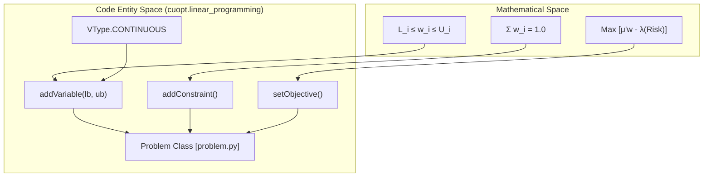
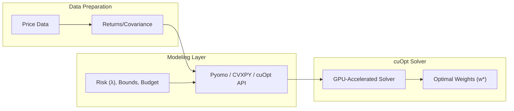

<!-- source: DeepWiki mcp.deepwiki.com · repo NVIDIA/cuopt-examples · page 5.3 Advanced Portfolio Topics · fetched 2026-10-26 -->

# Advanced Portfolio Topics

<details>
<summary>Relevant source files</summary>

The following files were used as context for generating this wiki page:

- [Pyomo_integration_example/README.md](Pyomo_integration_example/README.md)
- [Pyomo_integration_example/p_median_problem.ipynb](Pyomo_integration_example/p_median_problem.ipynb)
- [portfolio_optimization/QP_portfolio_optimization.ipynb](portfolio_optimization/QP_portfolio_optimization.ipynb)
- [portfolio_optimization/README.md](portfolio_optimization/README.md)

</details>


## Purpose and Scope

This document covers advanced portfolio optimization techniques and extensions beyond basic Conditional Value at Risk (CVaR) formulations. It details the use of **Quadratic Programming (QP)** for mean-variance optimization, diversification strategies, constraint configuration, efficient frontier construction, and integration with external quantitative workflows.

For basic CVaR portfolio optimization concepts, see [CVaR Portfolio Optimization](5.1). For data preparation and scenario generation, see [Portfolio Data Preparation](5.2).

**Note:** The most comprehensive advanced portfolio optimization examples, including backtesting strategies and turnover optimization, are available in the [NVIDIA Quantitative Portfolio Optimization repository](https://github.com/NVIDIA-AI-Blueprints/quantitative-portfolio-optimization).

Sources: [portfolio_optimization/README.md:1-26](), [portfolio_optimization/QP_portfolio_optimization.ipynb:8-21]()

---

## Mean-Variance Optimization (QP)

While CVaR optimization is formulated as a Linear Program (LP), classic Markowitz portfolio theory uses **Quadratic Programming (QP)** to balance expected return against the variance of returns (risk).

### Quadratic Objective Formulation
The objective in a QP portfolio problem typically minimizes portfolio variance for a target return or maximizes risk-adjusted return. In cuOpt, this is implemented using the `QuadraticExpression` class [portfolio_optimization/QP_portfolio_optimization.ipynb:135]().

**Objective Function:**
```
minimize: (1/2) * w^T * Σ * w - λ * μ^T * w
```
Where:
*   `w`: Vector of asset weights.
*   `Σ`: Covariance matrix of asset returns.
*   `μ`: Vector of expected returns.
*   `λ`: Risk tolerance parameter.

### Implementation in cuOpt
The `Problem` class supports quadratic objectives by passing a `QuadraticExpression` to `setObjective`.

```python
from cuopt.linear_programming.problem import Problem, QuadraticExpression, MINIMIZE

# Define variables and covariance matrix (Sigma)
problem = Problem()
# ... (add variables w_i) ...

# Create quadratic expression for variance
quad_expr = QuadraticExpression()
for i in range(n_assets):
    for j in range(n_assets):
        quad_expr.addTerm(w[i], w[j], Sigma[i, j])

problem.setObjective(quad_expr, MINIMIZE)
```

Sources: [portfolio_optimization/QP_portfolio_optimization.ipynb:129-141](), [portfolio_optimization/QP_portfolio_optimization.ipynb:173-182]()

---

## Portfolio Constraints and Diversification

### Weight Bounds and Position Limits
The optimization implementation supports flexible weight constraints through `lb` (lower bound) and `ub` (upper bound) parameters when adding variables to the `Problem` instance.

| Constraint Type | Implementation | Purpose |
|----------------|----------------|---------|
| **No Short Selling** | `lb=0.0` | Prevents negative positions (long-only). |
| **Maximum Concentration** | `ub=0.10` | Limits single asset exposure (e.g., to 10%). |
| **Budget Constraint** | `sum(w) == 1.0` | Ensures 100% of capital is allocated. |

### Code Entity Mapping: Constraints
The following diagram bridges the mathematical constraints to the cuOpt API entities used in the portfolio examples.



Sources: [portfolio_optimization/QP_portfolio_optimization.ipynb:129-141](), [portfolio_optimization/QP_portfolio_optimization.ipynb:173-182]()

---

## Efficient Frontier Construction

The efficient frontier represents the set of optimal portfolios offering the highest expected return for each level of risk.

### Parametric Sweep Methodology
To construct the frontier, the optimization problem is solved iteratively across a range of risk aversion values ($\lambda$).
1.  **Define Range**: Select a sequence of $\lambda$ values (e.g., from 0.1 to 10.0).
2.  **Iterative Solve**: Loop through each $\lambda$, update the objective function, and call `problem.solve()`.
3.  **Data Collection**: Store the resulting portfolio variance (risk) and expected return for each point.
4.  **Visualization**: Plot the (risk, return) pairs to form the frontier curve.

### GPU Acceleration for Frontiers
Because each point on the frontier requires a complete optimization solve, GPU acceleration via cuOpt significantly reduces the total wall-clock time required to generate high-resolution frontiers (e.g., 100+ points) for large universes like the S&P 500.

Sources: [portfolio_optimization/QP_portfolio_optimization.ipynb:12-21](), [portfolio_optimization/README.md:19-22]()

---

## Integration with External Workflows

### Modeling Language Integrations
cuOpt integrates with common optimization modeling frameworks, allowing users to define complex portfolio logic (like turnover constraints or multi-period rebalancing) in familiar syntax while using cuOpt as the backend solver.

*   **Pyomo**: Uses `pyo.SolverFactory("cuopt")` to solve Mixed-Integer Programming (MIP) versions of portfolio problems (e.g., when adding fixed transaction costs or cardinality constraints) [Pyomo_integration_example/p_median_problem.ipynb:26-27]().
*   **CVXPY**: Ideal for convex portfolio problems (like Mean-Variance or CVaR), using `problem.solve(solver='CUOPT')`.

### Workflow Data Flow
The following diagram illustrates the data flow from raw financial data to an optimized portfolio using the cuOpt architecture.



Sources: [Pyomo_integration_example/README.md:9-15](), [portfolio_optimization/QP_portfolio_optimization.ipynb:149-182]()

---

## Advanced Performance Metrics

After optimization, the following metrics are typically calculated to validate the strategy:

| Metric | Calculation | Purpose |
|--------|-------------|---------|
| **Sharpe Ratio** | `(Return - RiskFree) / Volatility` | Risk-adjusted performance. |
| **HHI** | `sum(w^2)` | Measures concentration (1/HHI = effective assets). |
| **Turnover** | `sum|w_new - w_old|` | Measures trading activity and cost impact. |

Sources: [portfolio_optimization/QP_portfolio_optimization.ipynb:12-16](), [portfolio_optimization/README.md:19-23]()

---

