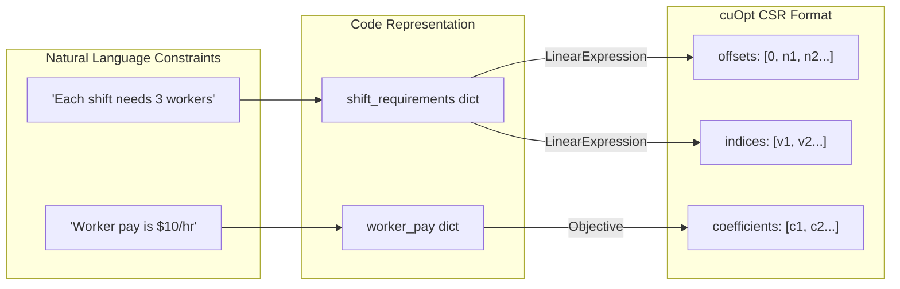

<!-- source: DeepWiki mcp.deepwiki.com · repo NVIDIA/cuopt-examples · page 6 Linear and Mixed-Integer Programming · fetched 2026-10-26 -->

# Linear and Mixed-Integer Programming

<details>
<summary>Relevant source files</summary>

The following files were used as context for generating this wiki page:

- [AI-accelerated-routing/initializing_cuopt_with_rl_solutions.ipynb](AI-accelerated-routing/initializing_cuopt_with_rl_solutions.ipynb)
- [AI-accelerated-routing/training_rl_agent_for_vrp.ipynb](AI-accelerated-routing/training_rl_agent_for_vrp.ipynb)
- [README.md](README.md)
- [VERSION](VERSION)
- [ci/release/update_version.sh](ci/release/update_version.sh)
- [diet_optimization/diet_optimization_lp.ipynb](diet_optimization/diet_optimization_lp.ipynb)
- [diet_optimization/diet_optimization_milp.ipynb](diet_optimization/diet_optimization_milp.ipynb)
- [portfolio_optimization/cvar_portfolio_optimization.ipynb](portfolio_optimization/cvar_portfolio_optimization.ipynb)
- [workforce_optimization/workforce_optimization_milp.ipynb](workforce_optimization/workforce_optimization_milp.ipynb)

</details>


## Purpose and Scope

This page provides an overview of Linear Programming (LP) and Mixed-Integer Linear Programming (MILP) capabilities in cuOpt. It covers the problem formulation concepts, data structures, and available APIs for solving these optimization problems using GPU acceleration.

For vehicle routing problems, see [Vehicle Routing Problems](#4). For portfolio optimization using LP formulations, see [Portfolio Optimization](#5). For detailed code examples, see [Linear Programming Examples](#6.1) and [Mixed-Integer Programming Examples](#6.2).

## Problem Categories

cuOpt supports two categories of mathematical programming problems:

**Linear Programming (LP)**: Optimization problems with continuous variables and linear constraints. All decision variables can take any real value within their bounds. Example applications include diet optimization, resource allocation, and production planning. [diet_optimization/diet_optimization_lp.ipynb:7-18]()

**Mixed-Integer Linear Programming (MILP)**: Optimization problems that include both continuous and integer variables. Integer variables can be restricted to whole numbers or binary (0/1) values. Example applications include workforce scheduling, facility location, and assignment problems. [workforce_optimization/workforce_optimization_milp.ipynb:6-19]()

Sources: [diet_optimization/diet_optimization_lp.ipynb:7-18](), [workforce_optimization/workforce_optimization_milp.ipynb:6-19]()

## Access Patterns

The diagram below illustrates the relationship between high-level modeling entities and the underlying code classes used to solve LP/MILP problems.

### Code Entity Mapping

```mermaid
graph TB
    subgraph "SDK Problem API"
        Problem["cuopt.linear_programming.problem.Problem"]
        VType["cuopt.linear_programming.problem.VType"]
        Sense["cuopt.linear_programming.problem.sense"]
        LinExp["cuopt.linear_programming.problem.LinearExpression"]
        Settings["cuopt.linear_programming.solver_settings.SolverSettings"]
        
        Problem -- "uses" --> VType
        Problem -- "uses" --> Sense
        Problem -- "manages" --> LinExp
        Problem -- "solved by" --> Settings
    end
    
    subgraph "Server DataModel API"
        DataModel["cuopt.linear_programming.data_model.DataModel"]
        Client["CuOptServiceSelfHostClient"]
        SolveEP["/cuopt/LP_solve"]
        
        DataModel -- "serializes to" --> Client
        Client -- "calls" --> SolveEP
    end

    subgraph "Variable Management"
        addVar["Problem.addVariable()"]
        setObj["Problem.setObjective()"]
        addConst["Problem.addConstraint()"]
    end

    Problem --> addVar
    Problem --> setObj
    Problem --> addConst
```


**Direct SDK Access (Problem API)**: Use the `Problem` class from `cuopt.linear_programming.problem` to construct optimization problems programmatically. This approach provides object-oriented access with `Variable` and `LinearExpression` classes for building constraints and objectives. [workforce_optimization/workforce_optimization_milp.ipynb:107-111]()

**Server-Based Access (DataModel API)**: Use the `DataModel` class to structure problem data, then submit to the cuOpt server via `CuOptServiceSelfHostClient`. This approach is suitable for client-server architectures. [README.md:3-5]()

Sources: [workforce_optimization/workforce_optimization_milp.ipynb:107-111](), [portfolio_optimization/cvar_portfolio_optimization.ipynb:160-164](), [README.md:3-5]()

## Problem Formulation Components

### Standard Form

All LP and MILP problems in cuOpt follow this structure:

```
Minimize/Maximize:  c^T * x

Subject to:
    l_c <= A * x <= u_c    (constraint bounds)
    l_v <= x <= u_v        (variable bounds)
    x_i ∈ {Integer, Continuous, Binary}  (variable types)
```

Where:
- `x` is the vector of decision variables.
- `c` is the objective coefficient vector.
- `A` is the constraint matrix in CSR format.
- `l_c, u_c` are constraint lower and upper bounds.
- `l_v, u_v` are variable lower and upper bounds.

Sources: [portfolio_optimization/cvar_portfolio_optimization.ipynb:17-32](), [workforce_optimization/workforce_optimization_milp.ipynb:11-18]()

### CSR Constraint Matrix Format

Constraints are represented as a sparse matrix using the Compressed Sparse Row (CSR) format, which is highly efficient for GPU processing.

### Data Flow: Natural Language to CSR


| Component | Description |
|-----------|-------------|
| `offsets` | Starting position of each constraint in the coefficients array. |
| `indices` | Variable indices for each coefficient. |
| `coefficients` | Coefficient values (typically `np.float32`). |

Sources: [workforce_optimization/workforce_optimization_milp.ipynb:128-171](), [diet_optimization/diet_optimization_lp.ipynb:133-188]()

### Variable Types

**Variable Type Indicators**:
- `VType.CONTINUOUS`: Any real value (default for LP). [diet_optimization/diet_optimization_lp.ipynb:113-114]()
- `VType.INTEGER`: Whole numbers only (for MILP). [workforce_optimization/workforce_optimization_milp.ipynb:107-110]()
- **Binary**: Integer type with lower bound `0.0` and upper bound `1.0`. [workforce_optimization/workforce_optimization_milp.ipynb:203-220]()

Sources: [workforce_optimization/workforce_optimization_milp.ipynb:203-220](), [diet_optimization/diet_optimization_lp.ipynb:113-114]()

## Problem API Workflow

**Step-by-step process**:

1. **Create Problem**: Instantiate `Problem` with a problem name.
2. **Add Variables**: Call `problem.addVariable()` for each decision variable, specifying `lb`, `ub`, and `vtype`. [workforce_optimization/workforce_optimization_milp.ipynb:203-220]()
3. **Build Expressions**: Create `LinearExpression` objects. [workforce_optimization/workforce_optimization_milp.ipynb:235-245]()
4. **Set Objective**: Call `problem.setObjective()` with the expression and `sense.MINIMIZE` or `sense.MAXIMIZE`. [workforce_optimization/workforce_optimization_milp.ipynb:247-248]()
5. **Add Constraints**: Call `problem.addConstraint()` with expressions using `==`, `<=`, or `>=`. [workforce_optimization/workforce_optimization_milp.ipynb:255-275]()
6. **Configure Solver**: Create `SolverSettings` and set parameters like `time_limit`. [workforce_optimization/workforce_optimization_milp.ipynb:283-295]()
7. **Solve**: Call `problem.solve(settings)`. [workforce_optimization/workforce_optimization_milp.ipynb:303-305]()
8. **Extract Results**: Access `problem.Status`, `problem.ObjValue`, and `var.getValue()`. [workforce_optimization/workforce_optimization_milp.ipynb:307-313]()

Sources: [workforce_optimization/workforce_optimization_milp.ipynb:203-313]()

## Solver Configuration

Common parameters available via `SolverSettings`:

| Parameter | Code Symbol | Description |
|-----------|-------------|-------------|
| Time Limit | `time_limit` | Maximum solve time in seconds. |
| Solver Mode | `PDLPSolverMode` | Specific solver algorithms (e.g., for LP). |
| Optimality | `optimality_tolerance` | Convergence threshold for the objective. |

Sources: [portfolio_optimization/cvar_portfolio_optimization.ipynb:160-164](), [workforce_optimization/workforce_optimization_milp.ipynb:283-295]()

## Integration with Other cuOpt Features

- **Portfolio Optimization**: Uses the `Problem` API to solve CVaR formulations as linear programs. [portfolio_optimization/cvar_portfolio_optimization.ipynb:7-32]()
- **VRP Initialization**: While primarily for routing, RL-based solutions can be injected into the evolutionary algorithm, demonstrating hybrid optimization approaches. [AI-accelerated-routing/initializing_cuopt_with_rl_solutions.ipynb:8-10]()

Sources: [portfolio_optimization/cvar_portfolio_optimization.ipynb:7-32](), [AI-accelerated-routing/initializing_cuopt_with_rl_solutions.ipynb:8-10]()

## Next Steps

For detailed code examples and complete workflows, see the child pages:
- [Linear Programming Examples](#6.1) — Detailed LP formulation for diet and resource problems.
- [Mixed-Integer Programming Examples](#6.2) — Complex MILP scenarios including workforce and fleet optimization.

---

