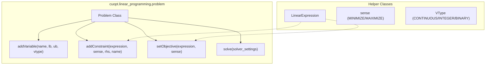
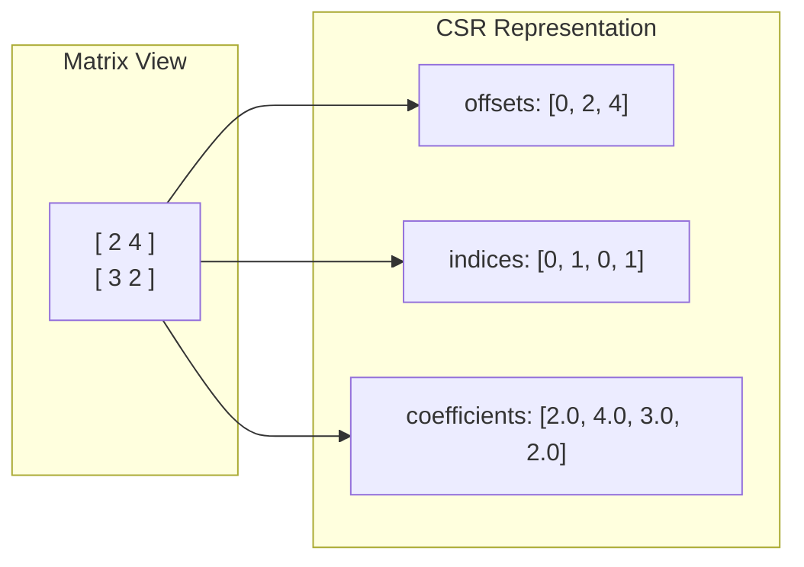
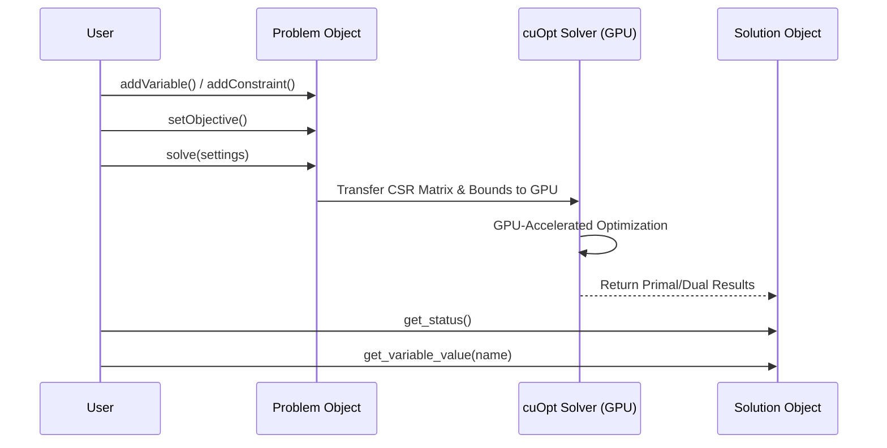

<!-- source: DeepWiki mcp.deepwiki.com · repo NVIDIA/cuopt-examples · page 6.1 Linear Programming Examples · fetched 2026-10-26 -->

# Linear Programming Examples

<details>
<summary>Relevant source files</summary>

The following files were used as context for generating this wiki page:

- [AI-accelerated-routing/initializing_cuopt_with_rl_solutions.ipynb](AI-accelerated-routing/initializing_cuopt_with_rl_solutions.ipynb)
- [AI-accelerated-routing/training_rl_agent_for_vrp.ipynb](AI-accelerated-routing/training_rl_agent_for_vrp.ipynb)
- [diet_optimization/diet_optimization_lp.ipynb](diet_optimization/diet_optimization_lp.ipynb)
- [diet_optimization/diet_optimization_milp.ipynb](diet_optimization/diet_optimization_milp.ipynb)
- [emergency_management/capacitated_emergency_shelter.ipynb](emergency_management/capacitated_emergency_shelter.ipynb)
- [portfolio_optimization/cvar_portfolio_optimization.ipynb](portfolio_optimization/cvar_portfolio_optimization.ipynb)

</details>


This page documents linear programming (LP) problem formulation and solution using cuOpt. LP problems contain only continuous variables with linear constraints and a linear objective function. For problems with integer or binary variables, see [Mixed-Integer Programming Examples]().

The examples demonstrate two primary approaches: using the high-level `Problem` API for direct GPU-accelerated solving and the server-based `DataModel` abstraction for client-server deployments.

---

## Problem Formulation

Linear programs consist of decision variables, linear constraints, and a linear objective function. cuOpt requires these components to be specified in a structured format before solving.

### Mathematical Formulation Example (Diet Optimization)

The diet problem involves selecting food quantities to meet nutritional requirements at minimum cost.

**Objective:**
$$\min \sum_{j \in J} c_j x_j$$
Where $c_j$ is the cost of food $j$ and $x_j$ is the quantity.

**Constraints:**
$$\sum_{j \in J} a_{ij} x_j \geq b_i^{min} \quad \forall i \in I$$
$$\sum_{j \in J} a_{ij} x_j \leq b_i^{max} \quad \forall i \in I$$
Where $a_{ij}$ is the amount of nutrient $i$ in food $j$.

Sources: [diet_optimization/diet_optimization_lp.ipynb:11-18](), [emergency_management/capacitated_emergency_shelter.ipynb:38-67]()

---

## cuOpt Problem API

The `cuopt.linear_programming.problem.Problem` class provides a high-level interface for defining variables, constraints, and objectives.

### Core API Entities



Sources: [diet_optimization/diet_optimization_lp.ipynb:113-114](), [portfolio_optimization/cvar_portfolio_optimization.ipynb:161-163]()

### Implementation Example: Diet Optimization

The following implementation defines continuous variables for food items and adds nutritional constraints.

```python
from cuopt.linear_programming.problem import Problem, VType, sense

# Initialize Problem
prob = Problem()

# Add Variables (Continuous for LP)
food_vars = {food: prob.addVariable(name=food, lb=0, vtype=VType.CONTINUOUS) 
             for food in food_costs.keys()}

# Set Objective: Minimize Cost
prob.setObjective(sum(food_costs[f] * food_vars[f] for f in food_costs), sense.MINIMIZE)

# Add Constraints: Nutritional Requirements
for cat, bounds in categories.items():
    nutrient_expr = sum(nutrition_df.loc[f, f"{cat} (per serving)"] * food_vars[f] 
                        for f in food_costs)
    if bounds['min'] > 0:
        prob.addConstraint(nutrient_expr >= bounds['min'])
    if bounds['max'] < float('inf'):
        prob.addConstraint(nutrient_expr <= bounds['max'])
```

Sources: [diet_optimization/diet_optimization_lp.ipynb:214-255](), [diet_optimization/diet_optimization_lp.ipynb:262-280]()

---

## CSR Constraint Matrix Format

For large-scale problems or when using the server-based API, cuOpt utilizes Compressed Sparse Row (CSR) format to represent the constraint matrix $A$ in $Ax \leq b$.

### CSR Structure

| Component | Code Identifier | Description |
|-----------|-----------------|-------------|
| **Offsets** | `offsets` | Indices in the coefficients array where each row starts. |
| **Indices** | `indices` | Column (variable) index for each non-zero coefficient. |
| **Values** | `coefficients` | The non-zero values of the matrix. |



Sources: [emergency_management/capacitated_emergency_shelter.ipynb:51-53](), [diet_optimization/diet_optimization_lp.ipynb:242-255]()

---

## Emergency Shelter Placement (P-Median Problem)

The P-Median problem is a classic LP/MILP application for disaster relief, aiming to minimize the total weighted distance from demand points to $p$ selected facilities.

### Problem Components

1.  **Clients ($I$):** Affected population zones.
2.  **Facilities ($J$):** Potential shelter locations.
3.  **Weights ($a_i$):** Population count in zone $i$.
4.  **Cost ($d_{ij}$):** Evacuation distance/time.

### Constraints and Objectives

- **Assignment:** Each zone must be assigned to exactly one shelter.
- **Shelter Count:** Exactly $p$ shelters must be opened.
- **Linking:** A zone can only be assigned to an open shelter ($x_{ij} \leq y_j$).

Sources: [emergency_management/capacitated_emergency_shelter.ipynb:25-67]()

---

## Solver Configuration and Execution

cuOpt uses `SolverSettings` to control the optimization process, including time limits and tolerances.

### Configuration Parameters

| Parameter | Function/Key | Description |
|-----------|--------------|-------------|
| **Time Limit** | `set_parameter("time_limit", value)` | Maximum solve time in seconds. |
| **Tolerance** | `set_optimality_tolerance(value)` | Precision required for optimality. |
| **Method** | `PDLPSolverMode` | Specific algorithm selection (e.g., for CVaR). |

```python
from cuopt.linear_programming.solver_settings import SolverSettings

settings = SolverSettings()
settings.set_parameter("time_limit", 10.0)
# Solve the formulated problem
solution = prob.solve(settings)
```

Sources: [diet_optimization/diet_optimization_lp.ipynb:284-298](), [portfolio_optimization/cvar_portfolio_optimization.ipynb:162-163]()

---

## Solution Handling

The solution object provides access to the objective value and variable assignments.

### Data Flow: Problem to Solution



Sources: [diet_optimization/diet_optimization_lp.ipynb:303-315](), [emergency_management/capacitated_emergency_shelter.ipynb:68-74]()

### Solution Status Codes

- `1`: Optimal solution found.
- `0`: Infeasible or error.

Sources: [diet_optimization/diet_optimization_lp.ipynb:303-305]()

---

## Implementation Notes

- **Variable Types:** For pure LP, ensure `VType.CONTINUOUS` is used [diet_optimization/diet_optimization_lp.ipynb:220]().
- **GPU Requirements:** cuOpt requires an NVIDIA GPU with CUDA 12.x or 13.x [portfolio_optimization/cvar_portfolio_optimization.ipynb:39-42]().
- **Large Scale Data:** Use `pandas` or `cudf` to prepare cost matrices and nutritional data before passing them to the `Problem` API [diet_optimization/diet_optimization_lp.ipynb:198-203]().

Sources: [diet_optimization/diet_optimization_lp.ipynb:111-115](), [portfolio_optimization/cvar_portfolio_optimization.ipynb:152-163]()

---

