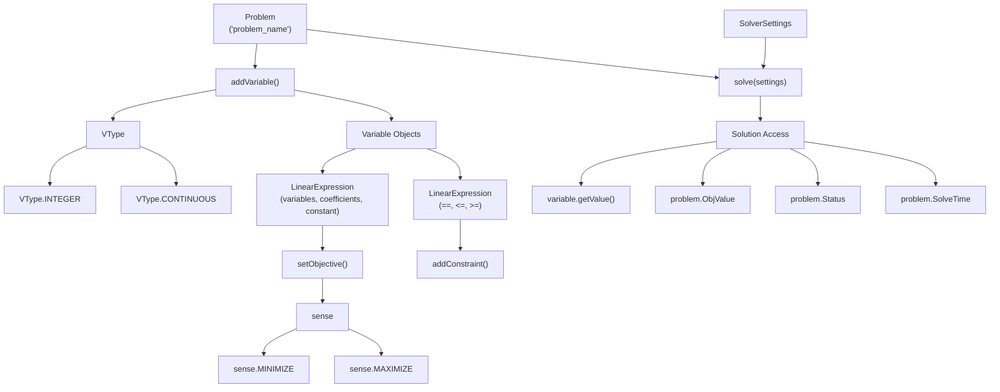
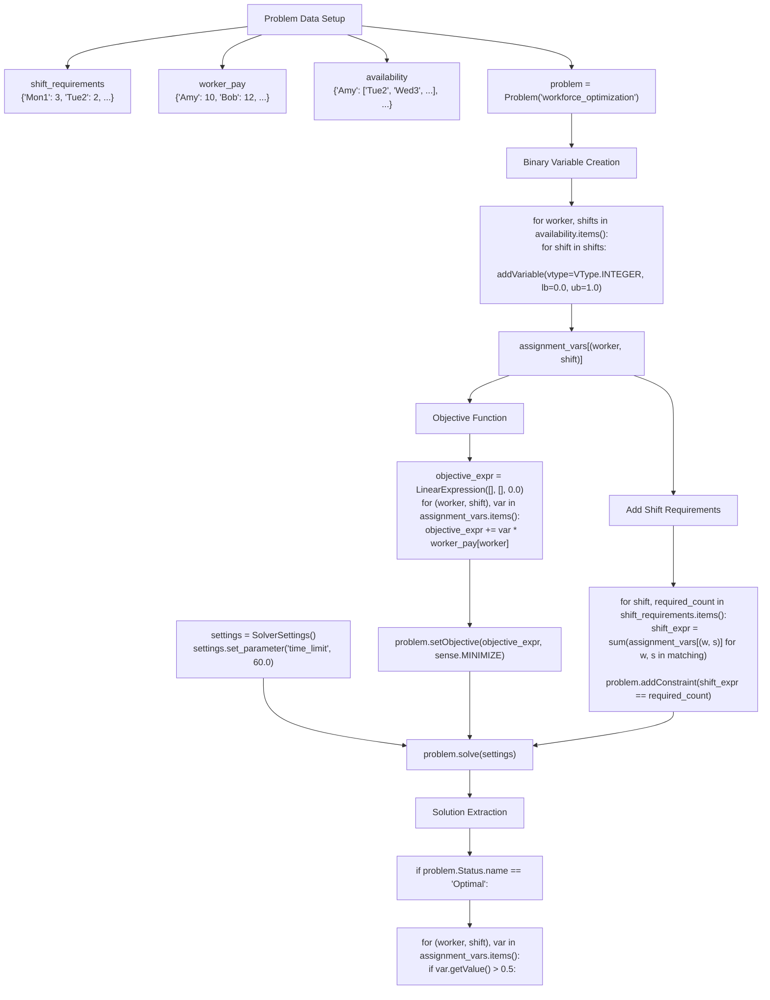
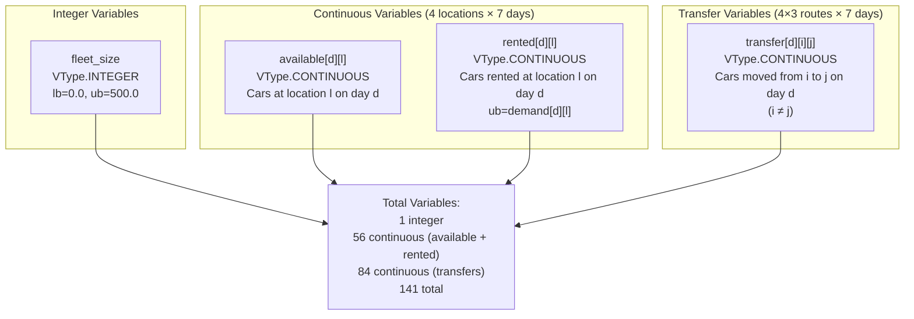

<!-- source: DeepWiki mcp.deepwiki.com · repo NVIDIA/cuopt-examples · page 6.2 Mixed-Integer Programming Examples · fetched 2026-10-26 -->

# Mixed-Integer Programming Examples

<details>
<summary>Relevant source files</summary>

The following files were used as context for generating this wiki page:

- [README.md](README.md)
- [VERSION](VERSION)
- [car_rental_optimization/README.md](car_rental_optimization/README.md)
- [car_rental_optimization/car_rental_optimization_milp.ipynb](car_rental_optimization/car_rental_optimization_milp.ipynb)
- [ci/release/update_version.sh](ci/release/update_version.sh)
- [workforce_optimization/workforce_optimization_milp.ipynb](workforce_optimization/workforce_optimization_milp.ipynb)

</details>


This document covers examples of Mixed-Integer Linear Programming (MILP) problems solved using the cuOpt Python API. MILP problems contain a mix of continuous and integer (including binary) decision variables, linear objective functions, and linear constraints.

For general linear programming with only continuous variables, see [Linear Programming Examples](#6.1). For portfolio optimization examples using LP formulations, see [Portfolio Optimization](#5). For mathematical programming via modeling languages, see [Modeling Language Integrations](#8).

## Overview

The repository provides two complete MILP application examples that demonstrate workforce assignment and fleet optimization scenarios. Both examples use the `cuopt.linear_programming.problem.Problem` class to formulate optimization models with integer and binary variables.

| Example | Problem Type | Variables | Key Features |
|---------|--------------|-----------|--------------|
| Workforce Optimization | Assignment | Binary (worker-shift pairs) | Labor cost minimization, availability constraints |
| Car Rental Optimization | Fleet sizing + allocation | Integer (fleet size) + Continuous (allocation, transfers) | Multi-period, flow conservation, profit maximization |

Sources: [workforce_optimization/workforce_optimization_milp.ipynb:1-18](), [car_rental_optimization/car_rental_optimization_milp.ipynb:1-43]()

## Problem API Architecture for MILP

The MILP formulation process uses the same `Problem` class as LP but introduces integer variable types and handles mixed variable scenarios.

**MILP Code Entity Mapping**


**Key API Components:**

- **Variable Creation**: `Problem.addVariable(name, vtype, lb, ub)` creates decision variables [workforce_optimization/workforce_optimization_milp.ipynb:109-110]().
- **Variable Types**: `VType.INTEGER` for integer variables, `VType.CONTINUOUS` for continuous [workforce_optimization/workforce_optimization_milp.ipynb:109-110]().
- **Binary Variables**: Implemented as `VType.INTEGER` with `lb=0.0, ub=1.0` [workforce_optimization/workforce_optimization_milp.ipynb:212-218]().
- **Objective Setting**: `Problem.setObjective(expression, sense)` defines optimization goal [workforce_optimization/workforce_optimization_milp.ipynb:239-240]().
- **Constraint Addition**: `Problem.addConstraint(expression, name)` adds constraints [workforce_optimization/workforce_optimization_milp.ipynb:264-265]().
- **Solution Retrieval**: `variable.getValue()` extracts optimal values after solving [workforce_optimization/workforce_optimization_milp.ipynb:341-342]().

Sources: [workforce_optimization/workforce_optimization_milp.ipynb:103-112](), [workforce_optimization/workforce_optimization_milp.ipynb:203-220]()

## Workforce Optimization Example

### Problem Description

The workforce optimization example solves a shift assignment problem where workers must be assigned to shifts while minimizing labor costs. The problem formulation is located in `workforce_optimization/workforce_optimization_milp.ipynb`.

**Problem Data:**
- 14 shifts across 7 days with varying requirements (2-7 workers per shift) [workforce_optimization/workforce_optimization_milp.ipynb:129-145]().
- 7 workers with different hourly pay rates ($8-$12 per shift) [workforce_optimization/workforce_optimization_milp.ipynb:147-156]().
- Worker availability constraints (each worker available for a specific subset of shifts) [workforce_optimization/workforce_optimization_milp.ipynb:158-167]().

**Decision Variables:**
- Binary variables `x[worker][shift]` indicate assignment (1 if assigned, 0 otherwise) [workforce_optimization/workforce_optimization_milp.ipynb:212-218]().

**Objective:**
- Minimize total labor cost: Σ (pay_rate[worker] × x[worker][shift]) [workforce_optimization/workforce_optimization_milp.ipynb:229-239]().

**Constraints:**
- Each shift must have exactly the required number of workers [workforce_optimization/workforce_optimization_milp.ipynb:248-270]().
- Workers can only be assigned to shifts they are available for (enforced by variable creation) [workforce_optimization/workforce_optimization_milp.ipynb:212-218]().

Sources: [workforce_optimization/workforce_optimization_milp.ipynb:118-171]()

### Implementation Structure

**Workforce Optimization Logic Flow**


Sources: [workforce_optimization/workforce_optimization_milp.ipynb:203-270]()

### Key Implementation Details

**Binary Variable Creation** [workforce_optimization/workforce_optimization_milp.ipynb:212-218]():
```python
var = problem.addVariable(name=var_name, vtype=VType.INTEGER, lb=0.0, ub=1.0)
assignment_vars[(worker, shift)] = var
```

**Objective Function Construction** [workforce_optimization/workforce_optimization_milp.ipynb:229-239]():
The objective function uses `LinearExpression` to accumulate costs. Variables are multiplied by coefficients using the `*` operator and combined using `+=`:
```python
objective_expr = LinearExpression([], [], 0.0)
for (worker, shift), var in assignment_vars.items():
    cost = worker_pay[worker]
    if cost != 0:
        objective_expr += var * cost
problem.setObjective(objective_expr, sense.MINIMIZE)
```

**Constraint Formulation** [workforce_optimization/workforce_optimization_milp.ipynb:248-270]():
Equality constraints ensure each shift has exactly the required number of workers:
```python
shift_expr = LinearExpression([], [], 0.0)
for var in shift_assignments:
    shift_expr += var
constraint = problem.addConstraint(shift_expr == required_count, name=f"shift_{shift}")
```

Sources: [workforce_optimization/workforce_optimization_milp.ipynb:203-270]()

### Adding Dynamic Constraints

The example demonstrates adding constraints to an existing model. After the initial solve, maximum shift constraints are added [workforce_optimization/workforce_optimization_milp.ipynb:413-438]():

```python
max_shifts_per_worker = 4
for worker in worker_pay.keys():
    worker_shifts = [var for (w, shift), var in assignment_vars.items() if w == worker]
    if worker_shifts:
        worker_expr = LinearExpression([], [], 0.0)
        for var in worker_shifts:
            worker_expr += var
        constraint = problem.addConstraint(worker_expr <= max_shifts_per_worker, 
                                          name=f"max_shifts_{worker}")
```

Sources: [workforce_optimization/workforce_optimization_milp.ipynb:407-466]()

## Car Rental Optimization Example

### Problem Description

The car rental optimization example determines optimal fleet size and vehicle distribution across multiple locations over a week to maximize profit.

**Problem Characteristics:**
- 4 locations (Airport, Downtown, Suburb_A, Suburb_B) [car_rental_optimization/car_rental_optimization_milp.ipynb:173]().
- 7-day planning horizon [car_rental_optimization/car_rental_optimization_milp.ipynb:174]().
- Mixed integer-continuous formulation [car_rental_optimization/car_rental_optimization_milp.ipynb:40]().

**Decision Variables:**
- `fleet_size`: Total number of cars (integer) [car_rental_optimization/car_rental_optimization_milp.ipynb:303-309]().
- `available[d][l]`: Cars available at location `l` on day `d` (continuous) [car_rental_optimization/car_rental_optimization_milp.ipynb:313-332]().
- `rented[d][l]`: Cars rented at location `l` on day `d` (continuous) [car_rental_optimization/car_rental_optimization_milp.ipynb:335-354]().
- `transfer[d][i][j]`: Cars transferred from location `i` to `j` on day `d` (continuous) [car_rental_optimization/car_rental_optimization_milp.ipynb:357-380]().

**Objective:**
- Maximize: `Σ(rental_revenue) - weekly_car_cost × fleet_size - Σ(transfer_costs)` [car_rental_optimization/car_rental_optimization_milp.ipynb:393-422]().

**Key Constraints:**
1. Rented cars ≤ available cars [car_rental_optimization/car_rental_optimization_milp.ipynb:432-446]().
2. Flow conservation: available[d][l] = available[d-1][l] + transfers_in - transfers_out [car_rental_optimization/car_rental_optimization_milp.ipynb:449-506]().
3. Total cars ≤ fleet_size [car_rental_optimization/car_rental_optimization_milp.ipynb:509-528]().
4. Rented cars ≤ demand [car_rental_optimization/car_rental_optimization_milp.ipynb:335-354]().

Sources: [car_rental_optimization/car_rental_optimization_milp.ipynb:6-43](), [car_rental_optimization/car_rental_optimization_milp.ipynb:279-295]()

### Variable Structure



Sources: [car_rental_optimization/car_rental_optimization_milp.ipynb:299-380]()

### Objective Function

The objective maximizes profit by combining revenue, operational costs, and transfer costs [car_rental_optimization/car_rental_optimization_milp.ipynb:393-422]():

```python
objective = LinearExpression([], [], 0.0)

# Revenue from rentals
for d in range(n_days):
    for l in range(n_locations):
        revenue = float(rental_revenue[locations[l]])
        objective += rented[d][l] * revenue

# Subtract weekly operational costs
objective += fleet_size * float(-weekly_car_cost)

# Subtract transfer costs
for d in range(n_days):
    for i in range(n_locations):
        for j in range(n_locations):
            if i != j:
                cost = float(transfer_cost_matrix[i][j])
                objective += transfer[d][i][j] * (-cost)

problem.setObjective(objective, sense.MAXIMIZE)
```

Sources: [car_rental_optimization/car_rental_optimization_milp.ipynb:393-422]()

### Constraint Types

**1. Rental Limit Constraints** [car_rental_optimization/car_rental_optimization_milp.ipynb:432-446]():
Ensures rented cars cannot exceed available inventory:
```python
for d in range(n_days):
    for l in range(n_locations):
        problem.addConstraint(
            rented[d][l] <= available[d][l],
            name=f"rental_limit_day{d}_loc{l}"
        )
```

**2. Flow Conservation Constraints** [car_rental_optimization/car_rental_optimization_milp.ipynb:449-506]():
Maintains inventory balance across days:
```python
for d in range(1, n_days):
    for l in range(n_locations):
        flow_expr = LinearExpression([], [], 0.0)
        flow_expr += available[d-1][l]
        # ... (add transfers_in and subtract transfers_out)
        problem.addConstraint(
            available[d][l] == flow_expr,
            name=f"flow_conservation_day{d}_loc{l}"
        )
```

Sources: [car_rental_optimization/car_rental_optimization_milp.ipynb:432-528]()

## Common MILP Patterns

### Binary Variable Pattern
Binary variables are used for yes/no decisions:
```python
binary_var = problem.addVariable(
    name="decision_name",
    vtype=VType.INTEGER,
    lb=0.0,
    ub=1.0
)
```
Sources: [workforce_optimization/workforce_optimization_milp.ipynb:212-218]()

### LinearExpression Building Pattern
Both examples construct expressions incrementally:
```python
expr = LinearExpression([], [], 0.0)
for var, coeff in var_coeff_pairs:
    expr += var * coeff
```
Sources: [workforce_optimization/workforce_optimization_milp.ipynb:229-239](), [car_rental_optimization/car_rental_optimization_milp.ipynb:393-420]()

### Problem Size and Performance

| Metric | Workforce | Car Rental |
|--------|-----------|------------|
| Variables | 94 binary | 141 (1 integer, 140 continuous) |
| Constraints | 14-21 | 91 |
| Solve Time | < 1 second | 1-2 seconds |

Sources: [workforce_optimization/workforce_optimization_milp.ipynb:169-171](), [car_rental_optimization/car_rental_optimization_milp.ipynb:378-379](), [car_rental_optimization/car_rental_optimization_milp.ipynb:548]()

---

