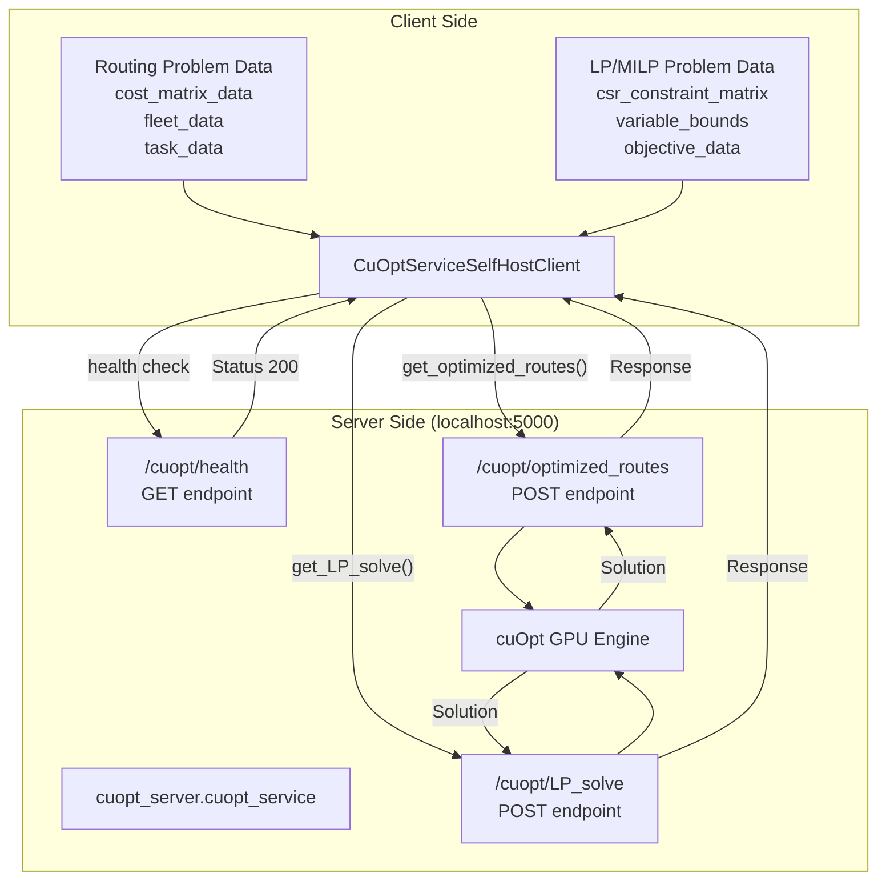
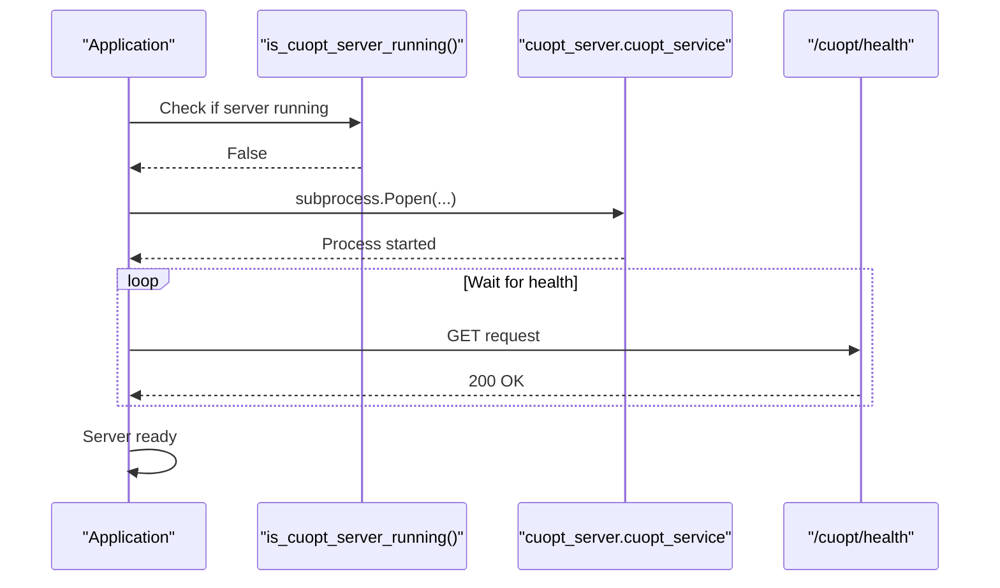
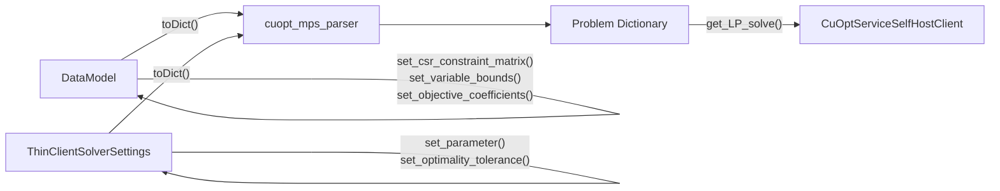
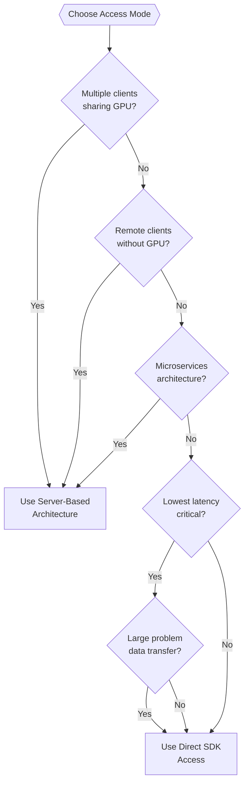

<!-- source: DeepWiki mcp.deepwiki.com · repo NVIDIA/cuopt-examples · page 7 Server-Based Architecture · fetched 2026-10-26 -->

# Server-Based Architecture

<details>
<summary>Relevant source files</summary>

The following files were used as context for generating this wiki page:

- [intra-factory_transport/README.md](intra-factory_transport/README.md)
- [last_mile_delivery/README.md](last_mile_delivery/README.md)
- [routing_optimization_over_server/README.md](routing_optimization_over_server/README.md)
- [routing_optimization_over_server/cvrptw_benchmark_gehring_homberger.ipynb](routing_optimization_over_server/cvrptw_benchmark_gehring_homberger.ipynb)
- [routing_optimization_over_server/cvrptw_service_team_routing.ipynb](routing_optimization_over_server/cvrptw_service_team_routing.ipynb)
- [sample_lp_sever_notebooks/README.md](sample_lp_sever_notebooks/README.md)
- [sample_lp_sever_notebooks/linear-programming-with-datamodel.ipynb](sample_lp_sever_notebooks/linear-programming-with-datamodel.ipynb)
- [sample_lp_sever_notebooks/linear-programming.ipynb](sample_lp_sever_notebooks/linear-programming.ipynb)
- [sample_lp_sever_notebooks/mixed-integer-linear-programming-with-datamodel.ipynb](sample_lp_sever_notebooks/mixed-integer-linear-programming-with-datamodel.ipynb)
- [sample_lp_sever_notebooks/mixed-integer-linear-programming.ipynb](sample_lp_sever_notebooks/mixed-integer-linear-programming.ipynb)

</details>


## Purpose and Scope

This page explains the cuOpt server-based architecture for client-server deployments, including server startup, client configuration, endpoint usage, and when to choose server mode versus direct SDK access. For direct SDK usage without a server, see [Core Concepts](#3). For detailed client API documentation, see [CuOptServiceSelfHostClient](#7.1). For endpoint specifications, see [Server Endpoints and Data Formats](#7.2).

## Overview

The cuOpt server-based architecture provides a client-server deployment model where optimization problems are submitted via HTTP to a self-hosted cuOpt service. This architecture decouples problem submission from GPU resources and enables scenarios such as:

- Multiple clients sharing a single GPU server
- Remote optimization from CPU-only machines
- Integration with existing web services and APIs
- Centralized GPU resource management

The server exposes HTTP endpoints for submitting routing problems and linear/mixed-integer programming problems, returning optimized solutions.

## Architecture Components

### System Architecture

Title: cuOpt Client-Server Interaction Flow


Sources: [routing_optimization_over_server/cvrptw_benchmark_gehring_homberger.ipynb:149-221](), [sample_lp_sever_notebooks/linear-programming.ipynb:131-204]()

### Server Process

The cuOpt server runs as a Python module (`cuopt_server.cuopt_service`) that exposes HTTP endpoints on a specified host and port. The default configuration listens on `localhost:5000`.

**Server startup command:**
```bash
python3 -m cuopt_server.cuopt_service -i localhost -p 5000
```

The server process:
1. Initializes the cuOpt GPU engine
2. Binds to the specified network interface and port
3. Registers HTTP endpoints for problem submission
4. Processes incoming requests

Sources: [routing_optimization_over_server/cvrptw_benchmark_gehring_homberger.ipynb:196-201](), [sample_lp_sever_notebooks/linear-programming.ipynb:178-183]()

### Client Library

The `CuOptServiceSelfHostClient` class provides a Python interface for submitting problems to the cuOpt server. The client handles HTTP communication, request serialization, and response parsing.

**Client initialization:**
```python
from cuopt_sh_client import CuOptServiceSelfHostClient

client = CuOptServiceSelfHostClient(
    ip="localhost",
    port="5000",
    polling_timeout=None
)
```

**Key parameters:**

| Parameter | Type | Description |
|-----------|------|-------------|
| `ip` | str | Server IP address |
| `port` | str | Server port number |
| `polling_timeout` | int or None | Timeout in seconds for polling results. `None` polls indefinitely. Default is 600. |

Sources: [routing_optimization_over_server/cvrptw_benchmark_gehring_homberger.ipynb:135-135](), [routing_optimization_over_server/cvrptw_benchmark_gehring_homberger.ipynb:361-365](), [sample_lp_sever_notebooks/linear-programming.ipynb:441-445]()

### Server Endpoints

The cuOpt service exposes three primary HTTP endpoints:

| Endpoint | Method | Purpose | Client Method |
|----------|--------|---------|---------------|
| `/cuopt/health` | GET | Health check, returns 200 when server is ready | N/A (internal) |
| `/cuopt/optimized_routes` | POST | Submit routing problems (CVRP, CVRPTW, CPDPTW) | `get_optimized_routes()` |
| `/cuopt/LP_solve` | POST | Submit LP/MILP optimization problems | `get_LP_solve()` |

Sources: [routing_optimization_over_server/cvrptw_benchmark_gehring_homberger.ipynb:177-194](), [sample_lp_sever_notebooks/linear-programming.ipynb:159-176]()

## Server Lifecycle Management

### Starting the Server

Title: Server Startup and Health Check Sequence


Sources: [routing_optimization_over_server/cvrptw_benchmark_gehring_homberger.ipynb:166-221]()

The typical server startup sequence:

```python
import subprocess
import psutil
import requests
import time
import atexit

host = "localhost"
port = "5000"

def is_cuopt_server_running():
    """Check if cuOpt server is already running"""
    for proc in psutil.process_iter(['pid', 'name', 'cmdline']):
        try:
            cmdline = proc.info['cmdline']
            if 'python3' in proc.info['name'] and cmdline:
                if any('cuopt_server.cuopt_service' in cmd for cmd in cmdline):
                    return True
        except (psutil.NoSuchProcess, psutil.AccessDenied):
            pass
    return False

def wait_for_server_health(timeout=30):
    """Wait for server to be healthy"""
    start_time = time.time()
    while time.time() - start_time < timeout:
        try:
            response = requests.get(f'http://{host}:{port}/cuopt/health', timeout=5)
            if response.status_code == 200:
                return True
        except requests.exceptions.RequestException:
            pass
        time.sleep(1)
    return False

if not is_cuopt_server_running():
    server_process = subprocess.Popen(
        ['python3', '-m', 'cuopt_server.cuopt_service', '-i', host, '-p', port],
        stdout=subprocess.PIPE,
        stderr=subprocess.PIPE
    )
    
    wait_for_server_health(timeout=30)
```

Sources: [routing_optimization_over_server/cvrptw_benchmark_gehring_homberger.ipynb:166-221](), [sample_lp_sever_notebooks/linear-programming.ipynb:148-204]()

### Server Cleanup

Proper server cleanup ensures graceful shutdown:

```python
def cleanup_server():
    """Terminate server process gracefully"""
    try:
        server_process.terminate()
        server_process.wait(timeout=5)
    except (subprocess.TimeoutExpired, ProcessLookupError):
        try:
            server_process.kill()
        except ProcessLookupError:
            pass

atexit.register(cleanup_server)
```

The cleanup function:
1. Attempts graceful termination via `terminate()`
2. Waits up to 5 seconds for process exit
3. Forces termination via `kill()` if graceful shutdown fails
4. Is registered with `atexit` to execute on program exit

Sources: [routing_optimization_over_server/cvrptw_benchmark_gehring_homberger.ipynb:202-215](), [sample_lp_sever_notebooks/linear-programming.ipynb:184-197]()

## Problem Submission Patterns

### Routing Problems

Routing problems (CVRP, CVRPTW, CPDPTW) are submitted using `client.get_optimized_routes()`:

```python
cuopt_problem_data = {
    "cost_matrix_data": {
        "data": {
            "0": cost_matrix  # 2D list of costs
        }
    },
    "fleet_data": {
        "vehicle_locations": [[0, 0], [0, 0]],
        "capacities": [[200, 100]]
    },
    "task_data": {
        "task_locations": [1, 2, 3],
        "demand": [[10, 20, 15]],
        "task_time_windows": [[9, 12], [10, 14], [11, 16]],
        "service_times": [1.0, 1.5, 0.5]
    },
    "solver_config": {
        "time_limit": 5.0
    }
}

solver_response = client.get_optimized_routes(cuopt_problem_data)
solver_resp = solver_response["response"]["solver_response"]
```

**Response structure:**

| Field | Type | Description |
|-------|------|-------------|
| `status` | int | Solution status (0 = success) |
| `solution_cost` | float | Total objective value |
| `num_vehicles` | int | Number of vehicles used |
| `vehicle_data` | dict | Dictionary mapping vehicle IDs to route data |

Sources: [routing_optimization_over_server/cvrptw_service_team_routing.ipynb:562-658](), [routing_optimization_over_server/cvrptw_benchmark_gehring_homberger.ipynb:512-523]()

### LP/MILP Problems

Linear and mixed-integer programming problems are submitted using `client.get_LP_solve()`:

```python
problem_data = {
    "csr_constraint_matrix": {
        "offsets": [0, 2, 4],
        "indices": [0, 1, 0, 1],
        "values": [2.0, 4.0, 3.0, 2.0]
    },
    "constraint_bounds": {
        "upper_bounds": ["inf", 190.0],
        "lower_bounds": [230.0, "ninf"]
    },
    "variable_bounds": {
        "upper_bounds": ["inf", "inf"],
        "lower_bounds": [0.0, 0.0]
    },
    "objective_data": {
        "coefficients": [5.0, 3.0],
        "scalability_factor": 1.0,
        "offset": 0.0
    },
    "maximize": True,
    "variable_names": ["x", "y"],
    "variable_types": ["I", "C"],
    "solver_config": {
        "time_limit": 1.0
    }
}

solution = client.get_LP_solve(problem_data, response_type="dict")
```

**Response structure:**

| Field | Type | Description |
|-------|------|-------------|
| `status` | int | Solution status (1 = optimal) |
| `primal_solution` | list | Variable values |
| `primal_objective` | float | Objective function value |
| `vars` | dict | Dictionary mapping variable names to values |
| `lp_statistics` | dict | LP solver statistics (if LP) |
| `milp_statistics` | dict | MILP solver statistics (if MILP) |

Sources: [sample_lp_sever_notebooks/linear-programming.ipynb:238-450](), [sample_lp_sever_notebooks/mixed-integer-linear-programming.ipynb:238-471]()

## DataModel API for Server

The `DataModel` class provides a structured interface for building LP/MILP problems. For detailed documentation, see [DataModel API for Server](#7.3).

Title: DataModel to Server Dictionary Pipeline


Sources: [sample_lp_sever_notebooks/linear-programming-with-datamodel.ipynb:213-474]()

**Usage example:**

```python
from data_model import DataModel
from cuopt_sh_client import ThinClientSolverSettings
import cuopt_mps_parser
import numpy as np

dm = DataModel()
ss = ThinClientSolverSettings()

# Set constraint matrix (CSR format)
offsets = np.array([0, 2, 4], dtype=np.int32)
indices = np.array([0, 1, 0, 1], dtype=np.int32)
coefficients = np.array([2.0, 4.0, 3.0, 2.0], dtype=np.float64)
dm.set_csr_constraint_matrix(coefficients, indices, offsets)

# Set bounds
dm.set_constraint_lower_bounds(np.array([230, -np.inf], dtype=np.float64))
dm.set_constraint_upper_bounds(np.array([np.inf, 190], dtype=np.float64))
dm.set_variable_lower_bounds(np.array([0, 0], dtype=np.float64))
dm.set_variable_upper_bounds(np.array([np.inf, np.inf], dtype=np.float64))

# Set objective
dm.set_objective_coefficients(np.array([5, 3], dtype=np.float64))
dm.set_maximize(True)

# Set variable types
dm.set_variable_types(np.array(["I", "C"]))
dm.set_variable_names(np.array(["x", "y"]))

# Configure solver
ss.set_parameter("time_limit", 1)

# Convert to dictionary and submit
data = cuopt_mps_parser.toDict(dm)
data["solver_config"] = ss.toDict()
solution = client.get_LP_solve(data, response_type="dict")
```

Sources: [sample_lp_sever_notebooks/linear-programming-with-datamodel.ipynb:213-474](), [sample_lp_sever_notebooks/mixed-integer-linear-programming-with-datamodel.ipynb:213-468]()

## Server vs Direct SDK

### Decision Matrix

Title: Architecture Selection Decision Tree


Sources: [routing_optimization_over_server/README.md:1-18](), [sample_lp_sever_notebooks/README.md:1-58]()

### Use Cases

**Use server-based architecture when:**
- Multiple clients need to share GPU resources.
- Clients run on CPU-only machines without GPU access.
- Integration with web services or microservices architecture is required.
- Centralized management of optimization requests is beneficial.
- Problem submission and solving should be decoupled.

**Use direct SDK when:**
- Single-user environment with dedicated GPU.
- Lowest latency is critical (no network overhead).
- Complex custom workflows require tight integration with cuOpt.
- Problem data is large and network transfer would be prohibitive.
- Maximum throughput for batch processing is needed.

Sources: [routing_optimization_over_server/README.md:1-18]()

### Performance Comparison

| Aspect | Server-Based | Direct SDK |
|--------|--------------|------------|
| **Network Overhead** | HTTP/JSON serialization adds latency | None (in-process) |
| **Problem Data Transfer** | Required over network | In-process memory |
| **GPU Access** | Remote via HTTP | Direct memory access |
| **Concurrency** | Server-managed queue | Application-managed |
| **Setup Complexity** | Higher (server deployment) | Lower (library import) |
| **Resource Sharing** | Multiple clients per GPU | One application per GPU |
| **Fault Isolation** | Server crash doesn't affect clients | Application crash loses everything |

Sources: [routing_optimization_over_server/cvrptw_benchmark_gehring_homberger.ipynb:17-23](), [routing_optimization_over_server/cvrptw_benchmark_gehring_homberger.ipynb:500-503]()

## Related Documentation

- [CuOptServiceSelfHostClient](#7.1) - Detailed client API reference including connection parameters and methods.
- [Server Endpoints and Data Formats](#7.2) - Complete endpoint specifications and request/response schemas.
- [DataModel API for Server](#7.3) - Structured problem building interface for LP/MILP problems.
- [Core Concepts](#3) - Direct SDK usage without server for single-process deployments.
- [Vehicle Routing Problems](#4) - Routing problem types and formulations.
- [Linear and Mixed-Integer Programming](#6) - LP/MILP problem formulations and examples.

---

