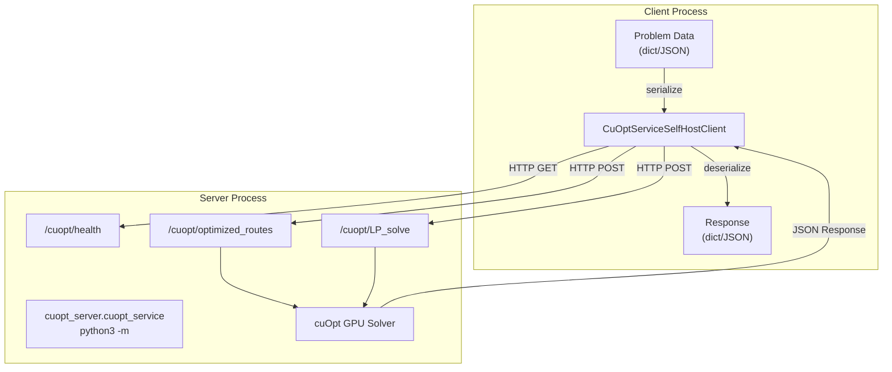
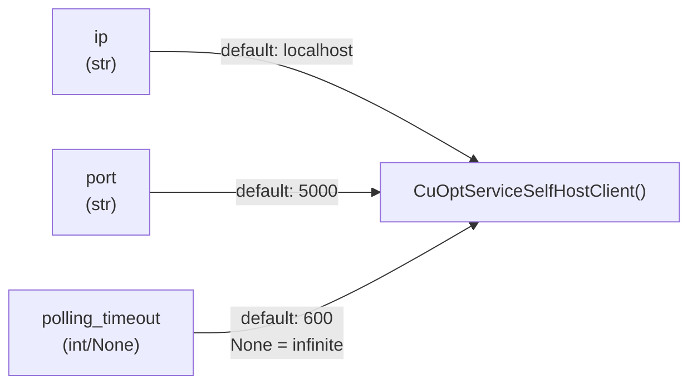
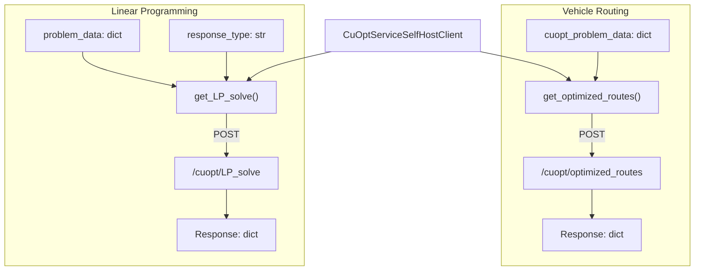
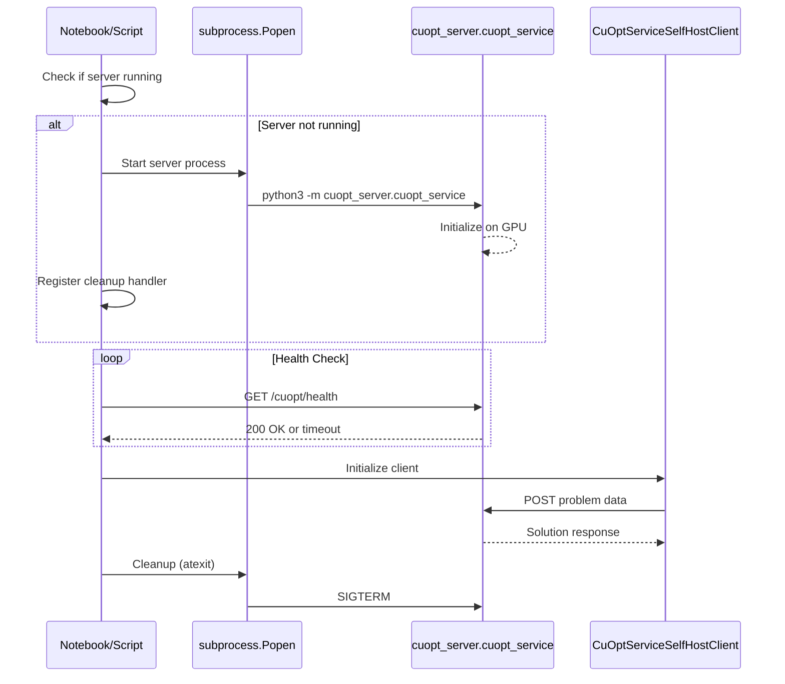
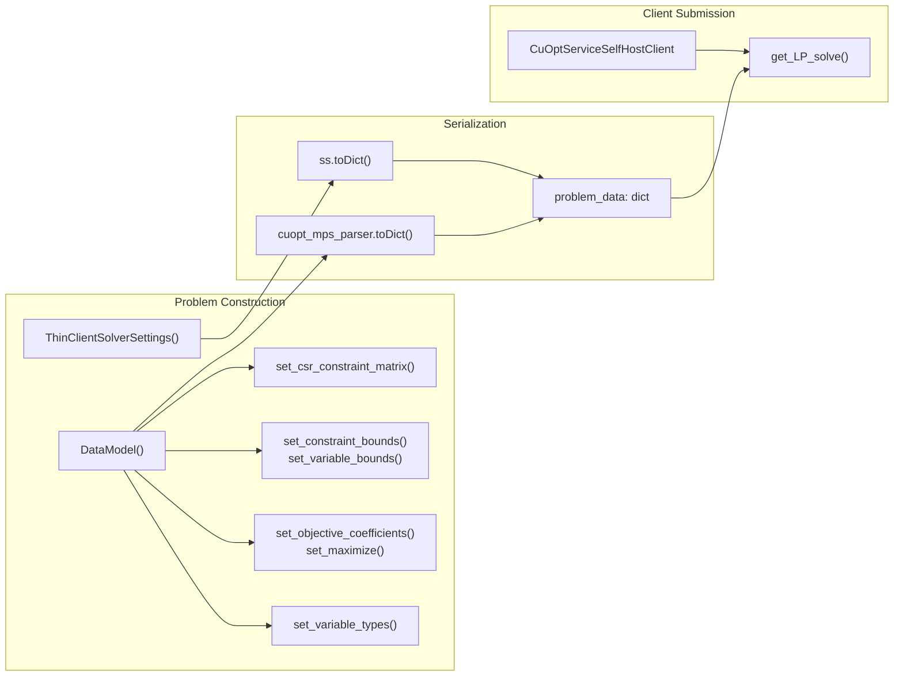

<!-- source: DeepWiki mcp.deepwiki.com · repo NVIDIA/cuopt-examples · page 7.1 CuOptServiceSelfHostClient · fetched 2026-10-26 -->

# CuOptServiceSelfHostClient

<details>
<summary>Relevant source files</summary>

The following files were used as context for generating this wiki page:

- [routing_optimization_over_server/cvrptw_benchmark_gehring_homberger.ipynb](routing_optimization_over_server/cvrptw_benchmark_gehring_homberger.ipynb)
- [routing_optimization_over_server/cvrptw_service_team_routing.ipynb](routing_optimization_over_server/cvrptw_service_team_routing.ipynb)
- [sample_lp_sever_notebooks/linear-programming-with-datamodel.ipynb](sample_lp_sever_notebooks/linear-programming-with-datamodel.ipynb)
- [sample_lp_sever_notebooks/linear-programming.ipynb](sample_lp_sever_notebooks/linear-programming.ipynb)
- [sample_lp_sever_notebooks/mixed-integer-linear-programming-with-datamodel.ipynb](sample_lp_sever_notebooks/mixed-integer-linear-programming-with-datamodel.ipynb)
- [sample_lp_sever_notebooks/mixed-integer-linear-programming.ipynb](sample_lp_sever_notebooks/mixed-integer-linear-programming.ipynb)

</details>


## Purpose and Scope

The `CuOptServiceSelfHostClient` class provides a Python client library for submitting optimization problems to a locally-hosted cuOpt server over HTTP. This client handles connection management, request serialization, response polling, and error handling for both vehicle routing problems (VRP) and linear/mixed-integer programming (LP/MILP) problems.

This page documents the client-side interface for server-based deployments. For information about server endpoints and data formats, see [Server Endpoints and Data Formats](#7.2). For information about building LP/MILP problems using the DataModel abstraction, see [DataModel API for Server](#7.3). For direct SDK usage without a server, see [Problem API](#3.1) and [Routing DataModel API](#4.1).

---

## Architecture Overview

The client-server architecture separates problem submission from solver execution, enabling deployment scenarios where optimization workloads run on dedicated GPU infrastructure.

### System Components



**Diagram: Client-Server Communication Flow**

The client serializes problem data to JSON, submits HTTP requests to the cuOpt server, and polls for results. The server processes requests using GPU-accelerated solvers and returns solutions.

**Sources:** [routing_optimization_over_server/cvrptw_benchmark_gehring_homberger.ipynb:135-136](), [routing_optimization_over_server/cvrptw_service_team_routing.ipynb:157-158](), [sample_lp_sever_notebooks/linear-programming.ipynb:163-164]()

---

## Installation and Prerequisites

The `CuOptServiceSelfHostClient` is part of the `cuopt-sh-client` package.

### Installation

```bash
pip install cuopt-sh-client
```

For environments using CUDA 12:
```bash
pip install --extra-index-url=https://pypi.nvidia.com cuopt-server-cu12 cuopt-sh-client
```

For environments using CUDA 13:
```bash
pip install --extra-index-url=https://pypi.nvidia.com cuopt-server-cu13 cuopt-sh-client
```

**Sources:** [routing_optimization_over_server/cvrptw_benchmark_gehring_homberger.ipynb:107-110](), [sample_lp_sever_notebooks/linear-programming.ipynb:114-117]()

### Server Prerequisites

The cuOpt server must be running and accessible before client connections are established. The server requires GPU access via NVIDIA Docker runtime.

**Sources:** [routing_optimization_over_server/cvrptw_benchmark_gehring_homberger.ipynb:31-33](), [routing_optimization_over_server/cvrptw_service_team_routing.ipynb:52-54]()

---

## Client Initialization

### Import Statement

```python
from cuopt_sh_client import CuOptServiceSelfHostClient
```

**Sources:** [routing_optimization_over_server/cvrptw_benchmark_gehring_homberger.ipynb:135](), [sample_lp_sever_notebooks/linear-programming.ipynb:433]()

### Constructor Parameters



**Diagram: Constructor Parameters and Defaults**

**Sources:** [routing_optimization_over_server/cvrptw_benchmark_gehring_homberger.ipynb:361-365](), [sample_lp_sever_notebooks/linear-programming.ipynb:441-445]()

### Parameter Specification

| Parameter | Type | Default | Description |
|-----------|------|---------|-------------|
| `ip` | `str` | `"localhost"` | Server IP address or hostname |
| `port` | `str` | `"5000"` | Server port number |
| `polling_timeout` | `int` or `None` | `600` | Maximum seconds to poll for results. `None` polls indefinitely until completion or error |

**Sources:** [routing_optimization_over_server/cvrptw_benchmark_gehring_homberger.ipynb:361-365](), [sample_lp_sever_notebooks/mixed-integer-linear-programming-with-datamodel.ipynb:456-463]()

### Example Initialization

```python
# Connect to local server with infinite polling
client = CuOptServiceSelfHostClient(
    ip="localhost",
    port="5000",
    polling_timeout=None
)

# Connect to remote server with 10-minute timeout
client = CuOptServiceSelfHostClient(
    ip="192.168.1.100",
    port="8080",
    polling_timeout=600
)
```

**Sources:** [routing_optimization_over_server/cvrptw_benchmark_gehring_homberger.ipynb:361-365](), [routing_optimization_over_server/cvrptw_service_team_routing.ipynb:538-542]()

---

## Client Methods

The client provides two primary methods corresponding to the two problem types supported by the cuOpt server.

### Method Overview



**Diagram: Client Methods and Endpoints**

**Sources:** [routing_optimization_over_server/cvrptw_benchmark_gehring_homberger.ipynb:517-519](), [sample_lp_sever_notebooks/linear-programming.ipynb:447]()

---

### get_optimized_routes()

Submits vehicle routing problems (CVRP, CVRPTW, CPDPTW) to the server for optimization.

#### Method Signature

```python
def get_optimized_routes(
    cuopt_problem_data: dict
) -> dict
```

#### Input Format

The `cuopt_problem_data` dictionary must contain routing-specific fields:

| Field | Type | Required | Description |
|-------|------|----------|-------------|
| `cost_matrix_data` | `dict` | Yes | Cost matrices with `"data"` key containing matrix ID to 2D list mapping |
| `fleet_data` | `dict` | Yes | Vehicle configuration including `"vehicle_locations"` and `"capacities"` |
| `task_data` | `dict` | Yes | Order/task information including `"task_locations"`, `"demand"`, `"task_time_windows"`, `"service_times"` |
| `solver_config` | `dict` | No | Solver parameters like `"time_limit"` |

**Sources:** [routing_optimization_over_server/cvrptw_benchmark_gehring_homberger.ipynb:406-433](), [routing_optimization_over_server/cvrptw_service_team_routing.ipynb:562-614]()

#### Example Usage: CVRPTW

```python
# Problem data structure
cuopt_problem_data = {
    "cost_matrix_data": {
        "data": {
            "0": [[0, 10, 15], [10, 0, 20], [15, 20, 0]]
        }
    },
    "fleet_data": {
        "vehicle_locations": [[0, 0], [0, 0]],
        "capacities": [[100, 100]],
        "vehicle_time_windows": [[9, 17], [9, 17]]
    },
    "task_data": {
        "task_locations": [1, 2],
        "demand": [[50, 30]],
        "task_time_windows": [[9, 12], [13, 16]],
        "service_times": [1, 1]
    },
    "solver_config": {
        "time_limit": 60.0
    }
}

# Submit and get solution
solver_response = client.get_optimized_routes(cuopt_problem_data)
solver_resp = solver_response["response"]["solver_response"]

if solver_resp["status"] == 0:
    print(f"Cost: {solver_resp['solution_cost']}")
    print(f"Vehicles used: {solver_resp['num_vehicles']}")
```

**Sources:** [routing_optimization_over_server/cvrptw_benchmark_gehring_homberger.ipynb:512-523](), [routing_optimization_over_server/cvrptw_service_team_routing.ipynb:652-662]()

#### Response Structure

The response contains a nested structure with routing solution details:

```python
{
    "response": {
        "solver_response": {
            "status": 0,                    # 0 = success
            "solution_cost": 42478.95,      # Total solution cost
            "num_vehicles": 100,            # Vehicles used
            "vehicle_data": {               # Per-vehicle routes
                "0": {
                    "route": [0, 1, 5, 0],  # Location sequence
                    "arrival_stamp": [...], # Arrival times
                    "type": [...]           # Action types
                }
            }
        },
        "total_solve_time": 120.5
    },
    "reqId": "uuid-string"
}
```

**Sources:** [routing_optimization_over_server/cvrptw_benchmark_gehring_homberger.ipynb:522-523](), [routing_optimization_over_server/cvrptw_service_team_routing.ipynb:658-662]()

---

### get_LP_solve()

Submits linear programming (LP) or mixed-integer linear programming (MILP) problems to the server.

#### Method Signature

```python
def get_LP_solve(
    problem_data: dict,
    response_type: str = "dict"
) -> dict
```

#### Parameters

| Parameter | Type | Default | Description |
|-----------|------|---------|-------------|
| `problem_data` | `dict` | Required | Problem specification including constraints, bounds, objective |
| `response_type` | `str` | `"dict"` | Response format specifier |

**Sources:** [sample_lp_sever_notebooks/linear-programming.ipynb:447](), [sample_lp_sever_notebooks/mixed-integer-linear-programming-with-datamodel.ipynb:465]()

#### Input Format

The `problem_data` dictionary must contain LP/MILP-specific fields:

| Field | Type | Required | Description |
|-------|------|----------|-------------|
| `csr_constraint_matrix` | `dict` | Yes | CSR format sparse matrix with `"offsets"`, `"indices"`, `"values"` |
| `constraint_bounds` | `dict` | Yes | Upper and lower bounds for constraints |
| `variable_bounds` | `dict` | Yes | Upper and lower bounds for variables |
| `objective_data` | `dict` | Yes | Objective coefficients and direction |
| `maximize` | `bool` | Yes | `True` for maximization, `False` for minimization |
| `variable_names` | `list` | No | Variable names for readable output |
| `variable_types` | `list` | No | `"C"` (continuous) or `"I"` (integer) per variable |
| `solver_config` | `dict` | No | Solver parameters |

**Sources:** [sample_lp_sever_notebooks/linear-programming.ipynb:242-409](), [sample_lp_sever_notebooks/mixed-integer-linear-programming.ipynb:244-428]()

#### Example Usage: Linear Programming

```python
# LP problem: maximize 5x + 3y subject to constraints
problem_data = {
    "csr_constraint_matrix": {
        "offsets": [0, 2, 4],
        "indices": [0, 1, 0, 1],
        "values": [2.0, 4.0, 3.0, 2.0]
    },
    "constraint_bounds": {
        "upper_bounds": ["inf", 190.0],
        "lower_bounds": [230.0, "ninf"]
    },
    "variable_bounds": {
        "upper_bounds": ["inf", "inf"],
        "lower_bounds": [0.0, 0.0]
    },
    "objective_data": {
        "coefficients": [5.0, 3.0],
        "scalability_factor": 1.0,
        "offset": 0.0
    },
    "maximize": True,
    "variable_names": ["x", "y"],
    "solver_config": {
        "time_limit": 1.0,
        "tolerances": {
            "optimality": 0.0001
        }
    }
}

solution = client.get_LP_solve(problem_data, response_type="dict")
```

**Sources:** [sample_lp_sever_notebooks/linear-programming.ipynb:238-449]()

#### Example Usage: Mixed-Integer Programming

```python
# MILP problem: x is integer, y is continuous
problem_data = {
    # ... same structure as LP ...
    "variable_types": ["I", "C"],  # Integer, Continuous
    "solver_config": {
        "time_limit": 1.0
    }
}

solution = client.get_LP_solve(problem_data, response_type="dict")
```

**Sources:** [sample_lp_sever_notebooks/mixed-integer-linear-programming.ipynb:404-470]()

#### Response Structure

The LP/MILP response includes solution values and solver statistics:

```python
{
    "response": {
        "solver_response": {
            "status": 1,                    # 1 = optimal
            "solution": {
                "problem_category": 0,      # 0=LP, 1=MILP
                "primal_solution": [37.5, 38.75],
                "dual_solution": [-0.125, -1.75],
                "primal_objective": 303.75,
                "vars": {
                    "x": 37.5,
                    "y": 38.75
                },
                "lp_statistics": {
                    "primal_residual": 6.9e-310,
                    "dual_residual": 6.9e-310,
                    "gap": 6.9e-310,
                    "nb_iterations": 2
                },
                "milp_statistics": {},
                "reduced_cost": [0.0, 0.0]
            }
        },
        "total_solve_time": 0.124
    },
    "reqId": "uuid-string"
}
```

**Sources:** [sample_lp_sever_notebooks/linear-programming.ipynb:465-504](), [sample_lp_sever_notebooks/mixed-integer-linear-programming.ipynb:486-523]()

---

## Server Process Management

The examples demonstrate common patterns for starting and managing the cuOpt server process alongside client code.

### Server Startup Pattern



**Diagram: Server Process Lifecycle**

**Sources:** [routing_optimization_over_server/cvrptw_benchmark_gehring_homberger.ipynb:149-222](), [routing_optimization_over_server/cvrptw_service_team_routing.ipynb:171-243]()

### Server Launch Command

```python
import subprocess
import atexit

host = "localhost"
port = "5000"

# Start server if not running
if not is_cuopt_server_running():
    server_process = subprocess.Popen(
        ['python3', '-m', 'cuopt_server.cuopt_service', '-i', host, '-p', port],
        stdout=subprocess.PIPE,
        stderr=subprocess.PIPE
    )

# Register cleanup handler
def cleanup_server():
    try:
        server_process.terminate()
        server_process.wait(timeout=5)
        print("Terminated cuOpt server")
    except subprocess.TimeoutExpired:
        server_process.kill()
        print("Killed cuOpt server")

atexit.register(cleanup_server)
```

**Sources:** [routing_optimization_over_server/cvrptw_benchmark_gehring_homberger.ipynb:198-215](), [sample_lp_sever_notebooks/linear-programming.ipynb:180-197]()

### Server Health Checking

The examples include health check logic to ensure the server is ready before client operations:

```python
import requests
import time

def wait_for_server_health(timeout=30):
    """Wait for server to be healthy, return True if healthy, False if timeout"""
    start_time = time.time()
    while time.time() - start_time < timeout:
        try:
            response = requests.get(f'http://{host}:{port}/cuopt/health', timeout=5)
            if response.status_code == 200:
                print("Server is healthy!")
                return True
        except requests.exceptions.RequestException:
            pass
        
        print(f"Waiting for server to be ready... ({int(time.time() - start_time)}s elapsed)")
        time.sleep(1)
    
    print(f"Server health check timed out after {timeout} seconds")
    return False

# Usage
if not wait_for_server_health():
    print("Warning: Server may not be fully ready")
```

**Sources:** [routing_optimization_over_server/cvrptw_benchmark_gehring_homberger.ipynb:177-193](), [sample_lp_sever_notebooks/linear-programming.ipynb:159-175]()

### Process Detection

```python
import psutil

def is_cuopt_server_running():
    for proc in psutil.process_iter(['pid', 'name', 'cmdline']):
        try:
            cmdline = proc.info['cmdline']
            if 'python3' in proc.info['name'] and cmdline:
                if any('cuopt_server.cuopt_service' in cmd for cmd in cmdline):
                    return True
        except (psutil.NoSuchProcess, psutil.AccessDenied):
            pass
    return False
```

**Sources:** [routing_optimization_over_server/cvrptw_benchmark_gehring_homberger.ipynb:166-175](), [routing_optimization_over_server/cvrptw_service_team_routing.ipynb:188-197]()

---

## Integration with DataModel API

For LP/MILP problems, the `DataModel` and `ThinClientSolverSettings` classes provide a structured interface for building problem specifications that can be serialized to the format expected by `get_LP_solve()`.

### DataModel and SolverSettings Import

```python
import numpy as np
import cuopt_mps_parser
from data_model import DataModel
from cuopt_sh_client import ThinClientSolverSettings

dm = DataModel()
ss = ThinClientSolverSettings()
```

**Sources:** [sample_lp_sever_notebooks/linear-programming-with-datamodel.ipynb:213-222](), [sample_lp_sever_notebooks/mixed-integer-linear-programming-with-datamodel.ipynb:214-223]()

### Building and Serializing Problems



**Diagram: DataModel to Client Submission Workflow**

**Sources:** [sample_lp_sever_notebooks/linear-programming-with-datamodel.ipynb:247-474](), [sample_lp_sever_notebooks/mixed-integer-linear-programming-with-datamodel.ipynb:248-467]()

### Example: Using DataModel with Client

```python
# Build problem using DataModel
dm = DataModel()
dm.set_csr_constraint_matrix(
    np.array([2.0, 4.0, 3.0, 2.0], dtype=np.float64),
    np.array([0, 1, 0, 1], dtype=np.int32),
    np.array([0, 2, 4], dtype=np.int32)
)
dm.set_constraint_lower_bounds(np.array([230, -np.inf], dtype=np.float64))
dm.set_constraint_upper_bounds(np.array([np.inf, 190], dtype=np.float64))
dm.set_variable_lower_bounds(np.array([0, 0], dtype=np.float64))
dm.set_variable_upper_bounds(np.array([np.inf, np.inf], dtype=np.float64))
dm.set_objective_coefficients(np.array([5, 3], dtype=np.float64))
dm.set_maximize(True)
dm.set_variable_names(np.array(["x", "y"]))
dm.set_variable_types(np.array(["I", "C"]))  # Mixed-integer

# Configure solver
ss = ThinClientSolverSettings()
ss.set_parameter("time_limit", 1)

# Serialize to dictionary
data = cuopt_mps_parser.toDict(dm)
data["solver_config"] = ss.toDict()

# Submit to server
client = CuOptServiceSelfHostClient(ip="localhost", port="5000", polling_timeout=None)
solution = client.get_LP_solve(data, response_type="dict")
```

**Sources:** [sample_lp_sever_notebooks/mixed-integer-linear-programming-with-datamodel.ipynb:247-467]()

---

## Status Codes

Both routing and LP/MILP endpoints return status codes indicating solution quality.

### Routing Status Codes

| Status | Meaning |
|--------|---------|
| `0` | Solution found successfully |
| Non-zero | Error or infeasibility |

**Sources:** [routing_optimization_over_server/cvrptw_benchmark_gehring_homberger.ipynb:522-523](), [routing_optimization_over_server/cvrptw_service_team_routing.ipynb:660]()

### LP/MILP Status Codes

| Status | Meaning |
|--------|---------|
| `1` | Optimal solution available |
| Other | Suboptimal, infeasible, or error states |

**Sources:** [sample_lp_sever_notebooks/linear-programming.ipynb:457](), [sample_lp_sever_notebooks/mixed-integer-linear-programming.ipynb:478]()

---

## Error Handling

### Polling Timeout Behavior

The `polling_timeout` parameter controls how long the client waits for the server to complete processing:

- **`None`**: Client polls indefinitely until solution or error
- **Numeric value**: Client waits specified seconds before timing out
- **Default**: `600` seconds (10 minutes)

```python
# Infinite polling for long-running problems
client = CuOptServiceSelfHostClient(
    ip="localhost",
    port="5000",
    polling_timeout=None
)

# Short timeout for testing
client = CuOptServiceSelfHostClient(
    ip="localhost",
    port="5000",
    polling_timeout=30
)
```

**Sources:** [routing_optimization_over_server/cvrptw_benchmark_gehring_homberger.ipynb:361-365](), [sample_lp_sever_notebooks/linear-programming.ipynb:437-445]()

### Connection Errors

If the server is unreachable or not running, client methods will raise connection exceptions. The examples demonstrate checking server health before client initialization.

**Sources:** [routing_optimization_over_server/cvrptw_benchmark_gehring_homberger.ipynb:177-193](), [routing_optimization_over_server/cvrptw_service_team_routing.ipynb:199-215]()

---

## Performance Considerations

### Network Overhead

For large problems (e.g., 1000+ locations), network transfer time can be significant:

> "Note: due to the large amount of data network transfer time can exceed the requested solve time."

**Sources:** [routing_optimization_over_server/cvrptw_benchmark_gehring_homberger.ipynb:500-502]()

### Solver Time Limits

The `solver_config` dictionary allows specifying time limits:

```python
cuopt_problem_data["solver_config"] = {
    "time_limit": 60.0  # seconds
}
```

Time limits apply to solver execution, not including network transfer or serialization overhead.

**Sources:** [routing_optimization_over_server/cvrptw_benchmark_gehring_homberger.ipynb:512-514](), [sample_lp_sever_notebooks/linear-programming.ipynb:402-409]()

### Response Time Components

The response includes timing breakdown:

- `solver_time`: Time spent in the GPU solver
- `total_solve_time`: End-to-end processing time including data transfer

**Sources:** [sample_lp_sever_notebooks/linear-programming.ipynb:500](), [routing_optimization_over_server/cvrptw_benchmark_gehring_homberger.ipynb:516-523]()

---

## Related Components

| Component | Purpose | Wiki Reference |
|-----------|---------|----------------|
| Server Endpoints | Endpoint specifications and request formats | [Server Endpoints and Data Formats](#7.2) |
| DataModel API | Structured LP/MILP problem building | [DataModel API for Server](#7.3) |
| Problem API | Direct SDK usage without server | [Problem API](#3.1) |
| Routing DataModel | Direct VRP SDK usage without server | [Routing DataModel API](#4.1) |

---

**Sources:** [routing_optimization_over_server/cvrptw_benchmark_gehring_homberger.ipynb:135-523](), [routing_optimization_over_server/cvrptw_service_team_routing.ipynb:157-662](), [sample_lp_sever_notebooks/linear-programming.ipynb:433-449](), [sample_lp_sever_notebooks/linear-programming-with-datamodel.ipynb:213-474](), [sample_lp_sever_notebooks/mixed-integer-linear-programming.ipynb:454-470](), [sample_lp_sever_notebooks/mixed-integer-linear-programming-with-datamodel.ipynb:214-467]()

---

