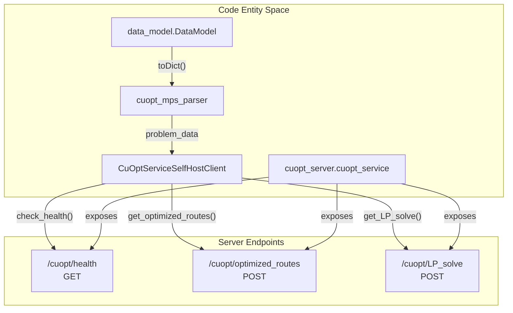
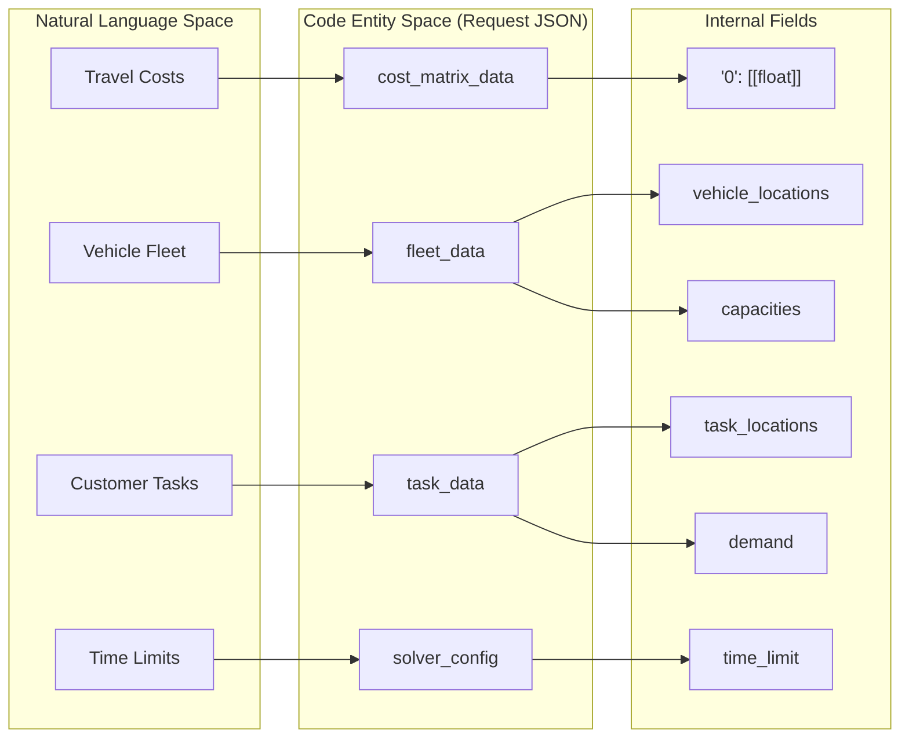

<!-- source: DeepWiki mcp.deepwiki.com · repo NVIDIA/cuopt-examples · page 7.2 Server Endpoints and Data Formats · fetched 2026-10-26 -->

# Server Endpoints and Data Formats

Relevant source files

The following files were used as context for generating this wiki page:

- [intra-factory_transport/README.md](intra-factory_transport/README.md)
- [last_mile_delivery/README.md](last_mile_delivery/README.md)
- [routing_optimization_over_server/README.md](routing_optimization_over_server/README.md)
- [routing_optimization_over_server/cvrptw_benchmark_gehring_homberger.ipynb](routing_optimization_over_server/cvrptw_benchmark_gehring_homberger.ipynb)
- [routing_optimization_over_server/cvrptw_service_team_routing.ipynb](routing_optimization_over_server/cvrptw_service_team_routing.ipynb)
- [sample_lp_sever_notebooks/README.md](sample_lp_sever_notebooks/README.md)
- [sample_lp_sever_notebooks/linear-programming-with-datamodel.ipynb](sample_lp_sever_notebooks/linear-programming-with-datamodel.ipynb)
- [sample_lp_sever_notebooks/linear-programming.ipynb](sample_lp_sever_notebooks/linear-programming.ipynb)
- [sample_lp_sever_notebooks/mixed-integer-linear-programming-with-datamodel.ipynb](sample_lp_sever_notebooks/mixed-integer-linear-programming-with-datamodel.ipynb)
- [sample_lp_sever_notebooks/mixed-integer-linear-programming.ipynb](sample_lp_sever_notebooks/mixed-integer-linear-programming.ipynb)

This page documents the HTTP endpoints exposed by the cuOpt server and the data formats required for submitting optimization problems. The cuOpt server runs on `localhost:5000` by default and provides RESTful endpoints for both vehicle routing problems and linear/mixed-integer programming problems.

For information about the client library used to interact with these endpoints, see [CuOptServiceSelfHostClient](). For the DataModel abstraction that simplifies building LP/MILP problems, see [DataModel API for Server]().

## Available Endpoints

The cuOpt server exposes three primary endpoints for optimization and health monitoring.

### System Architecture and Endpoint Mapping

**Sources:** [routing_optimization_over_server/cvrptw_service_team_routing.ipynb:164-243](), [sample_lp_sever_notebooks/linear-programming.ipynb:159-203](), [sample_lp_sever_notebooks/linear-programming-with-datamodel.ipynb:447-450]()

### Health Check Endpoint

**Endpoint:** `GET /cuopt/health`

**Purpose:** Verify that the cuOpt server is running and ready to accept requests.

**Response:** HTTP 200 OK when server is healthy.

This endpoint is used by clients to wait for server readiness after startup, typically with a polling loop that checks every second until the server responds.

**Sources:** [routing_optimization_over_server/cvrptw_benchmark_gehring_homberger.ipynb:177-193](), [routing_optimization_over_server/cvrptw_service_team_routing.ipynb:199-215]()

### Vehicle Routing Endpoint

**Endpoint:** `POST /cuopt/optimized_routes`

**Purpose:** Solve vehicle routing problems (CVRP, CVRPTW, CPDPTW) and return optimized routes.

**Client Method:** `CuOptServiceSelfHostClient.get_optimized_routes(cuopt_problem_data)`

This endpoint accepts vehicle routing problems with constraints like capacity limits, time windows, pickup-delivery pairs, and service times. It returns optimized vehicle routes that minimize total cost while satisfying all constraints.

**Sources:** [routing_optimization_over_server/cvrptw_benchmark_gehring_homberger.ipynb:517-523](), [routing_optimization_over_server/cvrptw_service_team_routing.ipynb:652-658]()

### Linear Programming Endpoint

**Endpoint:** `POST /cuopt/LP_solve`

**Purpose:** Solve linear programming (LP) and mixed-integer linear programming (MILP) problems.

**Client Method:** `CuOptServiceSelfHostClient.get_LP_solve(problem_data, response_type="dict")`

This endpoint accepts LP/MILP problems defined with constraint matrices in CSR format, variable bounds, and objective functions. It supports both continuous and integer variables.

**Sources:** [sample_lp_sever_notebooks/linear-programming.ipynb:447-449](), [sample_lp_sever_notebooks/mixed-integer-linear-programming.ipynb:468-470]()

## Vehicle Routing Problem Data Format

The `/cuopt/optimized_routes` endpoint expects a JSON object containing cost matrices, fleet specifications, task requirements, and solver configuration.

### VRP Data Flow and Structures

**Sources:** [routing_optimization_over_server/cvrptw_service_team_routing.ipynb:562-635](), [routing_optimization_over_server/cvrptw_benchmark_gehring_homberger.ipynb:406-514]()

### Request Structure

#### cost_matrix_data
Contains one or more cost matrices indexed by string keys. Each matrix is a 2D list where entry `[i][j]` represents the cost of traveling from location `i` to location `j`.
**Sources:** [routing_optimization_over_server/cvrptw_service_team_routing.ipynb:562-566]()

#### fleet_data
Specifies vehicle characteristics:
| Field | Type | Description |
|-------|------|-------------|
| `vehicle_locations` | `[[int, int]]` | Start/end location indices for each vehicle |
| `capacities` | `[[int]]` | Multi-dimensional capacity for each vehicle |
| `vehicle_time_windows` | `[[int, int]]` | Earliest and latest availability time |
**Sources:** [routing_optimization_over_server/cvrptw_service_team_routing.ipynb:584-589]()

#### task_data
Specifies task/location requirements:
| Field | Type | Description |
|-------|------|-------------|
| `task_locations` | `[int]` | Location index for each task |
| `demand` | `[[int]]` | Multi-dimensional demand for each task |
| `task_time_windows` | `[[int, int]]` | Earliest and latest service time |
| `service_times` | `[int]` | Time required to service each task |
**Sources:** [routing_optimization_over_server/cvrptw_service_team_routing.ipynb:607-614]()

### Response Structure
The server returns a JSON object where `response.solver_response` contains:
- `status`: Status code (0 = success).
- `solution_cost`: Total cost of the solution.
- `num_vehicles`: Number of vehicles used.
- `vehicle_data`: Mapping of vehicle IDs to `route` (list of indices) and `type`.
**Sources:** [routing_optimization_over_server/cvrptw_service_team_routing.ipynb:658-665]()

## LP/MILP Problem Data Format

The `/cuopt/LP_solve` endpoint accepts optimization problems defined by constraint matrices and objective functions.

### Request Structure: Direct JSON Format

#### csr_constraint_matrix
Constraints are stored in Compressed Sparse Row (CSR) format:
- `offsets`: Starting index of each constraint row in `values`.
- `indices`: Column (variable) indices for each non-zero coefficient.
- `values`: Non-zero coefficient values.
**Sources:** [sample_lp_sever_notebooks/linear-programming.ipynb:238-246]()

#### constraint_bounds and variable_bounds
Defines upper and lower bounds. Use `"inf"` for positive infinity and `"ninf"` for negative infinity.
**Sources:** [sample_lp_sever_notebooks/linear-programming.ipynb:278-284](), [sample_lp_sever_notebooks/linear-programming.ipynb:317-323]()

#### objective_data
- `coefficients`: Coefficient for each variable.
- `maximize`: Boolean flag for optimization direction.
**Sources:** [sample_lp_sever_notebooks/linear-programming.ipynb:352-361]()

#### variable_types (MILP Only)
An array where `"C"` denotes continuous and `"I"` denotes integer variables.
**Sources:** [sample_lp_sever_notebooks/mixed-integer-linear-programming.ipynb:404]()

### Request Structure: DataModel Format
Users can build the problem using the `DataModel` class and convert it using `cuopt_mps_parser.toDict(dm)`.
**Sources:** [sample_lp_sever_notebooks/linear-programming-with-datamodel.ipynb:447-450]()

### Response Structure
The response contains a `solution` object with:
- `primal_solution`: Optimal values for each variable.
- `primal_objective`: Optimal objective value.
- `vars`: Dictionary mapping variable names to their solved values.
- `lp_statistics` or `milp_statistics`: Convergence and performance metrics.
**Sources:** [sample_lp_sever_notebooks/linear-programming.ipynb:465-504](), [sample_lp_sever_notebooks/mixed-integer-linear-programming-with-datamodel.ipynb:483-520]()

## Common Elements

### Polling Behavior
The `CuOptServiceSelfHostClient` handles the HTTP communication. It includes a `polling_timeout` (default 600s) to wait for the server to process complex optimization requests.
**Sources:** [routing_optimization_over_server/cvrptw_service_team_routing.ipynb:538-542](), [sample_lp_sever_notebooks/linear-programming.ipynb:441-445]()

---

