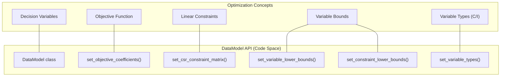
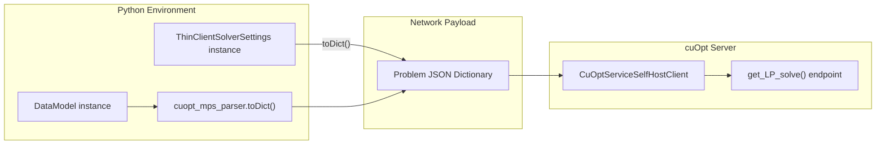

<!-- source: DeepWiki mcp.deepwiki.com · repo NVIDIA/cuopt-examples · page 7.3 DataModel API for Server · fetched 2026-10-26 -->

# DataModel API for Server

<details>
<summary>Relevant source files</summary>

The following files were used as context for generating this wiki page:

- [routing_optimization_over_server/cvrptw_benchmark_gehring_homberger.ipynb](routing_optimization_over_server/cvrptw_benchmark_gehring_homberger.ipynb)
- [routing_optimization_over_server/cvrptw_service_team_routing.ipynb](routing_optimization_over_server/cvrptw_service_team_routing.ipynb)
- [sample_lp_sever_notebooks/linear-programming-with-datamodel.ipynb](sample_lp_sever_notebooks/linear-programming-with-datamodel.ipynb)
- [sample_lp_sever_notebooks/linear-programming.ipynb](sample_lp_sever_notebooks/linear-programming.ipynb)
- [sample_lp_sever_notebooks/mixed-integer-linear-programming-with-datamodel.ipynb](sample_lp_sever_notebooks/mixed-integer-linear-programming-with-datamodel.ipynb)
- [sample_lp_sever_notebooks/mixed-integer-linear-programming.ipynb](sample_lp_sever_notebooks/mixed-integer-linear-programming.ipynb)

</details>


This page documents the `DataModel` abstraction for building Linear Programming (LP) and Mixed-Integer Linear Programming (MILP) problems intended for submission to the cuOpt server. The `DataModel` class provides a structured, programmatic interface for defining optimization problems using method-based property assignment rather than manual JSON construction.

For information about the server client interface, see [CuOptServiceSelfHostClient](#7.1). For details on the server endpoints and raw JSON formats, see [Server Endpoints and Data Formats](#7.2). For the direct SDK Problem API (non-server), see [Problem API](#3.1).

## Overview

The `DataModel` API is designed specifically for mathematical programming problems submitted to the cuOpt server via the `/cuopt/LP_solve` endpoint. It facilitates the construction of complex sparse matrices and property sets required by the GPU-accelerated solver.

The workflow involves two primary classes:
- **`DataModel`**: Encapsulates problem structure (constraint matrix, bounds, objective, variable types).
- **`ThinClientSolverSettings`**: Encapsulates solver configuration parameters.

These objects are transformed into the server's expected JSON format using the `cuopt_mps_parser.toDict()` utility before submission.

### Natural Language to Code Entity Mapping

The following diagram bridges the conceptual optimization problem components to the specific classes and methods used in the server-side DataModel API.

**Diagram: Optimization Concepts to Code Entities**

Sources: [sample_lp_sever_notebooks/linear-programming-with-datamodel.ipynb:213-397](), [sample_lp_sever_notebooks/mixed-integer-linear-programming-with-datamodel.ipynb:214-397]()

## DataModel Class

The `DataModel` class is the central entity for problem definition. It is typically used in conjunction with `cuopt_mps_parser` to prepare data for the `CuOptServiceSelfHostClient`.

### Instantiation
```python
from data_model import DataModel
dm = DataModel()
```
Sources: [sample_lp_sever_notebooks/linear-programming-with-datamodel.ipynb:213-222](), [sample_lp_sever_notebooks/mixed-integer-linear-programming-with-datamodel.ipynb:214-223]()

### Constraint Matrix Configuration
The solver expects constraints in a Compressed Sparse Row (CSR) format to optimize GPU memory usage.

#### `set_csr_constraint_matrix(coefficients, indices, offsets)`
Sets the linear constraint coefficients.
- **`coefficients`**: `np.array(float64)` - The non-zero values in the matrix.
- **`indices`**: `np.array(int32)` - Column indices for each non-zero value.
- **`offsets`**: `np.array(int32)` - Row pointers indicating where each constraint's data starts in the coefficients array.

Sources: [sample_lp_sever_notebooks/linear-programming-with-datamodel.ipynb:240-251](), [sample_lp_sever_notebooks/mixed-integer-linear-programming-with-datamodel.ipynb:241-252]()

### Bound and Objective Specification

#### Constraint and Variable Bounds
Bounds are set using NumPy arrays. Use `np.inf` or `-np.inf` to represent unbounded directions.
- `set_constraint_lower_bounds(lower_bounds)` / `set_constraint_upper_bounds(upper_bounds)`
- `set_variable_lower_bounds(var_lower_bounds)` / `set_variable_upper_bounds(var_upper_bounds)`

Sources: [sample_lp_sever_notebooks/linear-programming-with-datamodel.ipynb:277-323](), [sample_lp_sever_notebooks/mixed-integer-linear-programming-with-datamodel.ipynb:278-325]()

#### Objective Function
- `set_objective_coefficients(objective_coefficients)`: Sets the linear cost/profit coefficients for each variable.
- `set_maximize(bool)`: Defines the optimization direction (`True` for maximization, `False` for minimization).

Sources: [sample_lp_sever_notebooks/linear-programming-with-datamodel.ipynb:347-355](), [sample_lp_sever_notebooks/mixed-integer-linear-programming-with-datamodel.ipynb:349-357]()

### Variable Properties
- `set_variable_names(variable_names)`: Assigns string labels to variables for readable results.
- `set_variable_types(variable_types)`: Essential for MILP. Use `"C"` for continuous and `"I"` for integer variables.

Sources: [sample_lp_sever_notebooks/linear-programming-with-datamodel.ipynb:370-397](), [sample_lp_sever_notebooks/mixed-integer-linear-programming-with-datamodel.ipynb:373-397]()

## Solver Configuration

The `ThinClientSolverSettings` class manages parameters passed to the server-side solver engine.

### ThinClientSolverSettings Methods
- `set_parameter(name, value)`: General method for solver-specific settings (e.g., `"time_limit"`).
- `set_optimality_tolerance(value)`: Sets the precision requirement for the solution.

Sources: [sample_lp_sever_notebooks/linear-programming-with-datamodel.ipynb:417-419](), [sample_lp_sever_notebooks/mixed-integer-linear-programming-with-datamodel.ipynb:417]()

## Data Flow to Server

The following diagram illustrates the transformation of code entities into the network-ready payload consumed by the cuOpt server.

**Diagram: Data Transformation and Submission**

Sources: [sample_lp_sever_notebooks/linear-programming-with-datamodel.ipynb:437-474](), [sample_lp_sever_notebooks/mixed-integer-linear-programming-with-datamodel.ipynb:436-467]()

## Comparison: DataModel vs. Direct JSON

While users can construct the JSON dictionary manually, the `DataModel` API offers several advantages in a server-based workflow.

| Feature | DataModel API | Direct JSON Construction |
| :--- | :--- | :--- |
| **Data Integrity** | Enforces NumPy types (float64/int32) | Manual verification required |
| **Complexity** | Methods abstract the CSR structure | Must manually manage offsets and indices |
| **Extensibility** | Supports `cuopt_mps_parser` integration | Requires custom parsing logic |
| **Readability** | Explicit methods like `set_maximize` | Key-value pairs like `"maximize": true` |

Sources: [sample_lp_sever_notebooks/linear-programming-with-datamodel.ipynb:240-449](), [sample_lp_sever_notebooks/linear-programming.ipynb:237-361]()

## Complete Implementation Example

This example demonstrates building a Mixed-Integer problem and solving it via the server client.

```python
import numpy as np
import cuopt_mps_parser
from data_model import DataModel
from cuopt_sh_client import ThinClientSolverSettings, CuOptServiceSelfHostClient

# 1. Initialize DataModel and Settings
dm = DataModel()
ss = ThinClientSolverSettings()

# 2. Define Constraints (e.g., 2x + 4y >= 230)
dm.set_csr_constraint_matrix(
    np.array([2.0, 4.0, 3.0, 2.0], dtype=np.float64), # coefficients
    np.array([0, 1, 0, 1], dtype=np.int32),          # indices
    np.array([0, 2, 4], dtype=np.int32)              # offsets
)
dm.set_constraint_lower_bounds(np.array([230, -np.inf], dtype=np.float64))
dm.set_constraint_upper_bounds(np.array([np.inf, 190], dtype=np.float64))

# 3. Define Variables (x is Integer, y is Continuous)
dm.set_variable_types(np.array(["I", "C"]))
dm.set_variable_lower_bounds(np.array([0, 0], dtype=np.float64))

# 4. Define Objective (Maximize 5x + 3y)
dm.set_objective_coefficients(np.array([5, 3], dtype=np.float64))
dm.set_maximize(True)

# 5. Solve via Server
ss.set_parameter("time_limit", 1)
data = cuopt_mps_parser.toDict(dm)
data["solver_config"] = ss.toDict()

client = CuOptServiceSelfHostClient(ip="localhost", port="5000")
solution = client.get_LP_solve(data, response_type="dict")
```
Sources: [sample_lp_sever_notebooks/mixed-integer-linear-programming-with-datamodel.ipynb:214-467]()

---

