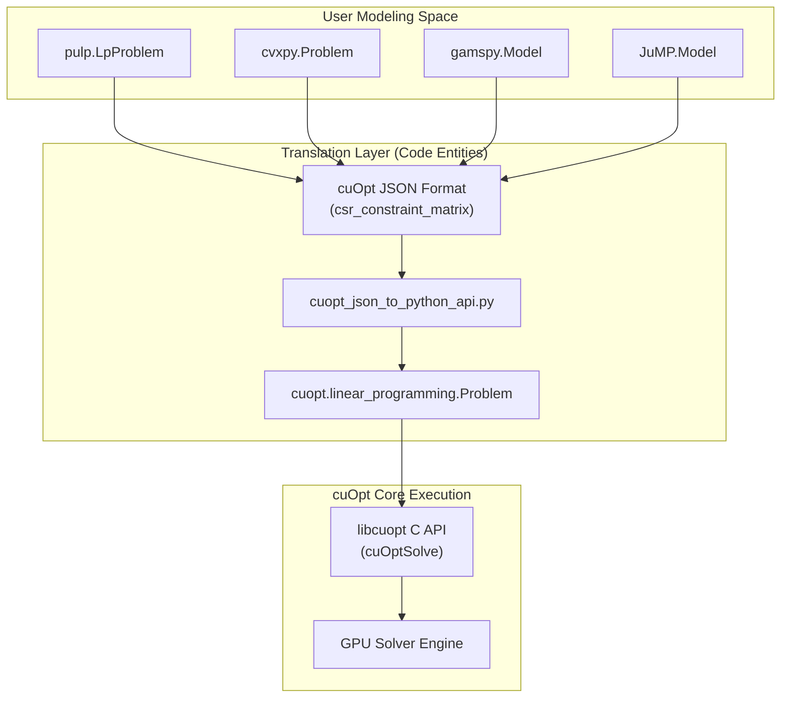
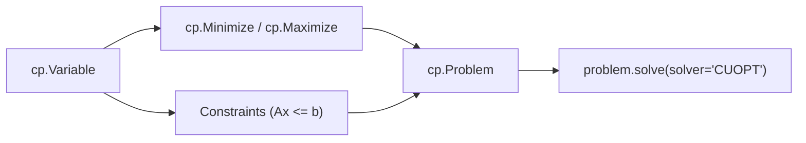

<!-- source: DeepWiki mcp.deepwiki.com · repo NVIDIA/cuopt-examples · page 8 Modeling Language Integrations · fetched 2026-10-26 -->

# Modeling Language Integrations

<details>
<summary>Relevant source files</summary>

The following files were used as context for generating this wiki page:

- [CVXPY_integration_example/README.md](CVXPY_integration_example/README.md)
- [CVXPY_integration_example/diet_optimization.ipynb](CVXPY_integration_example/diet_optimization.ipynb)
- [PuLP_integration_example/Production_Planning_Example_Pulp.ipynb](PuLP_integration_example/Production_Planning_Example_Pulp.ipynb)
- [PuLP_integration_example/Simple_LP_pulp.ipynb](PuLP_integration_example/Simple_LP_pulp.ipynb)
- [PuLP_integration_example/Simple_MIP_pulp.ipynb](PuLP_integration_example/Simple_MIP_pulp.ipynb)
- [PuLP_integration_example/Sudoku_pulp.ipynb](PuLP_integration_example/Sudoku_pulp.ipynb)

</details>


## Purpose and Scope

This page documents cuOpt's integration with popular mathematical optimization modeling frameworks, enabling users to leverage cuOpt's GPU-accelerated solving capabilities through familiar declarative modeling languages. These integrations allow existing optimization models to use cuOpt as a solver with minimal code changes.

For information about the underlying Problem API that these integrations build upon, see [Problem API](#3.1). For details about the cuOpt service-based architecture, see [Server-Based Architecture](#7).

## Integration Architecture

cuOpt provides multiple pathways for users to access its GPU-accelerated optimization capabilities. All modeling language integrations follow a common pattern: they translate declarative model specifications into cuOpt's internal problem representation, solve using cuOpt's GPU-accelerated solvers, and return results in the framework's native format.

### Integration Layers

The following diagram maps the flow from natural language modeling concepts to the specific code entities used in the `cuopt-examples` repository.

**Code Entity Mapping: Modeling to Solver**



**Sources:** [PuLP_integration_example/Simple_LP_pulp.ipynb:148-174](), [CVXPY_integration_example/diet_optimization.ipynb:110-220](), [PuLP_integration_example/Simple_MIP_pulp.ipynb:134-169]()

## cuOpt JSON Format

All modeling language integrations use a standardized JSON format as an intermediate representation. This format provides a complete specification of LP/MIP problems that can be consumed by any cuOpt interface.

### JSON Structure

The cuOpt JSON format contains primary sections for matrix representation and bounds. For detailed technical specifications, see [cuOpt JSON Format](#10.1).

**Sources:** [PuLP_integration_example/Simple_LP_pulp.ipynb:120-153](), [PuLP_integration_example/Simple_MIP_pulp.ipynb:120-145]()

## Integration Framework Details

### GAMSPy Integration (#8.1)

GAMSPy provides a Python interface to GAMS (General Algebraic Modeling System) with cuOpt as a solver backend. It uses algebraic syntax for defining `Set`, `Parameter`, `Variable`, and `Equation` objects within a `Container`.

For implementation details, see [GAMSPy Integration](#8.1).

### PuLP Integration (#8.2)

PuLP is a popular Python modeling language for linear and mixed-integer programming. cuOpt integrates as a solver class `CUOPT` that PuLP can invoke via the `problem.solve()` method.

**PuLP to cuOpt Variable Mapping**

| PuLP Category (`cat`) | cuOpt Variable Type | File Reference |
|-----------------------|---------------------|----------------|
| `LpContinuous` | Continuous (`'C'`) | [PuLP_integration_example/Simple_LP_pulp.ipynb:149]() |
| `LpInteger` | Integer (`'I'`) | [PuLP_integration_example/Simple_MIP_pulp.ipynb:137]() |
| `LpBinary` | Binary (`'I'` with 0/1 bounds) | [PuLP_integration_example/Production_Planning_Example_Pulp.ipynb:163]() |

**Usage Pattern:**
```python
from pulp import LpProblem, LpVariable, LpMinimize, CUOPT
# Define problem
problem = LpProblem("Example", LpMinimize)
# Solve using cuOpt
status = problem.solve(CUOPT(msg=0))
```

For details, see [PuLP Integration](#8.2).

**Sources:** [PuLP_integration_example/Simple_LP_pulp.ipynb:148-174](), [PuLP_integration_example/Simple_MIP_pulp.ipynb:134-169](), [PuLP_integration_example/Production_Planning_Example_Pulp.ipynb:158-170]()

### CVXPY Integration (#8.3)

CVXPY is a Python-embedded modeling language for convex optimization. cuOpt acts as a solver for LP and MILP problems formulated in CVXPY using the `solver='CUOPT'` parameter.

**Key Code Entities in CVXPY Workflow**



For details, see [CVXPY Integration](#8.3).

**Sources:** [CVXPY_integration_example/diet_optimization.ipynb:110-220](), [CVXPY_integration_example/README.md:1-27]()

### AMPL, Julia, GAMS, and Pyomo Integrations (#8.4)

These integrations cover a wide range of industry-standard tools:
*   **AMPL**: Uses `amplpy` to generate model strings and solve.
*   **Julia/JuMP**: Utilizes `cuOpt.Optimizer` within the Julia ecosystem.
*   **Pyomo**: Uses `SolverFactory('cuopt')` for problem solving.

For details, see [AMPL, Julia, GAMS, and Pyomo Integrations](#8.4).

## Choosing an Integration

The choice of integration typically depends on the existing codebase or the specific mathematical requirements of the problem.

| Requirement | Recommended Integration |
|-------------|-------------------------|
| Existing Python MILP models | **PuLP** |
| Convex optimization research | **CVXPY** |
| Enterprise algebraic modeling | **GAMSPy / GAMS** |
| High-performance Julia apps | **JuMP** |
| Maximum control/performance | **Direct Problem API** |

**Sources:** [CVXPY_integration_example/README.md:9-16](), [PuLP_integration_example/Simple_LP_pulp.ipynb:11-13]()

---

