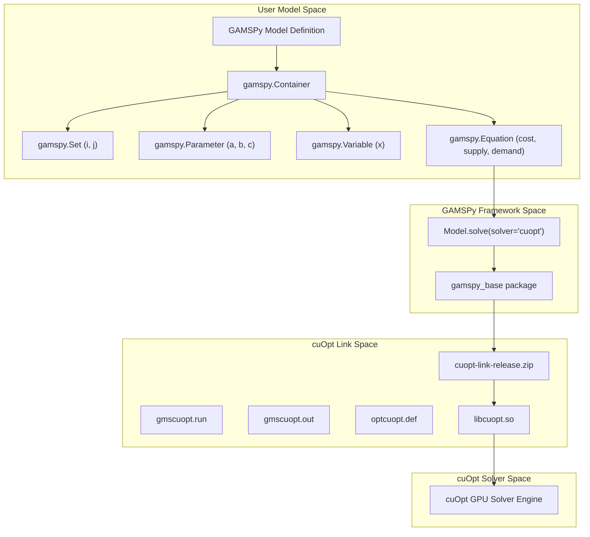
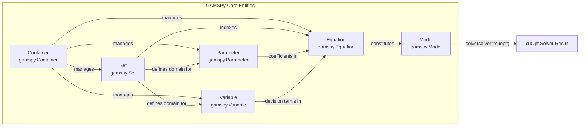

<!-- source: DeepWiki mcp.deepwiki.com · repo NVIDIA/cuopt-examples · page 8.1 GAMSPy Integration · fetched 2026-10-26 -->

# GAMSPy Integration

<details>
<summary>Relevant source files</summary>

The following files were used as context for generating this wiki page:

- [GAMSPy_integration_example/transport_cuopt.ipynb](GAMSPy_integration_example/transport_cuopt.ipynb)
- [PuLP_integration_example/Production_Planning_Example_Pulp.ipynb](PuLP_integration_example/Production_Planning_Example_Pulp.ipynb)
- [PuLP_integration_example/Simple_LP_pulp.ipynb](PuLP_integration_example/Simple_LP_pulp.ipynb)
- [PuLP_integration_example/Simple_MIP_pulp.ipynb](PuLP_integration_example/Simple_MIP_pulp.ipynb)
- [PuLP_integration_example/Sudoku_pulp.ipynb](PuLP_integration_example/Sudoku_pulp.ipynb)

</details>


## Purpose and Scope

This document describes the integration between GAMSPy and cuOpt, enabling GPU-accelerated optimization for models written in the GAMSPy modeling language. GAMSPy is a Python-based algebraic modeling system that provides a declarative syntax for formulating linear programming (LP) and mixed-integer programming (MIP) problems.

This page covers the GAMSPy-specific integration, including installation of the cuOpt link package, core GAMSPy classes (`Container`, `Set`, `Parameter`, `Variable`, `Equation`, `Model`), and solver invocation. For other modeling language integrations, see [PuLP Integration](8.2) and [CVXPY Integration](8.3).

## Integration Architecture

GAMSPy integration with cuOpt requires a separate link package that bridges the GAMSPy framework with the cuOpt solver backend.

**Entity Mapping: Natural Language to Code Entities**


Sources: [GAMSPy_integration_example/transport_cuopt.ipynb:17-52](), [GAMSPy_integration_example/transport_cuopt.ipynb:131-141]()

### Installation Requirements

The integration requires specific installation steps to link the GPU solver to the GAMSPy environment:

| Component | Installation Method | Purpose |
|-----------|-------------------|---------|
| GAMSPy | `pip install gamspy` | Core modeling framework [GAMSPy_integration_example/transport_cuopt.ipynb:131-131]() |
| cuOpt Link | Extract `cuopt-link-release.zip` to `gamspy_base` | Solver bridge package [GAMSPy_integration_example/transport_cuopt.ipynb:136-138]() |
| cuOpt | `pip install cuopt-cu12` or `cuopt-cu13` | GPU-accelerated solver engine [GAMSPy_integration_example/transport_cuopt.ipynb:119-120]() |

The cuOpt link package must be extracted to the GAMSPy base directory, which can be located programmatically:

```python
import subprocess
import sys
gams_base_path = subprocess.check_output([sys.executable, '-m', 'gamspy', 'show', 'base']).decode('utf-8').strip()
# Extract to gams_base_path
```
Sources: [GAMSPy_integration_example/transport_cuopt.ipynb:137-138]()

## Core GAMSPy Classes

The GAMSPy framework uses a structured hierarchy of classes to define optimization problems.

**Class Relationship Diagram**


Sources: [GAMSPy_integration_example/transport_cuopt.ipynb:485-498](), [GAMSPy_integration_example/transport_cuopt.ipynb:520-560](), [GAMSPy_integration_example/transport_cuopt.ipynb:1399-1421]()

### Container
The `Container` class serves as the central data store. All model entities (Sets, Parameters, etc.) must be linked to a `Container` instance upon initialization.
[GAMSPy_integration_example/transport_cuopt.ipynb:485-498]()

### Set
The `Set` class defines index domains. It can be populated from pandas Index or list objects using `setRecords()`.
[GAMSPy_integration_example/transport_cuopt.ipynb:520-560]()

### Parameter
`Parameter` objects hold the fixed data coefficients for the model. They can be indexed by one or more `Set` objects.
[GAMSPy_integration_example/transport_cuopt.ipynb:727-798]()

### Variable
The `Variable` class represents the values the solver optimizes. Types include `"free"`, `"positive"`, `"binary"`, and `"integer"`.
[GAMSPy_integration_example/transport_cuopt.ipynb:1198-1214]()

### Equation
`Equation` objects define the mathematical relationships (constraints and objectives). They are defined using GAMSPy expressions and the `Sum` operator.
[GAMSPy_integration_example/transport_cuopt.ipynb:1275-1383]()

### Model
The `Model` class groups equations and specifies the optimization `Sense` (Minimize/Maximize) and the problem type (e.g., `"LP"`).
[GAMSPy_integration_example/transport_cuopt.ipynb:1399-1421]()

## Solving with cuOpt

To invoke the GPU-accelerated solver, the `Model.solve()` method is called with the `solver` argument set to `'cuopt'`.

```python
# Solving a model instance
model_name.solve(solver="cuopt")
```
Sources: [GAMSPy_integration_example/transport_cuopt.ipynb:1423-1434]()

### Solution Access
Once `solve()` completes, results are stored back into the `Variable` objects. Users can access these via the `.records` attribute, which returns a pandas DataFrame.
[GAMSPy_integration_example/transport_cuopt.ipynb:1423-1434]()

## Comparison with Other Integrations

While GAMSPy uses an algebraic approach with explicit `Set` and `Container` management, other integrations like PuLP or CVXPY offer different modeling paradigms.

| Feature | GAMSPy | PuLP | CVXPY |
|---------|--------|------|-------|
| **Solver Call** | `model.solve(solver='cuopt')` | `prob.solve(CUOPT())` | `prob.solve(solver='CUOPT')` |
| **Variable Type** | `Variable(..., type='binary')` | `LpVariable(..., cat='Binary')` | `cp.Variable(..., boolean=True)` |
| **Indexing** | Native `Set` objects | Python dictionaries/lists | NumPy/SciPy arrays |

Sources: [GAMSPy_integration_example/transport_cuopt.ipynb:1423-1434](), [PuLP_integration_example/Simple_MIP_pulp.ipynb:163-169](), [PuLP_integration_example/Simple_LP_pulp.ipynb:174-174]()

---

