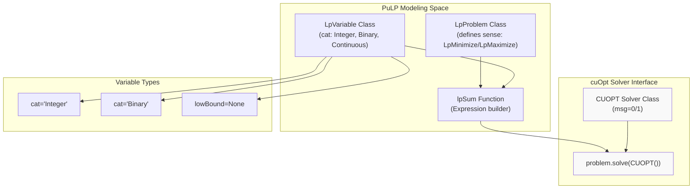
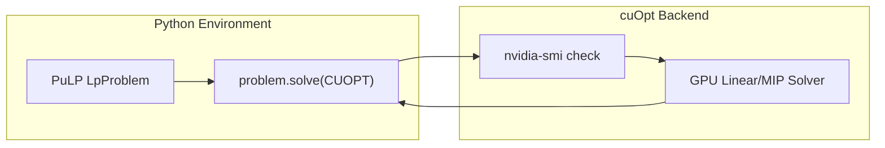

<!-- source: DeepWiki mcp.deepwiki.com · repo NVIDIA/cuopt-examples · page 8.2 PuLP Integration · fetched 2026-10-26 -->

# PuLP Integration

<details>
<summary>Relevant source files</summary>

The following files were used as context for generating this wiki page:

- [PuLP_integration_example/Production_Planning_Example_Pulp.ipynb](PuLP_integration_example/Production_Planning_Example_Pulp.ipynb)
- [PuLP_integration_example/README.md](PuLP_integration_example/README.md)
- [PuLP_integration_example/Simple_LP_pulp.ipynb](PuLP_integration_example/Simple_LP_pulp.ipynb)
- [PuLP_integration_example/Simple_MIP_pulp.ipynb](PuLP_integration_example/Simple_MIP_pulp.ipynb)
- [PuLP_integration_example/Sudoku_pulp.ipynb](PuLP_integration_example/Sudoku_pulp.ipynb)

</details>


## Purpose and Scope

This document describes the integration between NVIDIA cuOpt and PuLP, a Python linear and mixed-integer programming modeler. The integration enables users to solve LP and MIP problems using cuOpt's GPU-accelerated solver through PuLP's standard modeling interface. For GAMSPy integration, see [GAMSPy Integration](#8.1). For CVXPY integration, see [CVXPY Integration](#8.3).

The integration supports:
- **Linear Programming (LP)** with continuous variables [PuLP_integration_example/Simple_LP_pulp.ipynb:9-13]()
- **Mixed Integer Programming (MIP)** with integer and binary variables [PuLP_integration_example/Simple_MIP_pulp.ipynb:9-13]()
- **Constraint satisfaction problems** like Sudoku [PuLP_integration_example/Sudoku_pulp.ipynb:9-13]()
- Standard PuLP modeling constructs including `LpProblem`, `LpVariable`, and `lpSum` [PuLP_integration_example/Simple_LP_pulp.ipynb:132-153]()

---

## Core Integration Components

### CUOPT Solver Class

The `CUOPT` solver class serves as the bridge between PuLP's problem representation and cuOpt's GPU-accelerated optimization engine. Users instantiate this class and pass it to PuLP's `solve()` method [PuLP_integration_example/Simple_MIP_pulp.ipynb:169]().

**Key Usage Pattern:**
```python
from pulp import *

# Define the problem
problem = LpProblem("problem_name", LpMinimize)
# ... define variables and constraints ...

# Solve using the CUOPT solver class
status = problem.solve(CUOPT(msg=0))
```
[PuLP_integration_example/Simple_MIP_pulp.ipynb:134-169]()

**Solver Instantiation:**
- `msg` parameter: Controls verbosity (0 = quiet, 1 = verbose) [PuLP_integration_example/Simple_MIP_pulp.ipynb:169]().
- Default solver configuration uses cuOpt's automatic parameter selection.

Sources: [PuLP_integration_example/Simple_LP_pulp.ipynb:174](), [PuLP_integration_example/Simple_MIP_pulp.ipynb:169]()

---

### Problem Construction Classes

The following diagram maps PuLP modeling entities to the workflow required to invoke the `CUOPT` solver.

**Diagram: PuLP to cuOpt Entity Mapping**



Sources: [PuLP_integration_example/Simple_LP_pulp.ipynb:131-153](), [PuLP_integration_example/Simple_MIP_pulp.ipynb:131-145](), [PuLP_integration_example/Production_Planning_Example_Pulp.ipynb:158-166]()

---

## Variable Declaration Patterns

### Continuous Variables
Continuous variables have no integrality constraints. Declaration requires a name and optional bounds [PuLP_integration_example/Simple_LP_pulp.ipynb:149]().
```python
# Unbounded continuous variable
x = LpVariable('x', lowBound=None)

# Non-negative continuous variable
y = LpVariable('y', lowBound=0.0)
```
Sources: [PuLP_integration_example/Simple_LP_pulp.ipynb:149](), [PuLP_integration_example/Simple_MIP_pulp.ipynb:138]()

### Integer Variables
Integer variables are restricted to integer values. Specified using the `cat='Integer'` parameter [PuLP_integration_example/Simple_MIP_pulp.ipynb:137]().
```python
# Non-negative integer variable
x1 = LpVariable('x1', lowBound=0, cat='Integer')
```
Sources: [PuLP_integration_example/Production_Planning_Example_Pulp.ipynb:161-162]()

### Binary Variables
Binary variables take values in {0, 1}. Declared using `cat='Binary'` [PuLP_integration_example/Production_Planning_Example_Pulp.ipynb:163]().
```python
# Machine usage flag
y = LpVariable('y', cat='Binary')
```
Sources: [PuLP_integration_example/Production_Planning_Example_Pulp.ipynb:163]()

---

## Constraint Formulation

### Equality and Inequality
PuLP supports equality and inequality constraints using standard Python comparison operators [PuLP_integration_example/Simple_MIP_pulp.ipynb:143-145]().

```python
# Inequality
problem += x + y >= 10.0, "Constraint1"
# Equality (e.g., in Sudoku)
prob += lpSum([choices[v][r][c] for v in Vals]) == 1
```
Sources: [PuLP_integration_example/Simple_MIP_pulp.ipynb:144](), [PuLP_integration_example/Sudoku_pulp.ipynb:1-226]()

### Conditional Constraints (MIP)
Binary variables enable conditional logic, such as forcing a minimum production if a machine is activated [PuLP_integration_example/Production_Planning_Example_Pulp.ipynb:127]().
```python
# If machine used (y=1), at least 5 units of x2 must be produced
problem += x2 >= 5.0 * y, "Minimum_if_machine_used"
```
Sources: [PuLP_integration_example/Production_Planning_Example_Pulp.ipynb:137-171]()

---

## Solution Extraction

After the `problem.solve(CUOPT())` call returns, the solution status and variable values are extracted from the problem object [PuLP_integration_example/Simple_MIP_pulp.ipynb:169-175]().

```python
# Extract status
print("Status:", LpStatus[status])

# Extract objective
print("Optimal Value:", value(problem.objective))

# Extract specific variable values
print("x =", x.varValue)
```
Sources: [PuLP_integration_example/Simple_MIP_pulp.ipynb:172-175](), [PuLP_integration_example/Production_Planning_Example_Pulp.ipynb:198-205]()

---

## Complete Example: Production Planning

The production planning example demonstrates a Mixed Integer Program (MIP) with binary decision variables and conditional constraints [PuLP_integration_example/Production_Planning_Example_Pulp.ipynb:118-144]().

| Component | Code Entity | Role |
|-----------|-------------|------|
| **Objective** | `LpMaximize` | Maximize profit ($20x_1 + $120x_2 - $1000y) |
| **Product Qty** | `x1`, `x2` | Integer variables (units produced) |
| **Machine Flag** | `y` | Binary variable (fixed cost activation) |
| **Material Limit** | `3.0*x1 + 2.0*x2 <= 240.0` | Resource constraint |
| **Labor Limit** | `2.0*x1 + 4.0*x2 <= 180.0` | Resource constraint |

Sources: [PuLP_integration_example/Production_Planning_Example_Pulp.ipynb:158-174]()

---

## Performance and Infrastructure

### GPU Requirements
The `CUOPT` solver requires a compatible NVIDIA GPU (e.g., T4 or better) and the `nvidia-smi` utility for verification [PuLP_integration_example/Simple_LP_pulp.ipynb:15-84]().

**Diagram: Solver Execution Flow**



Sources: [PuLP_integration_example/Simple_LP_pulp.ipynb:36-84](), [PuLP_integration_example/Simple_LP_pulp.ipynb:174]()

### Dependencies
Integration requires `pulp` (recommended version 3.3.0) and the `cuopt` package [PuLP_integration_example/Simple_LP_pulp.ipynb:95-109]().

```bash
pip install pulp==3.3.0
# cuOpt installation (if not in container)
pip install --upgrade --extra-index-url=https://pypi.nvidia.com cuopt-cu12
```
Sources: [PuLP_integration_example/Simple_LP_pulp.ipynb:95](), [PuLP_integration_example/Simple_MIP_pulp.ipynb:94]()

---

