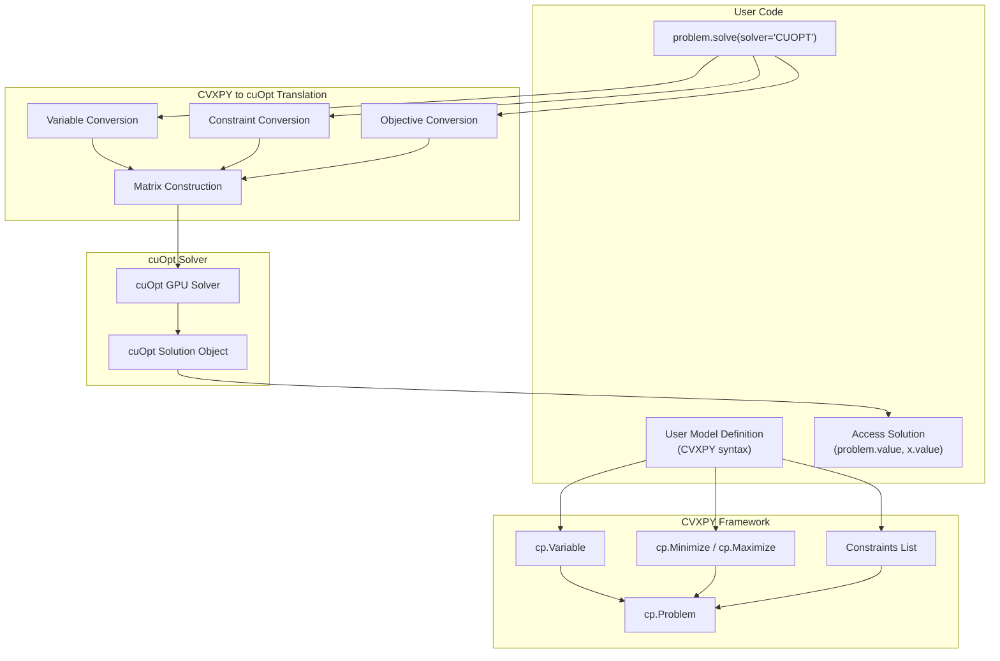
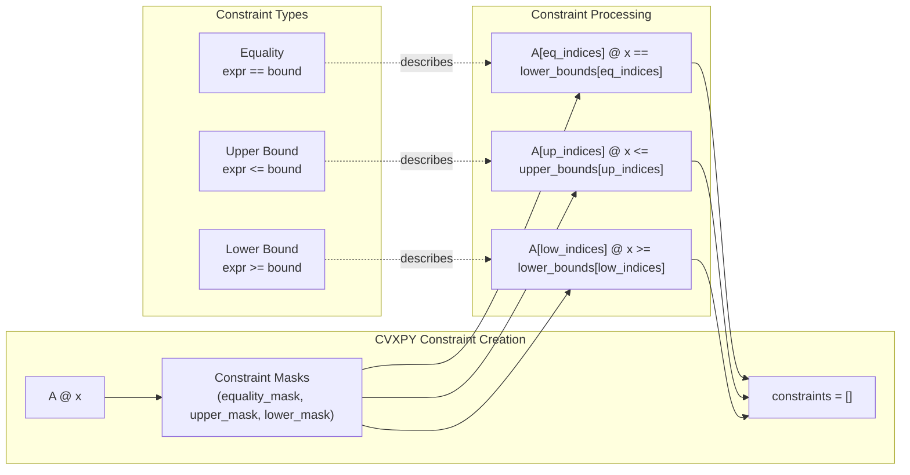
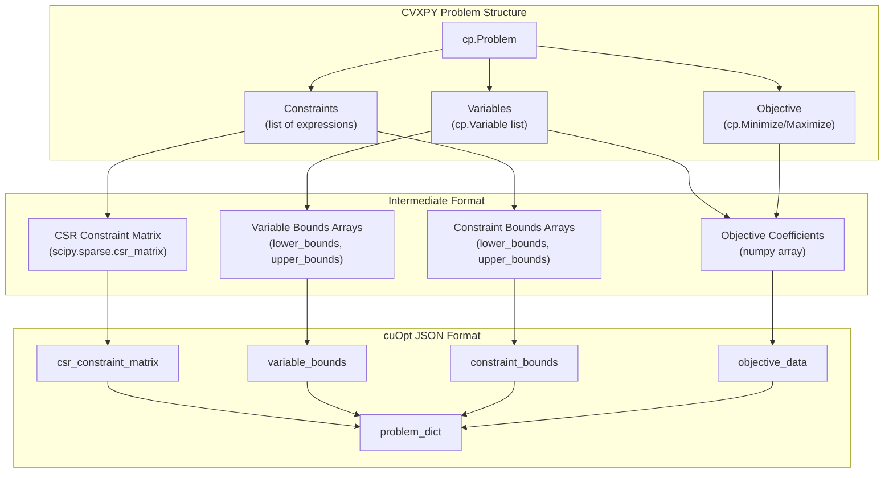
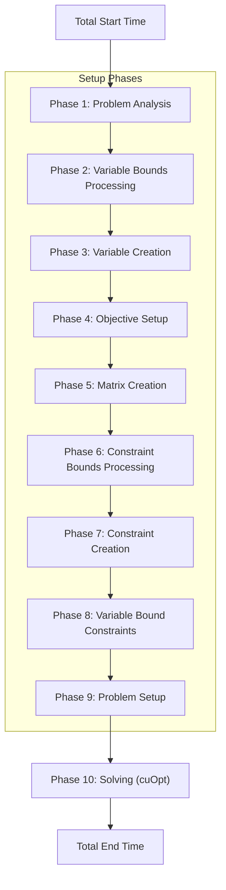

<!-- source: DeepWiki mcp.deepwiki.com · repo NVIDIA/cuopt-examples · page 8.3 CVXPY Integration · fetched 2026-10-26 -->

# CVXPY Integration

<details>
<summary>Relevant source files</summary>

The following files were used as context for generating this wiki page:

- [CVXPY_integration_example/README.md](CVXPY_integration_example/README.md)
- [CVXPY_integration_example/diet_optimization.ipynb](CVXPY_integration_example/diet_optimization.ipynb)

</details>


## Purpose and Scope

This page documents the integration between CVXPY and NVIDIA cuOpt, enabling users to leverage cuOpt's GPU-accelerated solver as a backend for CVXPY-modeled optimization problems. CVXPY is a Python-embedded modeling language for convex optimization that allows problems to be expressed in natural mathematical notation. This integration combines CVXPY's intuitive modeling syntax with cuOpt's high-performance solving capabilities.

**Sources:** [CVXPY_integration_example/README.md:1-27]()

## Integration Architecture

The CVXPY integration operates as a solver backend within the CVXPY framework, translating CVXPY problem representations into cuOpt's internal format and returning solutions through CVXPY's standard interface.

### System Overview

Title: CVXPY to cuOpt Data Flow


**Sources:** [CVXPY_integration_example/diet_optimization.ipynb:7-23](), [benchmark_apis/cuopt_json_to_cvxpy.py:1-50]()

### File Structure

| File | Purpose |
|------|---------|
| `CVXPY_integration_example/diet_optimization.ipynb` | Example notebook demonstrating CVXPY+cuOpt usage |
| `CVXPY_integration_example/README.md` | Overview documentation |
| `benchmark_apis/cuopt_json_to_cvxpy.py` | Benchmark driver and detailed conversion implementation |

**Sources:** [CVXPY_integration_example/README.md:17-27](), [benchmark_apis/cuopt_json_to_cvxpy.py:1-30]()

## Problem Formulation

### Variable Creation

CVXPY variables are created using `cp.Variable` and can be specified as continuous or integer types. Variable bounds can be set through the `bounds` parameter or as separate constraints.

```python
# Continuous variables with bounds
x = cp.Variable(n_foods, nonneg=True, name="servings")

# Integer variables with bounds
x = cp.Variable(n_vars, integer=True, bounds=[lower_bounds, upper_bounds])

# Mixed variable types (created individually)
variables = []
for i in range(n_vars):
    if var_type == 'I':
        var = cp.Variable(integer=True, name=f'x_{i}', bounds=[lb[i], ub[i]])
    else:
        var = cp.Variable(name=f'x_{i}', bounds=[lb[i], ub[i]])
    variables.append(var)
```

**Key Functions:**
- `cp.Variable()` - Creates decision variables [CVXPY_integration_example/diet_optimization.ipynb:193-193]()
- `nonneg=True` - Sets non-negativity constraint [CVXPY_integration_example/diet_optimization.ipynb:193-193]()
- `integer=True` - Specifies integer variables [benchmark_apis/cuopt_json_to_cvxpy.py:65-65]()
- `bounds=[lb, ub]` - Sets variable bounds [benchmark_apis/cuopt_json_to_cvxpy.py:65-65]()

**Sources:** [CVXPY_integration_example/diet_optimization.ipynb:183-197](), [benchmark_apis/cuopt_json_to_cvxpy.py:46-80]()

### Objective Function

Objectives are defined using `cp.Minimize` or `cp.Maximize` with linear expressions of variables.

```python
# Minimize total cost
cost_vector = np.array([food_costs[food] for food in food_names])
objective = cp.Minimize(cost_vector @ x)

# With offset term
obj_coeffs = np.array(objective_data['coefficients'])
obj_offset = objective_data['offset']
objective = (cp.Minimize if not maximize else cp.Maximize)(obj_coeffs @ x + obj_offset)
```

**Sources:** [CVXPY_integration_example/diet_optimization.ipynb:205-210](), [benchmark_apis/cuopt_json_to_cvxpy.py:131-144]()

### Constraint Specification

Constraints are created as list elements using comparison operators with variable expressions.

Title: CVXPY Constraint Logic


```python
# Build constraint matrix
A = sparse.csr_matrix(
    (values, indices, offsets),
    shape=(n_constraints, n_variables)
)

# Pre-compute constraint type masks
equality_mask = (lower_bounds == upper_bounds) & \
                (lower_bounds != -np.inf) & (upper_bounds != np.inf)
upper_mask = (upper_bounds != np.inf) & ~equality_mask
lower_mask = (lower_bounds != -np.inf) & ~equality_mask

# Create constraints using vectorized operations
constraints = []
if np.any(equality_mask):
    eq_indices = np.where(equality_mask)[0]
    for i in eq_indices:
        constraints.append(A[i, :] @ x == lower_bounds[i])

if np.any(upper_mask):
    up_indices = np.where(upper_mask)[0]
    constraints.append(A[up_indices, :] @ x <= upper_bounds[up_indices])
```

**Sources:** [CVXPY_integration_example/diet_optimization.ipynb:234-254](), [benchmark_apis/cuopt_json_to_cvxpy.py:173-218]()

## Solver Invocation

### Basic Solve Call

The cuOpt solver is invoked by passing `solver="CUOPT"` to the `problem.solve()` method:

```python
# Create problem
problem = cp.Problem(objective, constraints)

# Solve with cuOpt
result = problem.solve(solver="CUOPT")

# Access solution
print(f"Status: {problem.status}")
print(f"Optimal value: {problem.value}")
print(f"Variable values: {x.value}")
```

**Sources:** [CVXPY_integration_example/diet_optimization.ipynb:281-301]()

### Solver Configuration

Advanced solver parameters can be passed through keyword arguments:

| Parameter | Type | Description |
|-----------|------|-------------|
| `solver_verbose` | bool | Enable solver logging output |
| `verbose` | bool | Enable CVXPY framework logging |
| `pdlp_solver_mode` | str/int | PDLP mode: "Stable1", "Stable2", "Methodical1", "Fast1" or 0-3 |
| `solver_method` | str/int | Method: "concurrent", "PDLP", "DualSimplex" or 0-2 |

**Sources:** [benchmark_apis/cuopt_json_to_cvxpy.py:284-295](), [benchmark_apis/cuopt_json_to_cvxpy.py:381-392]()

## Data Formats and Conversion

### Internal Representation

CVXPY internally represents problems using structures that are translated to cuOpt JSON format for the backend.

Title: CVXPY to cuOpt Translation Entities


**Sources:** [benchmark_apis/cuopt_json_to_cvxpy.py:147-172]()

### CSR Matrix Construction

Constraint matrices are converted to Compressed Sparse Row (CSR) format for efficient representation:

```python
# Create CSR matrix from cuOpt JSON format
A = sparse.csr_matrix(
    (problem_dict['csr_constraint_matrix']['values'],     # Non-zero values
     problem_dict['csr_constraint_matrix']['indices'],    # Column indices
     problem_dict['csr_constraint_matrix']['offsets']),   # Row pointers
    shape=(n_constraints, n_variables)
)
```

**Sources:** [benchmark_apis/cuopt_json_to_cvxpy.py:147-156]()

### Bounds Processing

The conversion handles infinity values and bound representations:

```python
def process_bounds(bounds_array, inf_str='inf'):
    """Convert bound strings/values to numeric format."""
    if isinstance(bounds_array, np.ndarray):
        if bounds_array.dtype.kind in {'U', 'S'}:  # String array
            result = np.full_like(bounds_array, np.inf, dtype=float)
            ninf_mask = bounds_array == 'ninf'
            inf_mask = bounds_array == 'inf'
            result[ninf_mask] = -np.inf
            result[~(ninf_mask | inf_mask)] = bounds_array[~(ninf_mask | inf_mask)].astype(float)
            return result
    else:
        return np.array([float('-inf') if x == 'ninf' else 
                        float('inf') if x == 'inf' else float(x) 
                        for x in bounds_array])
```

**Sources:** [benchmark_apis/cuopt_json_to_cvxpy.py:28-44]()

## Performance Considerations

### Timing Analysis

The CVXPY integration includes detailed performance tracking across multiple phases:

Title: Integration Pipeline Timing


**Sources:** [benchmark_apis/cuopt_json_to_cvxpy.py:82-352]()

### Optimization Strategies

The implementation employs several optimization techniques:

#### Vectorized Constraint Creation

For uniform variable types, constraints are created using vectorized operations:

```python
# Vectorized approach (faster for uniform types)
if np.any(upper_mask):
    up_indices = np.where(upper_mask)[0]
    constraints.append(A[up_indices, :] @ x <= upper_bounds[up_indices])
```

**Sources:** [benchmark_apis/cuopt_json_to_cvxpy.py:206-218]()

#### Variable Bounds Handling

Variable bounds can be specified either in the variable definition or as explicit constraints:

```python
# Method 1: Bounds in variable definition (recommended)
x = create_variables(var_types, var_lb, var_ub)

# Method 2: Bounds as constraints (matrix_variable_bounds=True)
x = create_variables(var_types)  # No bounds
constraints.append(x[var_lb_mask] >= var_lb[var_lb_mask])
constraints.append(x[var_ub_mask] <= var_ub[var_ub_mask])
```

**Sources:** [benchmark_apis/cuopt_json_to_cvxpy.py:119-127](), [benchmark_apis/cuopt_json_to_cvxpy.py:234-262]()

## Example Workflow

### Diet Optimization Problem

The following example demonstrates the complete workflow for a diet optimization problem:

```python
import cvxpy as cp
import numpy as np

# Create variables (servings of each food)
x = cp.Variable(9, nonneg=True, name="servings")

# Objective: minimize cost
objective = cp.Minimize(food_costs @ x)

# Constraints: nutritional requirements
constraints = []
for i, (nutrient, (min_val, max_val)) in enumerate(requirements.items()):
    nutrition_intake = nutrition_matrix[i, :] @ x
    constraints.append(nutrition_intake >= min_val)
    if max_val != float('inf'):
        constraints.append(nutrition_intake <= max_val)

# Create and solve problem
problem = cp.Problem(objective, constraints)
result = problem.solve(solver="CUOPT")
```

**Sources:** [CVXPY_integration_example/diet_optimization.ipynb:127-269]()

### Integration with Benchmarking

The CVXPY integration is part of the benchmarking infrastructure that compares performance across modeling frameworks.

**Sources:** [benchmark_apis/benchmark_cuopt.py:559-561](), [benchmark_apis/cuopt_json_to_cvxpy.py:301-304]()

---

