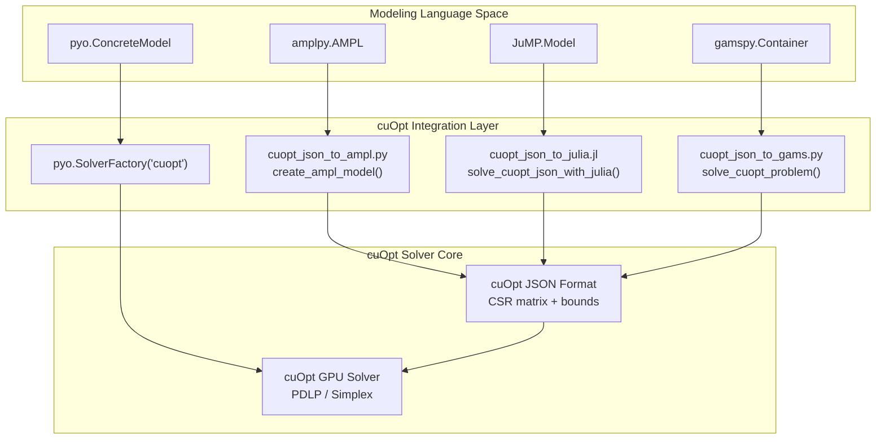
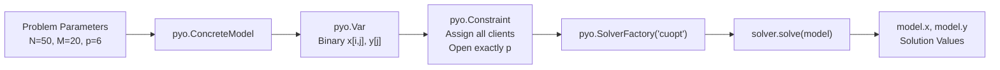

<!-- source: DeepWiki mcp.deepwiki.com · repo NVIDIA/cuopt-examples · page 8.4 AMPL, Julia, GAMS, and Pyomo Integrations · fetched 2026-10-26 -->

# AMPL, Julia, GAMS, and Pyomo Integrations

<details>
<summary>Relevant source files</summary>

The following files were used as context for generating this wiki page:

- [Pyomo_integration_example/README.md](Pyomo_integration_example/README.md)
- [Pyomo_integration_example/p_median_problem.ipynb](Pyomo_integration_example/p_median_problem.ipynb)
- [benchmark_apis/analyze_benchmark_results.py](benchmark_apis/analyze_benchmark_results.py)
- [benchmark_apis/benchmark_cuopt.py](benchmark_apis/benchmark_cuopt.py)
- [benchmark_apis/c_api_driver/Makefile](benchmark_apis/c_api_driver/Makefile)
- [benchmark_apis/c_api_driver/cuopt_json_to_c_api.c](benchmark_apis/c_api_driver/cuopt_json_to_c_api.c)
- [benchmark_apis/cuopt_json_to_ampl.py](benchmark_apis/cuopt_json_to_ampl.py)
- [benchmark_apis/cuopt_json_to_cvxpy.py](benchmark_apis/cuopt_json_to_cvxpy.py)
- [benchmark_apis/cuopt_json_to_gams.py](benchmark_apis/cuopt_json_to_gams.py)
- [benchmark_apis/cuopt_json_to_julia.jl](benchmark_apis/cuopt_json_to_julia.jl)
- [benchmark_apis/cuopt_json_to_pulp.py](benchmark_apis/cuopt_json_to_pulp.py)
- [benchmark_apis/cuopt_json_to_python_api.py](benchmark_apis/cuopt_json_to_python_api.py)
- [benchmark_apis/transform.py](benchmark_apis/transform.py)
- [portfolio_optimization/QP_portfolio_optimization.ipynb](portfolio_optimization/QP_portfolio_optimization.ipynb)

</details>


## Purpose and Scope

This page documents the integration of cuOpt with several major optimization modeling frameworks: **AMPL**, **Julia/JuMP**, **GAMS**, and **Pyomo**. These integrations allow users to define linear (LP) and mixed-integer programming (MIP) problems using high-level declarative syntax while leveraging the GPU-accelerated performance of the cuOpt solver.

For the GAMSPy Python integration, see [GAMSPy Integration](#8.1). For PuLP and CVXPY, see [PuLP Integration](#8.2) and [CVXPY Integration](#8.3).

---

## Integration Architecture Overview

The following diagram illustrates how different modeling languages interface with the cuOpt solver, typically using a standardized JSON format as an intermediate representation.

**System Entity to Code Entity Mapping**

**Sources:** [benchmark_apis/cuopt_json_to_ampl.py:93-108](), [benchmark_apis/cuopt_json_to_julia.jl:72-87](), [benchmark_apis/cuopt_json_to_gams.py:58-75](), [Pyomo_integration_example/p_median_problem.ipynb:265-275]()

---

## Pyomo Integration

### Overview
Pyomo is a Python-based open-source software package that supports a diverse set of optimization capabilities. cuOpt integrates as a backend solver via the `SolverFactory`.

### Implementation: The P-Median Problem
The integration is demonstrated using the classic p-median problem, which involves choosing $p$ facility locations to minimize weighted distance to demand zones [Pyomo_integration_example/p_median_problem.ipynb:117-132]().

**Data Flow in Pyomo Integration**

**Sources:** [Pyomo_integration_example/p_median_problem.ipynb:140-168](), [Pyomo_integration_example/p_median_problem.ipynb:213-260](), [Pyomo_integration_example/p_median_problem.ipynb:265-275]()

### Key Solver Invocation
The cuOpt solver is invoked directly through the Pyomo solver interface:
```python
# From Pyomo_integration_example/p_median_problem.ipynb:268-270
solver = pyo.SolverFactory("cuopt")
results = solver.solve(model, tee=True)
```

---

## AMPL Integration

### AMPL Model Generation
The AMPL integration reads cuOpt JSON files and dynamically generates an AMPL model string. It handles variable name sanitization to ensure compatibility with AMPL's syntax requirements [benchmark_apis/cuopt_json_to_ampl.py:72-91]().

**Key Functions:**
* `sanitize_ampl_name(name)`: Strips leading dots and ensures names start with letters/underscores [benchmark_apis/cuopt_json_to_ampl.py:72-91]().
* `create_ampl_model(problem_data)`: Iterates through `variable_bounds` and `csr_matrix` to build the `var`, `minimize/maximize`, and `subject to` strings [benchmark_apis/cuopt_json_to_ampl.py:93-283]().

### Constraint Logic
Constraints are generated by analyzing lower and upper bounds to determine equality (`==`), upper bound (`<=`), or lower bound (`>=`) types [benchmark_apis/cuopt_json_to_ampl.py:226-275]().

---

## Julia/JuMP Integration

### Overview
The Julia integration utilizes `JuMP.jl` with the `cuOpt.Optimizer` backend.

### Indexing and Model Construction
A critical step in the Julia integration is the conversion from 0-based indexing (JSON/Python) to 1-based indexing (Julia) [benchmark_apis/cuopt_json_to_julia.jl:251-256]().

**JuMP Model Flow:**
1. **Initialize**: `model = Model(cuOpt.Optimizer)` [benchmark_apis/cuopt_json_to_julia.jl:140-144]().
2. **Variables**: Created using the `@variable` macro with bounds extracted from JSON [benchmark_apis/cuopt_json_to_julia.jl:189-219]().
3. **Constraints**: Linear expressions are built from the CSR matrix rows and added via `@constraint` [benchmark_apis/cuopt_json_to_julia.jl:279-323]().

---

## GAMS Integration

### Batch Constraint Creation
The GAMS integration via `gamspy` uses an optimized batch approach. Instead of defining constraints one-by-one, it uses GAMS conditional equations (`.where[]`) to apply constraints to sets [benchmark_apis/cuopt_json_to_gams.py:242-262]().

### Implementation Detail: CSR to Dense
GAMS parameters often require dense representations or explicit record lists. The integration converts the `csr_constraint_matrix` to a dense array and filters non-zeros for the `gp.Parameter` records [benchmark_apis/cuopt_json_to_gams.py:183-196]().

```python
# From benchmark_apis/cuopt_json_to_gams.py:183-196
A_dense = A.toarray()
matrix_data = []
for i in range(num_constraints):
    for j in range(num_variables):
        if abs(A_dense[i, j]) > 1e-10:
            matrix_data.append((f"c{i}", f"x{j}", A_dense[i, j]))
```

---

## Comparison of Integration Methods

| Feature | Pyomo | AMPL | Julia/JuMP | GAMS |
| :--- | :--- | :--- | :--- | :--- |
| **Solver Factory** | `SolverFactory('cuopt')` | `ampl.solve()` | `Model(cuOpt.Optimizer)` | `model.solve('cuopt')` |
| **Data Format** | Native Objects | String Generation | Macro-based DSL | Set/Parameter Containers |
| **Indexing** | 0-based (Python) | 0-based (Python) | 1-based (Julia) | Set-based |
| **Primary File** | `p_median_problem.ipynb` | `cuopt_json_to_ampl.py` | `cuopt_json_to_julia.jl` | `cuopt_json_to_gams.py` |

**Sources:** [Pyomo_integration_example/p_median_problem.ipynb:268]() , [benchmark_apis/cuopt_json_to_ampl.py:417](), [benchmark_apis/cuopt_json_to_julia.jl:140](), [benchmark_apis/cuopt_json_to_gams.py:336]()

---

