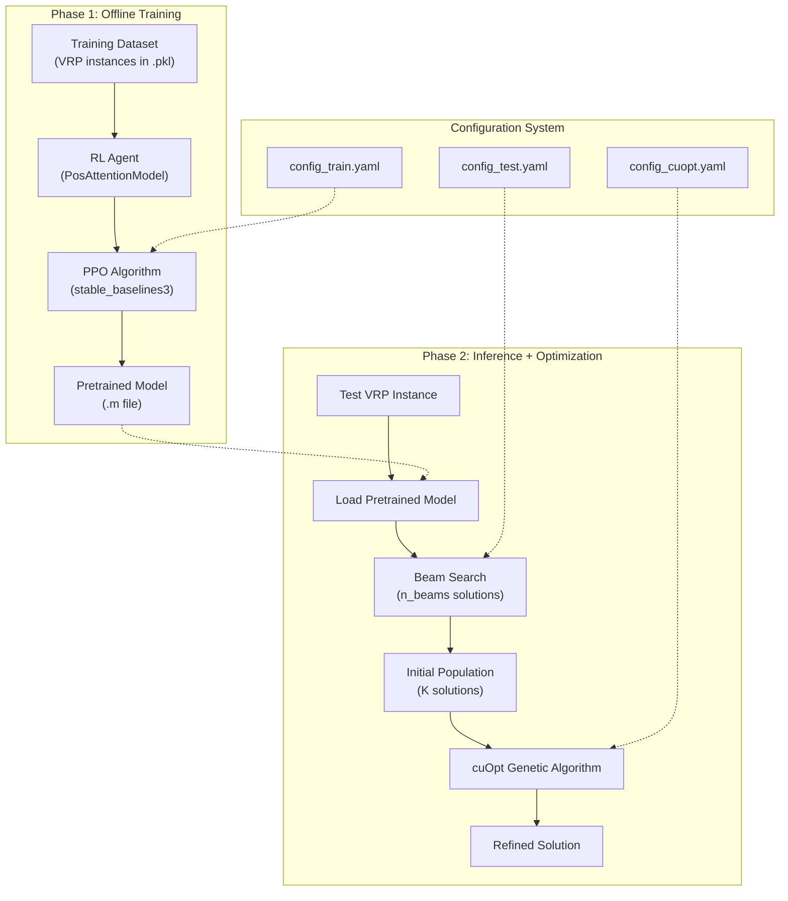
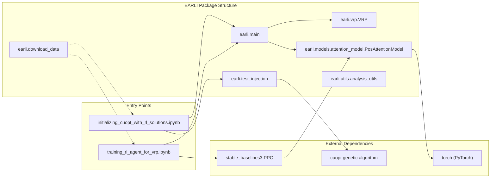
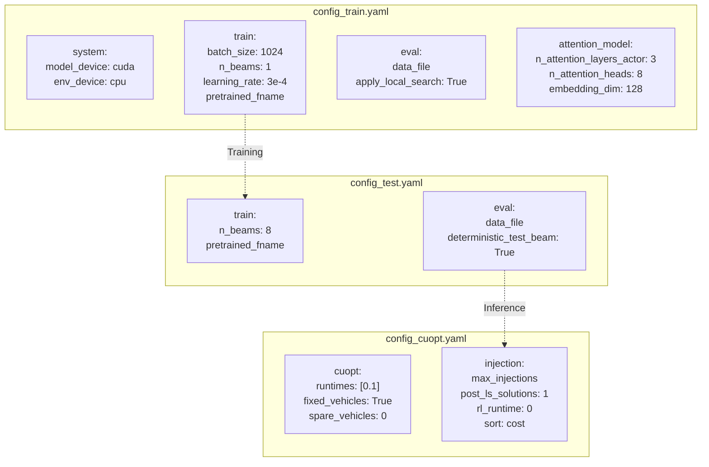
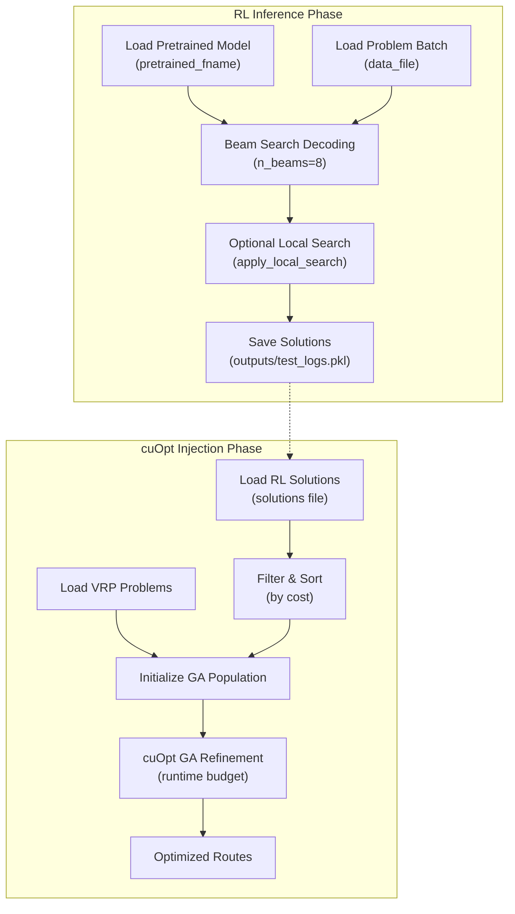

<!-- source: DeepWiki mcp.deepwiki.com · repo NVIDIA/cuopt-examples · page 9 AI-Accelerated Routing (EARLI) · fetched 2026-10-26 -->

# AI-Accelerated Routing (EARLI)

Relevant source files

The following files were used as context for generating this wiki page:

- [AI-accelerated-routing/README.md](AI-accelerated-routing/README.md)
- [AI-accelerated-routing/configs/config.yaml](AI-accelerated-routing/configs/config.yaml)
- [AI-accelerated-routing/configs/config_cuopt.yaml](AI-accelerated-routing/configs/config_cuopt.yaml)
- [AI-accelerated-routing/configs/config_initialization.yaml](AI-accelerated-routing/configs/config_initialization.yaml)
- [AI-accelerated-routing/configs/config_test.yaml](AI-accelerated-routing/configs/config_test.yaml)
- [AI-accelerated-routing/configs/config_train.yaml](AI-accelerated-routing/configs/config_train.yaml)
- [AI-accelerated-routing/constraints.txt](AI-accelerated-routing/constraints.txt)
- [AI-accelerated-routing/initializing_cuopt_with_rl_solutions.ipynb](AI-accelerated-routing/initializing_cuopt_with_rl_solutions.ipynb)
- [AI-accelerated-routing/outputs/.gitkeep](AI-accelerated-routing/outputs/.gitkeep)
- [AI-accelerated-routing/photos/diagram.png](AI-accelerated-routing/photos/diagram.png)
- [AI-accelerated-routing/photos/sample_sp2rio_100_cuOpt_1s_85.png](AI-accelerated-routing/photos/sample_sp2rio_100_cuOpt_1s_85.png)
- [AI-accelerated-routing/training_rl_agent_for_vrp.ipynb](AI-accelerated-routing/training_rl_agent_for_vrp.ipynb)
- [diet_optimization/diet_optimization_lp.ipynb](diet_optimization/diet_optimization_lp.ipynb)
- [diet_optimization/diet_optimization_milp.ipynb](diet_optimization/diet_optimization_milp.ipynb)
- [portfolio_optimization/cvar_portfolio_optimization.ipynb](portfolio_optimization/cvar_portfolio_optimization.ipynb)

## Purpose and Scope

This document describes the EARLI (Evolutionary Algorithm with RL Initialization) framework for solving Vehicle Routing Problems (VRP) through a hybrid approach combining Reinforcement Learning (RL) with cuOpt's Genetic Algorithm (GA). EARLI accelerates time-to-solution by using a trained RL agent to generate high-quality initial solutions, which then serve as the starting population for cuOpt's GA refinement.

For detailed information on RL agent training methodology, see [RL Agent Training for VRP](#9.1). For solution injection mechanics and performance benchmarking, see [Solution Injection and Hybrid Optimization](#9.2). For core VRP problem formulation without EARLI, see [Vehicle Routing Problems](#4).

**Sources:** [AI-accelerated-routing/README.md:1-26]()

## Framework Architecture

EARLI operates in two phases: offline training and online inference with optimization. The framework integrates with cuOpt's routing solver to provide GPU-accelerated hybrid optimization.

### High-Level Workflow

**EARLI Two-Phase Architecture**: The framework trains an attention-based RL agent offline on VRP datasets, then uses the trained model to generate multiple solutions via beam search that initialize cuOpt's GA for final refinement.

**Sources:** [AI-accelerated-routing/README.md:4-26](), [AI-accelerated-routing/training_rl_agent_for_vrp.ipynb:1-9]() (Markdown cells), [AI-accelerated-routing/initializing_cuopt_with_rl_solutions.ipynb:1-10]() (Markdown cells), [AI-accelerated-routing/photos/diagram.png:1-30]()

### Component Mapping to Code

**Code Entity Mapping**: Key modules in the EARLI framework showing how training and inference notebooks interact with the core package components and external dependencies.

**Sources:** [AI-accelerated-routing/training_rl_agent_for_vrp.ipynb:181-196](), [AI-accelerated-routing/initializing_cuopt_with_rl_solutions.ipynb:210-223]()

## Data Format and Requirements

EARLI requires VRP problem instances stored as pickle files containing specific data structures:

| Field | Type | Shape | Description |
|-------|------|-------|-------------|
| `positions` | `numpy.ndarray` | `(n_problems, problem_size, 2)` | 2D coordinates for each location |
| `distance_matrix` | `numpy.ndarray` | `(n_problems, problem_size, problem_size)` | Pairwise distances between locations |
| `demands` | `numpy.ndarray` | `(n_problems, problem_size)` | Demand at each location |
| `capacities` | `numpy.ndarray` | `(n_problems,)` | Vehicle capacity for each problem |

The `download_data.py` script fetches test datasets from the [olist-vrp-benchmark](https://github.com/NVlabs/olist-vrp-benchmark) repository containing real-world VRP instances from São Paulo and Rio de Janeiro with sizes ranging from 20 to 500 nodes.

**Sources:** [AI-accelerated-routing/README.md:40-54](), [AI-accelerated-routing/training_rl_agent_for_vrp.ipynb:204-208]()

## Configuration System

EARLI uses YAML configuration files to control training, inference, and cuOpt integration parameters. The configuration hierarchy separates concerns across three primary files:

### Configuration File Hierarchy

**Configuration Flow**: Training configuration establishes model architecture and learning parameters, test configuration controls inference beam search, and cuOpt configuration manages solution injection and GA runtime.

**Sources:** [AI-accelerated-routing/configs/config_train.yaml:1-147](), [AI-accelerated-routing/configs/config_test.yaml:1-146](), [AI-accelerated-routing/configs/config_cuopt.yaml:1-66]()

### Key Configuration Parameters

| Parameter | File | Purpose | Default |
|-----------|------|---------|---------|
| `train.n_beams` | config_train.yaml | Solutions per training step | 1 |
| `train.pretrained_fname` | config_train.yaml | Path to initial model | null |
| `train.n_parallel_problems` | config_train.yaml | Batch size for parallel inference | 256 |
| `attention_model.n_attention_layers_actor` | config_train.yaml | Depth of policy network | 3 |
| `attention_model.embedding_dim` | config_train.yaml | Feature embedding size | 128 |
| `eval.data_file` | config_test.yaml | Problem instance file | (dataset path) |
| `eval.deterministic_test_beam` | config_test.yaml | Use deterministic beam search | True |
| `cuopt.runtimes` | config_cuopt.yaml | GA time budgets (seconds) | [0.1] |
| `injection.max_injections` | config_cuopt.yaml | Solutions to inject into GA | null (all) |
| `injection.rl_runtime` | config_cuopt.yaml | RL inference time to subtract | 0 |

**Sources:** [AI-accelerated-routing/configs/config_train.yaml:14-105](), [AI-accelerated-routing/configs/config_test.yaml:14-45](), [AI-accelerated-routing/configs/config_cuopt.yaml:41-62]()

## RL Agent Architecture

EARLI uses an attention-based policy network (`PosAttentionModel`) trained with Proximal Policy Optimization (PPO) from `stable_baselines3`. The agent learns to construct VRP solutions autoregressively.

### Attention Model Structure

The `PosAttentionModel` implements a multi-headed attention mechanism with separate encoder-decoder architecture:

- **Actor Network**: 3 attention layers with 8 heads, processes graph representation of VRP to output action probabilities. [AI-accelerated-routing/configs/config_train.yaml:97-100]()
- **Critic Network**: 3 attention layers with 8 heads, estimates state value for policy gradient updates. [AI-accelerated-routing/configs/config_train.yaml:98-100]()
- **Embedding Dimension**: 128-dimensional feature vectors. [AI-accelerated-routing/configs/config_train.yaml:78]()
- **Autoregressive Decoding**: Sequentially builds routes. [AI-accelerated-routing/configs/config_train.yaml:115]()

For comprehensive training methodology, hyperparameters, and curriculum learning strategies, see [RL Agent Training for VRP](#9.1).

**Sources:** [AI-accelerated-routing/configs/config_train.yaml:75-115](), [AI-accelerated-routing/training_rl_agent_for_vrp.ipynb:191-193]()

## Solution Injection into cuOpt

The inference phase generates multiple candidate solutions using beam search, then injects them as the initial population for cuOpt's genetic algorithm. This warm-start approach significantly reduces convergence time.

### Inference and Injection Workflow

**Inference to Injection Pipeline**: RL agent generates diverse solutions via beam search, which are then filtered, sorted by cost, and used to initialize cuOpt's population-based genetic algorithm.

**Sources:** [AI-accelerated-routing/README.md:8-13](), [AI-accelerated-routing/configs/config_cuopt.yaml:51-62]()

### Runtime Accounting

The `injection.rl_runtime` parameter allows subtracting RL inference time from the total GA budget for fair comparison with non-initialized solvers.

For detailed injection strategies, population management, and performance analysis, see [Solution Injection and Hybrid Optimization](#9.2).

**Sources:** [AI-accelerated-routing/configs/config_cuopt.yaml:59-61]()

## Pretrained Models

EARLI provides pretrained models for immediate use, including:
- `model_vrp_100_L2.m` and `model_vrp_500_L2.m` for synthetic data. [AI-accelerated-routing/configs/config_train.yaml:26-27]()
- `model_vrp_100_sp.m` and `model_vrp_500_sp.m` for São Paulo road network data. [AI-accelerated-routing/configs/config_train.yaml:28-29]()

Models trained on São Paulo data demonstrate generalization to Rio de Janeiro instances, as shown in the sample visualization. [AI-accelerated-routing/README.md:28-30]()

**Sources:** [AI-accelerated-routing/README.md:14-31](), [AI-accelerated-routing/configs/config_train.yaml:25-29]()

## References

EARLI is published in the paper: **Accelerating Vehicle Routing via AI-Initialized Genetic Algorithms** by Greenberg et al., 2025.

**Sources:** [AI-accelerated-routing/README.md:57-69]()

---

