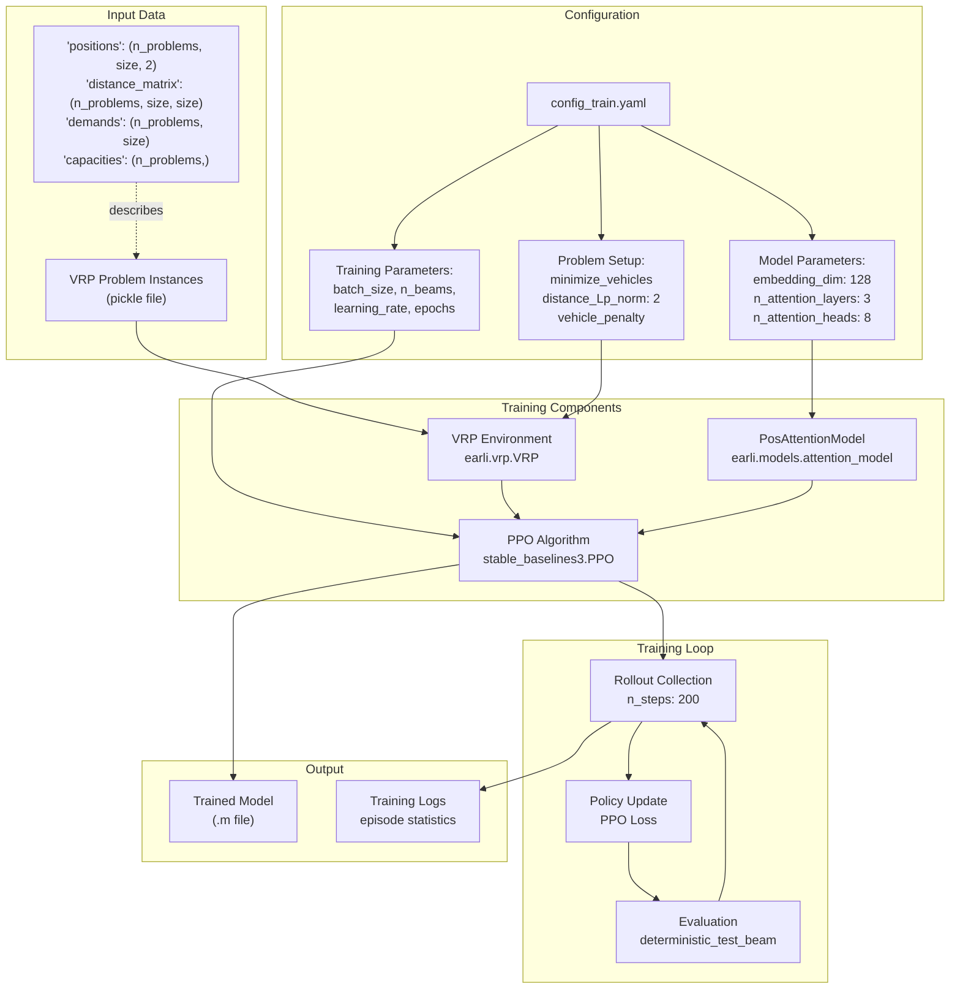
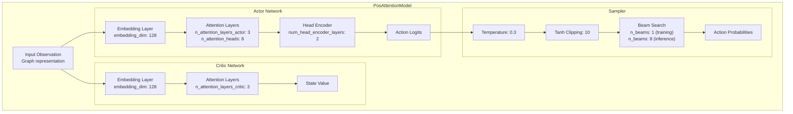
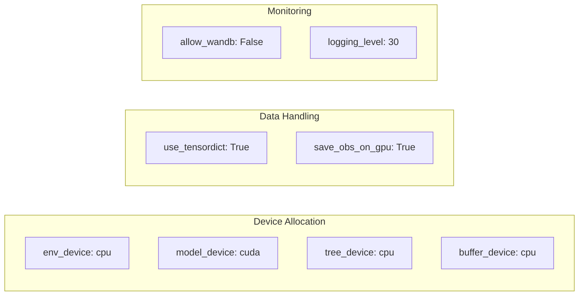
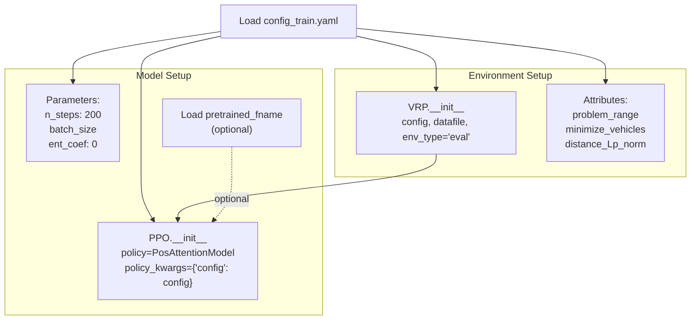
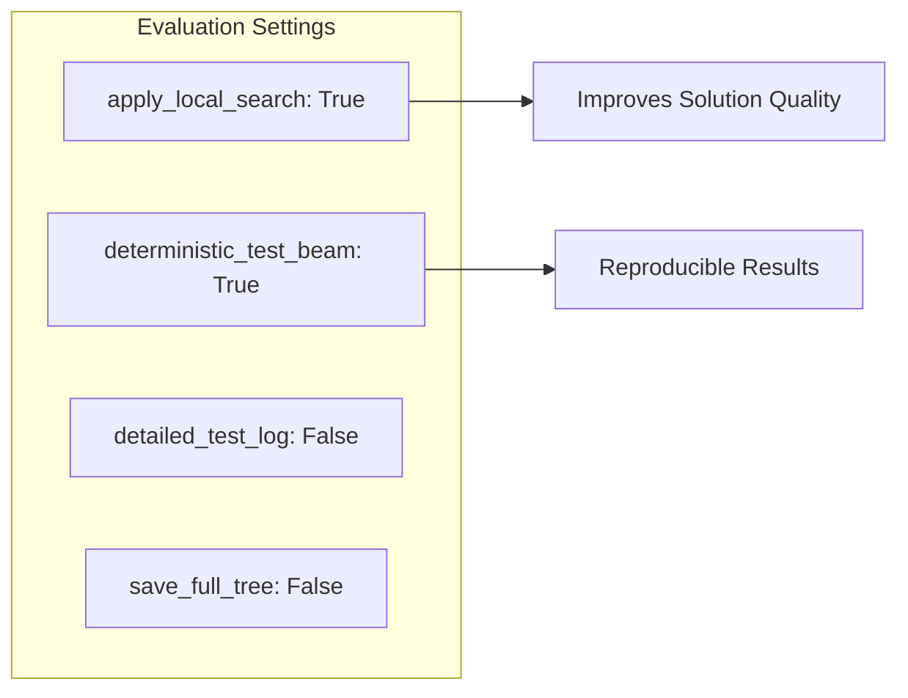
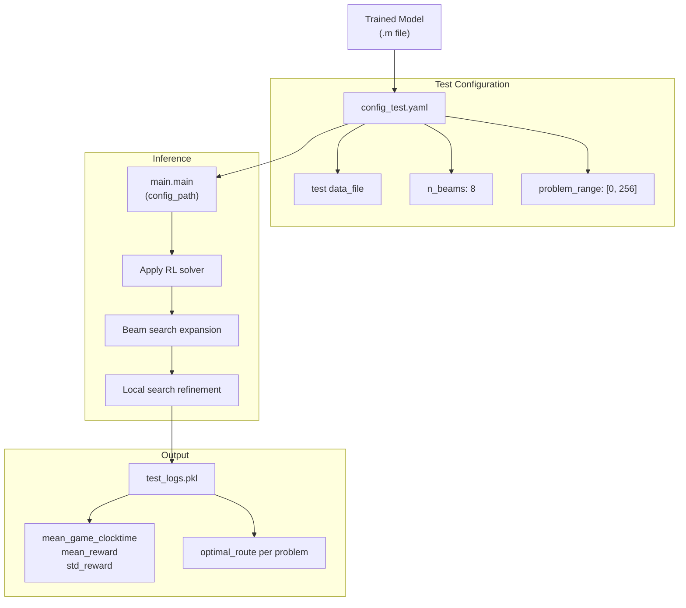

<!-- source: DeepWiki mcp.deepwiki.com · repo NVIDIA/cuopt-examples · page 9.1 RL Agent Training for VRP · fetched 2026-10-26 -->

# RL Agent Training for VRP

<details>
<summary>Relevant source files</summary>

The following files were used as context for generating this wiki page:

- [AI-accelerated-routing/README.md](AI-accelerated-routing/README.md)
- [AI-accelerated-routing/configs/config.yaml](AI-accelerated-routing/configs/config.yaml)
- [AI-accelerated-routing/configs/config_cuopt.yaml](AI-accelerated-routing/configs/config_cuopt.yaml)
- [AI-accelerated-routing/configs/config_initialization.yaml](AI-accelerated-routing/configs/config_initialization.yaml)
- [AI-accelerated-routing/configs/config_test.yaml](AI-accelerated-routing/configs/config_test.yaml)
- [AI-accelerated-routing/configs/config_train.yaml](AI-accelerated-routing/configs/config_train.yaml)
- [AI-accelerated-routing/constraints.txt](AI-accelerated-routing/constraints.txt)
- [AI-accelerated-routing/initializing_cuopt_with_rl_solutions.ipynb](AI-accelerated-routing/initializing_cuopt_with_rl_solutions.ipynb)
- [AI-accelerated-routing/outputs/.gitkeep](AI-accelerated-routing/outputs/.gitkeep)
- [AI-accelerated-routing/photos/diagram.png](AI-accelerated-routing/photos/diagram.png)
- [AI-accelerated-routing/photos/sample_sp2rio_100_cuOpt_1s_85.png](AI-accelerated-routing/photos/sample_sp2rio_100_cuOpt_1s_85.png)
- [AI-accelerated-routing/training_rl_agent_for_vrp.ipynb](AI-accelerated-routing/training_rl_agent_for_vrp.ipynb)
- [diet_optimization/diet_optimization_lp.ipynb](diet_optimization/diet_optimization_lp.ipynb)
- [diet_optimization/diet_optimization_milp.ipynb](diet_optimization/diet_optimization_milp.ipynb)
- [portfolio_optimization/cvar_portfolio_optimization.ipynb](portfolio_optimization/cvar_portfolio_optimization.ipynb)

</details>


## Purpose and Scope

This page documents the reinforcement learning (RL) agent training process for Vehicle Routing Problems (VRP) within the EARLI framework. The trained agents learn to quickly generate high-quality initial solutions that can be used to initialize cuOpt's genetic algorithm solver. For information about using these trained agents for inference and solution injection into cuOpt, see [Solution Injection and Hybrid Optimization](#9.2). For the broader EARLI framework context, see [AI-Accelerated Routing (EARLI)](#9).

The training process uses Proximal Policy Optimization (PPO) with attention-based policy networks to learn solution construction policies from datasets of VRP instances.

**Sources:** [AI-accelerated-routing/training_rl_agent_for_vrp.ipynb:1-10](), [AI-accelerated-routing/README.md:1-14]()

---

## Training Pipeline Overview



**Sources:** [AI-accelerated-routing/training_rl_agent_for_vrp.ipynb:176-197](), [AI-accelerated-routing/configs/config_train.yaml:1-147](), [AI-accelerated-routing/README.md:42-47]()

---

## Data Format Requirements

Training data must be provided in a pickle file containing a Python dictionary with the following structure:

| Field | Type | Shape | Description |
|-------|------|-------|-------------|
| `positions` | `numpy.ndarray` | `(n_problems, problem_size, 2)` | 2D coordinates of depot (index 0) and customer locations |
| `distance_matrix` | `numpy.ndarray` | `(n_problems, problem_size, problem_size)` | Pairwise distances or travel times between all locations |
| `demands` | `numpy.ndarray` | `(n_problems, problem_size)` | Demand at each location (depot has 0 demand) |
| `capacities` | `numpy.ndarray` | `(n_problems,)` | Vehicle capacity for each problem instance |

The data can be downloaded using the EARLI data download utility:

```python
from earli import download_data
download_data.main(['--cleanup', '--force'])
```

This downloads VRP instances from the Olist benchmark dataset into `datasets/problem_instances/`, including files like `vrp-train-size-20-sp-n_problems-1000.pkl` and `vrp-train-size-30-sp-n_problems-1000.pkl`.

**Sources:** [AI-accelerated-routing/README.md:40-55](), [AI-accelerated-routing/training_rl_agent_for_vrp.ipynb:210-312]()

---

## Model Architecture



The model uses a graph attention mechanism with the following key components:

### Attention Layers
- **Layer normalization**: Batch normalization (`layer_normalization: 'batch'`) ([AI-accelerated-routing/configs/config_train.yaml:96]())
- **Multi-head attention**: 8 attention heads ([AI-accelerated-routing/configs/config_train.yaml:100]())
- **Embedding dimension**: 128 ([AI-accelerated-routing/configs/config_train.yaml:78]())
- **Actor depth**: 3 layers ([AI-accelerated-routing/configs/config_train.yaml:97]())
- **Critic depth**: 3 layers ([AI-accelerated-routing/configs/config_train.yaml:98]())

### Policy Sampling
- **Score conversion**: Uses probabilities (`score_to_prob: probs`) ([AI-accelerated-routing/configs/config_train.yaml:108]())
- **Temperature**: 0.3 for controlled exploration ([AI-accelerated-routing/configs/config_train.yaml:109]())
- **Attention normalization**: Enabled ([AI-accelerated-routing/configs/config_train.yaml:111]())
- **Tanh clipping**: 10 to prevent extreme values ([AI-accelerated-routing/configs/config_train.yaml:112]())

### Input Representation
- **Graph connectivity**: k=8 nearest neighbors ([AI-accelerated-routing/configs/config_train.yaml:61]())
- **Self-loops**: Enabled ([AI-accelerated-routing/configs/config_train.yaml:62]())
- **Normalization**: Position observations normalized like rewards ([AI-accelerated-routing/configs/config_train.yaml:66]())
- **Distance to head**: Added to node features ([AI-accelerated-routing/configs/config_train.yaml:69]())

**Sources:** [AI-accelerated-routing/configs/config_train.yaml:69-112](), [AI-accelerated-routing/training_rl_agent_for_vrp.ipynb:191]()

---

## Training Configuration Parameters

### System Configuration



**Key training parameters from `config_train.yaml`:**

| Parameter | Value | Description |
|-----------|-------|-------------|
| `method` | `'tree_based'` | Training method using tree-based rollouts |
| `optimizer` | `'adam'` | Adam optimizer |
| `batch_size` | 1024 | Batch size for policy updates |
| `learning_rate` | 3e-4 | Learning rate for optimizer |
| `gamma` | 1 | Discount factor (no discounting for single-episode VRP) |
| `n_beams` | 1 | Number of beams during training (increased for inference) |
| `n_parallel_problems` | 256 | Number of problems processed in parallel |
| `deterministic_algo` | True | Ensures reproducibility |
| `seed` | 0 | Random seed |

### Problem Setup

| Parameter | Value | Description |
|-----------|-------|-------------|
| `minimize_vehicles` | True | Objective includes minimizing vehicle count |
| `last_return_to_depot` | True | Routes must end at depot |
| `distance_Lp_norm` | 2 | Euclidean distance (L2 norm) |
| `vehicle_penalty` | 0 | Penalty weight for extra vehicles |
| `spare_numeric_capacity` | 0.1 | Small capacity buffer for numerical stability |

### Pretrained Model Loading

The configuration supports loading pretrained models for fine-tuning or transfer learning:

```yaml
pretrained_fname: 'earli/pretrained_models/model_vrp_100_sp.m'
```

Available pretrained models:
- `model_vrp_100_L2.m` - 100-node synthetic problems ([AI-accelerated-routing/configs/config_train.yaml:26]())
- `model_vrp_500_L2.m` - 500-node synthetic problems ([AI-accelerated-routing/configs/config_train.yaml:27]())
- `model_vrp_100_sp.m` - 100-node São Paulo problems ([AI-accelerated-routing/configs/config_train.yaml:28]())
- `model_vrp_500_sp.m` - 500-node São Paulo problems ([AI-accelerated-routing/configs/config_train.yaml:29]())

**Sources:** [AI-accelerated-routing/configs/config_train.yaml:14-32](), [AI-accelerated-routing/configs/config_train.yaml:42-56]()

---

## Training Process

### Environment and Model Initialization



The training setup follows this sequence from the training notebook:

```python
# 1. Load configuration
with open('configs/config_train.yaml') as f:
    config = yaml.load(f, Loader=yaml.SafeLoader)
config = verify_consistent_config(config)

# 2. Initialize VRP environment
env = VRP(config, datafile=config['eval']['data_file'], env_type='eval')

# 3. Initialize PPO with attention model
model = PPO(
    policy=PosAttentionModel, 
    env=env, 
    policy_kwargs={'config': config},
    n_steps=200,
    batch_size=config['train']['batch_size'],
    ent_coef=0
)
```

**Sources:** [AI-accelerated-routing/training_rl_agent_for_vrp.ipynb:355-372]()

### Training Loop Execution

The training loop uses PPO's `learn()` method:

```python
model.learn(total_train_steps, log_interval=1)
```

This executes approximately 6 minutes for 1M steps on the example 20-node problem set, processing:
- 200 steps per rollout (`n_steps`)
- 1024 samples per batch (`batch_size`)
- Multiple epochs over the collected data

**Training metrics logged:**
- Episode reward statistics
- Policy loss
- Value function loss
- Entropy (with coefficient 0, so effectively unused)

**Sources:** [AI-accelerated-routing/training_rl_agent_for_vrp.ipynb:384-410]()

### Evaluation Configuration



During evaluation, the model generates solutions with:
- **Local search**: Applied post-generation to improve solution quality ([AI-accelerated-routing/configs/config_train.yaml:42]())
- **Deterministic beam search**: Ensures reproducibility ([AI-accelerated-routing/configs/config_train.yaml:43]())
- **Multiple beams**: `n_beams: 8` for inference vs `n_beams: 1` for training ([AI-accelerated-routing/configs/config_test.yaml:24]())

**Sources:** [AI-accelerated-routing/configs/config_train.yaml:35-46]()

---

## Model Persistence and Testing

### Saving Trained Models

After training, models are saved using PyTorch's state dictionary format:

```python
model_path = config['train']['save_model_path']
torch.save({'model_state_dict': model.policy.state_dict()}, model_path)
```

Default save location: `outputs/new_vrp_model.m` ([AI-accelerated-routing/configs/config_train.yaml:31]())

The saved file contains only the policy network parameters, not the full PPO training state.

**Sources:** [AI-accelerated-routing/training_rl_agent_for_vrp.ipynb:422-438]()

### Testing Pipeline



Testing is performed by calling:

```python
main.main(config_path='configs/config_test.yaml')
```

This generates:
- **Solutions file**: `outputs/test_logs.pkl` containing routes and statistics
- **Performance metrics**: 
  - `mean_game_clocktime`: Average inference time per problem
  - `mean_game_iters`: Average number of construction steps
  - `mean_reward`: Average solution cost (negative)
  - `std_reward`: Solution cost standard deviation

Example output for 20-node problems:
```
mean_game_clocktime: 0.00138
mean_game_iters: 21.8
mean_reward: -0.601
std_reward: 0.109
```

**Sources:** [AI-accelerated-routing/training_rl_agent_for_vrp.ipynb:449-490](), [AI-accelerated-routing/configs/config_test.yaml:1-146]()

---

## Solution Analysis

### Loading and Analyzing Results

Test results can be analyzed by loading the pickle file:

```python
with open('outputs/test_logs.pkl', 'rb') as f:
    results_log = pkl.load(f)

with open(results_log['problems_path'], 'rb') as f:
    problems = pkl.load(f)
```

The results log contains:
- `optimal_route`: Best route found for each problem
- `problems_path`: Path to original problem instances
- Performance statistics

### Cost Calculation

Solution costs are computed using the distance matrix:

```python
best_sols = results_log['optimal_route']
vehicles = [np.sum([node==0 for node in sol]).item()-1 for sol in best_sols]
costs = [utils.solution_cost(sol, dist_mat).item() 
         for sol, dist_mat in zip(best_sols, problems['distance_matrix'])]
```

Key metrics:
- **Number of vehicles**: Count of depot returns in route (minus 1)
- **Total cost**: Sum of distances along route using distance matrix

**Sources:** [AI-accelerated-routing/training_rl_agent_for_vrp.ipynb:510-674]()

---

## Performance Considerations

### GPU Acceleration
- Model runs on CUDA device (`model_device: cuda`) ([AI-accelerated-routing/configs/config_train.yaml:4]())
- Environment and tree search run on CPU for efficiency (`env_device: cpu`) ([AI-accelerated-routing/configs/config_train.yaml:3]())
- Observations can be saved on GPU (`save_obs_on_gpu: True`) ([AI-accelerated-routing/configs/config_train.yaml:7]())

### Parallel Processing
- `n_parallel_problems: 256` enables batch inference ([AI-accelerated-routing/configs/config_train.yaml:32]())
- Reduce this parameter if encountering out-of-memory errors
- Local search is parallelized across solutions

### Training Time
Example from 20-node problems (1M training steps):
- **Wall time**: ~6 minutes
- **CPU time**: ~10 minutes 40 seconds

The training time scales with:
- Problem size (20 nodes vs 100 nodes vs 500 nodes)
- Batch size and number of parallel problems
- Number of attention layers and embedding dimensions

**Sources:** [AI-accelerated-routing/training_rl_agent_for_vrp.ipynb:384-410](), [AI-accelerated-routing/configs/config_train.yaml:32]()

---

## Integration with cuOpt

The trained models produce solutions that can be injected into cuOpt's genetic algorithm solver. The training process optimizes for solution quality that serves as a strong starting population for further refinement. For details on using trained models with cuOpt, see [Solution Injection and Hybrid Optimization](#9.2).

**Sources:** [AI-accelerated-routing/README.md:1-14]()

---

