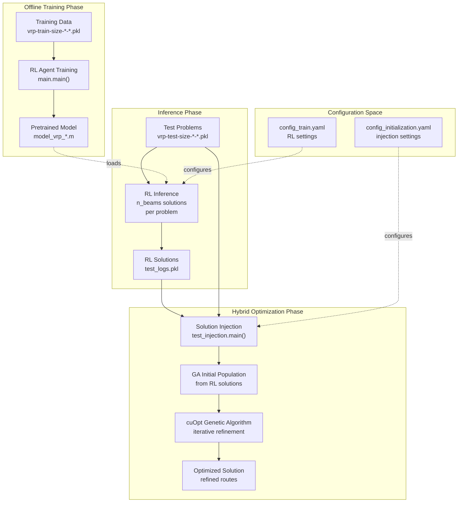
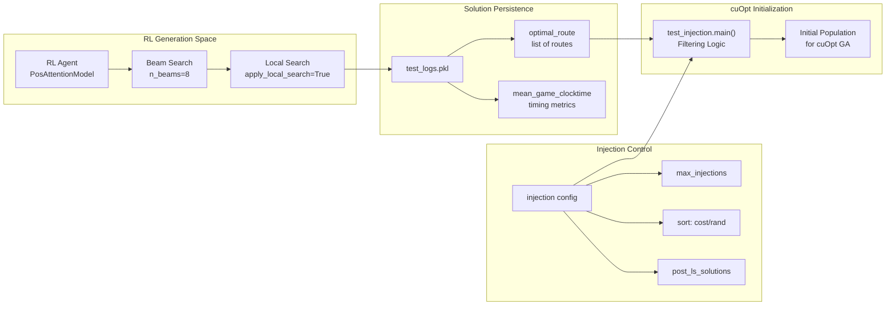
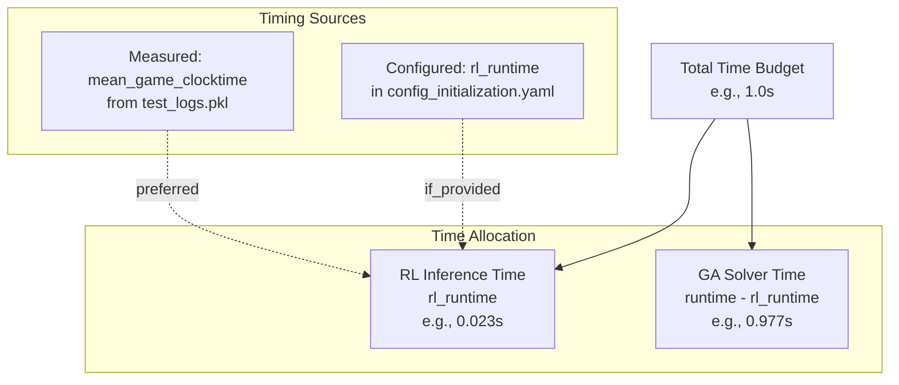

<!-- source: DeepWiki mcp.deepwiki.com · repo NVIDIA/cuopt-examples · page 9.2 Solution Injection and Hybrid Optimization · fetched 2026-10-26 -->

# Solution Injection and Hybrid Optimization

Relevant source files

The following files were used as context for generating this wiki page:

- [AI-accelerated-routing/README.md](AI-accelerated-routing/README.md)
- [AI-accelerated-routing/configs/config.yaml](AI-accelerated-routing/configs/config.yaml)
- [AI-accelerated-routing/configs/config_cuopt.yaml](AI-accelerated-routing/configs/config_cuopt.yaml)
- [AI-accelerated-routing/configs/config_initialization.yaml](AI-accelerated-routing/configs/config_initialization.yaml)
- [AI-accelerated-routing/configs/config_test.yaml](AI-accelerated-routing/configs/config_test.yaml)
- [AI-accelerated-routing/configs/config_train.yaml](AI-accelerated-routing/configs/config_train.yaml)
- [AI-accelerated-routing/constraints.txt](AI-accelerated-routing/constraints.txt)
- [AI-accelerated-routing/initializing_cuopt_with_rl_solutions.ipynb](AI-accelerated-routing/initializing_cuopt_with_rl_solutions.ipynb)
- [AI-accelerated-routing/outputs/.gitkeep](AI-accelerated-routing/outputs/.gitkeep)
- [AI-accelerated-routing/photos/diagram.png](AI-accelerated-routing/photos/diagram.png)
- [AI-accelerated-routing/photos/sample_sp2rio_100_cuOpt_1s_85.png](AI-accelerated-routing/photos/sample_sp2rio_100_cuOpt_1s_85.png)
- [AI-accelerated-routing/training_rl_agent_for_vrp.ipynb](AI-accelerated-routing/training_rl_agent_for_vrp.ipynb)
- [diet_optimization/diet_optimization_lp.ipynb](diet_optimization/diet_optimization_lp.ipynb)
- [diet_optimization/diet_optimization_milp.ipynb](diet_optimization/diet_optimization_milp.ipynb)
- [portfolio_optimization/cvar_portfolio_optimization.ipynb](portfolio_optimization/cvar_portfolio_optimization.ipynb)

## Purpose and Scope

This page documents the solution injection mechanism and hybrid optimization workflow in the EARLI (Evolutionary Algorithm with RL Initialization) framework. It explains how reinforcement learning-generated solutions are injected into cuOpt's genetic algorithm solver to accelerate convergence to high-quality Vehicle Routing Problem (VRP) solutions.

The EARLI framework combines learned policy inference with the iterative refinement capabilities of NVIDIA cuOpt's GPU-accelerated genetic algorithm [AI-accelerated-routing/README.md:1-15]().

---

## Hybrid Optimization Architecture

The EARLI framework combines two complementary optimization approaches:

1.  **RL Agent (Fast Initialization)**: Generates multiple high-quality candidate solutions quickly using learned attention-based policies [AI-accelerated-routing/README.md:4-7]().
2.  **Genetic Algorithm (Iterative Refinement)**: Uses RL solutions as the initial population to refine and improve solution quality over a specified time budget [AI-accelerated-routing/README.md:8-13]().

### System Architecture Diagram

This diagram maps the high-level workflow to specific configuration files and execution modules.

**Sources:** [AI-accelerated-routing/README.md:1-70](), [AI-accelerated-routing/configs/config_train.yaml:1-147](), [AI-accelerated-routing/configs/config_initialization.yaml:1-66]()

---

## Solution Injection Workflow

### Data Flow and Code Entities

The following diagram associates system components with specific code classes and configuration fields.

**Sources:** [AI-accelerated-routing/configs/config_initialization.yaml:50-61](), [AI-accelerated-routing/initializing_cuopt_with_rl_solutions.ipynb:422-449](), [AI-accelerated-routing/configs/config_train.yaml:95-105]()

### Injection Process

The solution injection mechanism operates as follows:

1.  **RL Solution Generation**: The RL agent (typically a `PosAttentionModel`) generates `n_beams` solutions per problem instance [AI-accelerated-routing/configs/config_train.yaml:24-91]().
2.  **Local Search (Optional)**: Solutions undergo local search improvement if `apply_local_search` is set to `True` [AI-accelerated-routing/configs/config_train.yaml:42]().
3.  **Solution Storage**: Results are stored in a pickle file (e.g., `test_logs.pkl`) containing the `optimal_route` and `mean_game_clocktime` [AI-accelerated-routing/configs/config_initialization.yaml:29-30]().
4.  **Solution Filtering**: The `test_injection` module filters and sorts these solutions based on cost or randomness [AI-accelerated-routing/configs/config_initialization.yaml:51-57]().
5.  **GA Initialization**: These filtered solutions are passed to cuOpt as the starting population for the genetic algorithm.

**Sources:** [AI-accelerated-routing/initializing_cuopt_with_rl_solutions.ipynb:447-449](), [AI-accelerated-routing/configs/config_train.yaml:36-46](), [AI-accelerated-routing/configs/config_initialization.yaml:50-61]()

---

## Configuration Parameters

### Injection Settings

The injection behavior is controlled via the `injection` section in `config_initialization.yaml`:

| Parameter | Type | Description |
| :--- | :--- | :--- |
| `max_injections` | `null` or `int` | Maximum number of solutions to inject per problem. `null` means no limit [AI-accelerated-routing/configs/config_initialization.yaml:51](). |
| `can_choose_injections` | `bool` | If `True`, sorts before filtering best `max_injections` [AI-accelerated-routing/configs/config_initialization.yaml:52](). |
| `post_ls_solutions` | `int` | Apply local search: `0`=never, `1`=RL only, `2`=both RL and naive [AI-accelerated-routing/configs/config_initialization.yaml:53](). |
| `both_rl_and_naive` | `int` | `0`=RL only, `1`=naive if RL suboptimal, `2`=add naive to RL [AI-accelerated-routing/configs/config_initialization.yaml:54](). |
| `avoid_suboptimal` | `bool` | Filter out suboptimal solutions before injection [AI-accelerated-routing/configs/config_initialization.yaml:55](). |
| `sort` | `str` | Sort criterion: `"cost"` or `"rand"` [AI-accelerated-routing/configs/config_initialization.yaml:56](). |
| `n_naives` | `int` | Number of naive greedy solutions to generate [AI-accelerated-routing/configs/config_initialization.yaml:57](). |
| `use_greedy` | `bool` | Whether to use greedy initialization alongside RL [AI-accelerated-routing/configs/config_initialization.yaml:58](). |

**Sources:** [AI-accelerated-routing/configs/config_initialization.yaml:50-61]()

### cuOpt Solver Settings

The `cuopt` section configures the genetic algorithm solver behavior:

| Parameter | Type | Description |
| :--- | :--- | :--- |
| `runtimes` | `list[float]` | Time budgets for solver (e.g., `[0.016, 0.03, 0.1, 0.3, 1]` for 100-node problems) [AI-accelerated-routing/configs/config_initialization.yaml:41](). |
| `fixed_vehicles` | `bool` | Whether vehicle count is fixed [AI-accelerated-routing/configs/config_initialization.yaml:43](). |
| `normalization` | `float` | Distance normalization factor (e.g., `1000` for real data) [AI-accelerated-routing/configs/config_initialization.yaml:46](). |
| `repetitions` | `int` | Number of solver repetitions per configuration [AI-accelerated-routing/configs/config_initialization.yaml:48](). |

**Sources:** [AI-accelerated-routing/configs/config_initialization.yaml:40-49]()

---

## Initialization Methods

### RL-Based Initialization

RL initialization uses the trained attention model to generate solutions. Key configuration parameters from `config_train.yaml` include:

*   `attention_model.n_attention_layers_actor`: Depth of the actor network (default: 3) [AI-accelerated-routing/configs/config_train.yaml:97]().
*   `sampler.n_beams`: Number of parallel solutions per problem instance (default: 8 in test) [AI-accelerated-routing/configs/config_test.yaml:24]().
*   `eval.apply_local_search`: Enable post-processing local search (default: `True`) [AI-accelerated-routing/configs/config_train.yaml:42]().
*   `sampler.temperature`: Sampling temperature for diversity (default: 0.3) [AI-accelerated-routing/configs/config_train.yaml:109]().

**Sources:** [AI-accelerated-routing/configs/config_train.yaml:95-116](), [AI-accelerated-routing/configs/config_test.yaml:24]()

### Naive Greedy Initialization

Naive initialization provides a baseline using simple greedy heuristics:

*   Constructs routes by iteratively selecting nearest unvisited customers.
*   Configured via `injection.n_naives` and `injection.use_greedy` [AI-accelerated-routing/configs/config_initialization.yaml:57-58]().
*   Acts as a fallback or supplement to RL-generated solutions when `both_rl_and_naive` is non-zero [AI-accelerated-routing/configs/config_initialization.yaml:54]().

---

## Runtime Management and Benchmarking

### Time Budget Allocation

To ensure fair performance benchmarking, the EARLI framework deducts the RL inference time from the total GA solver budget.

**Sources:** [AI-accelerated-routing/configs/config_initialization.yaml:59-61](), [AI-accelerated-routing/initializing_cuopt_with_rl_solutions.ipynb:432-443]()

### Benchmarking Strategy

The `rl_runtime` parameter in `config_initialization.yaml` is used to maintain a constant total budget across methods:

1.  **Baseline (cuOpt)**: The solver uses the full `runtime` budget [AI-accelerated-routing/configs/config_initialization.yaml:20]().
2.  **Hybrid (cuOpt_RL)**: The solver uses `runtime - rl_runtime`. This ensures that the total time (RL inference + GA search) matches the baseline [AI-accelerated-routing/configs/config_initialization.yaml:21, 59]().

**Sources:** [AI-accelerated-routing/configs/config_initialization.yaml:17-22](), [AI-accelerated-routing/configs/config_initialization.yaml:59-61]()

---

## Solution Data Format

### RL Output Structure

The solution file (e.g., `test_logs.pkl`) contains a dictionary with the following key fields used during injection:

| Field | Description |
| :--- | :--- |
| `optimal_route` | List of solution routes (node indices) per problem instance [AI-accelerated-routing/initializing_cuopt_with_rl_solutions.ipynb:432-443](). |
| `mean_game_clocktime` | Average RL inference time per problem (seconds) [AI-accelerated-routing/initializing_cuopt_with_rl_solutions.ipynb:432-443](). |
| `mean_reward` | Average solution quality metric (negative distance/cost) [AI-accelerated-routing/initializing_cuopt_with_rl_solutions.ipynb:432-443](). |

**Sources:** [AI-accelerated-routing/initializing_cuopt_with_rl_solutions.ipynb:432-443]()

### Route Encoding

Routes are encoded as sequences of node indices where `0` represents the depot.

*   **Example**: `[0, 5, 12, 3, 0, 8, 15, 1, 9, 0]`
*   **Interpretation**:
    *   Vehicle 1: Depot → 5 → 12 → 3 → Depot
    *   Vehicle 2: Depot → 8 → 15 → 1 → 9 → Depot

**Sources:** [AI-accelerated-routing/training_rl_agent_for_vrp.ipynb:669-673]()

---

