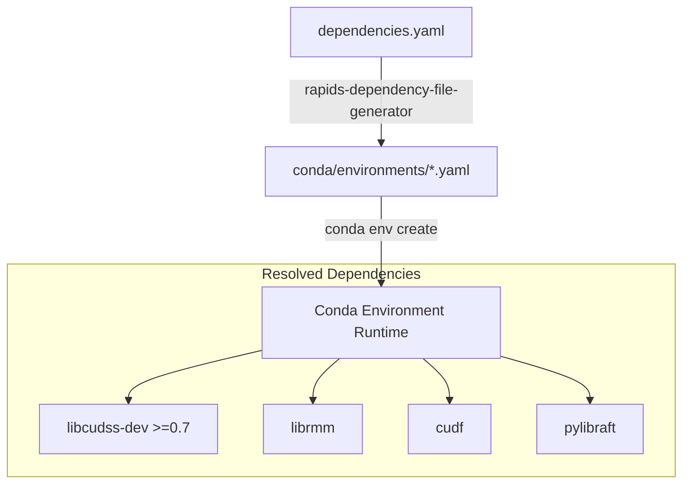

<!-- source: DeepWiki mcp.deepwiki.com · repo NVIDIA/cuopt · page 1.1 Installation and Getting Started · fetched 2026-10-26 -->

# Installation and Getting Started

<details>
<summary>Relevant source files</summary>

The following files were used as context for generating this wiki page:

- [.github/workflows/build.yaml](.github/workflows/build.yaml)
- [.github/workflows/build_test_publish_images.yaml](.github/workflows/build_test_publish_images.yaml)
- [.github/workflows/cloud_ci.yaml](.github/workflows/cloud_ci.yaml)
- [.github/workflows/multi_gpu_cpp_test.yaml](.github/workflows/multi_gpu_cpp_test.yaml)
- [.github/workflows/nightly-summary.yaml](.github/workflows/nightly-summary.yaml)
- [.github/workflows/pr.yaml](.github/workflows/pr.yaml)
- [.github/workflows/test.yaml](.github/workflows/test.yaml)
- [.github/workflows/trigger-breaking-change-alert.yaml](.github/workflows/trigger-breaking-change-alert.yaml)
- [RAPIDS_BRANCH](RAPIDS_BRANCH)
- [README.md](README.md)
- [docs/cuopt/source/cuopt-c/quick-start.rst](docs/cuopt/source/cuopt-c/quick-start.rst)
- [docs/cuopt/source/cuopt-cli/quick-start.rst](docs/cuopt/source/cuopt-cli/quick-start.rst)
- [docs/cuopt/source/cuopt-python/quick-start.rst](docs/cuopt/source/cuopt-python/quick-start.rst)
- [docs/cuopt/source/cuopt-server/quick-start.rst](docs/cuopt/source/cuopt-server/quick-start.rst)
- [docs/cuopt/source/faq.rst](docs/cuopt/source/faq.rst)
- [docs/cuopt/source/index.rst](docs/cuopt/source/index.rst)
- [docs/cuopt/source/system-requirements.rst](docs/cuopt/source/system-requirements.rst)
- [skills/cuopt-install/BENCHMARK.md](skills/cuopt-install/BENCHMARK.md)
- [skills/cuopt-install/SKILL.md](skills/cuopt-install/SKILL.md)
- [skills/cuopt-install/evals/evals.json](skills/cuopt-install/evals/evals.json)
- [skills/cuopt-install/skill-card.md](skills/cuopt-install/skill-card.md)
- [skills/cuopt-install/skill.oms.sig](skills/cuopt-install/skill.oms.sig)

</details>


## Purpose and Scope

This page provides comprehensive installation instructions for NVIDIA cuOpt across all supported distribution mechanisms: pip, conda, Docker containers, and building from source. It details system requirements, verification procedures, and initial setup workflows for both development and production environments. For detailed API usage, refer to the Python API documentation ([4.2]()), Server API documentation ([4.3]()), and C API documentation ([4.1]()). For build system architecture and CI/CD pipelines, see [5]().

Sources: [README.md:1-22](), [skills/cuopt-install/SKILL.md:1-21]()

---

## System Requirements

### Minimum Hardware and Software Specifications

| Component | Requirement |
|-----------|-------------|
| **GPU Architecture** | Volta or newer (Compute Capability ≥ 7.0; e.g., V100, A100, H100, RTX series). Pascal (GTX 10xx) is not supported. |
| **CUDA Toolkit** | CUDA 12.0+ or CUDA 13.0+ |
| **NVIDIA Driver** | ≥ 525.60.13 (Linux), ≥ 527.41 (Windows) |
| **Python Version** | Python ≥ 3.11, ≤ 3.14 |
| **System Architecture** | x86_64 (64-bit) or aarch64 (64-bit) |
| **Operating System** | Linux (native) or Windows via WSL2 |

**Note:** WSL2 is supported for running cuOpt workloads, but source code compilation should be performed on a native Linux environment.

Sources: [README.md:62-79](), [skills/cuopt-install/SKILL.md:22-28]()

---

## Installation Methods Overview

The following diagram maps high-level user installation channels to internal code packages and deployment targets within the codebase.

```mermaid
graph TB
    subgraph "Natural Language Space"
        PipChannel[""PyPI Wheel Installation""]
        CondaChannel[""Conda Package Manager""]
        DockerChannel[""Docker / NGC Containers""]
        SourceBuild[""Source Compilation""]
    end

    subgraph "Code Entity Space"
        LibCuOpt[""python/libcuopt""]
        CuOptPy[""python/cuopt""]
        CuServer[""python/cuopt_server""]
        CuClient[""python/cuopt_self_hosted""]
        CliTool[""cuopt_cli (C++)""]
    end

    PipChannel --> LibCuOpt
    PipChannel --> CuOptPy
    PipChannel --> CuServer
    PipChannel --> CuClient

    CondaChannel --> LibCuOpt
    CondaChannel --> CuOptPy
    CondaChannel --> CuServer
    CondaChannel --> CuClient

    DockerChannel --> LibCuOpt
    DockerChannel --> CuOptPy
    DockerChannel --> CuServer
    DockerChannel --> CuClient
    DockerChannel --> CliTool

    SourceBuild --> LibCuOpt
    SourceBuild --> CuOptPy
    SourceBuild --> CuServer
    SourceBuild --> CuClient
    SourceBuild --> CliTool
```

Sources: [README.md:82-149](), [.github/workflows/build.yaml:50-108]()

---

## Installation via pip

The Python and C components are distributed as precompiled wheels via the NVIDIA Python Package Index. The package CUDA suffix must match the runtime CUDA version installed on the host.

### Installation Steps for CUDA 12.x

```bash
pip install \
  --extra-index-url=https://pypi.nvidia.com \
  nvidia-cuda-runtime-cu12==12.9.* \
  cuopt-server-cu12==26.10.* cuopt-sh-client==26.10.*
```

Sources: [README.md:90-97](), [skills/cuopt-install/SKILL.md:48-51]()

### Installation Steps for CUDA 13.x

```bash
pip install \
  --extra-index-url=https://pypi.nvidia.com \
  cuopt-server-cu13==26.10.* cuopt-sh-client==26.10.*
```

Sources: [README.md:107-113](), [skills/cuopt-install/SKILL.md:44-47]()

### Package Dependency Mapping

Pip wheels resolve dependencies through package manifest files:

| Package Name | Key Dependencies | Configuration Path |
|--------------|------------------|-------------------|
| `libcuopt` | `librmm`, `rapids-logger`, `cuopt-mps-parser`, `nvidia-cudss` | [python/libcuopt/pyproject.toml:32-44]() |
| `cuopt` | `libcuopt`, `cudf`, `cupy-cuda13x`, `pylibraft`, `rmm`, `numba` | [python/cuopt/pyproject.toml:21-36]() |
| `cuopt_server` | `cuopt`, `fastapi`, `uvicorn`, `msgpack-numpy`, `psutil` | [python/cuopt_server/pyproject.toml:23-34]() |
| `cuopt_sh_client` | `cuopt-mps-parser`, `msgpack-numpy`, `requests` | [python/cuopt_self_hosted/pyproject.toml:22-27]() |

Sources: [python/libcuopt/pyproject.toml:32-44](), [python/cuopt/pyproject.toml:21-36](), [python/cuopt_server/pyproject.toml:23-34](), [python/cuopt_self_hosted/pyproject.toml:22-27]()

---

## Installation via conda

Conda packages are published via the `rapidsai` channel and automatically provision all shared library dependencies.

### Installation Command

```bash
conda install -c rapidsai -c conda-forge -c nvidia cuopt-server=26.10.* cuopt-sh-client=26.10.*
```

Sources: [README.md:130-132](), [skills/cuopt-install/SKILL.md:104-106]()

### Environment Generation Pipeline



Sources: [.github/workflows/build_test_publish_images.yaml:44-80](), [conda/environments/all_cuda-129_arch-x86_64.yaml:21-62]()

---

## Installation via Docker

Pre-built Ubuntu and Red Hat UBI container images are hosted on Docker Hub and the NVIDIA NGC registry.

### Pulling Container Images

```bash
# For CUDA 12.x
docker pull nvidia/cuopt:latest-cu12

# For CUDA 13.x
docker pull nvidia/cuopt:latest-cu13
```

Sources: [README.md:143-149](), [docs/cuopt/source/cuopt-server/quick-start.rst:45-50]()

### Running the Server Container

```bash
docker run --gpus all -it --rm -p 5000:5000 nvidia/cuopt:latest-cu12
```

Sources: [docs/cuopt/source/cuopt-server/quick-start.rst:47-50]()

---

## Building from Source

Source compilation is handled via `build.sh` and CMake for developers modifying the C++ core or Python extensions.

### Environment Setup

```bash
git clone https://github.com/NVIDIA/cuopt.git
cd cuopt
conda env create --name cuopt_dev --file conda/environments/all_cuda-129_arch-x86_64.yaml
conda activate cuopt_dev
```

Sources: [.github/workflows/build.yaml:50-66](), [.github/workflows/build_test_publish_images.yaml:44-62]()

---

## Verification and Smoke Tests

The validation workflow ensures that the runtime environment, GPU bindings, and serving interfaces are correctly wired.

```mermaid
graph TB
    subgraph "Validation Entry Points"
        SmokeScript[""smoke_test_example.sh""]
        HealthEndpoint[""/cuopt/health (HTTP)""]
        RequestEndpoint[""/cuopt/request (HTTP)""]
    end

    subgraph "Internal Execution Flow"
        SmokeScript -->|imports| PyCuOpt[""cuopt.routing.DataModel""]
        HealthEndpoint -->|invokes| ServicePing[""cuopt_server.cuopt_service""]
        RequestEndpoint -->|dispatches| SolverEngine[""libcuopt Solver Kernels""]
    end
```

Sources: [docs/cuopt/source/cuopt-python/quick-start.rst:20-42](), [docs/cuopt/source/cuopt-server/quick-start.rst:80-148]()

### Python Routing Smoke Test

Execute the verification script to confirm package imports and routing execution:

```bash
bash docs/cuopt/source/cuopt-python/routing/examples/smoke_test_example.sh
```

Sources: [docs/cuopt/source/cuopt-python/quick-start.rst:25-31]()

### Server API Smoke Test

Start the server process and query the health endpoint:

```bash
python3 -m cuopt_server.cuopt_service --ip 0.0.0.0 --port 8000 &
curl -s http://localhost:8000/cuopt/health
```

Sources: [docs/cuopt/source/cuopt-server/quick-start.rst:80-97]()

---

