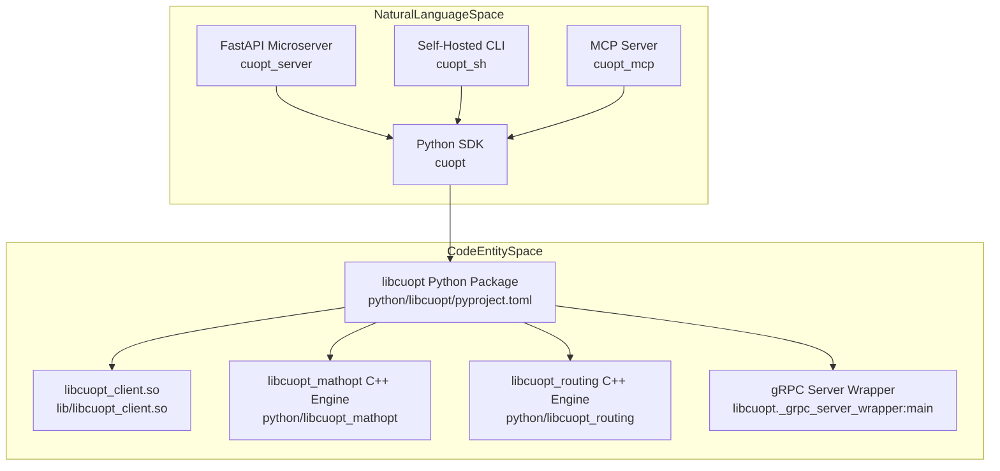
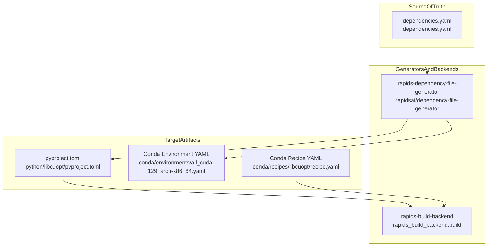

<!-- source: DeepWiki mcp.deepwiki.com · repo NVIDIA/cuopt · page 1.2 Package Architecture · fetched 2026-10-26 -->

# Package Architecture

Relevant source files

The following files were used as context for generating this wiki page:

- [ci/build_wheel_libcuopt_client.sh](ci/build_wheel_libcuopt_client.sh)
- [conda/environments/all_cuda-129_arch-aarch64.yaml](conda/environments/all_cuda-129_arch-aarch64.yaml)
- [conda/environments/all_cuda-129_arch-x86_64.yaml](conda/environments/all_cuda-129_arch-x86_64.yaml)
- [conda/environments/all_cuda-133_arch-aarch64.yaml](conda/environments/all_cuda-133_arch-aarch64.yaml)
- [conda/environments/all_cuda-133_arch-x86_64.yaml](conda/environments/all_cuda-133_arch-x86_64.yaml)
- [conda/recipes/cuopt-server/recipe.yaml](conda/recipes/cuopt-server/recipe.yaml)
- [conda/recipes/cuopt-sh-client/recipe.yaml](conda/recipes/cuopt-sh-client/recipe.yaml)
- [conda/recipes/cuopt/recipe.yaml](conda/recipes/cuopt/recipe.yaml)
- [conda/recipes/libcuopt/recipe.yaml](conda/recipes/libcuopt/recipe.yaml)
- [cpp/src/CMakeLists.txt](cpp/src/CMakeLists.txt)
- [dependencies.yaml](dependencies.yaml)
- [python/cuopt/cuopt/CMakeLists.txt](python/cuopt/cuopt/CMakeLists.txt)
- [python/cuopt/cuopt/distance_engine/CMakeLists.txt](python/cuopt/cuopt/distance_engine/CMakeLists.txt)
- [python/cuopt/cuopt/linear_programming/data_model/CMakeLists.txt](python/cuopt/cuopt/linear_programming/data_model/CMakeLists.txt)
- [python/cuopt/cuopt/linear_programming/internals/CMakeLists.txt](python/cuopt/cuopt/linear_programming/internals/CMakeLists.txt)
- [python/cuopt/cuopt/linear_programming/io/CMakeLists.txt](python/cuopt/cuopt/linear_programming/io/CMakeLists.txt)
- [python/cuopt/cuopt/linear_programming/solver/CMakeLists.txt](python/cuopt/cuopt/linear_programming/solver/CMakeLists.txt)
- [python/cuopt/cuopt/linear_programming/solver_settings/CMakeLists.txt](python/cuopt/cuopt/linear_programming/solver_settings/CMakeLists.txt)
- [python/cuopt/cuopt/routing/CMakeLists.txt](python/cuopt/cuopt/routing/CMakeLists.txt)
- [python/cuopt/pyproject.toml](python/cuopt/pyproject.toml)
- [python/cuopt_self_hosted/pyproject.toml](python/cuopt_self_hosted/pyproject.toml)
- [python/cuopt_server/pyproject.toml](python/cuopt_server/pyproject.toml)
- [python/libcuopt/pyproject.toml](python/libcuopt/pyproject.toml)
- [python/libcuopt_client/libcuopt_client/VERSION](python/libcuopt_client/libcuopt_client/VERSION)
- [python/libcuopt_client/pyproject.toml](python/libcuopt_client/pyproject.toml)
- [python/libcuopt_mathopt/libcuopt_mathopt/VERSION](python/libcuopt_mathopt/libcuopt_mathopt/VERSION)
- [python/libcuopt_routing/libcuopt_routing/VERSION](python/libcuopt_routing/libcuopt_routing/VERSION)

## Purpose and Scope

This document details the cuOpt package ecosystem, explaining the split `libcuopt` native components (`libcuopt-client`, `libcuopt-mathopt`, `libcuopt-routing`, and the gRPC server wrapper), the `cuopt` Python SDK, `cuopt_server`, `cuopt_sh_client`, `cuopt_mcp`, and their layering relationships. It focuses on the modular distribution structure, component boundaries, and dependency management. For internal solver mechanisms, see [System Architecture](#1.3); for compilation mechanics, see [Build System](#5.1).

---

## Package Ecosystem Overview

The cuOpt repository is engineered as a modular ecosystem of Python packages and native C++ shared libraries. The native core is split into granular components via `libcuopt-split` to isolate heavy CUDA dependencies (such as `cudss`, `nccl`, and `nvjitlink`) from lightweight client components [conda/recipes/libcuopt/recipe.yaml:102-105](), [dependencies.yaml:161-163]().

| Package Name | Component Type | Primary Role & Code References | Target Audience / Usage |
|--------------|----------------|--------------------------------|-------------------------|
| `libcuopt-client` | C++ Shared Library / Wheel | RPC communication, client stubs, and logging [`conda/recipes/libcuopt/recipe.yaml:106-121]() | Lightweight clients needing no direct GPU math libs [conda/recipes/libcuopt/recipe.yaml:114-115]() |
| `libcuopt-mathopt` | C++ Shared Library / Wheel | LP, MILP, QP, SOCP solvers, cuDSS, and sparse algebra [dependencies.yaml:161-163]() | Mathematical programming solvers |
| `libcuopt-routing` | C++ Shared Library / Wheel | Vehicle routing optimization engines [python/libcuopt_routing/libcuopt_routing/VERSION]() | VRP and logistics users |
| `lib` metapackage | Python Wheel / Conda | Bundles native components and header assets [python/libcuopt/pyproject.toml:32-37]() | C++ developers and dependency graph resolution [dependencies.yaml:71-78]() |
| `cuopt` | Python SDK | High-level routing, LP/MILP/QP APIs, and Cython bridges [python/cuopt/pyproject.toml:12-34]() | Python data scientists and operations researchers |
| `cuopt_server` | Python Microservice | FastAPI asynchronous optimization microservice [python/cuopt_server/pyproject.toml:13-33]() | HTTP API consumers and enterprise service deployments |
| `cuopt_sh_client` | Python CLI / Client | Command-line utility (`cuopt_sh`) for client-server workflows [python/cuopt_self_hosted/pyproject.toml:11-25]() | Terminal users and self-hosted orchestration clients |
| `cuopt_mcp` | Python MCP Server | Model Context Protocol server exposing cuOpt tools to LLM agents | AI agents and LLM-driven optimization pipelines |

**Diagram: Ecosystem Layering (Natural Language to Code Entity Space)**

**Sources:** [dependencies.yaml:40-163](), [conda/recipes/libcuopt/recipe.yaml:102-168](), [python/libcuopt/pyproject.toml:32-50](), [python/cuopt/pyproject.toml:21-34](), [python/cuopt_server/pyproject.toml:13-34](), [python/cuopt_self_hosted/pyproject.toml:11-25]()

---

## Split `libcuopt` Components

To prevent routing-only or client-only installations from unnecessarily linking massive GPU runtime libraries (such as cuDSS or NCCL), `libcuopt` is decoupled into distinct C++ shared libraries packaged independently [conda/recipes/libcuopt/recipe.yaml:102-105](), [dependencies.yaml:161-163]().

### `libcuopt-client`
`libcuopt-client` compiles the base communication, logging (`rapids-logger`), and gRPC client stubs into `libcuopt_client.so` [conda/recipes/libcuopt/recipe.yaml:106-121](). It is built as a leaf package requirement that operates without direct dependency on RMM or CUDA math runtimes, allowing remote execution clients to resolve cleanly [conda/recipes/libcuopt/recipe.yaml:114-115]().

### `libcuopt-mathopt`
`libcuopt-mathopt` provides the mathematical programming engines (LP, MILP, QP, SOCP). It links against NVIDIA cuDSS (`libcudss`), cuSPARSE (`libcusparse`), and NCCL for multi-GPU linear algebra operations [conda/recipes/libcuopt/recipe.yaml:87-91]().

### `libcuopt-routing`
`libcuopt-routing` contains the routing solver engines for Vehicle Routing Problems (VRP), time-window routing, and distance engine integrations.

### `cuopt-grpc-server` and Wrapper
Distributed as part of the `libcuopt` wheel, the `cuopt_grpc_server` executable entry point is mapped to `libcuopt._grpc_server_wrapper:main` [python/libcuopt/pyproject.toml:48-50](). It handles remote gRPC client requests via shared-memory job queues and worker process spawning.

**Sources:** [dependencies.yaml:43-63](), [conda/recipes/libcuopt/recipe.yaml:102-168](), [python/libcuopt/pyproject.toml:48-50]()

---

## Python SDK and Microservices

### `cuopt` Python SDK
The `cuopt` package provides high-level abstractions for linear programming, quadratic programming, mixed-integer programming, and vehicle routing [python/cuopt/pyproject.toml:12-34](). It integrates deeply with the RAPIDS ecosystem via `cudf`, `rmm`, `pylibraft`, and `cupy` [python/cuopt/pyproject.toml:21-34]().

### `cuopt_server`
`cuopt_server` implements a FastAPI-based microservice that exposes endpoints for asynchronous optimization tasks [python/cuopt_server/pyproject.toml:13-34](). It serializes payload data using `msgpack` and `msgpack-numpy` and manages background execution pools using `psutil` [python/cuopt_server/pyproject.toml:23-34]().

### `cuopt_sh_client`
`cuopt_sh_client` provides the `cuopt_sh` command-line utility [python/cuopt_self_hosted/pyproject.toml:51-52]() and a lightweight client library for interfacing with self-hosted cuOpt microservice endpoints without requiring local GPU acceleration [python/cuopt_self_hosted/pyproject.toml:10-26]().

### `cuopt_mcp`
`cuopt_mcp` is a Model Context Protocol server integration that exposes cuOpt optimization tools as discoverable primitives to LLM agents and assistant runtimes.

**Sources:** [python/cuopt/pyproject.toml:12-34](), [python/cuopt_server/pyproject.toml:13-34](), [python/cuopt_self_hosted/pyproject.toml:10-52]()

---

## Dependency Management and Build Layering

All package requirements are centrally managed through `dependencies.yaml`, which acts as the single source of truth [dependencies.yaml:4-6](). The `rapids-dependency-file-generator` parses `dependencies.yaml` to project dependencies across `pyproject.toml` manifests and Conda environment configuration files [dependencies.yaml:4-6](), [conda/environments/all_cuda-129_arch-x86_64.yaml:1-2]().

**Diagram: Build and Dependency Resolution Flow**

**Sources:** [dependencies.yaml:1-6](), [conda/recipes/libcuopt/recipe.yaml:1-168](), [python/libcuopt/pyproject.toml:4-9](), [conda/environments/all_cuda-129_arch-x86_64.yaml:1-80]()

---

