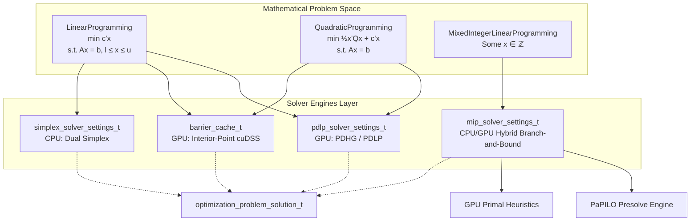
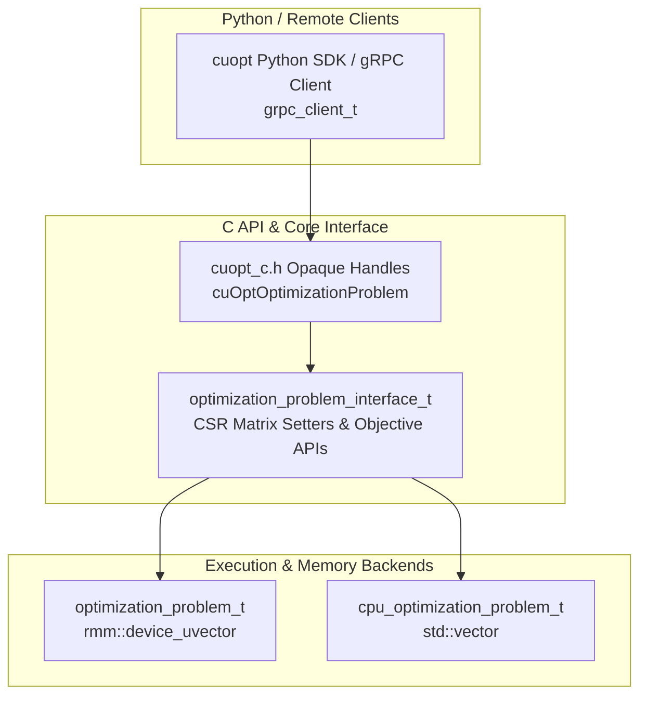
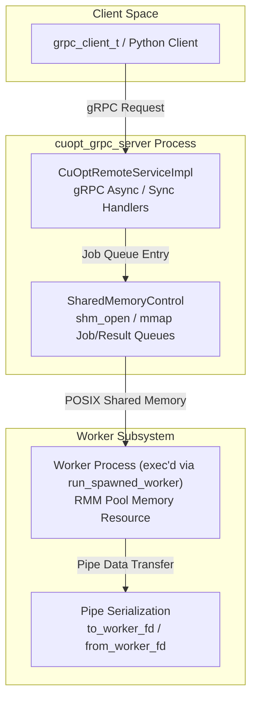

<!-- source: DeepWiki mcp.deepwiki.com · repo NVIDIA/cuopt · page 1.3 System Architecture · fetched 2026-10-26 -->

# System Architecture

Relevant source files

The following files were used as context for generating this wiki page:

- [CONTRIBUTING.md](CONTRIBUTING.md)
- [build.sh](build.sh)
- [cpp/CMakeLists.txt](cpp/CMakeLists.txt)
- [cpp/include/cuopt/mathematical_optimization/constants.h](cpp/include/cuopt/mathematical_optimization/constants.h)
- [cpp/include/cuopt/mathematical_optimization/mip/solver_settings.hpp](cpp/include/cuopt/mathematical_optimization/mip/solver_settings.hpp)
- [cpp/include/cuopt/mathematical_optimization/pdlp/solver_settings.hpp](cpp/include/cuopt/mathematical_optimization/pdlp/solver_settings.hpp)
- [cpp/src/dual_simplex/simplex_solver_settings.hpp](cpp/src/dual_simplex/simplex_solver_settings.hpp)
- [cpp/src/grpc/server/grpc_incumbent_proto.hpp](cpp/src/grpc/server/grpc_incumbent_proto.hpp)
- [cpp/src/grpc/server/grpc_pipe_io.cpp](cpp/src/grpc/server/grpc_pipe_io.cpp)
- [cpp/src/grpc/server/grpc_pipe_serialization.hpp](cpp/src/grpc/server/grpc_pipe_serialization.hpp)
- [cpp/src/grpc/server/grpc_server_logger.hpp](cpp/src/grpc/server/grpc_server_logger.hpp)
- [cpp/src/grpc/server/grpc_server_main.cpp](cpp/src/grpc/server/grpc_server_main.cpp)
- [cpp/src/grpc/server/grpc_server_threads.cpp](cpp/src/grpc/server/grpc_server_threads.cpp)
- [cpp/src/grpc/server/grpc_server_types.hpp](cpp/src/grpc/server/grpc_server_types.hpp)
- [cpp/src/grpc/server/grpc_service_impl.cpp](cpp/src/grpc/server/grpc_service_impl.cpp)
- [cpp/src/grpc/server/grpc_worker.cpp](cpp/src/grpc/server/grpc_worker.cpp)
- [cpp/src/grpc/server/grpc_worker_infra.cpp](cpp/src/grpc/server/grpc_worker_infra.cpp)
- [cpp/src/math_optimization/solver_settings.cu](cpp/src/math_optimization/solver_settings.cu)
- [cpp/src/mip_heuristics/feasibility_jump/fj_types.hpp](cpp/src/mip_heuristics/feasibility_jump/fj_types.hpp)
- [cpp/src/mip_heuristics/feasibility_jump/load_balancing.cuh](cpp/src/mip_heuristics/feasibility_jump/load_balancing.cuh)
- [cpp/src/pdlp/solve.cu](cpp/src/pdlp/solve.cu)
- [cpp/tests/CMakeLists.txt](cpp/tests/CMakeLists.txt)
- [cpp/tests/examples/routing/CMakeLists.txt](cpp/tests/examples/routing/CMakeLists.txt)
- [cpp/tests/linear_programming/CMakeLists.txt](cpp/tests/linear_programming/CMakeLists.txt)
- [cpp/tests/linear_programming/grpc/CMakeLists.txt](cpp/tests/linear_programming/grpc/CMakeLists.txt)
- [cpp/tests/linear_programming/grpc/grpc_integration_test.cpp](cpp/tests/linear_programming/grpc/grpc_integration_test.cpp)
- [cpp/tests/linear_programming/grpc/grpc_worker_spawn_test.cpp](cpp/tests/linear_programming/grpc/grpc_worker_spawn_test.cpp)
- [cpp/tests/linear_programming/unit_tests/lp_solution_test.cu](cpp/tests/linear_programming/unit_tests/lp_solution_test.cu)

## Purpose and Scope

This document provides a technical deep dive into NVIDIA cuOpt's internal architecture, covering the solver hierarchy, API layers, GPU/CPU hybrid execution model, remote gRPC execution infrastructure, and the end-to-end data flow from problem input to solution. The architecture is designed to deliver high-performance mathematical optimization (LP, QP, MILP, and VRP) by combining massive GPU parallelism via CUDA with a robust CPU-based control plane.

Key architectural components include:
1.  **Concurrent Solver Execution**: Simultaneous execution of multiple solvers (PDLP, Barrier, and Dual Simplex) with automatic selection of the fastest converging result.
2.  **Hybrid Memory Management**: Dynamic allocation via `rmm::device_uvector` for device memory and `std::vector` for host memory structures.
3.  **Layered API and Remote Services**: Unified abstractions across C/C++ core engines, Cython bindings, Python SDKs, and a high-performance gRPC remote execution server (`cuopt_grpc_server`) utilizing POSIX shared memory and pipe-based IPC.

Sources: [cpp/src/pdlp/solve.cu:30-42](), [cpp/src/grpc/server/grpc_server_main.cpp:6-16]()

---

## Core Solver Architecture

cuOpt organizes its optimization capabilities into specialized solver engines managed through unified configuration and problem structures.

### Solver Type Hierarchy

The following diagram bridges the mathematical optimization problem space to the internal C++ solver classes and configuration structs.

Sources: [cpp/include/cuopt/mathematical_optimization/pdlp/solver_settings.hpp:121-125](), [cpp/src/dual_simplex/simplex_solver_settings.hpp:31-35]()

### Concurrent Solver Execution

For Linear and Quadratic Programming, cuOpt supports a concurrent solver mode (`method_t::Concurrent`). When invoked, the solver spawns parallel execution threads for `PDLP` (GPU), `Barrier` (GPU), and `Dual Simplex` (CPU). The first thread to reach optimality or satisfy termination criteria publishes the solution, and cancellation signals terminate the remaining solver tasks.

Sources: [cpp/include/cuopt/mathematical_optimization/pdlp/solver_settings.hpp:71-78](), [cpp/src/pdlp/solve.cu:30-45]()

---

## API Layers and Interface Design

cuOpt presents a structured hierarchy of API layers, translating high-level Python and remote requests into core C++ data structures.

### API Entity Mapping

This diagram maps public API abstractions to internal C++ classes, memory backends, and bridging mechanisms.

Sources: [cpp/src/math_optimization/solver_settings.cu:30-45](), [cpp/src/grpc/server/grpc_worker.cpp:192-193]()

### Memory Backends and Execution Modes

Depending on whether execution is local (GPU-accelerated) or remote (via gRPC server workers), problem data is instantiated using specialized containers:
*   **Device Memory (`optimization_problem_t`)**: Utilizes `rmm::device_uvector` for high-throughput GPU memory operations managed via RAPIDS Memory Manager (RMM).
*   **Host Memory (`cpu_optimization_problem_t`)**: Utilizes standard host vectors (`std::vector`), employed during serialization, client-side preparation, and CPU-fallback processing.

Sources: [cpp/src/pdlp/solve.cu:83-105](), [cpp/src/grpc/server/grpc_worker.cpp:192-193]()

---

## Remote gRPC Execution Architecture

Remote execution is handled by `cuopt_grpc_server`, which coordinates client connections, multi-process worker isolation, and low-latency IPC.

### gRPC Server Internal Topology

Sources: [cpp/src/grpc/server/grpc_server_main.cpp:65-72](), [cpp/src/grpc/server/grpc_server_types.hpp:86-121](), [cpp/src/grpc/server/grpc_worker.cpp:145-160]()

*   **Shared Memory Queues**: Fixed-size job and result circular buffers (`JobQueueEntry` and `ResultQueueEntry`) allocated via POSIX shared memory (`shm_open`, `mmap`) coordinate tasks between the main gRPC server thread and worker processes.
*   **Worker Spawning & Isolation**: Worker processes are spawned via `run_spawned_worker` with isolated CUDA device assignments (`cudaSetDevice`) and private RMM memory pools (`pool_memory_resource`).
*   **Pipe Serialization & Streaming**: Problem definition payloads and intermediate incumbent solutions are transferred across dedicated UNIX pipes (`WorkerPipes`), enabling real-time stream updates back to the client.

Sources: [cpp/src/grpc/server/grpc_server_main.cpp:65-72](), [cpp/src/grpc/server/grpc_server_types.hpp:86-187](), [cpp/src/grpc/server/grpc_worker.cpp:145-186]()

---

## Execution and Data Flow

### Hybrid GPU/CPU Orchestration

cuOpt coordinates workload distribution between the GPU and CPU depending on the algorithm stage:
*   **GPU Execution**: Sparse matrix-vector multiplications (SpMV), PDLP gradient updates, Cholesky/LDLT factorizations via `cuDSS`, and parallel MIP feasibility heuristics (Feasibility Jump).
*   **CPU Execution**: Revised dual simplex basis updates, LU factorization, Branch-and-Bound tree node scheduling, and PaPILO presolving routines.
*   **Synchronization**: Atomic primitives (`omp_atomic_t`) and mutexes (`omp_mutex_t`) ensure thread-safe updates to global incumbents and stopping flags across concurrent workers.

Sources: [cpp/src/pdlp/solve.cu:30-50](), [cpp/src/math_optimization/solver_settings.cu:30-45]()

### Problem Transformation Pipeline

1.  **Parsing**: Input formats (such as MPS, QPS, or LP files) are ingested by `mps_parser` and mapped into intermediate data models (`mps_data_model_t`).
2.  **Problem Population**: Data is loaded into `optimization_problem_interface_t` implementations, defining variable types, constraint bounds, and objective coefficients.
3.  **Presolving & Transformation**: The problem undergoes presolving reductions (via PaPILO/PSLP) before being translated into solver-specific formats (`lp_problem_t` or `user_problem_t`).
4.  **Execution & Solution Retrieval**: Solvers execute either locally on device memory or remotely via gRPC. Results are returned through `optimization_problem_solution_interface_t` abstractions, providing unified host/device accessors for primal/dual solutions and objective values.

Sources: [cpp/src/pdlp/solve.cu:30-50](), [cpp/src/grpc/server/grpc_worker.cpp:38-48]()

---

