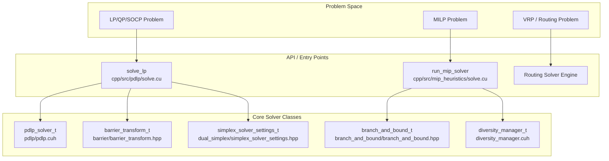
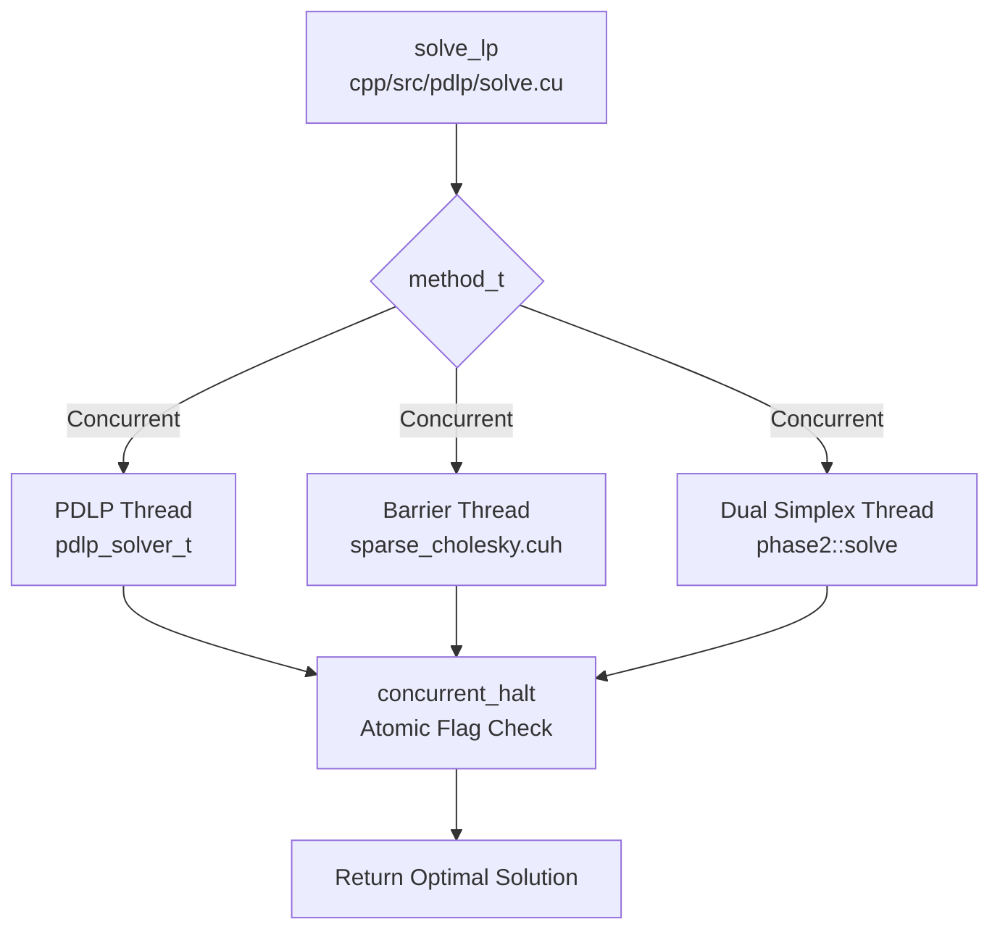

<!-- source: DeepWiki mcp.deepwiki.com · repo NVIDIA/cuopt · page 2 Core Solver Engines · fetched 2026-10-26 -->

# Core Solver Engines

Relevant source files

The following files were used as context for generating this wiki page:

- [cpp/include/cuopt/mathematical_optimization/constants.h](cpp/include/cuopt/mathematical_optimization/constants.h)
- [cpp/include/cuopt/mathematical_optimization/mip/solver_settings.hpp](cpp/include/cuopt/mathematical_optimization/mip/solver_settings.hpp)
- [cpp/include/cuopt/mathematical_optimization/pdlp/solver_settings.hpp](cpp/include/cuopt/mathematical_optimization/pdlp/solver_settings.hpp)
- [cpp/src/dual_simplex/simplex_solver_settings.hpp](cpp/src/dual_simplex/simplex_solver_settings.hpp)
- [cpp/src/math_optimization/solver_settings.cu](cpp/src/math_optimization/solver_settings.cu)
- [cpp/src/mip_heuristics/diversity/diversity_manager.cu](cpp/src/mip_heuristics/diversity/diversity_manager.cu)
- [cpp/src/mip_heuristics/diversity/population.cu](cpp/src/mip_heuristics/diversity/population.cu)
- [cpp/src/mip_heuristics/diversity/population.cuh](cpp/src/mip_heuristics/diversity/population.cuh)
- [cpp/src/mip_heuristics/presolve/third_party_presolve.cpp](cpp/src/mip_heuristics/presolve/third_party_presolve.cpp)
- [cpp/src/mip_heuristics/presolve/third_party_presolve.hpp](cpp/src/mip_heuristics/presolve/third_party_presolve.hpp)
- [cpp/src/mip_heuristics/solve.cu](cpp/src/mip_heuristics/solve.cu)
- [cpp/src/mip_heuristics/solver.cu](cpp/src/mip_heuristics/solver.cu)
- [cpp/src/pdlp/solve.cu](cpp/src/pdlp/solve.cu)
- [cpp/tests/internal/CMakeLists.txt](cpp/tests/internal/CMakeLists.txt)
- [cpp/tests/linear_programming/unit_tests/presolve_test.cu](cpp/tests/linear_programming/unit_tests/presolve_test.cu)
- [cpp/tests/mip/incumbent_callback_test.cu](cpp/tests/mip/incumbent_callback_test.cu)
- [cpp/tests/mip/population_test.cu](cpp/tests/mip/population_test.cu)

## Purpose and Scope

This document provides a high-level overview of cuOpt's core solver engines: the Linear Programming and Quadratic/Second-Order Cone Programming (LP/QP/SOCP) solver, the Mixed Integer Linear Programming (MILP) solver, and the Vehicle Routing Problem (VRP) solver. It outlines their design principles, GPU acceleration strategies, and concurrent execution models.

For detailed technical descriptions of specific algorithms and components, refer to the child pages:
- [Linear Programming Solver](#2.1) — Concurrent methods (PDLP, Barrier, Dual Simplex) and automatic backend selection.
- [Mixed Integer Programming Solver](#2.2) — Hybrid GPU/CPU branch-and-bound and GPU primal heuristics.
- [Routing Solver](#2.3) — Population metaheuristics, local search operators, and VRP variants.

For API configurations and parameters, see [C/C++ API](#4.1), [Python API](#4.2), and [Solver Configuration and Parameter Tuning](#7.3).

Sources: `[cpp/tests/linear_programming/pdlp_test.cu:68-72]()`, `[cpp/src/branch_and_bound/branch_and_bound.hpp:75-147]()`

---

## Solver Engine Architecture

The cuOpt library implements three distinct solver engines coordinated through shared data structures like `optimization_problem_t` and `cpu_optimization_problem_t` [cpp/src/pdlp/solve.cu:32-35](). Each engine targets specific mathematical formulations while leveraging NVIDIA GPU acceleration via `raft::handle_t`, `cuDSS`, and custom CUDA kernels.

Diagram: Solver Problem Mapping to Code Entities

Sources: `[cpp/src/pdlp/solve.cu:32-35]()`, `[cpp/src/mip_heuristics/solve.cu:117-125](), [cpp/src/mip_heuristics/diversity/diversity_manager.cu:53-98]()`

---

## Linear Programming (LP/QP) Solver

The LP/QP solver engine handles continuous optimization with linear constraints and optional quadratic objectives. It supports multiple solution methods defined in `method_t`: `PDLP`, `Barrier`, `DualSimplex`, and `Concurrent` [cpp/include/cuopt/mathematical_optimization/pdlp/solver_settings.hpp:71-78](). 

In `Concurrent` mode, the solver executes PDLP and Barrier on the GPU alongside Dual Simplex on the CPU simultaneously, using an atomic synchronization flag (`concurrent_halt`) to terminate remaining tasks once the fastest method succeeds.

Diagram: LP Concurrent Execution Workflow

Sources: `[cpp/src/pdlp/solve.cu:32-47](), [cpp/include/cuopt/mathematical_optimization/pdlp/solver_settings.hpp:71-78]()`

For full details, see [Linear Programming Solver](#2.1).

---

## Mixed Integer Programming (MILP) Solver

The MILP solver (`mip_solver_t`) utilizes a hybrid CPU/GPU architecture to solve problems containing both continuous and discrete integer variables [cpp/src/mip_heuristics/solver.cu:54-63](). 

The architecture decouples primal bound discovery from dual bound improvement:
- **Primal Bound (GPU Heuristics):** `diversity_manager_t` and `population_t` coordinate GPU-accelerated feasibility pumps, feasibility jumps, and local search operators to rapidly discover high-quality integer-feasible solutions [cpp/src/mip_heuristics/diversity/diversity_manager.cu:53-98](), `[cpp/src/mip_heuristics/diversity/population.cu:33-51]()`.
- **Dual Bound (CPU Branch-and-Bound):** `branch_and_bound_t` executes tree search and LP relaxations on the CPU to close the optimality gap. Solutions and bounds are shared asynchronously between threads [cpp/src/mip_heuristics/solve.cu:117-125]().

For full details, see [Mixed Integer Programming Solver](#2.2).

Sources: `[cpp/src/mip_heuristics/solver.cu:54-63](), [cpp/src/mip_heuristics/solve.cu:117-125](), [cpp/src/mip_heuristics/diversity/diversity_manager.cu:53-98](), [cpp/src/mip_heuristics/diversity/population.cu:33-51]()`

---

## Routing Solver (VRP)

The Routing solver engine addresses Vehicle Routing Problems (VRP), Traveling Salesman Problems (TSP), and Pickup and Delivery Problems with Time Windows (PDPTW). It implements population-based metaheuristics and local search operators accelerated on the GPU.

Key components include:
- **Population Management:** Maintains a diverse pool of route solutions evaluated against capacity and time window constraints.
- **Recombination Operators:** Utilizes specialized crossover techniques (such as OX and EAX) to breed new route configurations.
- **Local Search:** Applies GPU-parallelized neighborhood moves (e.g., relocate, exchange, 2-opt) to escape local optima.

For full details, see [Routing Solver](#2.3).

Sources: `[cpp/tests/linear_programming/pdlp_test.cu:68-72]()`

---

## Solver Selection Guide

| Problem Characteristics | Recommended Engine | Primary Code Entry Point / Class |
|-------------------------|--------------------|----------------------------------|
| Continuous, Linear | LP Solver | `solve_lp` (`pdlp_solver_t`) `[cpp/src/pdlp/solve.cu:39]()` |
| Continuous, Quadratic / SOCP | LP/SOCP Solver | `solve_lp` with `method_t::Barrier` `[cpp/include/cuopt/mathematical_optimization/pdlp/solver_settings.hpp:71-78]()` |
| Discrete / Integer Variables | MILP Solver | `mip_solver_t` `[cpp/src/mip_heuristics/solver.cu:54-63]()` |
| Routing / Vehicle Scheduling | Routing Solver | Routing Python/C++ API |

Sources: `[cpp/src/pdlp/solve.cu:39](), [cpp/include/cuopt/mathematical_optimization/pdlp/solver_settings.hpp:71-78](), [cpp/src/mip_heuristics/solver.cu:54-63]()`

---

